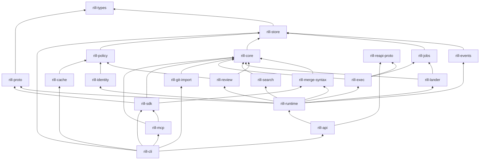

# Crates and layering

Rill is one Cargo workspace of twenty-one product crates under `crates/`, grouped
by layer, plus tooling under `tools/`. Each crate owns one boundary, and
dependencies only point down the stack, so the algorithms and policy crates
stay free of RPC and storage-layout concerns.

## Layout

```
crates/
  foundation/   types  proto  reapi-proto  store  events  jobs
  engine/       core  merge-syntax
  domain/       policy  review  lander  search  exec  identity  git-import
  server/       runtime  api  cache
  clients/      sdk  cli  mcp
tools/          sim  bench  load  fuzz
```

A folder is named for the crate without its `rill-` prefix
(`crates/domain/lander` is `rill-lander`); package names keep the prefix.
The workspace lists members as `crates/*/*` and `tools/*`, so a new crate
only needs a folder in the right group. `tools/fuzz` is a separate
`cargo-fuzz` workspace.

| Group | Holds |
| --- | --- |
| `foundation` | The object model, the wire format, storage, and the event log and job queues built on it |
| `engine` | Version-control algorithms: diff, merge, trees, rebase, history, derived data |
| `domain` | Subsystems with their own rules: policy, review, landing, search, verification, identity, import |
| `server` | A server process: its state and workers, the API over it, the regional cache |
| `clients` | What users and agents run: the SDK, the CLI, the MCP server |

## Crate map

| Crate | Owns | Does not own |
| --- | --- | --- |
| `rill-types` | Object model, ids, BLAKE3 hashing, canonical encoding, `Merge<T>` | I/O, policy decisions |
| `rill-proto` | `rill.v1` protobufs, generated buffa messages and Connect service traits and clients, domain/wire conversion | Handlers |
| `rill-reapi-proto` | Vendored REAPI v2, Google API and Buildbarn worker protos, generated tonic services | Execution logic |
| `rill-store` | `ObjectStore` / `MetaStore` traits, the keyspace layer, object backends (memory, files, S3) and metadata engines (memory, redb, FoundationDB), typed `RepoStore`, trunk CAS | Diff, merge, authorization |
| `rill-events` | Reading the event log: filtered, resumable tails that wait on the event counter; retention | Writing events (each writer does, in its own transaction) |
| `rill-jobs` | Durable job queues: priorities, shards, leased claims with fencing tokens, backoff, dead-letter queue, counters, a worker runtime | What jobs do (handlers live with their callers) |
| `rill-core` | Diff, three-way merge, trees, rebase, ancestry graph, derived data, blob chunking, `ChangeBuilder` | Storage layout, RPC |
| `rill-merge-syntax` | Structural merge: weave-core behind `rill-core`'s `ContentMerger`, configuration, counts | When it is consulted (the merge code decides) |
| `rill-policy` | Risk classification, Cedar submit rules, ReBAC, Biscuit capability tokens, signing, secret detection | Enforcement points (the server owns those) |
| `rill-review` | Labels, votes, threads, interdiff, stacks, submit evaluation, review agents | Landing |
| `rill-lander` | Queue, sequencer, rebase onto trunk, CAS land, landing records, post-land verification, bisect, revert | Review state (through `ReviewHooks`), execution (through `Verifier`) |
| `rill-search` | Trigram index, symbol extraction, query execution | Permission filtering (the server passes a `PathFilter`) |
| `rill-exec` | Remote execution's content store, action cache, operations and scheduler; verify plans compiled to actions; in-process local workers and their sandboxes | Serving the protocols (`rill-api`), production workers (Buildbarn) |
| `rill-identity` | Token signing keys and the key services that wrap them (local, Vault, AWS KMS, Google Cloud KMS), key rotation, OIDC and SAML | Request authentication (the server owns it) |
| `rill-git-import` | One-way git history import onto trunk | Export, mirroring |
| `rill-runtime` | A server process's state: configuration, stores, `AppState` and per-repository `RepoContext`s, background workers and job handlers, telemetry, the identity view, the audit log, rate limits, the checks every stored version passes (`writes`, `secrets`, `quarantine`), and the server error type with its error-code mapping | Requests (`rill-api` serves them) |
| `rill-api` | Authentication interceptor and `Permit`, API handlers and watch streams, the object HTTP protocol, read grants, SCIM, sign-in, binding and serving the listeners | State and workers |
| `rill-cache` | The regional cache tier: grant checks, a disk LRU, coalesced origin fetches | Authorization decisions (the origin's grants carry them) |
| `rill-sdk` | Typed client, blob upload, local checkout (`.rill/`), status, sync, stack helpers | User interface |
| `rill-cli` | The `rill` binary: client commands, `rill dev`, `rill api`, `rill cache`, output formats, exit codes | Business rules |
| `rill-mcp` | The MCP tool surface over the SDK for agents (`rmcp`); `rill-mcp` binary | Anything the SDK cannot do |

Tooling crates, never depended on by product crates: `rill-sim` (seeded
fault simulation, [simulation](../09-engineering/simulation.md)),
`rill-bench` and `rill-load` (benchmarks and load generation,
[performance](../09-engineering/performance.md)), and `tools/fuzz/` (a
separate `cargo-fuzz` workspace).

## Dependency graph

Arrows point from a crate to what it depends on, as declared in each
crate's `Cargo.toml` (normal dependencies only).



## Layering rules

The declared order is `rill-types` <- `rill-store` <- `rill-events` /
`rill-jobs` / `rill-core` <- `rill-policy` / `rill-review` / `rill-lander` /
`rill-search` / `rill-exec` <- `rill-identity` <- `rill-runtime` <-
`rill-api` <- `rill-sdk` <- `rill-cli` / `rill-mcp`, with `rill-cache`
beside the server crates on `rill-policy` and `rill-merge-syntax` just
above `rill-core`. Lower crates never depend on higher ones. The manifests refine
that order in a few places:

- `rill-events` and `rill-jobs` depend only on `rill-types` and
  `rill-store`. Key layouts for events and jobs stay in `rill-store`
  (`keys.rs`) with every other table.

- `rill-policy` depends on `rill-types` and `rill-store` only, not on
  `rill-core`. `rill-review` depends on both `rill-core` and `rill-policy`.
- `rill-runtime` never depends on `rill-api`: everything a worker or the
  state needs (the write set, the secret scanner, quarantine, rate limits)
  lives in the runtime, and handlers reach state through it. `rill-api`
  has no error type of its own; it uses the runtime's.
- `rill-lander` depends on neither `rill-review` nor `rill-exec`. The runtime
  adapts them through the lander's `ReviewHooks` and `Verifier` traits
  (`ReviewHooksAdapter`, `ExecVerifier`).
- `rill-proto` depends only on `rill-types`. It is the wire layer between
  the domain crates and anything that speaks the API.
- `rill-merge-syntax` sits just above `rill-core`, whose `ContentMerger`
  trait it implements; `rill-core` never depends on it. The server and the
  SDK plug it in.
- `rill-git-import` sits beside the other `rill-core` consumers. It writes
  through `RepoStore` directly and needs no server.
- `rill-sdk` depends on `rill-proto` and `rill-core`, not on `rill-api`.
  It is a client of the wire surface, not of the server crate.
- `rill-mcp` depends on `rill-sdk` (and `rill-types`, `rill-core`). It uses
  `rill-proto` and `connectrpc` only as dev-dependencies for tests.
- `rill-cache` depends on `rill-policy` (grant verification), `rill-store`
  (hash checks) and `rill-types`, not on `rill-api`: it talks to the origin
  only over the object protocol.
- The binary crate `rill-cli` additionally links `rill-api` and
  `rill-runtime` (for `rill dev` and `rill api`), `rill-cache` (for `rill cache`), `rill-store` and `rill-git-import` (for
  `rill import git`), and `rill-mcp` (shared JSON encoding, error codes,
  grep helper). No library crate links those.
- The tooling crates `rill-sim` and `rill-load` link the server crates to
  reuse their wiring; they sit above every product crate and nothing depends on
  them. `rill-types` exposes its test strategies and clock overrides only
  under the `testing` feature.

RPC and HTTP dependencies:

- `connectrpc` and `buffa` (the `rill.v1` API, ADR 017) appear in
  `rill-proto`, `rill-runtime` (error mapping), `rill-api`, `rill-sdk` and
  `rill-cli`. No crate below `rill-proto` depends on them.
- `tonic` and `prost` serve and call REAPI: `rill-reapi-proto`,
  `rill-exec`, `rill-runtime` (status mapping), `rill-api` and the load
  tools. The `rill-api` tests also use tonic's raw gRPC client to call
  every RPC by name.
- `axum` appears only in `rill-api` and `rill-cache`, which serve the API,
  the object protocol and health endpoints.
- The library crates `rill-core`, `rill-policy`, `rill-review`,
  `rill-lander`, `rill-exec` and `rill-search` have no RPC dependency.

Every external dependency is declared once in the root
`[workspace.dependencies]` table; crates reference it with
`{ workspace = true }`. See [development](../09-engineering/development.md)
for build profiles and features.

## Limitations

- Layering is enforced by review only. `cargo deny` (`deny.toml`, in CI)
  checks licences, advisories and sources of third-party crates, not the
  order of Rill's own.

## Code

- [Workspace manifest](../../Cargo.toml)
- [rill-policy/Cargo.toml](../../crates/domain/policy/Cargo.toml)
- [rill-lander/Cargo.toml](../../crates/domain/lander/Cargo.toml)
- [rill-runtime/Cargo.toml](../../crates/server/runtime/Cargo.toml)
- [rill-api/Cargo.toml](../../crates/server/api/Cargo.toml)
- [rill-sdk/Cargo.toml](../../crates/clients/sdk/Cargo.toml)
- [rill-mcp/Cargo.toml](../../crates/clients/mcp/Cargo.toml)
- [rill-cli/Cargo.toml](../../crates/clients/cli/Cargo.toml)
- [Lander adapters](../../crates/server/runtime/src/workers/hooks.rs)

---
← Previous: [Principles and invariants](principles-and-invariants.md) · [Index](../index.md) · Next: [Glossary](glossary.md) →
