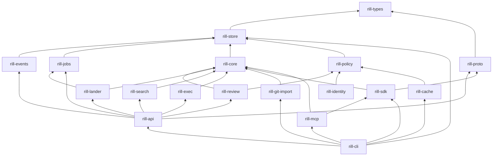

# Crates and layering

Rill is one Cargo workspace of sixteen crates under `crates/`. Each crate owns
one boundary, and dependencies only point down the stack, so the algorithms
and policy crates stay free of RPC and storage-layout concerns.

## Crate map

| Crate | Owns | Does not own |
| --- | --- | --- |
| `rill-types` | Object model, ids, BLAKE3 hashing, canonical encoding, `Merge<T>` | I/O, policy decisions |
| `rill-store` | `ObjectStore` / `MetaStore` traits, the keyspace layer, object backends (memory, files, S3) and metadata engines (memory, redb, FoundationDB), typed `RepoStore`, trunk CAS | Diff, merge, authorization |
| `rill-events` | Reading the event log: filtered, resumable tails that wait on the event counter; retention | Writing events (each writer does, in its own transaction) |
| `rill-jobs` | Durable job queues: priorities, shards, leased claims with fencing tokens, backoff, dead-letter queue, counters, a worker runtime | What jobs do (handlers live with their callers) |
| `rill-core` | Diff, three-way merge, trees, rebase, ancestry graph, derived data, blob chunking, `ChangeBuilder` | Storage layout, RPC |
| `rill-policy` | Risk classification, Cedar submit rules, ReBAC, Biscuit capability tokens, signing | Enforcement points (the server owns those) |
| `rill-review` | Labels, votes, threads, interdiff, stacks, submit evaluation, review agents | Landing |
| `rill-lander` | Queue, rebase onto trunk, CAS land, landing records, the jobs a landing enqueues, post-land verification, bisect, revert | Review state (through `ReviewHooks`), execution (through `Verifier`) |
| `rill-search` | Trigram index, symbol extraction, query execution | Permission filtering (the server passes a `PathFilter`) |
| `rill-exec` | Action cache, sandbox materialization, verify plans | Scheduling policy |
| `rill-identity` | Token signing keys and the key services that wrap them (local, Vault, AWS KMS, Google Cloud KMS), key rotation | Request authentication (the server owns it) |
| `rill-git-import` | One-way git history import onto trunk | Export, mirroring |
| `rill-proto` | `rill.v1` protobufs, generated tonic services, domain/wire conversion | Handlers |
| `rill-api` | Authentication, `RepoContext`, gRPC handlers and watch streams, object HTTP protocol, read grants, job handlers and workers, config | Client-side state |
| `rill-cache` | The regional cache tier: grant checks, a disk LRU, coalesced origin fetches | Authorization decisions (the origin's grants carry them) |
| `rill-sdk` | Typed client, blob upload, local checkout (`.rill/`), status, sync, stack helpers | User interface |
| `rill-mcp` | stdio JSON-RPC tool surface over the SDK for agents; `rill-mcp` binary | Anything the SDK cannot do |
| `rill-cli` | `rill` and `rill-api` binaries, output formats, exit codes | Business rules |

Tooling crates, never depended on by product crates: `rill-sim` (seeded
fault simulation, [simulation](../09-engineering/simulation.md)),
`rill-bench` and `rill-load` (benchmarks and load generation,
[performance](../09-engineering/performance.md)), and `fuzz/` (a separate
`cargo-fuzz` workspace).

## Dependency graph

Arrows point from a crate to what it depends on, as declared in each
`crates/*/Cargo.toml` (normal dependencies only).

## Layering rules

The declared order is `rill-types` <- `rill-store` <- `rill-events` /
`rill-jobs` / `rill-core` <- `rill-policy` / `rill-review` / `rill-lander` /
`rill-search` / `rill-exec` <- `rill-identity` <- `rill-api` <- `rill-sdk` <-
`rill-cli` / `rill-mcp`, with `rill-cache` beside `rill-api` on
`rill-policy`. Lower crates never depend on higher ones. The manifests refine
that order in a few places:

- `rill-events` and `rill-jobs` depend only on `rill-types` and
  `rill-store`. Key layouts for events and jobs stay in `rill-store`
  (`keys.rs`) with every other table.

- `rill-policy` depends on `rill-types` and `rill-store` only, not on
  `rill-core`. `rill-review` depends on both `rill-core` and `rill-policy`.
- `rill-lander` depends on neither `rill-review` nor `rill-exec`. The server
  adapts them through the lander's `ReviewHooks` and `Verifier` traits
  (`ReviewHooksAdapter`, `ExecVerifier`).
- `rill-proto` depends only on `rill-types`. It is the wire layer between
  the domain crates and anything that speaks gRPC.
- `rill-git-import` sits beside the other `rill-core` consumers. It writes
  through `RepoStore` directly and needs no server.
- `rill-sdk` depends on `rill-proto` and `rill-core`, not on `rill-api`.
  It is a client of the wire surface, not of the server crate.
- `rill-mcp` depends on `rill-sdk` (and `rill-types`, `rill-core`). It uses
  `rill-proto` and `tonic` only as dev-dependencies for tests.
- `rill-cache` depends on `rill-policy` (grant verification), `rill-store`
  (hash checks) and `rill-types`, not on `rill-api`: it talks to the origin
  only over the object protocol.
- The binary crate `rill-cli` additionally links `rill-api` (for `rill dev`
  and `rill api`), `rill-cache` (for `rill cache`), `rill-store` and `rill-git-import` (for
  `rill import git`), and `rill-mcp` (shared JSON encoding, error codes,
  grep helper). No library crate links those.
- The tooling crates `rill-sim` and `rill-load` link `rill-api` to reuse
  its wiring; they sit above every product crate and nothing depends on
  them. `rill-types` exposes its test strategies and clock overrides only
  under the `testing` feature.

RPC and HTTP dependencies:

- `tonic` appears in `rill-proto`, `rill-api`, `rill-sdk` and `rill-cli`.
  No crate below `rill-proto` depends on it.
- `axum` appears only in `rill-api` and `rill-cache`, which serve the
  object protocol and health endpoints.
- The library crates `rill-core`, `rill-policy`, `rill-review`,
  `rill-lander`, `rill-exec` and `rill-search` have no RPC dependency.

Every external dependency is declared once in the root
`[workspace.dependencies]` table; crates reference it with
`{ workspace = true }`. See [development](../09-engineering/development.md)
for build profiles and features.

## Limitations

- Layering is enforced by review only; there is no `cargo deny` or
  dependency-graph check.

## Code

- [Workspace manifest](../../Cargo.toml)
- [rill-policy/Cargo.toml](../../crates/rill-policy/Cargo.toml)
- [rill-lander/Cargo.toml](../../crates/rill-lander/Cargo.toml)
- [rill-api/Cargo.toml](../../crates/rill-api/Cargo.toml)
- [rill-sdk/Cargo.toml](../../crates/rill-sdk/Cargo.toml)
- [rill-mcp/Cargo.toml](../../crates/rill-mcp/Cargo.toml)
- [rill-cli/Cargo.toml](../../crates/rill-cli/Cargo.toml)
- [Lander adapters](../../crates/rill-api/src/workers/mod.rs)

---
← Previous: [Principles and invariants](principles-and-invariants.md) · [Index](../index.md) · Next: [Glossary](glossary.md) →
