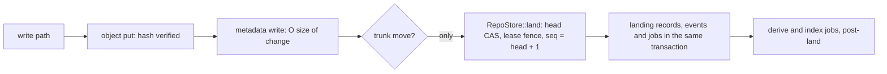

# Principles and invariants

This page is the authority for Rill's design principles and its
non-negotiable invariants. Principles decide trade-offs; invariants are rules
every change to the code must keep. When a change touches one of them, this
page and the page that owns the mechanism change together.

## Principles (in priority order)

When two principles conflict, the lower number wins.

1. **The server is the repository.** Clients hold bounded caches; every
   operation a client can do is an API call that needs no checkout.
2. **Immutable, content-addressed data everywhere (BLAKE3).** Mutable state
   is a small set of refs plus append-only logs.
3. **Cost scales with the change, not the repo.**
4. **Stable identity (`ChangeId`), mutable content (`ChangeVersion`).**
5. **Conflicts are data (`Merge<T>` terms), never errors.**
6. **Intent and provenance are first-class and signed into every change.**
   `Provenance` and the intent id are fields of the `ChangeVersion`, so they
   are covered by its hash; P-256 signatures over that hash are detached
   records, stored when the client supplies them.
7. **Landing is optimistic; verification is continuous** (post-land,
   bisect, revert).
8. **Agents are principals** with their own identity, capabilities and
   budgets.
9. **Build, test and search share the object store.**
10. **Humans get the ergonomic surface; agents get the structural one.**
    Nothing is possible in a UI that is not possible through the API.

## Invariants

**Data and storage**

- Every write to the metadata store is O(size of change). The root tree of a
  version is derived data, never stored in the version: `ChangeVersion`
  holds only `file_changes` and `subtree_changes` relative to its first
  parent. See [objects and ids](../02-data/objects-and-ids.md).
- Objects are verified against their hash on every `put`. Every
  `ObjectStore` backend (memory, local files, S3) calls `object::verify`
  before writing and rejects a mismatch with `Error::HashMismatch`.
- Serde types that go through postcard never use `skip_serializing_if`.
  (The only uses in the workspace are JSON-RPC types in `rill-mcp`.)

**Merge algebra**

- `Merge::simplify` operates on separate add/remove lists, never on the
  interleaved vector. Removing a pair from the interleaved vector would
  shift the parity of the terms between them. See
  [merge algebra](../02-data/merge-algebra.md).
- A rebase never fails on content; it may produce a conflicted version.
  `rill_core::rebase` turns every disagreeing path into a
  `FileChange::Conflict` and errors only on storage failures. See
  [rebase](../03-core-algorithms/rebase.md).

**Trunk and landing**

- Trunk moves only by one transaction, `RepoStore::land`, which
  compares the trunk-head row with the head the lander expects, asserts
  each next sequence key is absent, and writes the positions, their
  landing records, the reviews marked `Landed`, events, the head row and
  the trunk ref together. Sequence numbers are gap-free. In the server the
  lander is the only caller; `RepoService.MoveRef` refuses `trunk`. The git
  importer calls `land_on_trunk`, a one-entry batch, for imported mainline
  history. See [landing](../04-workflow/landing.md).
- A release ref (`release/<name>`) is a line of its own with the same
  rule: after `CutRelease` creates it, only `RepoStore::land` on that line
  moves it, called by the release's lander; `MoveRef` refuses it.
- A lander lands only while it holds its line's lease (`lander` for
  trunk, `lander:release/<name>` for a release): the land transaction
  checks the lease epoch, so a replaced lander cannot move its line.
- What a commit or a landing makes visible commits in one transaction;
  objects and derived values, which are immutable, may be written before
  it.

**Events and jobs**

- Every committed change to a repository's state writes exactly one event,
  in the same transaction as the change, so the event log neither misses
  nor invents changes. Watch streams read the log, not process memory. See
  [events and workers](../07-runtime/events-and-workers.md).
- Work a change makes necessary is enqueued as a job in the same
  transaction. A job may run more than once; handlers are idempotent or
  fence their writes on the claim's token.

**Crate boundaries**

- The server hot-swaps the `ReviewService` when `SetPolicy` changes the
  Cedar text: `AdminService.SetPolicy` validates and stores the text, then
  `RepoContext::reload_policy` rebuilds the service and stores it in an
  `ArcSwap`. Callers must not hold the returned `Arc` across requests.
- `rill-review` is the only crate that evaluates `rill-policy::submit`. The
  server parses and validates policy text (`SubmitPolicy::from_source`) to
  build the review service, but every `SubmitDecision` comes from
  `ReviewService::evaluate_for`.
- `rill-lander` does not depend on `rill-review`; the server adapts the two
  through `ReviewHooks` (`ReviewHooksAdapter`, which reads the same
  `ArcSwap`). `rill-exec` reaches the lander the same way, through the
  `Verifier` trait (`ExecVerifier`).
- Layering is strict: lower crates never depend on higher ones, no crate
  below `rill-proto` depends on tonic, and only `rill-api` depends on
  axum. See [crates and layering](crates-and-layering.md).

**Search**

- Search indexes blobs by hash, so an unchanged blob is never re-indexed.
  Each landing enqueues an index job for the new head in its own
  transaction, and `RepoContext::grep` indexes on demand a root that has no
  manifest. See
  [search](../06-services/search.md).

## Limitations

- No test or lint enforces the postcard and layering rules mechanically.

## Code

- [Merge::simplify](../../crates/foundation/types/src/merge.rs)
- [ChangeVersion](../../crates/foundation/types/src/objects/change.rs)
- [Object verification](../../crates/foundation/store/src/object.rs)
- [land_on_trunk](../../crates/foundation/store/src/repo/trunk.rs)
- [Land transaction](../../crates/foundation/store/src/repo/landing.rs)
- [Lander traits](../../crates/domain/lander/src/traits.rs)
- [ReviewHooksAdapter](../../crates/server/runtime/src/workers/hooks.rs)
- [Policy hot-swap](../../crates/server/runtime/src/state/repo_context.rs)
- [SetPolicy handler](../../crates/server/api/src/services/admin/mod.rs)
- [Rebase](../../crates/engine/core/src/rebase.rs)
- [Search index](../../crates/domain/search/src/index/search_index.rs)

---
← Previous: [System model](system-model.md) · [Index](../index.md) · Next: [Crates and layering](crates-and-layering.md) →
