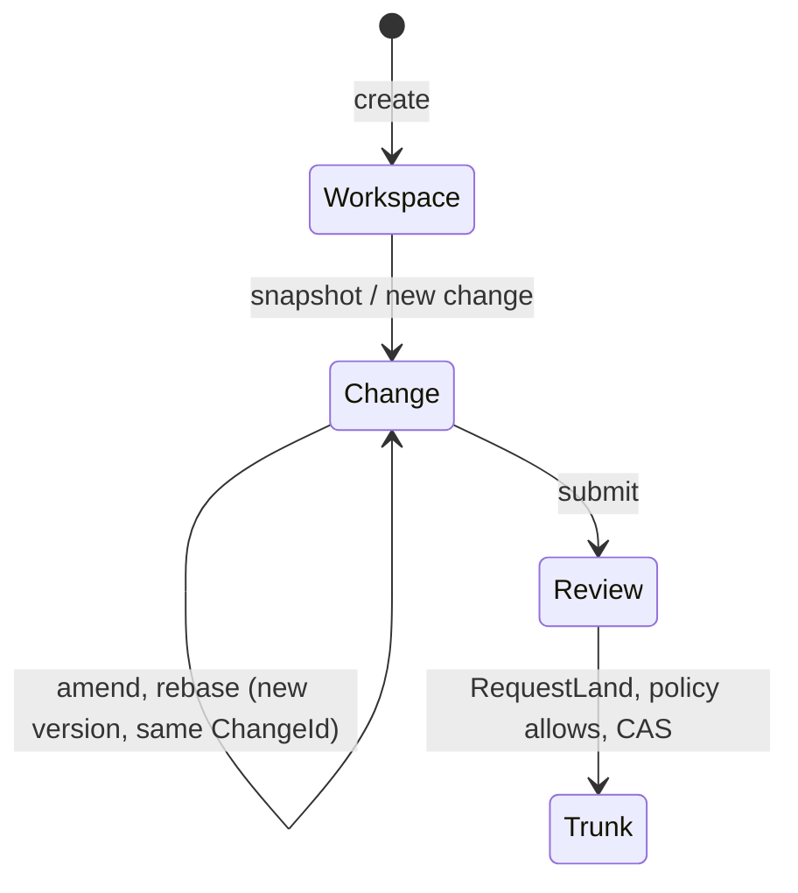
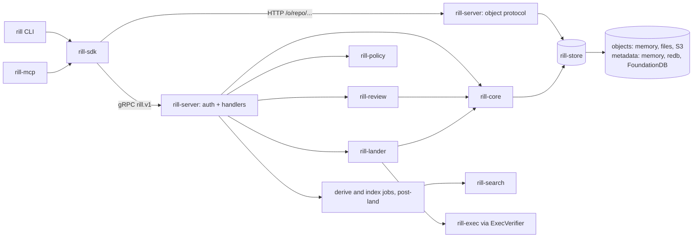
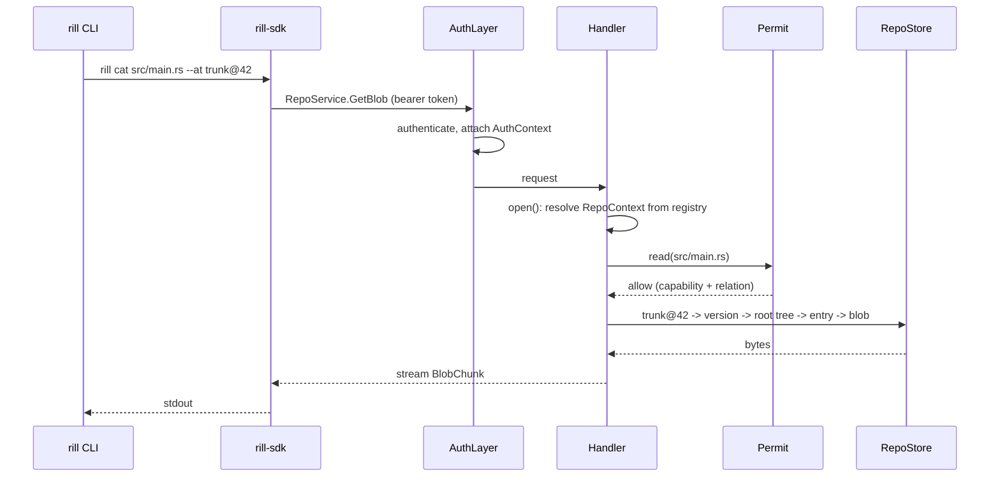

# System model

Rill is a server-authoritative source control system for codebases written by
humans and AI agents together. One server process owns each repository;
clients hold bounded caches and never a full copy, and every client operation
is an RPC that needs no checkout. Rill is not git-compatible; a one-way
importer migrates git history and nothing else crosses that boundary.

## Three records

The whole workflow runs on three records.

- **Workspace**: a principal's private in-progress state on the server. It
  holds a base version, the `ChangeId` of the in-progress change, the latest
  uploaded snapshot tree and an operation log. See
  [workspaces](../04-workflow/workspaces.md).
- **Change**: a unit of work with a stable `ChangeId` and one or more
  content-addressed `ChangeVersion`s. Review state is keyed by the `ChangeId`,
  so it follows the work across amend and rebase. See
  [changes and stacks](../04-workflow/changes-and-stacks.md).
- **Trunk**: the single landed line. It is the `trunk` ref plus a gap-free
  `TrunkSeq` per landed version (`trunk@42`). Only landings move it. See
  [landing](../04-workflow/landing.md).

## Boundaries

The crate map and dependency rules are in
[crates and layering](crates-and-layering.md). The wire surface (six gRPC
services and the HTTP object protocol) is in
[API surface](../07-runtime/api-surface.md).

## Request lifecycle

A `RepoContext` holds everything handlers need for one repository: the
`RepoStore`, tree cache, derived-data manager, commit graph, lander, review
service, search index, authorizer and the bus for land-ticket progress. The `RepoRegistry` builds it
on first use and caches it for the life of the process. The request-scoped
value is `Opened` (the caller's `AuthContext` plus an `Arc<RepoContext>`),
which does not outlive the handler. See [server](../07-runtime/server.md).

## Authority

The server's authenticator resolves each request to a principal (`human`,
`agent` or `service`) from a static token, a Biscuit capability token, or the
fixed `dev` principal in dev mode. Three layers must all allow an action:

- **Capabilities** on the token: repo, verbs, path prefixes, expiry.
  Attenuation can only narrow a token. Enforced even in dev mode. See
  [capability tokens](../05-policy/capability-tokens.md).
- **Relations** (ReBAC) on `repo` and `dir:/path` objects, inherited down the
  tree. A principal that cannot read a directory never sees its names in
  listings, diffs, blame or search. See [permissions](../05-policy/permissions.md).
- **Submit policy** (Cedar), evaluated by `rill-review` at `EvaluateSubmit`
  and `RequestLand` over facts about the change: risk class, votes by label
  and principal kind, unresolved threads, intent. The text is per repository
  and hot-swapped by `SetPolicy`. See [submit policy](../05-policy/submit-policy.md).

## Durable work

- Objects (blobs, chunks, manifests, trees, change versions) are written to
  the object store first and verified against their BLAKE3 hash on every put.
  Metadata (refs, trunk sequence, review, workspace and intent records) is
  written after and references objects by hash. See
  [storage and keyspace](../02-data/storage-and-keyspace.md).
- Trunk moves only through `RepoStore::land`, one metadata transaction
  that compare-and-swaps the trunk head, writes the positions, landing
  records and review updates, and is fenced by the lander's lease. See
  [landing](../04-workflow/landing.md).
- Every committed state change writes one event in its own transaction, so
  the repository's event log is exact; watch streams read it. Work a change
  makes necessary (deriving and indexing landings) is a durable job
  enqueued in the same transaction and run by leased workers. See
  [events and workers](../07-runtime/events-and-workers.md).

The rules these mechanisms must keep are listed in
[principles and invariants](principles-and-invariants.md).

## Limitations

- One server process per repository. Land requests and tickets are
  process-local, so a restart loses queued requests.
- Workers run inside the server process; there are no separate worker
  processes.
- No identity provider: authentication is static tokens or self-issued
  Biscuits.

## Code

- [Server composition](../../crates/rill-server/src/lib.rs)
- [RepoContext and registry](../../crates/rill-server/src/state/registry.rs)
- [Request opening](../../crates/rill-server/src/services/common.rs)
- [Permission checks](../../crates/rill-server/src/auth/permit.rs)
- [Event bus](../../crates/rill-server/src/state/events.rs)
- [Trunk CAS](../../crates/rill-store/src/repo/trunk.rs)
- [Landing pipeline](../../crates/rill-lander/src/land/pipeline.rs)
- [Object model](../../crates/rill-types/src/objects/mod.rs)

---
← Previous: [Index](../index.md) · [Index](../index.md) · Next: [Principles and invariants](principles-and-invariants.md) →
