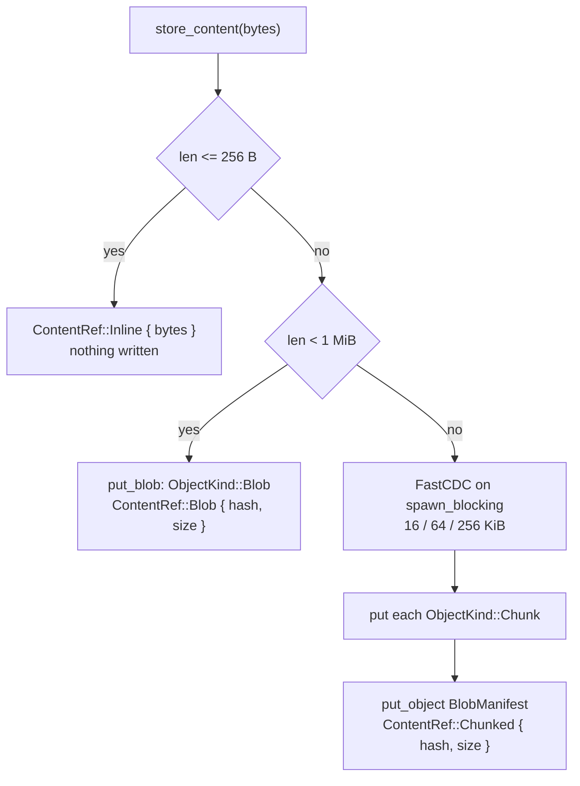

# Content and chunking

File content enters the object store through `rill_core::blobs::store_content`
and leaves it through `read_content`. The byte length alone picks the form:
inline in the change or tree entry, one `Blob` object, or a `BlobManifest`
over FastCDC `Chunk` objects. The thresholds are constants, so the same bytes
always get the same `ContentRef` and deduplicate across clients.

## Forms of content

| Constant | Value | Defined in |
| --- | --- | --- |
| `INLINE_THRESHOLD` | 256 bytes (inline at or below) | `rill-types` `objects/blob.rs` |
| `CHUNK_THRESHOLD` | 1 MiB (chunked at or above) | `rill-types` `objects/blob.rs` |
| `CHUNK_MIN` / `CHUNK_AVG` / `CHUNK_MAX` | 16 / 64 / 256 KiB | `rill-core` `blobs.rs` |

`BlobManifest { total_size, chunks: Vec<ChunkRef { hash, size: u32 }> }` is
`Encodable` and hashed under `BlobManifest`. Chunks and blobs are raw bytes
hashed under their own kinds.

`ContentRef` accessors:

* `size()`: the content length in bytes.
* `content_hash()`: a dedup key for any form; the blob or manifest hash, or
  `digest(Blob, bytes)` for inline content. Search and blame key on it.
* `stored_hash()`: the `(kind, hash)` to fetch, `None` for inline.

## Write path

`store_content(objects, bytes)`:

1. At or below `INLINE_THRESHOLD`, return `Inline` without touching the
   store.
2. Below `CHUNK_THRESHOLD`, `put_blob` and return `Blob { hash, size }`.
3. Otherwise `chunk_boundaries` runs FastCDC on a blocking thread and
   returns `(offset, length)` cuts covering the input. Each chunk is a slice
   of the original `Bytes` (no copy), hashed under `Chunk` and put in turn.
   The manifest is then stored with `put_object` and returned as
   `Chunked { hash, size }`.

Every `put` verifies the hash (see
[storage and keyspace](storage-and-keyspace.md)), and a chunk that already
exists is a no-op. An edit in the middle of a large file therefore stores
only the chunks whose boundaries moved.

Producers: the server's `PutBlob` RPC buffers the whole stream, checks the
announced `size` and optional `expected_hash` (the `Blob`-kind hash of the
bytes, whatever form is chosen), then calls `store_content`. The SDK's
`store_content` inlines at or below `INLINE_THRESHOLD` and otherwise sends
`PutBlob`, so chunking is always decided on the server. The change builder,
text merge and patch paths in `rill-core` and `rill-server` call
`store_content` directly.

On `PutChange` the server checks each `Set` content with
`check_content_exists`: the referenced blob or manifest must be present, and
inline content must not exceed `MAX_INLINE` (1 MiB).

## Read path

`read_content(objects, content)`:

| Form | Steps | Errors |
| --- | --- | --- |
| `Inline` | clone the bytes | none |
| `Blob` | `get_required(Blob, hash)`, check length | `ObjectNotFound`, `Error::ContentSize` |
| `Chunked` | load the manifest, one `get_many` over all chunks, concatenate, check each chunk against `ChunkRef.size` and the total against `size` | `ObjectNotFound` for manifest or chunk, `ContentSize` |

The invariant readers rely on: `read_content` returns exactly
`ContentRef::size()` bytes or fails. `BlobReader` is the trait form,
implemented for `Arc<dyn ObjectStore>`, so merge and blame code can take any
reader. The `GetBlob` RPC reads the whole content with `read_content`, then
slices the requested range and streams it.

## Limitations

* Content is read and written whole in memory; there is no streaming read
  or write, and `GetBlob` ranges still load the full file.
* Chunks are put one at a time, so a large file costs one sequential store
  round-trip per chunk.
* `read_content` does not re-hash chunk bytes; it trusts the store, which
  verified on `put`, and checks sizes only. `BlobManifest.total_size` is not
  checked against `ContentRef` size.
* A failure part-way through chunking leaves orphan chunks with no manifest;
  nothing removes them.
* The 256-byte inline rule is a producer convention. The server accepts
  inline content up to `MAX_INLINE` (1 MiB), so equal bytes can appear as
  both `Inline` and `Blob` and only `content_hash()` matches them.
* The manifest has no per-chunk offsets; random access means summing sizes.

## Code

* [rill-core blobs.rs](../../crates/rill-core/src/blobs.rs): `store_content`, `read_content`, `chunk_boundaries`, `BlobReader`
* [rill-types objects/blob.rs](../../crates/rill-types/src/objects/blob.rs): `ContentRef`, `ChunkRef`, `BlobManifest`, thresholds
* [rill-store object.rs](../../crates/rill-store/src/object.rs): `put_blob`, `get_many`, `verify`
* [rill-server services/repo/trees.rs](../../crates/rill-server/src/services/repo/trees.rs): `PutBlob`, `GetBlob`, `check_content_exists`, `MAX_INLINE`
* [rill-sdk repo/blobs.rs](../../crates/rill-sdk/src/repo/blobs.rs): client-side `store_content` and `put_blob`

---
← Previous: [Merge algebra](merge-algebra.md) · [Index](../index.md) · Next: [Derived data](derived-data.md) →
