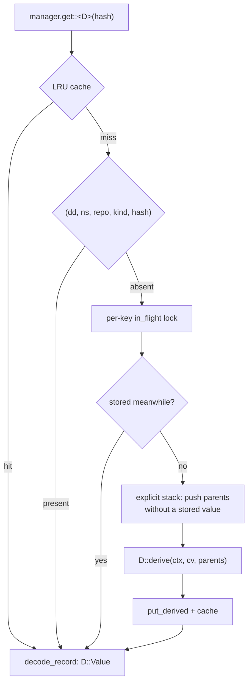

# Derived data

A derived value is a pure function of a change version and the same value
for its parents. The `derive` module in `rill-core` defines the `Derivable`
trait, the `DeriveManager` that fetches or computes values, a registry
saying when each kind is computed, a background worker, and the built-in
derivations: root tree, changed paths, ancestry, change summary, path
history and blame.
A value is keyed by `(kind@version, version hash)` and versions are
immutable, so nothing is ever invalidated.

## The trait

| Item | Meaning |
| --- | --- |
| `KIND` | short name in the storage key (`root`, `changed`, `anc`, `summary`, `phist`) |
| `VERSION` | computation version; `derived_kind_key::<D>()` is `"{KIND}@{VERSION}"` |
| `NEEDS_PARENTS` | default `true`; when `false` the manager passes an empty vector and never walks ancestors |
| `SCHEDULE` | `LandCritical`, `Background` or `OnDemand` (default); see below |
| `Value` | serde type, stored with `encode_record` |
| `derive(ctx, cv, parents)` | `parents[i]` is the value for `cv.parents[i]` |

`DeriveCtx` exposes `repo()`, `trees()` (`TreeOps`), `objects()` and
`manager()` for lookups of other derivables. It implements `RootLookup` by
calling `get::<RootTree>`.

Changing an algorithm means bumping `VERSION`. That is a new key family; old
rows are never read again.

## The manager

`DeriveManager::new(repo, trees, cache_size)` is built once per repository.
The server uses `DERIVE_CACHE = 8192` values and a `TreeOps` cache of
`DEFAULT_TREE_CACHE = 4096` trees.

`get::<D>(hash)`:

1. Look in the in-process `LruCache` of encoded bytes, then in the `dd` table via
   `RepoStore::get_derived`.
2. On a miss, take the `Mutex` for `(kind, hash)` from the `in_flight`
   `DashMap`, then look again, so concurrent requests compute a value once.
3. `compute` walks an explicit stack in post-order. For a `NEEDS_PARENTS`
   derivation, parents without a stored value are pushed above the version.
   A version is derived once all its parents have values; each result is
   stored immediately. There is no recursion, because histories can be
   millions of versions deep.

A missing version is `Error::ChangeNotFound`; a parent value that vanishes
mid-walk is `Error::Derive { kind, hash, reason }`. `get_keyed` and
`put_keyed` read and write values under an arbitrary `(kind, ObjectHash)`
key; blame uses them. The cache evicts the oldest eighth when it is full.

## Built-in derivations

| Derivation | Key | Value | What it does |
| --- | --- | --- | --- |
| `RootTree` | `root@1` | `TreeHash` | `TreeOps::materialize` applies `subtree_changes` then `file_changes` to the first parent's tree; a conflict contributes its first add. A subtree copy resolves `from_version` through `RootLookup`. See [trees](../03-core-algorithms/trees.md). |
| `ChangedPaths` | `changed@1` | `ChangedPathSet` | `NEEDS_PARENTS = false`; the change's file and subtree change paths, sorted, plus a Bloom filter of `=path` for each and `/dir` for each directory above one. `touches(path)` is true for the path, anything under it, or a path above it that replaced it; `overlaps(other)` checks two sets. Read from the change, so it never diffs trees; a superset of the paths whose state differs. |
| `Ancestry` | `anc@1` | `AncestryInfo` | generation (`1 + max(parents)`, 1 for a root), first-parent depth, whether a merge lies behind the version, first parent, and one skew-binary jump pointer. See [history graph](../03-core-algorithms/history-graph.md). |
| `ChangeSummary` | `summary@1` | `ChangeSummary` | `NEEDS_PARENTS = false`; reads the first parent's root and counts files added, modified, deleted and conflicted, `bytes_added`, `bytes_removed`, `languages` (by extension), `top_level_dirs`, `subtree_changes`. |
| `PathHistory` | `phist@1` | hash of a `HistoryNode` | rewrites only the `HistoryNode`s along touched paths and shares the rest with the first parent. Nodes are stored in the object store under kind `Derived`; the `dd` row holds the root hash. |
| `Blame` | `blame@1` (keyed) | `Vec<BlameLine>` | per `(version, path)`, key `Blame::key`; not a `Derivable`. |

`HistoryNode { entries: BTreeMap<String, HistoryEntry { version, subtree }> }`
records, per name, the last first-parent version that touched it or
anything beneath it. `subtree` is `None` for files and for directories
replaced by a subtree change. `DeriveManager::history(path, from, limit)`
follows the links: the node at `from` names the last version `v` that
touched `path`, the node at `v`'s first parent names the one before, and so
on. The root path yields the first-parent line itself.

`DeriveManager::blame(version, path)` walks first parents back to a stored
blame, the file's creation, or its absence, then replays forward one line
diff per content change and stores every intermediate `(version, path)`.
It fails with `Error::PathNotFound` when the path is absent at `version` and
`Error::BinaryContent` when a replayed version is binary. `BlameLine`
holds `version`, `author` and the one-based `line_no` in that version.

## When values are computed

[registry.rs](../../crates/rill-core/src/derive/registry.rs) lists every
version-keyed kind with its schedule:

| Schedule | Kinds | Computed |
| --- | --- | --- |
| `LandCritical` | `root@1`, `changed@1`, `anc@1` | by `ensure_land_critical`, which the server's `commit_version` calls after storing a version and before replying, and the lander calls before moving trunk. A change whose tree cannot be built fails the request, and every trunk version has all three. |
| `Background` | `phist@1`, `summary@1` | by a derive job (`ensure_background`) for every version that lands |
| `OnDemand` | blame (keyed by path) | by the first reader |

Any kind is also computed by its first reader if missing. `GetDerived`
with `compute` set computes any registered kind (`compute_kind`); other
kinds are returned as stored.

**Derive jobs.** The land transaction enqueues one `derive_background` job
per landed version on the repository's `derive` queue, so the work exists
exactly when the landing does. The server's derive worker
(`workers/deriver.rs`, two at a time per repository) runs
`DeriveManager::ensure_background`; a failure is retried with backoff, a
job whose worker died is taken back when its claim expires, and a job out
of attempts waits in the dead-letter queue. See
[events and workers](../07-runtime/events-and-workers.md#jobs).

Other readers: the lander's conflict partition reads `changed@1`; tree
reads in the server, review and post-land worker derive `RootTree`;
history and blame RPCs, the MCP blame tool and review agent context use
`PathHistory` and `blame`; commit-graph queries use `Ancestry`.

## Limitations

* `dd` rows and `Derived` objects are never deleted; only the in-process
  cache is bounded.
* `PutChange` stores the version before deriving its land-critical values;
  a version that fails to materialise stays in `ci`, `log` and `chv`.
* Derive jobs follow landings only; versions that never land, and trunk
  moved by imports (`land_on_trunk`), get background kinds only when read.
* The `in_flight` lock covers the requested key only; concurrent requests
  for different descendants of one missing ancestor can both derive it
  (values are equal, the last write wins).
* `ChangeSummary` skips parent summaries but still derives the first
  parent's `RootTree`, which walks the first-parent line if nothing is
  stored.
* `ChangeSummary` has no consumer in the server other than `GetDerived`
  and the derive jobs.
* History and blame follow first parents only. Blame derives the root tree
  of every first-parent version back to the file's creation, not only the
  versions that touched the path.
* Blame is not reachable through `GetDerived`.

## Code

* [derive/mod.rs](../../crates/rill-core/src/derive/mod.rs), [derive/traits.rs](../../crates/rill-core/src/derive/traits.rs), [derive/ctx.rs](../../crates/rill-core/src/derive/ctx.rs), [derive/manager.rs](../../crates/rill-core/src/derive/manager.rs)
* [derive/root_tree.rs](../../crates/rill-core/src/derive/root_tree.rs), [derive/ancestry.rs](../../crates/rill-core/src/derive/ancestry.rs), [derive/changed_paths.rs](../../crates/rill-core/src/derive/changed_paths.rs), [derive/registry.rs](../../crates/rill-core/src/derive/registry.rs), [derive/summary.rs](../../crates/rill-core/src/derive/summary.rs), [derive/history.rs](../../crates/rill-core/src/derive/history.rs), [derive/blame.rs](../../crates/rill-core/src/derive/blame.rs)
* [tree/materialize.rs](../../crates/rill-core/src/tree/materialize.rs), [util/lru.rs](../../crates/rill-core/src/util/lru.rs)
* [rill-api services/repo/refs.rs](../../crates/rill-api/src/services/repo/refs.rs): `GetDerived` compute dispatch
* [rill-api services/repo/write.rs](../../crates/rill-api/src/services/repo/write.rs): land-critical values on `PutChange`; [workers/deriver.rs](../../crates/rill-api/src/workers/deriver.rs): derive jobs
* [rill-api state/registry.rs](../../crates/rill-api/src/state/registry.rs): manager construction

---
← Previous: [Content and chunking](content-and-chunking.md) · [Index](../index.md) · Next: [Diff](../03-core-algorithms/diff.md) →
