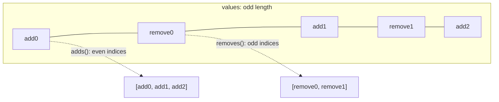

# Merge algebra

`Merge<T>` represents a merge result that never fails. A value is the formal
sum `A + (C - B) + (E - D)`: N+1 adds (the sides) and N removes (the bases).
A resolved value has one add and no removes. The representation is closed
under further merging and rebasing, so a conflict is ordinary data that
travels through any number of operations without nesting. It is stored in a
change as `FileChange::Conflict(Merge<FileState>)`.

## Structure

Terms are stored interleaved in one odd-length vector:
`[add0, remove0, add1, remove1, ..., addN]`.



| Constructor | Result |
| --- | --- |
| `Merge::resolved(v)` | `[v]` |
| `Merge::absent()` | `[None]`, the conflict-free "deleted" for `Merge<Option<T>>` |
| `Merge::three_way(base, left, right)` | `[left, base, right]`, that is `left + (right - base)` |
| `Merge::from_removes_adds(removes, adds)` | interleaves; panics unless there is exactly one more add than removes |
| `Merge::from_vec(values)` | as given; `Error::InvalidMerge` on even length |

Accessors: `num_sides()` (`len / 2 + 1`), `is_resolved()`, `as_resolved()`,
`into_resolved()`, `adds()`, `removes()`, `first()` (add0, conventionally
"ours"), and the shape-preserving `map`, `into_map`, `try_map`, `zip` (`zip`
panics on mismatched shapes). For `Merge<Option<T>>`, `is_absent()` and
`is_present_everywhere()` test every term. Serde encodes the interleaved
vector as-is, so a conflict hashes deterministically inside a
`ChangeVersion`.

## Simplify

`simplify` (needs `T: PartialEq`) splits the terms into separate add and
remove lists, then repeatedly removes one add and one equal remove until no
equal pair remains. After each cancellation it restarts from the first add,
because a later add may now cancel an earlier remove. The result is rebuilt
with `from_removes_adds`. The value is unchanged; only the term count drops.

This is an invariant: cancel on the separate lists, never on the interleaved
vector. Deleting a pair from the vector would shift the parity of every term
between them and turn adds into removes.

`resolve_trivial` returns a value when the simplified merge is resolved, or
when all remaining adds are equal (both sides made the same change). It
returns a reference into `self`, found by equality.
`into_trivially_resolved` is the owned form; on failure it returns the
simplified merge.

## Flatten

`Merge<Merge<T>>::flatten` concatenates the inner term lists. Each inner
list has odd length, so the outer interleaving is kept. At a remove slot the
inner terms land on alternating remove, add, remove positions, which negates
the inner value term by term: `-(a0 - r0 + a1) == -a0 + r0 - a1`.

## How a path is merged

`FileState = Option<(ContentRef, FileKind)>`; `None` means absent on that
side. `rill-core` merges one path in three steps:

1. Each side contributes its terms. A side whose tip records a conflict for
   the path contributes the stored `Merge<FileState>` (`tip_terms`);
   otherwise it contributes `Merge::resolved(state)`.
2. `merge_path` forms `Merge::three_way(Merge::resolved(base), left, right)`
   and flattens it.
3. `merge_file_state` simplifies, then tries `resolve_trivial`; a hit
   becomes `Set` or `Delete`. Otherwise, if every term is present, all have
   the same non-symlink kind and none is binary, the contents are
   text-merged. A clean text merge is stored as a `Set`. Anything else is
   `FileChange::Conflict` with the simplified terms.

See [merge](../03-core-algorithms/merge.md) and
[rebase](../03-core-algorithms/rebase.md) for the change-level algorithms.

## Worked example

Base `A`, left wrote `C`, right wrote `B`: the merge is `C + (B - A)`,
stored as `[C, A, B]`. `resolve_trivial()` is `None` because `C != B`.

Rebase that conflict onto `D` (base `C`, left `D`, right the conflict):

```text
three_way([C], [D], [C, A, B])
  = [[D], [C], [C, A, B]]      D + (conflict - C)
flatten
  = [D, C, C, A, B]            D - C + C - A + B
simplify (adds [D, C, B], removes [C, A])
  = [D, A, B]                  D + (B - A)
```

The base `C` cancels; the conflict follows the rebase with `D` in place of
`C`. Reverting a conflict cancels completely: `E + (C - E)` with
`E = [C, A, B]` flattens to `[C, A, B, C, A, B, C]` and simplifies to `[C]`.
These are the tests `rebase_simplifies_away_base` and
`revert_of_conflict_is_clean`.

If both sides wrote `B`, `[B, A, B]` does not simplify, but
`resolve_trivial()` returns `B` because all adds agree.

When a tree is built from a conflicted version, `first()` supplies the
entry (or deletes it if the first add is `None`). Trees never contain
conflicts; the conflict lives only in the change.

## Limitations

* `simplify` is quadratic in the number of terms because of the restart;
  real merges have a handful of terms.
* `from_removes_adds` and `zip` panic on shape errors instead of returning
  `Result`.
* A term carries no record of which side or parent it came from beyond its
  position.
* Text merge only runs when every term is present; a modify/delete
  conflict always stays a `Conflict`.

## Code

* [rill-types merge.rs](../../crates/rill-types/src/merge.rs): the algebra and its tests
* [rill-types objects/change.rs](../../crates/rill-types/src/objects/change.rs): `FileChange::Conflict`, `FileState`
* [rill-core merge/state.rs](../../crates/rill-core/src/merge/state.rs): `merge_file_state`
* [rill-core merge/change.rs](../../crates/rill-core/src/merge/change.rs): `tip_terms`, `merge_path`
* [rill-core tree/materialize.rs](../../crates/rill-core/src/tree/materialize.rs): first add wins when building a tree

---
← Previous: [Metadata engines](metadata-engines.md) · [Index](../index.md) · Next: [Content and chunking](content-and-chunking.md) →
