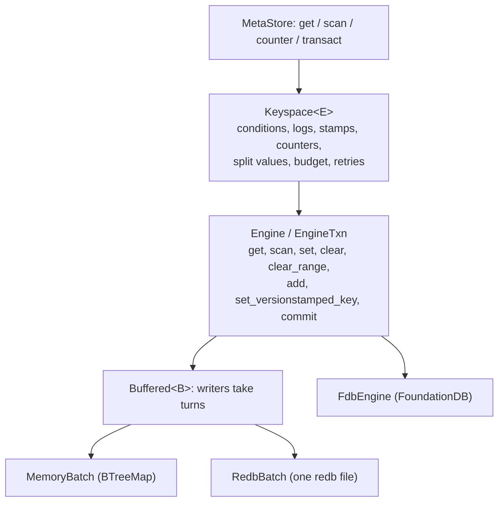

# Metadata engines

Every metadata backend runs the same code above a small raw engine. The
`Keyspace` layer implements all of `MetaStore` (conditions, logs, stamps,
counters, large values and size limits) once, on top of an `Engine` that
only reads, writes and commits raw rows. Memory, redb and FoundationDB
therefore agree on every rule, and the conformance suite checks that they
do.

## The engine contract

`Engine::begin` starts a transaction whose reads are serializable with
every other transaction's writes. `EngineTxn` offers point and range reads,
blind `set`, `clear`, `clear_range`, an atomic little-endian `add`, and
`set_versionstamped_key` (a key with a 10-byte placeholder the commit fills
in, with FoundationDB's trailing 4-byte offset). `commit` returns the
commit's stamp when a stamped key was written.

Two error kinds drive retries. `Error::Retryable` means nothing applied and
the work may be redone; the layer calls `reset_after` (backoff and reset)
and runs the transaction again, up to 64 attempts. `Error::CommitUnknown`
means the commit may have applied (FoundationDB's `commit_unknown_result`);
it is returned, never retried, because redoing a non-idempotent
transaction could apply it twice.

A transaction's reads need not see its own writes: the layer evaluates
every condition and log head before it writes anything.

## Layout of engine rows

| Region | Key | Holds |
| --- | --- | --- |
| values | `0x01 ++ key` | `0x00 ++ value`, or a split header `0x01 ++ id(8) ++ chunks u32 ++ len u64` |
| chunks | `0x02 ++ tuple(key, id, index)` | up to `ROW_BYTES` (90,000) bytes of a split value |
| counters | `0x03 ++ key` | little-endian `i64` |

A value of `ROW_BYTES` or more is split. The id is a digest of the whole
value, and writing a value first clears every chunk of its key, so a set
of chunks under one id is exactly one value. A read outside a transaction
reads the header, then the chunks, and re-reads if they no longer match
(the value was rewritten in between); a read inside a transaction sees one
snapshot and never needs to.

## Limits

| Limit | Value | FoundationDB's own |
| --- | --- | --- |
| Logical key | 8 KiB | 10,000 bytes |
| Bytes written by one transaction | 1,000,000 | 10 MB |
| Stamped appends per transaction | 65,535 | |
| Stamped value | under one row | |

A transaction over a limit fails with `Error::TooLarge` (gRPC
`RESOURCE_EXHAUSTED`) before it reaches the engine. Transactions slower
than one second are logged; FoundationDB itself cancels them at five.

## Engines

| Engine | Feature | How |
| --- | --- | --- |
| `MemoryMetaStore` = `Keyspace<Buffered<MemoryBatch>>` | always | a `BTreeMap`; tests and single-process servers |
| `RedbMetaStore` = `Keyspace<Buffered<RedbBatch>>` | `local` (default) | table `kv` in one redb file; table `sys` holds the commit counter |
| `FdbMetaStore` = `Keyspace<FdbEngine>` | `fdb` | FoundationDB, every key under the tuple subspace `(root,)` |

`Buffered` serves the single-process engines. `begin` takes the writer
turn (an async mutex) and holds it until commit, so nothing else writes
while a transaction reads; writes are buffered and applied as one atomic
batch. Stamps come from a commit counter, so they increase across
restarts (redb persists the counter in the same write transaction).

`FdbEngine` maps each operation onto a FoundationDB transaction. Reads use
`get` and paged `get_range` (`WantAll`); stamps come from
`get_versionstamp`; retries use FoundationDB's `on_error` backoff. The
client network starts once per process (`open_database`) and runs until
exit. `FdbEngine::clear_all` deletes the root subspace, for tests.

## Performance

In-process round trips on a laptop (`cargo bench -p rill-bench --bench meta`):

| Operation | memory | redb (in-memory file) |
| --- | --- | --- |
| conditional write (read, then `Equals` + set) | 1.1 µs | 41 µs |
| point read | 0.17 µs | 5.8 µs |
| 100-row scan | 2.3 µs | 17 µs |

Against the store before the keyspace layer, redb is within 12% (one more
blocking-thread hop to read conditions inside the transaction); memory
costs about a microsecond more per write. On disk, redb's fsync dominates.

## Limitations

* `Buffered` serializes every writer of a store, so redb and memory have
  one writer at a time. FoundationDB has no such limit.
* Scans outside a transaction run in one FoundationDB transaction, so a
  scan longer than five seconds fails; callers page with `limit`.
* `get_many` is a loop of point reads on every engine.
* There is no range delete in `MetaStore` yet (repository deletion,
  garbage collection).

## Code

* [keyspace/](../../crates/rill-store/src/keyspace/mod.rs): [engine.rs](../../crates/rill-store/src/keyspace/engine.rs), [store.rs](../../crates/rill-store/src/keyspace/store.rs), [layout.rs](../../crates/rill-store/src/keyspace/layout.rs), [buffered.rs](../../crates/rill-store/src/keyspace/buffered.rs)
* [memory.rs](../../crates/rill-store/src/memory.rs), [local/meta.rs](../../crates/rill-store/src/local/meta.rs), [fdb/](../../crates/rill-store/src/fdb/mod.rs)
* [tests/conformance/](../../crates/rill-store/tests/conformance/main.rs), [rill-bench benches/meta.rs](../../crates/rill-bench/benches/meta.rs)

---
← Previous: [Storage and keyspace](storage-and-keyspace.md) · [Index](../index.md) · Next: [Merge algebra](merge-algebra.md) →
