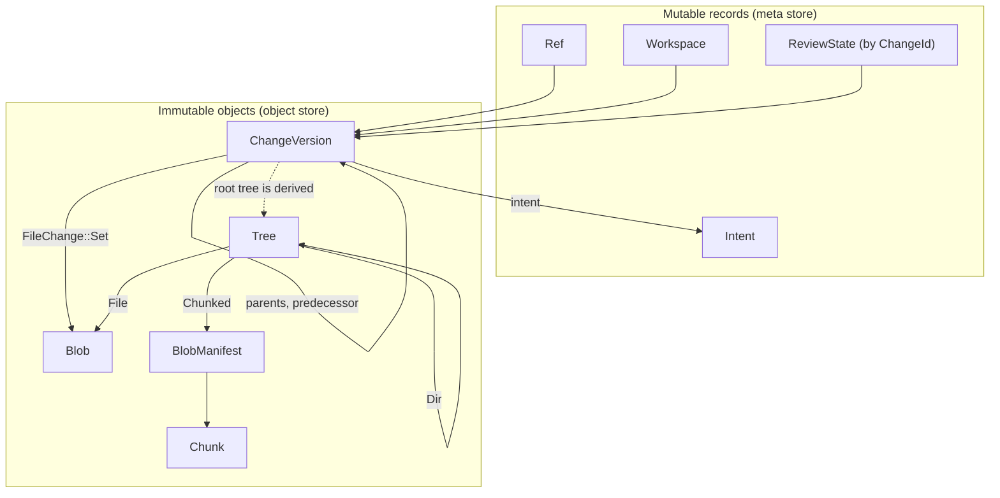

# Objects and ids

Everything Rill stores is either an immutable, content-addressed object or a
small mutable record that points at one. Immutable objects are named by the
BLAKE3 hash of their canonical encoding; mutable records are named by random
128-bit ids or a string key. All of these types live in `rill-types`, which
has no I/O and no async.

## Hashing

`ObjectHash` is 32 bytes, shown as hex (`short()` is the first 12 hex
characters). `ObjectHash::digest(kind, bytes)` is BLAKE3 over
`"rill:" ++ kind.as_str() ++ ":" ++ bytes`. The `ObjectKind` is a domain
separator, so equal bytes stored as different kinds never collide.

| `ObjectKind` | `as_str()` | What it names |
| --- | --- | --- |
| `Blob = 1` | `blob` | raw file bytes |
| `Chunk = 2` | `chunk` | raw bytes of one FastCDC chunk |
| `BlobManifest = 3` | `manifest` | encoded chunk list |
| `Tree = 4` | `tree` | encoded directory |
| `ChangeVersion = 5` | `cv` | encoded change version |
| `Derived = 6` | `derived` | derived objects such as `HistoryNode` |

`digest_parallel` (rayon tree hashing) and the streaming `hasher(kind)` give
the same digest as `digest`. `ObjectHash::ZERO` is a sentinel.

## Ids

`ChangeId` (`ch_`), `IntentId` (`in_`), `WorkspaceId` (`ws_`),
`PrincipalId` (`pr_`), `RepoId` (`rp_`) and `OperationId` (`op_`) are 16
bytes, displayed as `<prefix>_<hex>`; parsing accepts the hex with or
without the prefix. `new()` is random. `derived(namespace, name)` is the
first 16 bytes of BLAKE3 over `"rill:id:<prefix>:<namespace>:<name>"`;
`Principal::human/agent/service` use it so a principal's id follows from its
name. `OperationId` doubles as the idempotency key of write RPCs.

`TrunkSeq` is a `u64` shown as `trunk@N`. `RefName` is a validated string
of at most 256 characters from `[A-Za-z0-9/_.:@-]`, with no leading or
trailing `/`, no `//` and no `..`. `RepoPathBuf` is a `/`-separated relative
path; leading and trailing `/` are trimmed, the empty path is the root, and
`.`, `..`, empty components, `\` and NUL are rejected. `Timestamp` is `i64`
milliseconds since the Unix epoch (UTC), formatted as RFC 3339.

## Canonical encoding

An `Encodable` type declares `KIND`, `VERSION` (a `u8`) and `NAME`.
`encode` writes the version byte, then the postcard body. `decode` rejects
any other version byte with `Error::UnsupportedFormat`. `hash()` is
`digest(KIND, encode())`. `ChangeVersion`, `Tree` and `BlobManifest` are
`Encodable` at version 1; so is `HistoryNode` in `rill-core`, under kind
`Derived`. Blobs and chunks are not encoded: their bytes are the content.

The encoding is deterministic because postcard has no field reordering,
every map in the model is a `BTreeMap`, and no encoded type uses
`skip_serializing_if` (one value with two encodings would have two hashes).
`#[serde(default)]` only affects decoding and is used on fields added after
version 1.

Mutable records use `encode_record` in `rill-store`: the same version byte
plus postcard shape, never hashed. See
[storage and keyspace](storage-and-keyspace.md).

## Tree

`Tree { entries: BTreeMap<String, TreeEntry> }`; an entry is
`File { content: ContentRef, kind: FileKind }` or `Dir { hash, summary }`.
`DirSummary` (`file_count`, `dir_count`, `total_size`) covers the whole
subtree, so size queries never walk. `FileKind` is `Regular`, `Executable`
or `Symlink`. `ContentRef` is in [content and chunking](content-and-chunking.md).

## ChangeVersion

A `ChangeVersion` is one concrete version of a change. Its hash is the
version identity; `change_id` is the stable identity across amends and
rebases. It stores only what changed relative to `parents[0]`.

| Field | Meaning |
| --- | --- |
| `change_id` | stable `ChangeId` |
| `parents` | empty for a root, one for a linear change, more for a merge |
| `predecessor` | the version this one amends or rebases |
| `subtree_changes` | per directory: `Copy { from_path, from_version }` (reuses the tree hash) or `Delete`; applied before file changes |
| `file_changes` | per path: a `FileChange` |
| `author`, `provenance` | `Principal`; `Provenance` (`tool`, `model`, `session`, `prompt_ref`, `sponsor`, `resolved_by`, `extra`) is hashed in |
| `intent`, `message`, `created_at`, `extra` | the why, free text, time, extension slots |

`FileChange` has no add/modify split:

* `Set { content, kind, copy_from }`: the path has this content. A rename is
  a `Set` with `copy_from: Some(CopySource { path, version })` plus a
  `Delete` of the source.
* `Delete`: the path is gone. It may be a prefix of `Set` paths (a file
  replaced by a directory).
* `Conflict(Merge<FileState>)`: unresolved; see
  [merge algebra](merge-algebra.md).

The root tree is not a field. It is [derived data](derived-data.md):
the first parent's tree plus the changes. For a conflicted path the first
add of the merge supplies the tree entry, so trees never contain conflicts.

`ChangeInfo` is the projection without `file_changes`, so history listings
never load a large change map. `Signature` (`signer`, Ed25519 `public_key`
and `signature`, `signed_at`) is stored beside a version, not in its hash.

## Mutable records

`Workspace` and `Operation`: [workspaces](../04-workflow/workspaces.md).
`ReviewState`, `Label`, `LabelVote`, `Thread`:
[review](../04-workflow/review.md). `Intent`, `RiskClass`:
[intents](../04-workflow/intents.md). `Principal`:
[identity and auth](../05-policy/identity-and-auth.md). `RefUpdate` is a
compare-and-swap request: `expected: None` means the ref must not exist,
`target: None` deletes it.

## Limitations

* Nothing in `rill-types` verifies a `Signature`.
* `ChangeInfo.files_changed` counts `file_changes` only.
* `Principal.identity` and `Provenance` fields are unvalidated strings.
* The `trunk` / `release/<name>` / `<owner>/<name>` ref taxonomy is a
  convention; `RefName` only checks characters.
* The types allow a change to reference content that was never uploaded;
  the server checks `Set` content on `PutChange`, not `Conflict` terms.

## Code

* [hash.rs](../../crates/rill-types/src/hash.rs), [ids.rs](../../crates/rill-types/src/ids.rs), [encoding.rs](../../crates/rill-types/src/encoding.rs)
* [path.rs](../../crates/rill-types/src/path.rs), [time.rs](../../crates/rill-types/src/time.rs), [principal.rs](../../crates/rill-types/src/principal.rs), [error.rs](../../crates/rill-types/src/error.rs)
* [objects/tree.rs](../../crates/rill-types/src/objects/tree.rs), [objects/change.rs](../../crates/rill-types/src/objects/change.rs), [objects/blob.rs](../../crates/rill-types/src/objects/blob.rs), [objects/refs.rs](../../crates/rill-types/src/objects/refs.rs)
* [objects/workspace.rs](../../crates/rill-types/src/objects/workspace.rs), [objects/review.rs](../../crates/rill-types/src/objects/review.rs), [objects/intent.rs](../../crates/rill-types/src/objects/intent.rs)

---
← Previous: [Glossary](../01-overview/glossary.md) · [Index](../index.md) · Next: [Storage and keyspace](storage-and-keyspace.md) →
