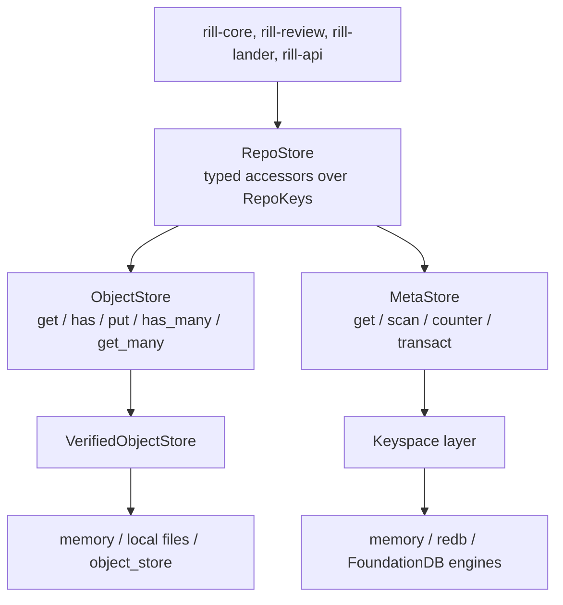

# Storage and keyspace

`rill-store` splits persistence into two traits. `ObjectStore` is an
immutable byte store keyed by `(ObjectKind, ObjectHash)`. `MetaStore` is an
ordered key-value space with conditional, atomic transactions for everything
mutable or sequenced. `RepoStore` puts a typed keyspace for one repository
over the pair, so services never build raw keys. How each metadata backend
implements `MetaStore` is on the next page, [metadata engines](metadata-engines.md).

## ObjectStore

* `get` returns `Ok(None)` when absent; `has` checks existence.
* `put(kind, hash, bytes)` first calls `verify`, which recomputes the digest
  under `kind` (with `digest_parallel` at 1 MiB and above) and fails with
  `Error::HashMismatch { expected, actual }`. Every backend does this. A put
  of an existing object is a no-op and never overwrites.
* Reads are verified too. `Stores::new` wraps every object store in
  `VerifiedObjectStore`, which re-hashes each `get` and `get_many` result
  and returns `Error::Corrupt { kind, hash }` (gRPC `DATA_LOSS`) on a
  mismatch, so bit rot or a tampered file is never served.
* `has_many` and `get_many` default to loops. The local store overrides
  `has_many`; the `object_store` backend overrides both with 16 requests in
  flight.
* `ObjectStoreExt` adds `get_required` (`Error::ObjectNotFound`),
  `put_object` / `get_object` / `get_object_required` for `Encodable` types,
  and `put_blob`.

## MetaStore

A `Transaction` is a list of `Condition`s and `Mutation`s. `transact`
checks every condition in the same transaction as its writes and either
applies everything or nothing; a failed condition returns `Error::Conflict`.

| Condition | Holds when |
| --- | --- |
| `Equals { key, value }` | the value equals `value` (`None`: absent) |
| `Absent { key }` / `Present { key }` | the key is absent / present |

| Mutation | Effect |
| --- | --- |
| `Set`, `Delete` | write or remove one value of any size |
| `AppendLog { prefix, value }` | write at `seq_key(prefix, n)`, `n` one more than the highest existing (1 for an empty log); dense, so concurrent appenders to one prefix conflict |
| `AppendStamped { prefix, value }` | write at `stamp_key(prefix, stamp)`, where the stamp is the commit's versionstamp; appenders never conflict |
| `Add { key, delta }` | add to a 64-bit counter without reading it; read with `counter(key)` |

`TxOutcome` reports the sequences `appended` and the `stamped`
`Versionstamp`s in mutation order. A `Versionstamp` is 12 bytes: 10 of
commit order, 2 of order within the transaction. Byte order is commit
order, and a stamp is a resumable cursor: once a reader has seen a stamp,
no entry with a smaller stamp can appear later.

`scan(KeyRange)` supports bounds, `limit` and `reverse`; `KeyRange::prefix`
uses `prefix_end` (increment the last non-`0xFF` byte; an all-`0xFF` prefix
is unbounded). Reads outside a transaction always see a whole value, never
part of one being rewritten.

## Keyspace

Every key is a FoundationDB tuple. Repository rows are
`(table, namespace, repo, ...)`, built by `RepoKeys`; ids and hashes are
byte elements, names and kinds string elements, sequences integer
elements. Tuple elements are self-delimiting, so no name is a prefix of a
longer name's rows (`dir:/src` never matches `dir:/src/x`), one
repository's rows in a table are one range, and an org, whose name is the
namespace, is a larger one. Repository names are unique per org; `Stores`
is scoped to one org (`Stores::org(name)`, `"default"` by default) for both
its metadata keys and its objects, and `find_repo(id)` resolves an id
through the global `repoid` index.

| Table | Key after `(table, ns, repo)` | Value |
| --- | --- | --- |
| `ci` | `hash` | `ChangeInfo` record |
| `sig` | `hash` | signatures, tagged `signatures` |
| `log` | `stamp` | version hash; every stored version, in commit order |
| `chv` | `change, seq` | version hash; versions of one change |
| `ch` | `change` | `ChangeRecord` (review minus votes and threads) |
| `vote` | `change, label, voter, version` | `LabelVote` |
| `vep` | `change` | vote epoch, rewritten by every vote |
| `thr` | `change, thread` | `ThreadHeader` |
| `cmt` | `change, thread, stamp` | `Comment` |
| `thd` | (none) | trunk head: be64 seq ++ version hash |
| `land` | `seq` | `Landing` record |
| `lease` | `role` | `LeaseRecord`: holder, epoch, expiry |
| `lepoch` | `role` | be64 epoch; fenced writes check it |
| `evt` | `stamp` | `Event`, written by the transaction that causes it |
| `evtn` | (none) | counter of events written; tailers wait on it |
| `jobq` | `queue, shard, priority, run_at, stamp` | `Job` ready from `run_at` |
| `jobl` | `queue, job` | claimed job with holder and lease expiry |
| `jobt` | `queue, job` | the claim's token; a handler's fenced writes check it |
| `jobd` | `queue, job` | `DeadJob`: out of attempts or failed for good |
| `jobn` | `queue, metric` | queue counter (`enqueued`, `completed`, `retried`, `dead`, `wake`) |
| `trunk` | `seq` | version hash landed at that sequence |
| `trunkh` | `hash` | be64 trunk sequence (reverse index) |
| `ref` | `name` | version hash |
| `ws` | `workspace` | `Workspace` record |
| `op` | `workspace, stamp` | `Operation`, with the whole resulting workspace |
| `opi` | `operation` | empty; idempotency marker |
| `in` | `intent` | `Intent` record |
| `dd` | `kind, hash` | derived value (see below) |
| `rebac` | `object, relation, subject` | empty |
| `misc` | `name` | named value (see below) |
| `repo` | `(repo, ns, id)` | `RepoConfig` record |
| `repon` | `(repon, ns, name)` | repo id |
| `org` | `(org, name)` | `OrgConfig` |
| `repoid` | `(repoid, id)` | the org a repository belongs to |
| `quota` | `(quota, org, principal, metric, day, shard)` | usage counter (16 shards) |
| `idem` | `(idem, principal, operation)` | a request's claim or stored response |
| `meta` | `(meta, "format")` | store format |

Change versions themselves live in the object store. A record is framed
as `[schema u16][tag len u8][tag][postcard]`. Typed records implement
`Record` (`TAG`, `SCHEMA = 1`) and use `encode_record` / `decode_record`:
`change`, `vote`, `thread`, `comment`, `workspace`, `operation`,
`intent`, `change_info`, `repo`, `org`, `event`, `landing`, `idem`. Other
values use `encode_tagged(tag, value)` with their storage kind as the tag
(`signatures`, a derived kind, a misc row name). Decoding checks
the tag, so a row read as the wrong type fails with `Error::Codec` rather
than decoding garbage.

Derived and misc values can grow large (search postings, the import
map). Above `OFFLOAD_BYTES` (64 KiB) `RepoStore` stores the
value as a `Derived` object and keeps only its hash in the row; a marker
byte (`0` inline, `1` object) tells the two apart. Callers see plain
bytes either way.

`(meta, "format")` holds the store format, `STORE_FORMAT = 1`.
`Stores::check_format` stamps it on a new store and fails with
`Error::IncompatibleFormat { found, expected }` on any other value; the
server calls it at start-up, so a store from an incompatible build is
refused rather than misread. Since Rill is pre-release, such a store is
recreated.

`RepoConfig` carries `RepoSettings { windows_safe }`, set at
`create_repo_with` and read by commit validation.

## Transaction boundaries

* `put_change_version` returns early if `ci` exists. Otherwise it puts the
  object, then commits one transaction: `Absent(ci)`, set `ci`, a stamped
  append to `log` and a dense append to `chv`. If the condition fails
  because a concurrent put won, it returns the hash; a version is logged
  once however many writers store it.
* Every write below that changes state also appends its event to `evt`
  and adds to `evtn` in the same transaction (`RepoStore::event`); see
  [events and workers](../07-runtime/events-and-workers.md).
* `update_ref` is `Equals(expected)` plus set or delete.
* **Commit.** `stage_version` writes the version object and returns the
  transaction that makes it visible; the server's commit adds the
  signatures, the review update, an event, a quota charge, the caller's
  extras and the request's idempotency effect, and commits them together
  (see [changes and stacks](../04-workflow/changes-and-stacks.md)).
* **Land.** `land(LandBatch)` checks the trunk-head row, the trunk ref, the
  lease epoch and each review snapshot, and writes positions, landing
  records, `Landed` reviews, events, charges, the head row, the ref and the
  caller's extra writes (the landing's jobs) in one transaction. Sequences are gap-free. See
  [landing](../04-workflow/landing.md).
* **Reviews.** `review_writes(snapshot, next)` checks the change record
  read, writes only changed parts, and checks the vote epoch when the
  record changes. See [review](../04-workflow/review.md).
* `operation_tx(expected, op)` checks `Absent(opi)` and the workspace as
  read, and writes the stamped operation, the resulting workspace and the
  `opi` marker.
* `create_org` uses `Absent(org)`. `try_acquire` takes a free or expired
  lease and bumps the epoch; `renew` and `release` check the record the
  holder has.
* Job claims move a `jobq` row to `jobl` and `jobt` under `Equals` on the
  row read; renew, complete and fail check the token.
* `put_derived`, `signatures_mutation`, `set_misc` are plain sets; `put_intent`
  is a set with its event.
* `Stores::create_repo` uses `Present(org)` and `Absent(repon)`, and writes
  the `repoid` index, so names are unique per org.

## Object backends

| Backend | Feature | Storage |
| --- | --- | --- |
| `MemoryObjectStore` | always | one `HashMap` keyed by namespace, unframed bytes; reference semantics |
| `ObjectStoreBackend` | always; `s3://` needs `s3` | `<prefix>/<namespace>/<kind>/<hh>/<hex>`, each object a codec frame, on any `object_store` store: `ObjectStoreBackend::local(dir)` (the filesystem), or `s3://`, `file://`, `memory://` via `from_url` |

`LocalStores::open(dir)` creates `<dir>/objects` and `<dir>/meta.redb`.
The server's `open_stores` picks objects from `[storage]` and metadata from
`[metadata]` (beside the objects by default, or FoundationDB). See
[configuration](../07-runtime/configuration.md).

On the filesystem, `object_store`'s `LocalFileSystem` (with `with_fsync`)
writes a temporary file, fsyncs it and renames it into place, so readers
never see a partial object. The backend writes with `PutMode::Create` and
treats `AlreadyExists` as success, since the bytes are identical by
construction. At start-up `probe` creates one probe object twice: if the
second create also succeeds, the service ignores conditional puts and the
server refuses to start unless `allow_unconditional_put` is set, in which
case the backend falls back to check-then-put (`PutStrategy::CheckThenPut`).

Every org's objects live in their own namespace, the org's name.
`ObjectStore::namespaced(name)` returns the same backend over another
namespace, and `Stores::org` uses it, so a repository only ever reads and
writes its org's objects. Objects are deduplicated within an org, never
across orgs: a hash learned in one org fetches nothing in another, and
identical content in two orgs is stored twice
([ADR 014](../10-decisions/014-objects-per-organization.md)). Both persistent backends
pass each frame through a `Sealer` (`ready` before, then `seal` on write
and `open` on read), which sees the namespace, kind and hash of each
object. `Plaintext` is the identity; `OrgSealer` encrypts under each org's
data keys ([data protection](../05-policy/data-protection.md#encryption-at-rest)).

## Codec

Persistent object stores wrap each object in a 7-byte `RILZ` header: magic
`RILZ`, frame version `1`, method (`Raw = 0`, `Zstd = 1`), zstd level, then
the payload. `compress_with_level` stores raw when the object is under
`RAW_THRESHOLD` (64 bytes) or does not shrink. The default level is
`DEFAULT_LEVEL = 3`. `decompress` fails with `Error::Codec` on a bad magic,
version or method.

## Limitations

* No backend deletes objects or rows; there is no garbage collection, and
  an offloaded derived value that is overwritten leaves its old object.
* Objects are written before the transaction that makes them visible; a
  commit that fails leaves an unreferenced object.
* `chv` is a dense log: appenders to one change conflict, which is fine
  for its one writer at a time.
* Org names cannot change; quotas are counted but not enforced
  (phase 10).
* The `object_store` backend is tested only against in-process stores,
  never a real S3 endpoint.

## Code

* [lib.rs](../../crates/foundation/store/src/lib.rs), [error.rs](../../crates/foundation/store/src/error.rs), [object.rs](../../crates/foundation/store/src/object.rs), [meta.rs](../../crates/foundation/store/src/meta.rs)
* [keys.rs](../../crates/foundation/store/src/keys.rs), [repo/](../../crates/foundation/store/src/repo/mod.rs) ([landing.rs](../../crates/foundation/store/src/repo/landing.rs), [reviews.rs](../../crates/foundation/store/src/repo/reviews.rs), [idem.rs](../../crates/foundation/store/src/repo/idem.rs), [orgs.rs](../../crates/foundation/store/src/repo/orgs.rs), [events.rs](../../crates/foundation/store/src/repo/events.rs)), [codec.rs](../../crates/foundation/store/src/codec.rs), [verified.rs](../../crates/foundation/store/src/verified.rs), [seal/](../../crates/foundation/store/src/seal/mod.rs)
* [memory.rs](../../crates/foundation/store/src/memory.rs), [backend.rs](../../crates/foundation/store/src/backend.rs), [local/](../../crates/foundation/store/src/local/mod.rs)
* [tests/conformance/](../../crates/foundation/store/tests/conformance/main.rs): every scenario on every backend
* [rill-runtime state/stores.rs](../../crates/server/runtime/src/state/stores.rs): `open_stores`

---
← Previous: [Objects and ids](objects-and-ids.md) · [Index](../index.md) · Next: [Metadata engines](metadata-engines.md) →
