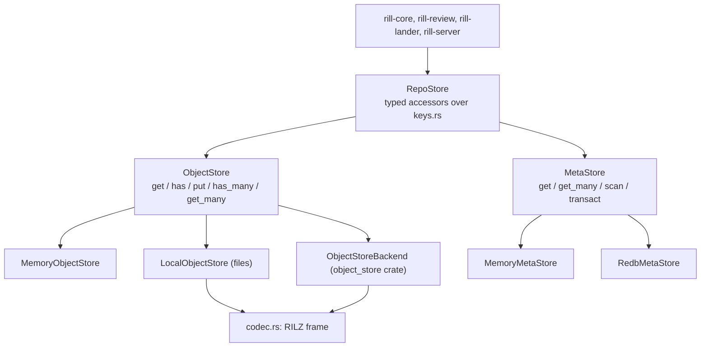

# Storage and keyspace

`rill-store` splits persistence into two traits. `ObjectStore` is an
immutable byte store keyed by `(ObjectKind, ObjectHash)`. `MetaStore` is an
ordered key-value space with conditional, atomic transactions for everything
mutable or sequenced. `RepoStore` puts a typed keyspace for one repository
over the pair, so services never build raw keys.

## ObjectStore

* `get` returns `Ok(None)` when absent; `has` checks existence.
* `put(kind, hash, bytes)` first calls `verify`, which recomputes the digest
  under `kind` (with `digest_parallel` at 1 MiB and above) and fails with
  `Error::HashMismatch { expected, actual }`. Every backend does this. A put
  of an existing object is a no-op and never overwrites.
* `has_many` and `get_many` default to loops. The local store overrides
  `has_many`; the `object_store` backend overrides both with 16 requests in
  flight.
* `ObjectStoreExt` adds `get_required` (`Error::ObjectNotFound`),
  `put_object` / `get_object` / `get_object_required` for `Encodable` types,
  and `put_blob`.

## MetaStore

A `Transaction` is a list of `Condition`s (`Equals { key, value }` where
`None` means absent, `Absent`, `Present`) and `Mutation`s (`Set`, `Delete`,
`AppendLog { prefix, value }`). `transact` checks every condition against
one snapshot before applying anything. If one fails it returns
`Error::Conflict` and writes nothing.

`AppendLog` writes `prefix ++ be64(seq)` where `seq` is one more than the
highest existing sequence under the prefix (1 for an empty log). Sequences
are dense and byte order equals numeric order. `TxOutcome.appended` returns
the assigned sequences in order. `scan(KeyRange)` supports bounds, `limit`
and `reverse`; `KeyRange::prefix` uses `prefix_end` (increment the last
non-`0xFF` byte; an all-`0xFF` prefix is unbounded).

## Keyspace

Every key is `<table>/<repo-id>/...` joined with `/`. Ids and hashes are raw
bytes (16 and 32), not hex, so one prefix scan covers a repository's rows in
a table.

| Table | Key suffix | Value |
| --- | --- | --- |
| `ci` | `<hash>` | `ChangeInfo` record |
| `sig` | `<hash>` | `Vec<Signature>` record |
| `log` | `<be64 seq>` | version hash; every stored version, in order |
| `chv` | `<change-id>/<be64 seq>` | version hash; versions of one change |
| `ch` | `<change-id>` | `ReviewState` record |
| `trunk` | `<be64 seq>` | version hash landed at that sequence |
| `trunkh` | `<hash>` | be64 trunk sequence (reverse index) |
| `ref` | `<name>` | version hash |
| `ws` | `<workspace-id>` | `Workspace` record |
| `op` | `<workspace-id>/<be64 seq>` | `Operation` record |
| `opi` | `<operation-id>` | be64 sequence; idempotency lookup |
| `in` | `<intent-id>` | `Intent` record |
| `dd` | `<kind@version>/<hash>` | derived value record |
| `rebac` | `<object>/<relation>/<subject>` | empty |
| `misc` | `<name>` | small values such as policy text |
| `repo` | `repo/<repo-id>` (no repo prefix) | `RepoConfig` record |
| `repon` | `repon/<name>` (no repo prefix) | repo id |

Change versions themselves live in the object store. Records are framed by
`encode_record`: version byte `RECORD_VERSION = 1`, then postcard;
`decode_record` rejects any other version with `Error::Codec`. Records are
not hashed, so fields can be added with `#[serde(default)]`.

## Transaction boundaries

* `put_change_version` returns early if `ci/` exists. Otherwise it puts the
  object, then commits one transaction: set `ci/`, `AppendLog` to `log/` and
  to `chv/`.
* `update_ref` is `Equals(expected)` plus set or delete.
* `land_on_trunk(expected, hash)` reads the trunk head, fails with
  `Conflict("trunk moved")` if it differs, then commits `Equals(ref/trunk)`,
  `Absent(trunk/<seq>)`, and sets `ref/trunk`, `trunk/<seq>` and
  `trunkh/<hash>`. Sequences are gap-free. See
  [landing](../04-workflow/landing.md).
* `put_review(state, expected)` adds an optional `Equals` on the previous
  record encoding.
* `append_operation` commits `Absent(opi/<op>)`, `AppendLog op/` and the
  `ws/` record, then sets `opi/<op>` in a second write.
* `put_derived`, `put_signatures`, `put_intent`, `set_misc` are plain sets.
* `Stores::create_repo` uses `Absent(repon/<name>)` so names are unique.

## Backends

| Backend | Feature | Storage |
| --- | --- | --- |
| `MemoryObjectStore` | always | `HashMap`, unframed bytes; reference semantics |
| `MemoryMetaStore` | always | `BTreeMap`; `transact` holds the write lock across check and apply |
| `LocalObjectStore` | `local` (default) | `<root>/<kind>/<hh>/<hex>`, each file a codec frame |
| `RedbMetaStore` | `local` (default) | one redb file, one table `kv`; one `Transaction` is one redb write transaction |
| `ObjectStoreBackend` | `s3` | `<prefix>/<kind>/<hh>/<hex>` on any `object_store` store (`s3://`, `file://`, `memory://` via `from_url`) |

`LocalStores::open(dir)` creates `<dir>/objects` and `<dir>/meta.redb`. The
server's `open_stores` maps `StorageConfig::Memory`, `Local { dir }` and
`S3 { url, prefix, meta_dir }` (S3 objects with a local redb for metadata).
See [configuration](../07-runtime/configuration.md).

The local object store runs all file work on `spawn_blocking`. It writes a
`.tmp-*` file with `create_new`, fsyncs it, re-checks for a concurrent
winner, renames into place and fsyncs the directory, so readers never see a
partial object. The `object_store` backend writes with `PutMode::Create` and
treats `AlreadyExists` as success, since the bytes are identical by
construction; it relies on the service honouring conditional create.

## Codec

Persistent object stores wrap each object in a 7-byte `RILZ` header: magic
`RILZ`, frame version `1`, method (`Raw = 0`, `Zstd = 1`), zstd level, then
the payload. `compress_with_level` stores raw when the object is under
`RAW_THRESHOLD` (64 bytes) or does not shrink. The default level is
`DEFAULT_LEVEL = 3`. `decompress` fails with `Error::Codec` on a bad magic,
version or method.

## Limitations

* No backend deletes objects or rows; there is no garbage collection.
* `put_change_version` is idempotent by a read before the transaction, not
  a condition in it; two concurrent first puts of one version can append
  two `log/` and `chv/` entries.
* `append_operation` writes `opi/` after its transaction; a crash in between
  leaves an operation without its idempotency index.
* The object put and meta transaction in `put_change_version` are not
  atomic; a failure between them leaves an unreferenced object.
* The `object_store` backend is tested only against in-process stores,
  never a real S3 endpoint.

## Code

* [lib.rs](../../crates/rill-store/src/lib.rs), [error.rs](../../crates/rill-store/src/error.rs), [object.rs](../../crates/rill-store/src/object.rs), [meta.rs](../../crates/rill-store/src/meta.rs)
* [keys.rs](../../crates/rill-store/src/keys.rs), [repo.rs](../../crates/rill-store/src/repo.rs), [codec.rs](../../crates/rill-store/src/codec.rs)
* [memory.rs](../../crates/rill-store/src/memory.rs), [local/mod.rs](../../crates/rill-store/src/local/mod.rs), [local/objects.rs](../../crates/rill-store/src/local/objects.rs), [local/meta.rs](../../crates/rill-store/src/local/meta.rs), [s3.rs](../../crates/rill-store/src/s3.rs)
* [tests/conformance.rs](../../crates/rill-store/tests/conformance.rs): one scenario run against every backend
* [rill-server state/app.rs](../../crates/rill-server/src/state/app.rs): `open_stores`

---
← Previous: [Objects and ids](objects-and-ids.md) · [Index](../index.md) · Next: [Merge algebra](merge-algebra.md) →
