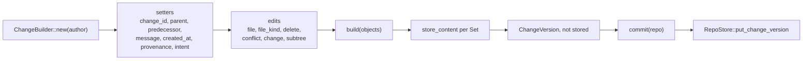

# Change builder

`ChangeBuilder` assembles a `ChangeVersion` through fluent calls. It stores
the content of every file it sets while building, then returns the version
without storing it. After `build`, every `Set` the builder created
references content that is already in the object store. The caller supplies
everything else: parents, identity, provenance and intent.

## Fields and defaults

| Field | Default from `new(author)` | Setter |
| --- | --- | --- |
| `change_id` | fresh `ChangeId::new()` | `change_id(id)`, for amends |
| `parents` | empty (a root change) | `parent(hash)`, repeatable; the first is the base of `file_changes` |
| `predecessor` | `None` | `predecessor(hash)` |
| `message` | empty | `message(..)` |
| `created_at` | `Timestamp::now()` | `created_at(ts)` |
| `provenance` | `Provenance::default()` | `provenance(p)` |
| `intent` | `None` | `intent(id)` |
| `extra` | empty | none |

## Recording edits

Edits are keyed by path; a later call at the same path replaces an earlier
one. Each edit method takes a `&str`, validates it with `RepoPathBuf::new`
and returns `Result<Self>`. An invalid path is `Error::Types`.

| Method | Becomes at `build` |
| --- | --- |
| `file(path, bytes)` | `FileChange::set(store_content(bytes), Regular)` |
| `file_kind(path, bytes, kind)` | Same, with `kind` |
| `delete(path)` | `FileChange::Delete` |
| `conflict(path, Merge<FileState>)` | `FileChange::Conflict(terms)` |
| `change(path, FileChange)` | The change as given; its content must already exist |
| `subtree(path, SubtreeChange)` | An entry in `subtree_changes` |

`build(objects)` walks the edits in path order and calls `store_content` for
each `Set` (inline, single blob or chunked; see
[content and chunking](../02-data/content-and-chunking.md)).
`commit(repo)` is `build` on `repo.objects()` followed by
`RepoStore::put_change_version`, and returns `(hash, cv)`.

## Producers of versions

| Producer | Uses the builder |
| --- | --- |
| `ApplyEdits` RPC ([repo/write.rs](../../crates/rill-api/src/services/repo/write.rs)) | Yes. Sets identity from the edit base, then one `change(path, FileChange)` per edit; `Patch` edits are applied with `apply_unified` first |
| Workspace `NewChange` ([services/workspace.rs](../../crates/rill-api/src/services/workspace.rs)) | No. `version_from_diff` maps each `TreeDiffEntry` from `diff_trees(base_root, snapshot)` to `Set` or `Delete` |
| `merge_changes`, `rebase`, `Resolve` RPC | No; they build or edit the struct directly |
| git importer ([importer.rs](../../crates/rill-git-import/src/import/importer.rs)) | Yes, with `build`; it then adds the git SHA to `extra` and stores the version itself |

## Validation

`build` runs `validate_version` with default rules: the change limits,
reserved paths and symlink targets from
[objects and ids](../02-data/objects-and-ids.md#change-limits). The
server's `commit_version` runs it again with the repository's rules
(adding Windows names when `windows_safe` is set), then the checks below,
before storing:

| Check | Error |
| --- | --- |
| Every parent and the predecessor exist | precondition |
| No `file_changes` key is the root path | invalid argument |
| Every `Set` content is in the object store | from `check_content_exists` |
| A `copy_from` source exists in its version | invalid argument |
| The root tree materialises, with no added name differing only in case from a sibling | `RootTree` is derived right after `put_change_version`, so a bad change fails the request |

`ChangeBuilder::commit` performs only the `build` checks. Tests and tools
that trust their input use it.

## Provenance and signing

`Provenance` is a plain field. The builder stores what the caller passes and
it is hashed with the rest of the version; through the server, `author`,
`created_at`, `sponsor` and `resolved_by` are replaced before hashing. The
builder has no signing hook.
Signatures are separate objects over the version hash, produced by
`rill-policy` and stored with `RepoStore::put_signatures`. Signing never
changes a version's hash. See [signing](../05-policy/signing.md).

## Failure behaviour

`build` stores content one path at a time. If it fails part-way, the blobs
already written stay in the store (content-addressed, harmless) and no
version is produced. `commit` writes the version only after all content is
stored. Errors are `Error::Types` (bad path), `Error::Store` (object store)
or `Error::Join` (the chunking task).

## Limitations

- `extra` cannot be set through the builder.
- `copy_from` on `FileChange::Set` has no setter; it can only be passed in
  through `change(..)`.
- `build` does not check parents: an unknown parent or a root-path edit
  builds successfully.
- The builder reads nothing. To modify the parent's content at a path, the
  caller must fetch it first.
- All content passed to the builder is held in memory until `build`.

## Code

- [builder.rs](../../crates/rill-core/src/builder.rs)
- [blobs/](../../crates/rill-core/src/blobs/mod.rs), [validate.rs](../../crates/rill-core/src/validate.rs)
- [rill-types objects/change.rs](../../crates/rill-types/src/objects/change.rs)
- [rill-api services/repo/write.rs](../../crates/rill-api/src/services/repo/write.rs)

---
← Previous: [History graph](history-graph.md) · [Index](../index.md) · Next: [Workspaces](../04-workflow/workspaces.md) →
