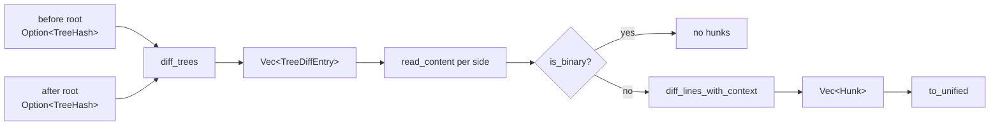

# Diff

The diff module turns two byte buffers into line hunks and two trees into a
list of changed paths. It also applies a unified patch back onto a buffer.
The tree diff never loads a subtree whose hash is equal on both sides, so it
costs O(changed paths x depth), not O(repository).

The server's `Diff` RPC
([services/diff.rs](../../crates/rill-api/src/services/diff.rs)) drives
this pipeline. It treats an absent side as empty, reports content larger
than `MAX_DIFF_BYTES` (4 MiB) as binary, and returns either structured hunks
or unified text depending on `DiffFormat`.

## Line tokens

`split_lines` ([tokens.rs](../../crates/rill-core/src/diff/tokens.rs))
yields each line with its `\n` included. The last line may have no
terminator. Diff and merge share these tokens. As a result:

- `a\n` and `a` are different lines. CRLF and LF are different lines.
- Joining the tokens gives back the input byte for byte. Hunks and merge
  regions are therefore lossless.
- `LineTokens::missing_final_newline` tells renderers to emit
  `\ No newline at end of file`.
- `line_content` strips `\n` and then `\r`, for callers that want bare text.

## Line diff

[lines.rs](../../crates/rill-core/src/diff/lines.rs):

- `edit_script(old, new)` is `pub(crate)`. It runs `imara-diff` with
  `Algorithm::Histogram`, then `postprocess_lines`, and returns raw
  `(old_range, new_range)` pairs in line indices. Merge uses it directly.
- `diff_lines(old, new)` calls `diff_lines_with_context` with
  `DEFAULT_CONTEXT = 3`.
- `group_hunks` joins edits whose gap is at most `2 * context` lines into
  one `Hunk`. It pads `context` lines on each side, clamped to the buffer,
  and tags every line `Context`, `Removed` or `Added`.

A `Hunk` ([hunk.rs](../../crates/rill-core/src/diff/hunk.rs)) has 1-based
`old_start`/`new_start` and `old_len`/`new_len` that count context lines too,
as `diff -u` does. Identical inputs give an empty `Vec<Hunk>`. Histogram is
the only algorithm; there is no word-level diff.

## Unified text

`to_unified(path, hunks) -> Vec<u8>`
([unified.rs](../../crates/rill-core/src/diff/unified.rs)) writes
`--- a/<path>` and `+++ b/<path>`, one `@@ -s,l +s,l @@` per hunk, and the
prefixes ` `, `-`, `+`. A range of length 1 prints as `s`; length 0 prints
as `s-1,0`. When there is exactly one hunk and one side has length 0, that
side is labelled `/dev/null`. Context is whatever the hunks were built with.
Line content is copied as bytes, so non-UTF-8 files round-trip exactly
through `apply_unified`. The server's `Diff` RPC returns unified text in a
proto `string` and converts lossily only at that boundary.

`apply_unified(old, patch)`
([patch.rs](../../crates/rill-core/src/diff/patch.rs)) is the inverse, used
by the `Patch` edit of `ApplyEdits`. It accepts the subset `to_unified`
emits. Hunks apply in order. Each must match its context and removed lines
at the stated line, or within `FUZZ_WINDOW = 50` lines of it, never before
the previous hunk's end. Lines are compared with `line_content`, so
terminator differences do not block a match. Anything else is
`Error::InvalidPatch`; the function does not guess.

## Binary detection

`is_binary` ([binary.rs](../../crates/rill-core/src/diff/binary.rs)) is true
when a NUL byte appears in the first `BINARY_SNIFF_LEN` (8 KiB). The same
test decides whether `merge_file_state` may text-merge a path.

## Tree diff

`diff_trees(ops, before, after)`
([tree.rs](../../crates/rill-core/src/diff/tree.rs)) takes an
`Option<TreeHash>` per side; `None` means "no tree", the parent of a root
change. It returns `Vec<TreeDiffEntry>` sorted by path. Each entry has
`before` and `after` as `Option<(ContentRef, FileKind)>`.

The walk uses an explicit stack of `(dir, before_hash, after_hash)`. A frame
whose hashes are equal is skipped without loading either tree. Otherwise the
union of entry names is visited:

| Before | After | Result |
| --- | --- | --- |
| `Dir(h1)` | `Dir(h2)`, `h1 != h2` | Descend |
| `Dir(h)` | `Dir(h)` | Nothing |
| `File` | `File` with different `(content, kind)` | Entry with both sides |
| `File` | absent or `Dir` | Delete entry; a `Dir` side is also descended with `before = None` |
| absent or `Dir` | `File` | Add entry; a `Dir` side is also descended with `after = None` |

A file replaced by a directory gives a delete of the file path plus adds
beneath it. A kind change with the same content is reported.

`file_state(ops, root, path)` looks up one path. It returns `None` for a
missing root, a missing path or a directory. Merge and rebase call it per
path.

## Limitations

- No rename or copy detection. `FileChange::Set` has a `copy_from` field,
  but `TreeDiffEntry` does not, and the diff never reads change versions.
- No whitespace-insensitive mode.
- `is_binary` looks only at the first 8 KiB.
- The `Diff` RPC's unified text is lossy for non-UTF-8 files (structured
  hunks are exact).
- Results are collected into a `Vec`, not streamed. The server applies its
  own `limit` and reports `truncated`.
- Hunk coordinates are `u32`.

## Code

- [diff/mod.rs](../../crates/rill-core/src/diff/mod.rs)
- [diff/tokens.rs](../../crates/rill-core/src/diff/tokens.rs)
- [diff/lines.rs](../../crates/rill-core/src/diff/lines.rs)
- [diff/hunk.rs](../../crates/rill-core/src/diff/hunk.rs)
- [diff/unified.rs](../../crates/rill-core/src/diff/unified.rs)
- [diff/patch.rs](../../crates/rill-core/src/diff/patch.rs)
- [diff/binary.rs](../../crates/rill-core/src/diff/binary.rs)
- [diff/tree.rs](../../crates/rill-core/src/diff/tree.rs)
- [rill-api services/diff.rs](../../crates/rill-api/src/services/diff.rs)

---
← Previous: [Derived data](../02-data/derived-data.md) · [Index](../index.md) · Next: [Merge](merge.md) →
