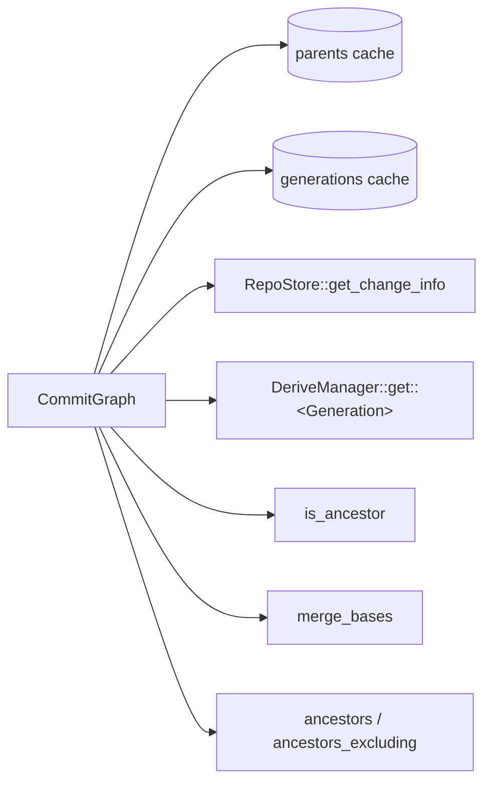

# History graph

`CommitGraph` answers ancestry questions over change versions: parents,
generation numbers, `is_ancestor`, `merge_bases` and the walk behind `log`.
It reads `ChangeInfo` records, never full `ChangeVersion`s, so a version
with a million paths costs the same as an empty one. Every query relies on
one invariant: a parent's generation is strictly lower than its child's.

## Primitives

[commit_graph.rs](../../crates/rill-core/src/graph/commit_graph.rs):

| Method | Source | Cache |
| --- | --- | --- |
| `info(hash)` | `RepoStore::get_change_info`; absent is `Error::ChangeNotFound` | Fills `parents` as a side effect; `info` itself always reads the store |
| `parents(hash)` | `info` | `DashMap<ChangeVersionHash, Arc<[ChangeVersionHash]>>` |
| `generation(hash)` | `DeriveManager::get::<Generation>` | `DashMap<ChangeVersionHash, u64>` |

`Generation` ([derive/generation.rs](../../crates/rill-core/src/derive/generation.rs))
is a derivation with kind `gen`: `1 + max(parent generations)`, and 1 for a
root. It is stored once computed. See
[derived data](../02-data/derived-data.md).

`ChangeInfo` is the metadata projection of a version: hash, `change_id`,
parents, predecessor, author, provenance, intent, message, `created_at`,
`files_changed`, `has_conflicts` and `trunk_seq`. The store writes it on
`put_change_version`.

Both caches are process-local and never evict. Versions are immutable, so
entries never go stale.

## is_ancestor

`is_ancestor(ancestor, descendant)` is true when the two are equal.
Otherwise it runs a max-heap on generation seeded with `descendant`. A
popped version at or below the target's generation is not expanded, since
nothing beneath it can reach the target. Each parent is compared with the
target before it is queued, and a `seen` set prevents re-expansion. Cost is
the number of reachable versions above the target's generation. The lander
uses it to skip rebasing a tip that is already on trunk.

## merge_bases

`merge_bases(a, b)` returns every best common ancestor (none an ancestor of
another), empty for disjoint histories. More than one means a criss-cross
history. `merge_base` is the first of them. The walk is git's
`paint_down_to_common` with generation numbers:

1. Flags `LEFT = 1`, `RIGHT = 2`, `STALE = 4`. `a` starts `LEFT`, `b`
   starts `RIGHT`; both go on a max-heap by generation.
2. Pop the highest generation. A version with `LEFT | RIGHT` and not
   `STALE` is a candidate; it becomes `STALE`.
3. Each parent takes on the popped flags. A parent whose flags changed is
   pushed. Ancestors of a candidate therefore become `STALE` and are never
   reported.
4. Stop when every queued version is `STALE`. The heap is scanned before
   each pop; the scan is bounded by the frontier width.

Candidates are ordered highest generation first, ties by smaller hash, so
the result is deterministic. `merge_bases(a, a)` is `[a]`.

## Log walks

[walk.rs](../../crates/rill-core/src/graph/walk.rs). Both walks pop from a
heap keyed `Key(generation, created_at, hash)`, highest first. A version is
always emitted before its parents, unrelated versions come newest first,
and the order is total.

| Method | Returns |
| --- | --- |
| `ancestors(start, limit)` | Up to `limit` ancestors of `start`, inclusive |
| `ancestors_excluding(start, exclude, limit)` | Ancestors of `start` that are not ancestors of `exclude`, same order |

`ancestors_excluding` walks both sides in one heap. A popped version that is
marked uninteresting marks its parents and is not emitted. Generation order
guarantees the mark reaches a version before it could be emitted. The walk
stops at `limit` or when nothing interesting is queued. Each result is a
`LogEntry { info, generation }`.

The server's `Log` RPC
([repo/history.rs](../../crates/rill-server/src/services/repo/history.rs))
uses `ancestors(start, limit + 1)` for the full walk, so it can detect
truncation. A `first_parent` log is a plain first-parent loop in the server,
and a path filter goes to the path-history derivation; neither uses
`CommitGraph`. `ancestors_excluding` has no caller outside `rill-core`. The
`MergeBase` and `IsAncestor` RPCs call the methods above directly.

## Failure behaviour

All queries are read-only. A missing version is
`Error::ChangeNotFound(hash)`. Store and derivation errors propagate. A walk
that fails part-way returns the error, not a partial list.

## Limitations

- The caches grow by one entry per version touched and never shrink.
- `ancestors` reads `ChangeInfo` twice per version: once when queued and
  again when popped.
- The first `Generation` of an un-derived version walks all its un-derived
  ancestors.
- `CommitGraph` has no first-parent walk, date-bounded walk or descendant
  walk.

## Code

- [graph/mod.rs](../../crates/rill-core/src/graph/mod.rs)
- [graph/commit_graph.rs](../../crates/rill-core/src/graph/commit_graph.rs)
- [graph/walk.rs](../../crates/rill-core/src/graph/walk.rs)
- [derive/generation.rs](../../crates/rill-core/src/derive/generation.rs)
- [rill-types objects/change.rs](../../crates/rill-types/src/objects/change.rs)

---
← Previous: [Trees](trees.md) · [Index](../index.md) · Next: [Change builder](change-builder.md) →
