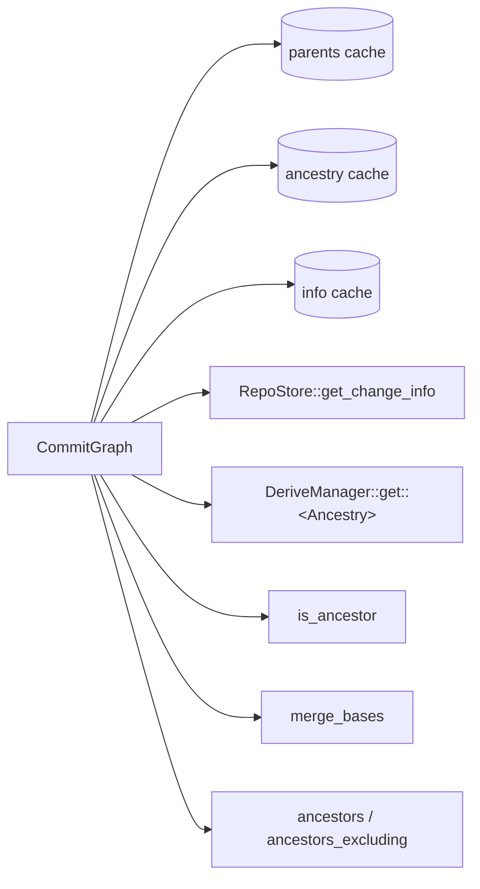

# History graph

`CommitGraph` answers ancestry questions over change versions: parents,
generation numbers, `is_ancestor`, `merge_bases` and the walk behind `log`.
It reads `ChangeInfo` records and `Ancestry` values, never full
`ChangeVersion`s, so a version with a million paths costs the same as an
empty one. Walks rely on one invariant: a parent's generation is strictly
lower than its child's. On histories without merges, which is every
history except git imports with merge commits, ancestry and merge bases
take O(log depth) steps through skip pointers instead of a walk.

## Primitives

[commit_graph.rs](../../crates/rill-core/src/graph/commit_graph.rs):

| Method | Source | Cache |
| --- | --- | --- |
| `info(hash)` | `RepoStore::get_change_info`; absent is `Error::ChangeNotFound` | `LruCache` of 20,000 versions on trunk; fills `parents` as a side effect |
| `parents(hash)` | `info` | `LruCache` of 200,000 versions |
| `ancestry(hash)`, `generation(hash)` | `DeriveManager::get::<Ancestry>` | `LruCache` of 200,000 versions |
| `ancestor_at_depth(from, depth)` | jump pointers | |

`Ancestry` ([derive/ancestry.rs](../../crates/rill-core/src/derive/ancestry.rs))
is a land-critical derivation with kind `anc`. `AncestryInfo` holds the
generation (`1 + max(parent generations)`, 1 for a root), the first-parent
`depth` (0 for a root), `merges` (true when the version or any ancestor
has several parents), the first `parent`, and one `jump` pointer with its
depth. Jumps follow the skew-binary rule (Myers 1983): a version jumps to
its parent's jump's jump when the parent's two jumps cover equal
distances, and to its parent otherwise. `ancestor_at_depth` follows a jump
when it does not overshoot and a parent otherwise, reaching any
first-parent ancestor in O(log depth) steps. See
[derived data](../02-data/derived-data.md).

`ChangeInfo` is the metadata projection of a version: hash, `change_id`,
parents, predecessor, author, provenance, intent, message, `created_at`,
`files_changed`, `has_conflicts` and `trunk_seq`. The store writes it on
`put_change_version`.

The caches are process-local and bounded. Versions are immutable, so
entries never go stale. The one mutable part of `ChangeInfo` is
`trunk_seq`, set once when the version lands, so only infos already on
trunk are cached; the rest are read again.

`ancestors` keeps the info it read to queue each parent and uses it when
the parent is popped, and the `Log` RPC returns those infos as they are,
so a page costs one info read per version.

## is_ancestor

`is_ancestor(ancestor, descendant)` is true when the two are equal. When
no merge lies behind `descendant`, the history is a tree and the answer is
whether `ancestor_at_depth(descendant, depth(ancestor))` is `ancestor`.
Otherwise it runs a max-heap on generation seeded with `descendant`. A
popped version at or below the target's generation is not expanded, since
nothing beneath it can reach the target. Each parent is compared with the
target before it is queued, and a `seen` set prevents re-expansion. Cost is
the number of reachable versions above the target's generation. The lander
uses it to skip rebasing a tip that is already on trunk.

## merge_bases

`merge_bases(a, b)` returns every best common ancestor (none an ancestor of
another), empty for disjoint histories. More than one means a criss-cross
history. `merge_base` is the first of them.

When neither side has a merge behind it there is exactly one candidate,
found by `common_ancestor`: bring both to the shallower depth, then step
both through their jumps while the jumps differ and through their parents
when they agree. Jumps depend only on depth, so both sides stay level and
the search takes O(log depth) steps. Otherwise the walk is git's
`paint_down_to_common` with generation numbers:

1. Flags `LEFT = 1`, `RIGHT = 2`, `STALE = 4`. `a` starts `LEFT`, `b`
   starts `RIGHT`; both go on a max-heap by generation.
2. Pop the highest generation. A version with `LEFT | RIGHT` and not
   `STALE` is a candidate; it becomes `STALE`.
3. Each parent takes on the popped flags. A parent whose flags changed is
   pushed. Ancestors of a candidate therefore become `STALE` and are never
   reported.
4. Stop when every queued version is `STALE`. The heap is scanned before
   each pop; the scan is bounded by the frontier width.

Candidates are ordered highest generation first, ties by smaller hash, so
the result is deterministic. `merge_bases(a, a)` is `[a]`.

## Log walks

[walk.rs](../../crates/rill-core/src/graph/walk.rs). Both walks pop from a
heap keyed `Key(generation, created_at, hash)`, highest first. A version is
always emitted before its parents, unrelated versions come newest first,
and the order is total.

| Method | Returns |
| --- | --- |
| `ancestors(start, limit)` | Up to `limit` ancestors of `start`, inclusive |
| `ancestors_excluding(start, exclude, limit)` | Ancestors of `start` that are not ancestors of `exclude`, same order |

`ancestors_excluding` walks both sides in one heap. A popped version that is
marked uninteresting marks its parents and is not emitted. Generation order
guarantees the mark reaches a version before it could be emitted. The walk
stops at `limit` or when nothing interesting is queued. Each result is a
`LogEntry { info, generation }`.

The server's `Log` RPC
([repo/history.rs](../../crates/rill-api/src/services/repo/history.rs))
uses `ancestors(start, limit + 1)` for the full walk, so it can detect
truncation. A `first_parent` log is a plain first-parent loop in the server,
and a path filter goes to the path-history derivation; neither uses
`CommitGraph`. `ancestors_excluding` has no caller outside `rill-core`. The
`MergeBase` and `IsAncestor` RPCs call the methods above directly.

## Failure behaviour

All queries are read-only. A missing version is
`Error::ChangeNotFound(hash)`. Store and derivation errors propagate. A walk
that fails part-way returns the error, not a partial list.

## Limitations

- Histories with merges (git imports) fall back to the generation walks.
- `ancestors` reads `ChangeInfo` twice per version: once when queued and
  again when popped.
- Versions stored through the server have `Ancestry` from the commit
  path; a version stored directly (tests, tools) derives it on first use,
  walking its un-derived ancestors.
- `CommitGraph` has no first-parent walk, date-bounded walk or descendant
  walk.

## Code

- [graph/mod.rs](../../crates/rill-core/src/graph/mod.rs)
- [graph/commit_graph.rs](../../crates/rill-core/src/graph/commit_graph.rs)
- [graph/walk.rs](../../crates/rill-core/src/graph/walk.rs)
- [derive/ancestry.rs](../../crates/rill-core/src/derive/ancestry.rs), [tests/ancestry.rs](../../crates/rill-core/tests/ancestry.rs)
- [rill-types objects/change.rs](../../crates/rill-types/src/objects/change.rs)

---
← Previous: [Trees](trees.md) · [Index](../index.md) · Next: [Change builder](change-builder.md) →
