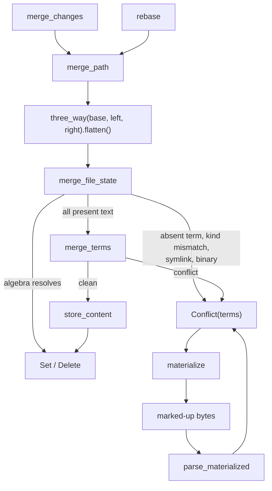

# Merge

Merging first evaluates the `Merge<T>` algebra and only falls back to a
line-level N-way text merge when the algebra cannot decide. Conflicts are
data, not errors: a path that does not merge becomes
`FileChange::Conflict(Merge<FileState>)` in the result. No function here
stores a change version; the caller decides whether to persist it.



## The algebra

`Merge<T>` stores terms as `[add0, remove0, add1, ..., addN]` and means
`add0 - remove0 + add1 - ...`. The core uses `Merge::three_way(base, left,
right)` (stored as `[left, base, right]`), `flatten` for nested merges,
`simplify` (cancels equal add/remove pairs on separate lists) and
`resolve_trivial` (resolved, or all adds equal after simplify). See
[merge algebra](../02-data/merge-algebra.md).

## Text merge (`merge/file.rs`)

`merge_terms(&Merge<Bytes>) -> Vec<MergeHunk>` is diff3 generalised to any
odd number of terms:

1. If `resolve_trivial` succeeds on the whole contents, return one
   `Resolved` hunk.
2. Split every term into line tokens. Term 1, the first remove, is the
   alignment base. Run `edit_script` (Histogram) from the base to each other
   term.
3. `align` cuts the base into regions. A region is either untouched by every
   term, or a maximal run touched by at least one. The run grows while any
   edit on any term starts at or before its current end. So adjacent edits
   with no unchanged base line between them share a region and conflict, as
   in git.
4. Each region becomes a `Merge` of line slices and is tried with
   `resolve_trivial`. Clean regions join the previous `Resolved` hunk.
   Conflicting regions are minimised zdiff3-style: lines equal in every term
   (base included) at the start and end move out into resolved text. The
   rest is a `MergeHunk::Conflict(Merge<Bytes>)`.

`merge_file(base, left, right)` wraps this for the three-way case and
returns `FileMergeResult::Resolved(bytes)` or `Conflicted { hunks }`. The
hunks always concatenate to the whole file. The SDK uses `merge_file` to
keep local edits when a checkout updates.

## File-state merge (`merge/state.rs`)

`merge_file_state(terms, reader, objects) -> FileChange` decides one path.
`FileState` is `Option<(ContentRef, FileKind)>`.

| Step | Result |
| --- | --- |
| `simplify`, then `resolve_trivial` succeeds | `Set` or `Delete`; no content read |
| Any term is `None` (edit against delete) | `Conflict` |
| Kinds differ, or the kind is `Symlink` | `Conflict` |
| Any content `is_binary` | `Conflict` |
| `merge_terms` is clean | Merged bytes stored with `store_content`; `Set` with the shared kind |
| `merge_terms` conflicts | `Conflict` |

The `Conflict` always carries the simplified file-state terms, not text
hunks. Text conflicts are recomputed when needed by `materialize`.
`merge_states(removes, adds, ..)` is the same with explicit lists.
`change_terms` lifts a `FileChange` to terms: a `Conflict` gives its terms,
`Set`/`Delete` give one resolved state.

## Change-level merge (`merge/change.rs`)

`merge_changes(derive, graph, left, right, MergeChangeOptions)` returns a
version with `parents = [left, right]`:

1. `MergeBase::of` ([base.rs](../../crates/rill-core/src/merge/base.rs))
   takes `graph.merge_bases(left, right)`. One base is used as is. Several
   (a criss-cross history) form a virtual base: per path, the bases are
   merged pairwise and recursively against their own bases, like git's
   recursive strategy, and a path whose virtual merge conflicts keeps the
   conflict terms.
2. Paths = `diff_trees(base_root, right_root)` for every root the base is
   built from, plus the conflicted paths of both tips. Paths that only
   `left` touched are already in the first parent.
3. Per path, `tip_terms` uses a tip's recorded `Conflict` terms instead of
   the first-add state its tree holds, so two conflicted tips combine.
4. `three_way(base, left, right).flatten()` runs through
   `merge_file_state`, where `base` may itself be conflict terms.
5. `is_same_as` drops entries that leave the path as `left` has it.

`MergeChangeOptions` supplies `author`, `message`, `created_at`, `change_id`
(fresh when `None`) and `provenance`. The result has `intent = None`, no
`predecessor` and no `subtree_changes`. The server's `Merge` RPC sets
`intent` from the request before storing.

## Conflict markers (`merge/materialize.rs`, `merge/parse.rs`)

`materialize(&Merge<Option<Bytes>>)` renders a conflicted file. Absent terms
merge as empty bytes and are listed in each header as `absent: term <i>`
(one-based interleaved index). If nothing conflicts the output is plain
merged text. Each conflicting region looks like:

```text
<<<<<<< Conflict 1 of 1 (2 sides)
%%%%%%% Changes from base #1 to side #1
-b
+L
+++++++ Contents of side #2
R
>>>>>>> Conflict 1 of 1 ends
```

There is one `%%%%%%%` section per remove `r_i` (a line diff `r_i -> a_i`)
and one `+++++++` section with the last add verbatim. An unterminated line
is followed by `\ No newline at end of file`. Markers are
`max(MIN_MARKER_LEN = 7, longest run of <>%+- starting a content line + 2)`
characters long, so content is never read as a marker. `materialize_with`
takes `ConflictLabels` to name sides in headers.

`parse_materialized(bytes) -> Option<Merge<Option<Bytes>>>` is the inverse.
A conflict opens only at a `<` run followed by the ` Conflict ` header that
`materialize` writes; any other marker-like line, including git-style
markers, is content. The marker length is the longest such header run. It
returns `None` for malformed input: an unterminated conflict, a side count
that changes between conflicts, an unknown section or a bad line prefix. A
file with no conflict headers parses as `Merge::resolved`. Auto-merged regions come back as the
same text in every term, an equivalent merge under the algebra that
re-materialises to identical bytes.

## Limitations

- Symlinks never text-merge, and a kind mismatch (for example executable
  against regular with the same content) is always a conflict.
- A virtual base's merged content is stored as ordinary blobs that nothing
  references once the merge is done.
- `merge_changes` carries no `subtree_changes` from either side.
- The checkout uses `parse_materialized` only to refuse a resolution that
  still has markers; resolved files reach the server as plain content
  through `Resolve` or a new snapshot, so partially resolved files cannot be
  uploaded as conflict terms.
- Merging reads whole file contents into memory.

## Code

- [merge/mod.rs](../../crates/rill-core/src/merge/mod.rs)
- [merge/file.rs](../../crates/rill-core/src/merge/file.rs)
- [merge/state.rs](../../crates/rill-core/src/merge/state.rs)
- [merge/change.rs](../../crates/rill-core/src/merge/change.rs)
- [merge/materialize.rs](../../crates/rill-core/src/merge/materialize.rs)
- [merge/parse.rs](../../crates/rill-core/src/merge/parse.rs)
- [rill-types merge.rs](../../crates/rill-types/src/merge.rs)
- [rill-sdk local/update.rs](../../crates/rill-sdk/src/local/update.rs)

---
← Previous: [Diff](diff.md) · [Index](../index.md) · Next: [Rebase](rebase.md) →
