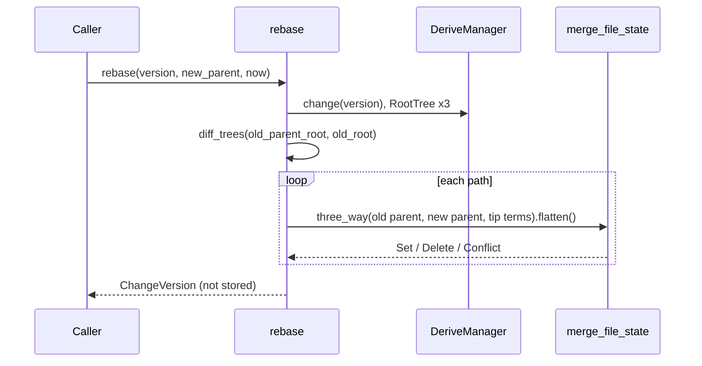

# Rebase

`rebase` moves a change version onto a new parent and returns the next
version of the same change. It never fails because of a conflict: a path
that does not merge becomes a `FileChange::Conflict` entry in the new
version. It fails only when an input is missing or content cannot be read.

## Algorithm

`rebase(derive, version, new_parent, created_at) -> ChangeVersion`
([rebase.rs](../../crates/rill-core/src/rebase.rs)):

1. Load the version, the root of its old first parent (`None` for a root
   change), its own root and the new parent's root, all through `RootTree`.
2. Paths = `diff_trees(old_parent_root, old_root)` plus the version's
   conflicted paths. A subtree change is kept only when the new parent left
   that directory exactly as the old parent had it; then the paths beneath
   it are removed and the subtree entry carries them. Otherwise replaying it
   would overwrite the new parent's work there, so it is dropped and its
   files are merged like any other path.
3. Per path, call `merge_path` with base = old parent state, left = new
   parent state, and right = `tip_terms(version)`. `tip_terms` uses the
   version's own `Conflict` terms when it has one, so an existing conflict is
   carried forward rather than flattened to its first add.
4. Drop the entry when the merged result equals the new parent's state
   (`is_same_as`).
5. Build the new version:
   - `parents = [new_parent]` followed by the old non-first parents, minus
     `new_parent` if it was one of them.
   - `predecessor = Some(version)`.
   - `change_id`, `author`, `provenance`, `intent`, `message` and `extra`
     copied unchanged; `subtree_changes` as decided in step 2.
   - `created_at` as passed in.

The per-path merge is the same `merge_path` -> `merge_file_state` used by
[merge](merge.md).

## Trivial outcomes

The algebra settles most paths before any content is read:

- The new parent did not touch the path since the old parent (left equals
  base): the result is the version's own state.
- The new parent made the same change: the result equals the new parent's
  state and the entry is dropped.
- A conflicted version rebased onto a parent equal to one of its terms
  simplifies back to a plain value.
- A conflicted version rebased onto an unrelated parent keeps its terms,
  flattened behind the new parent's state.

## Callers

| Caller | What happens to a conflicted result |
| --- | --- |
| `Rebase` RPC ([repo/write.rs](../../crates/rill-api/src/services/repo/write.rs)) | Stored through `commit_version`; `has_conflicts` is true |
| Workspace rebase ([services/workspace.rs](../../crates/rill-api/src/services/workspace.rs)) | Stored through `commit_version`; the workspace snapshot moves to its root |
| Lander ([land/pipeline.rs](../../crates/rill-lander/src/land/pipeline.rs)) | Not stored. The request gets `LandStatus::Conflict` and the change goes back to its owner |

The lander first checks `is_ancestor(tip, head)` and skips the rebase when
the tip is already on trunk. See [landing](../04-workflow/landing.md).

## Failure behaviour

| Condition | Result |
| --- | --- |
| Version or new parent missing | `Error::ChangeNotFound` from `DeriveManager` |
| A tree object missing | `Error::TreeNotFound` |
| Content unreadable | `Error::Store`; merged blobs already written for earlier paths stay (content-addressed, harmless) |
| Any path conflicts | Not an error; `ChangeVersion::has_conflicts()` is true |

## Limitations

- The change's effect is taken from its first parent only. Changes that
  other parents contributed are not re-merged.
- A subtree change expanded into file changes loses its cheap shallow form;
  the rebased version lists every file it touched.
- Every rebase loads three root trees and diffs the old parent against the
  version, so cost grows with the size of the change on every retry.

## Code

- [rebase.rs](../../crates/rill-core/src/rebase.rs)
- [merge/change.rs](../../crates/rill-core/src/merge/change.rs) (`merge_path`, `tip_terms`, `is_same_as`, `root_of`)
- [merge/state.rs](../../crates/rill-core/src/merge/state.rs)
- [rill-lander land/pipeline.rs](../../crates/rill-lander/src/land/pipeline.rs)

---
← Previous: [Merge](merge.md) · [Index](../index.md) · Next: [Trees](trees.md) →
