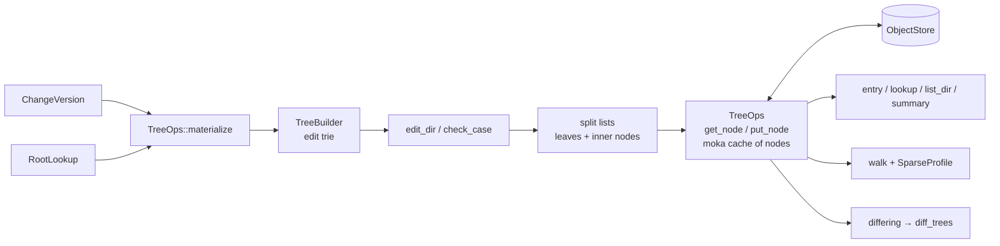

# Trees

A `Tree` is one directory's listing: a `BTreeMap<String, TreeEntry>` whose
entries are files (`ContentRef` + `FileKind`) or subdirectories
(`TreeHash` + `DirSummary`). It is stored as one or more `TreeNode`s. A
directory of up to `SHARD_ENTRIES` (4,096) entries is one node; a larger
one is split into leaves under inner nodes, with boundaries that depend
only on the names. Equal directories therefore have equal hashes however
they were built, an unchanged subtree is never loaded, rewritten or
walked, and an edit inside a huge directory rewrites only the nodes on its
path. `rill-core` reads and writes trees through `TreeOps`, builds new
roots with `TreeBuilder`, and projects a `ChangeVersion` onto its parent's
root.

The types live in `rill-types` (`objects/tree/`); see
[objects and IDs](../02-data/objects-and-ids.md#tree). Writing files to
disk is done by the SDK checkout and the exec runner, not here.

## Nodes

| `TreeNode` | Holds |
| --- | --- |
| `Leaf(Tree)` | a whole directory of up to 4,096 entries, or one leaf of a split directory |
| `Inner { level, children, names }` | `TreeChild { first, hash, count, summary }` pointers; `level` 1 points at leaves. The top node of a split directory sets `names` |
| `Names(Vec<String>)` | a leaf of a split directory's name index |

All three are `ObjectKind::Tree` objects. A parent entry points at a
directory's top node; `summary` on each child lets a split directory's
`DirSummary` be summed from its top node alone.

**Boundaries** ([shape.rs](../../crates/foundation/types/src/objects/tree/shape.rs)).
Chunking a sorted sequence left to right, a node at `level` ends after an
item when BLAKE3 (keyed `"rill tree node boundary"`, over the level and
the item's key) is divisible by the target (1,024 for leaves, 64 for inner
nodes), or when the node reaches its cap (4,096 items, 256 children). The
rule reads only the key and the node's length, so the nodes are a
function of the entries alone.

**Name index.** A split directory's top node points at a second split
list holding `case_key(name) NUL name` for every entry, sorted, so names
that collide on a case-insensitive filesystem sit next to each other. A
case check for a new name is a prefix lookup, not a scan.

## Editing a split list

[shard/list.rs](../../crates/engine/core/src/tree/shard/list.rs). `edit`
takes the leaf pointers (read from the inner nodes, which are few) and the
edits by key. Leaves before the first edited one are kept. From there it
re-chunks the edited leaves' items through a `Chunker`, continuing into
following leaves until it ends a node exactly where an old leaf ended and
the next leaf has no edits; the rest of the old leaves stand, because the
chunking state is the same from there on. Inner levels are then rebuilt
from the leaf list with `write_inner`; nodes already in the cache exist in
the store and are not written again, so only changed inner nodes are
written. A directory that drops to 4,096 entries or fewer becomes one
`Leaf` again; one that grows past it is split by `put_tree`.

## TreeOps

`TreeOps::new(objects, cache_size)`
([ops.rs](../../crates/engine/core/src/tree/ops.rs),
[shard/dir.rs](../../crates/engine/core/src/tree/shard/dir.rs)) binds an
object store to a `moka` cache (`Cache<TreeHash, NodeRef>`, TinyLFU
eviction) of decoded nodes. The
server uses `DEFAULT_TREE_CACHE = 4096` nodes per repository. Clones share
the cache. `nodes_written()` counts nodes actually written, for tests and
benchmarks.

| Method | Behaviour |
| --- | --- |
| `get_node` | Cache, else decode from the store; missing is `Error::TreeNotFound` |
| `get_tree` | The whole listing; a split directory loads every leaf |
| `entry(dir, name)` | One entry; a split directory descends from its top node |
| `summary(dir)`, `dir_len(dir)` | From the top node, without loading leaves |
| `put_tree` | One `Leaf`, or split with its name index above 4,096 entries |
| `edit_dir(base, DirEdits)` | Apply set and delete edits, keeping the name index in step |
| `check_case(base, added, removed)` | `InvalidChange` when an added name differs only in case from another entry after the edit |
| `differing(a, b)` | Listings that may differ; two split directories skip the leaves they share |
| `lookup(root, path)`, `dir_hash`, `list_dir` | Path lookups through `entry`; `list_dir` lists everything |
| `empty_tree` | Stores the empty directory, `Tree::empty_hash()` |

## TreeBuilder

[builder.rs](../../crates/engine/core/src/tree/builder.rs) records `Edit`s in
a trie keyed by path component. `build(ops, base)` walks the trie once.

| `Edit` | Effect at the path |
| --- | --- |
| `Set(ContentRef, FileKind)` | Entry becomes a file |
| `Delete` | Entry removed, file or whole directory |
| `Dir(TreeHash)` | Entry becomes that directory; its `DirSummary` comes from `summary` |

For each directory it looks up only the edited names (`entry`), builds
edited subdirectories first, collects a `DirEdits` of changed entries with
the names added and removed, runs `check_case`, and writes the directory
with `edit_dir`. Rules:

- A later edit at the same path replaces an earlier one.
- An edit at the root path is ignored. With no non-root edits, `build`
  returns `base`, or stores the empty tree when `base` is `None`.
- Edits beneath a name that holds a file build a fresh directory there;
  beneath a directory they edit it in place.
- A subtree that becomes empty is removed from its parent. Stored trees
  never contain empty directories.
- An unchanged directory returns its base hash without a write.
- A name added in a directory must not differ only in case from another
  entry; existing collisions do not block unrelated edits, and renaming a
  name to a case variant is allowed.

Cost: O(edited paths × depth) node loads and writes; in a split directory,
O(log n) per edit plus a read of its inner nodes.

## Applying a change version

`TreeOps::materialize(parent_root, cv, roots)`
([materialize.rs](../../crates/engine/core/src/tree/materialize.rs)) computes
a version's root from its first parent's root. The `RootTree` derivation
calls it; see [derived data](../02-data/derived-data.md). Steps:

1. `subtree_changes` in path order. `Delete` becomes `Edit::Delete`.
   `Copy { from_path, from_version }` resolves `from_version` through
   `RootLookup`, then `dir_hash`, then `Edit::Dir`. A missing source is
   `Error::NotADirectory`.
2. `file_changes` in path order. `Set` becomes `Edit::Set`, `Delete`
   becomes `Edit::Delete`, and `Conflict(terms)` becomes the first add's
   state (a set, or a delete when absent).
3. `TreeBuilder::build(self, parent_root)`.

A subtree or file change at the root path is `Error::InvalidChange`.
Conflicts leave no trace in the tree; they live only in the change.

## Walk

`TreeOps::walk(root, prefix, sparse) -> Vec<WalkEntry>`
([walk.rs](../../crates/engine/core/src/tree/walk.rs)) lists every file under
`prefix` as `(path, content, kind)`, sorted by path. `SparseProfile`
filters files, and excluded directories are pruned before loading.

## Scale

From `cargo bench -p rill-bench --bench trees` (laptop, release, memory
stores):

| Case | Nodes written | Time |
| --- | --- | --- |
| One-file commit, 100k files (fan-out 32) | 4 | 107 µs |
| One-file commit, 1M files | 4 | 117 µs |
| Diff of that commit, 100k / 1M files | | 10.8 / 10.5 µs |
| One-file commit in one 200k-entry directory | 3 | 1.2 ms |
| Lookup in a 200k-entry directory | | 0.37 µs |
| Diff of one changed entry, 200k-entry directory | | 0.23 ms |

`rill-bench/tests/node_writes.rs` asserts that a one-file commit writes
exactly one node per directory level.

## Limitations

- An edit in a split directory reads all of its inner nodes (about one
  pointer per thousand entries) and rebuilds the inner levels in memory.
- `get_tree`, `list_dir` and `walk` load whole listings; there is no paged
  listing of a split directory yet.
- The node cache is sized by node count, not bytes.

## Code

- [tree/ops.rs](../../crates/engine/core/src/tree/ops.rs), [tree/builder.rs](../../crates/engine/core/src/tree/builder.rs), [tree/materialize.rs](../../crates/engine/core/src/tree/materialize.rs), [tree/walk.rs](../../crates/engine/core/src/tree/walk.rs)
- [tree/shard/](../../crates/engine/core/src/tree/shard/mod.rs): [dir.rs](../../crates/engine/core/src/tree/shard/dir.rs), [list.rs](../../crates/engine/core/src/tree/shard/list.rs), [layout.rs](../../crates/engine/core/src/tree/shard/layout.rs)
- [rill-types objects/tree/](../../crates/foundation/types/src/objects/tree/mod.rs): [listing.rs](../../crates/foundation/types/src/objects/tree/listing.rs), [node.rs](../../crates/foundation/types/src/objects/tree/node.rs), [shape.rs](../../crates/foundation/types/src/objects/tree/shape.rs)
- [tests/large_dirs.rs](../../crates/engine/core/tests/large_dirs.rs), [rill-bench benches/trees.rs](../../tools/bench/benches/trees.rs)

---
← Previous: [Rebase](rebase.md) · [Index](../index.md) · Next: [History graph](history-graph.md) →
