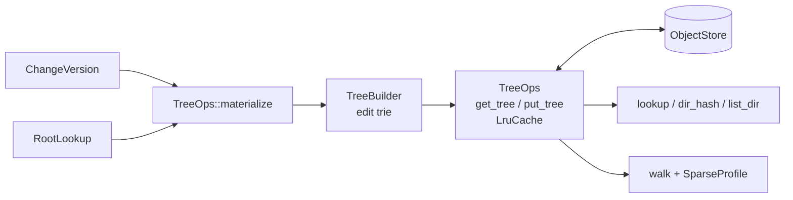

# Trees

A `Tree` is one directory: a `BTreeMap<String, TreeEntry>` whose entries
are files (`ContentRef` + `FileKind`) or subdirectories (`TreeHash` +
`DirSummary`). Trees are encoded canonically and addressed by hash, so equal
directories have equal hashes and an unchanged subtree is never loaded,
rewritten or walked. `rill-core` reads and writes trees through `TreeOps`,
builds new roots with `TreeBuilder`, and projects a `ChangeVersion` onto its
parent's root.

The `Tree` type and its hashing live in `rill-types`; see
[objects and IDs](../02-data/objects-and-ids.md). Writing files to disk is
done by the SDK checkout and the exec runner, not here.

## TreeOps

`TreeOps::new(objects, cache_size)`
([ops.rs](../../crates/rill-core/src/tree/ops.rs)) binds an object store to
an `LruCache<TreeHash, Arc<Tree>>`. The server uses
`DEFAULT_TREE_CACHE = 4096` decoded trees per repository. Clones share the
cache.

| Method | Behaviour |
| --- | --- |
| `get_tree` | Cache, else `get_object`; missing is `Error::TreeNotFound` |
| `put_tree` | `put_object` (hash-verified by the store), then cache |
| `empty_tree` | Stores `Tree::empty()` so its hash always loads |
| `lookup(root, path)` | Root path gives `Dir { hash: root, .. }`; a file in the middle of the path gives `None` |
| `dir_hash` | `Some` only for a directory |
| `list_dir` | Entries sorted by name; `Error::NotADirectory` for a file or missing path |

`LruCache` ([util/lru.rs](../../crates/rill-core/src/util/lru.rs)) stamps
each entry on access. On overflow it evicts `capacity / 8 + 1` of the oldest
entries in one pass. Minimum capacity is 8.

## TreeBuilder

[builder.rs](../../crates/rill-core/src/tree/builder.rs) records `Edit`s in
a trie keyed by path component. `build(ops, base)` walks the trie once.

| `Edit` | Effect at the path |
| --- | --- |
| `Set(ContentRef, FileKind)` | Entry becomes a file |
| `Delete` | Entry removed, file or whole directory |
| `Dir(TreeHash)` | Entry becomes that directory; its `DirSummary` is read from the stored tree |

Rules:

- A later edit at the same path replaces an earlier one.
- An edit at the root path is ignored. With no non-root edits, `build`
  returns `base`, or stores the empty tree when `base` is `None`.
- A base subtree is loaded only when an edit lies beneath it.
- Edits beneath a name that holds a file build a fresh directory there;
  beneath a directory they edit it in place.
- A subtree that becomes empty is removed from its parent. Stored trees
  never contain empty directories.
- An unchanged directory returns its base hash without a write. Writes are
  confined to the spine from each edited path to the root.
- `DirSummary` (`file_count`, `dir_count`, `total_size`) is recomputed for
  each rewritten directory, so size and count queries never walk.

Cost: O(edited paths x depth) tree loads and at most as many writes.

## Applying a change version

`TreeOps::materialize(parent_root, cv, roots)`
([materialize.rs](../../crates/rill-core/src/tree/materialize.rs)) computes
a version's root from its first parent's root. The `RootTree` derivation
calls it; see [derived data](../02-data/derived-data.md). Steps:

1. `subtree_changes` in path order. `Delete` becomes `Edit::Delete`.
   `Copy { from_path, from_version }` resolves `from_version` through
   `RootLookup`, then `dir_hash`, then `Edit::Dir`. A missing source is
   `Error::NotADirectory`.
2. `file_changes` in path order. `Set` becomes `Edit::Set`, `Delete`
   becomes `Edit::Delete`, and `Conflict(terms)` becomes the first add's
   state (a set, or a delete when absent).
3. `TreeBuilder::build(self, parent_root)`.

A subtree or file change at the root path is `Error::InvalidChange`. File
edits go into the same trie after subtree edits, so a file change under a
copied subtree overrides the copied entry. Conflicts leave no trace in the
tree; they live only in the change. `DeriveCtx` implements `RootLookup`;
`NoRoots` fails every lookup with `Error::ChangeNotFound`.

## Walk

`TreeOps::walk(root, prefix, sparse) -> Vec<WalkEntry>`
([walk.rs](../../crates/rill-core/src/tree/walk.rs)) lists every file under
`prefix` as `(path, content, kind)`, sorted by path.

- A `prefix` naming a file yields that file; a missing prefix yields nothing.
- `SparseProfile::contains` filters files: an `exclude` prefix wins, and an
  empty `include` means everything.
- Directories are pruned before loading when they sit under an `exclude`, or
  when includes exist and none is an ancestor or descendant of the
  directory.

## Limitations

- `FileKind` is the only mode information. Symlink targets are ordinary
  content and are not validated.
- No path normalisation beyond `RepoPathBuf` validation; case folding is
  not handled.
- `walk` collects the whole listing in memory; callers page by narrowing
  `prefix`.
- The tree cache is per process and sized by entry count, not bytes.

## Code

- [tree/mod.rs](../../crates/rill-core/src/tree/mod.rs)
- [tree/ops.rs](../../crates/rill-core/src/tree/ops.rs)
- [tree/builder.rs](../../crates/rill-core/src/tree/builder.rs)
- [tree/materialize.rs](../../crates/rill-core/src/tree/materialize.rs)
- [tree/walk.rs](../../crates/rill-core/src/tree/walk.rs)
- [util/lru.rs](../../crates/rill-core/src/util/lru.rs)
- [derive/root_tree.rs](../../crates/rill-core/src/derive/root_tree.rs)
- [rill-types objects/tree.rs](../../crates/rill-types/src/objects/tree.rs)

---
← Previous: [Rebase](rebase.md) · [Index](../index.md) · Next: [History graph](history-graph.md) →
