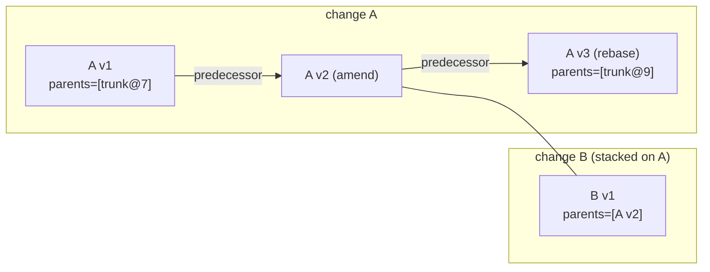

# Changes and stacks

A change is a stable identity (`ChangeId`, random 128-bit, printed
`ch_<hex>`). A sequence of immutable `ChangeVersion` objects belongs to it.
Every edit, amend, rebase or resolution writes a new version; nothing is
rewritten. The `change_id` survives every rewrite. `predecessor` links each
version to the one it replaced, so the history of a change can be walked
version by version. Review state, votes and provenance attach to the
`ChangeId`; content attaches to the version hash.

## Identity and storage

| Thing | Changes when | Notes |
| --- | --- | --- |
| `change_id` | Never | A merge or revert is a new change with a fresh id. |
| Version hash | Any hashed field differs | Fields: `parents`, `predecessor`, `file_changes`, `subtree_changes`, `author`, `provenance`, `intent`, `message`, `created_at`, `extra`. Signatures are stored beside the version and are not hashed. |
| `predecessor` | Set by amend, rebase and resolve | `None` for the first version of a change. |

`RepoStore::put_change_version` is idempotent on the hash. It puts the
object in the object store. Then, in one metadata transaction conditioned
on the `ci` row being absent, it writes the `ChangeInfo` row and appends
the hash to the repository's stamped version log (`log`) and to the
change's dense version list (`chv`, creation order).
`change_versions(id).last()` is the *current* version everywhere the
server needs one: `edit_base`, `NewChange`'s predecessor, review submit,
and the SDK's `current_version`. `ChangeInfo.trunk_seq` is filled in at
read time from the `trunkh/` index.

## The single write path

Every RPC that creates a version goes through `commit_version_with`
([commit.rs](../../crates/server/api/src/services/repo/commit.rs)). It
checks the change limits and path rules, that parents and predecessor
exist, that no change targets the root path, and that every `Set` content
and copy source exists. It writes the version object and its
land-critical derived values, which are immutable and harmless if the
commit then fails. Then **one transaction** stores:

* the version's info row, version-log and change-list entries
  (`stage_version`, conditioned on the version being new);
* its signatures: the server's attestation plus any client signatures;
* the review update from `ReviewService::prepare_version` (votes copied or
  dropped, threads re-anchored, risk and status recomputed), with a
  `StatusChanged` event when the status moves;
* a `VersionStored` event and a versions charge for the author;
* the caller's extras: `NewChange` and `UpdateBase` add their workspace
  operation, so the workspace and the version commit together;
* for a request with an `operation_id`, the version hash in its claim.

A missing review, or one that no longer takes versions, is skipped. If
the review or workspace changed meanwhile the transaction conflicts and
the commit is prepared again (up to 8 times); if an identical commit won,
its hash is returned. Afterwards the review events are emitted and
`RepoEvent::VersionCreated` is published. A retried request whose claim
names a stored version gets that version back instead of storing another
(see [API surface](../07-runtime/api-surface.md#retries)).

## Producing versions

| Operation | Entry point | Parents | Predecessor | `change_id` |
| --- | --- | --- | --- | --- |
| New change | `ApplyEdits(EditBase::Root, change_id=None)` | `[resolved root]` (none on an empty repo) | `None` | fresh |
| Amend onto a root | `ApplyEdits(EditBase::Root, change_id=id)` | `[resolved root]` | current version of `id` | `id` |
| Amend in place | `ApplyEdits(EditBase::ChangeId(id))` | current version's parents | current version | `id` (or the explicit `change_id`) |
| Workspace | `NewChange` | `[ws.base]` | current version of `ws.working_change` | `ws.working_change` |
| Rebase | `RepoSvc.Rebase`, `UpdateBase`, the lander, `rill stack sync` | `[new_parent]` + old parents after the first | the rebased version | kept |
| Resolve | `RepoSvc.Resolve` | unchanged | the conflicted version | kept |
| Merge | `RepoSvc.Merge` (`merge_changes`) | `[left, right]` | `None` | fresh |
| Raw | `CreateChangeVersion` | as given | as given | as given |

`ApplyEdits` edits are `SetContent` (a `ContentRef` that must already
exist, else `FailedPrecondition`), `Delete`, or `Patch`. A `Patch` is a
unified diff applied on the server against the base file by
`rill_core::apply_unified`
([patch.rs](../../crates/engine/core/src/diff/patch.rs)). Each hunk must
match exactly at its stated line or within 50 lines of it; otherwise the
request is `InvalidArgument`. `write(path)` is checked per edit. A version
with no file changes requires `write(root)`.

`Resolve` only accepts paths that are `FileChange::Conflict` in the
version. It merges provenance with the previous version and sets
`resolved_by`. `rebase` never fails on conflicts: it writes
`FileChange::Conflict` terms (see
[rebase](../03-core-algorithms/rebase.md)).

## CLI flows on a checkout

* `rill new -m`: if the checkout has a `working_change` that has not
  landed, the checkout first `update`s onto that change's current version.
  `working_change` is then cleared and the new change is snapshotted, so
  it is parented on the previous one. If the previous change has landed,
  only `working_change` is cleared. `--intent` sets `ChangeVersion.intent`
  and then calls `LinkChange` (see [intents](intents.md)).
* `rill amend` and `rill describe`: snapshot again with
  `change_id = working_change`. This creates a new version with parent =
  checkout base and predecessor = current version. `describe` sends all
  edits again with the new message, because no message-only RPC exists.
* `rill sync` clears `working_change` once it has landed.

Snapshot mechanics are in [checkouts](checkouts.md).

## Stacks

A stack is an ordered list of dependent changes, bottom first. There are
two separate notions.

**Structural.** `rill stack show|sync|submit|land` take a top change (the
checkout's `working_change` or `--top`). `stack::collect` walks first
parents from it until it reaches a landed version, with a bound of 10 000
hops. Nothing is stored.

**Declared.** `ReviewService::set_stack` (RPC `SetStack`,
[stacks.rs](../../crates/domain/review/src/stacks.rs)) requires a non-empty
list in which every member is under review and no id repeats. Each
member's current version must have the previous member's current version
as its first parent; otherwise it fails with `InvalidStack`. The list is
written to every member's `ReviewState.stack`. Risk and status are
recomputed with `stack_depth` = position, and `StackChanged` is emitted.
`stack_of` returns `[id]` for an undeclared change.

SDK helpers in [stack.rs](../../crates/clients/sdk/src/stack.rs):

* `submit_stack`: submits each change, then calls `set_stack`.
* `sync_stack`: rebases bottom-up, each current version onto the previous
  result, starting from the resolved `onto`. Conflicts are reported per
  change, not raised. The CLI exits 3 if any change conflicts.
* `land_stack`: calls `RequestLand` for each change bottom-up and polls
  `await_land` with backoff before requesting the next. The lander rebases
  each change onto the new trunk head (see [landing](landing.md)).

After a landing, the lander asks `ReviewHooks::dependents_of` for the
members above the landed change and publishes `DependentsReady`. Nothing
rebases those dependents automatically.

## Limitations

* `change_versions` is creation order, not a DAG. Amending an older
  version makes the amendment current regardless of its predecessor.
* A declared stack is validated only at `set_stack`. Later amends or
  rebases of members do not update or invalidate `ReviewState.stack`.
* `stack_depth` is computed into `ChangeFacts`, but no risk rule or Cedar
  attribute reads it.
* `ReviewService::restack_after_land` is called only from tests.
* No RPC changes only the message; `describe` sends every edit again.

## Code

* [rill-types/src/objects/change.rs](../../crates/foundation/types/src/objects/change.rs), [ids.rs](../../crates/foundation/types/src/ids.rs)
* [rill-store/src/repo/versions.rs](../../crates/foundation/store/src/repo/versions.rs) (`put_change_version`, `change_versions`)
* [rill-api/src/services/repo/commit.rs](../../crates/server/api/src/services/repo/commit.rs), [write.rs](../../crates/server/api/src/services/repo/write.rs)
* [rill-core/src/rebase.rs](../../crates/engine/core/src/rebase.rs), [builder.rs](../../crates/engine/core/src/builder.rs)
* [rill-review/src/stacks.rs](../../crates/domain/review/src/stacks.rs)
* [rill-api/src/workers/hooks.rs](../../crates/server/api/src/workers/hooks.rs) (`dependents_of`)
* [rill-sdk/src/stack.rs](../../crates/clients/sdk/src/stack.rs)
* [rill-cli/src/commands/change.rs](../../crates/clients/cli/src/commands/change.rs), [stack.rs](../../crates/clients/cli/src/commands/stack.rs)

---
← Previous: [Checkouts](checkouts.md) · [Index](../index.md) · Next: [Review](review.md) →
