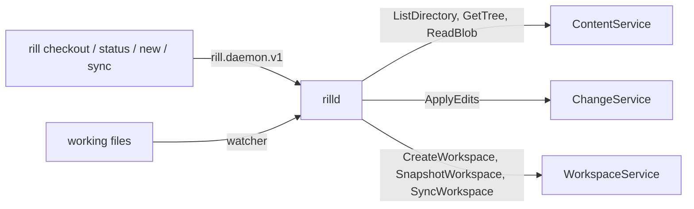

# Checkouts

A checkout is a directory the client daemon serves as a **mount**: a
base (a version, or the empty tree of an empty repository) plus an overlay
of local edits, synced to a server workspace. The CLI never touches the
files' bookkeeping itself; it asks the daemon
([client daemon](../08-clients/daemon.md)) over its local socket. A
checkout works without a server workspace (`--no-workspace`); then edits
stay local until committed.

## Marker

The daemon writes `.rill/mount.json` at the checkout's root: the mount's
name (`mounts/{id}`), the daemon directory serving it, the endpoint and
the repository. The CLI walks up from the working directory to the
nearest marker to find its checkout, endpoint and repository without
connecting. The path is reserved: the server refuses to store it.
Everything else about the mount lives in the daemon's state database, not
in the working tree, so repository content cannot alter it (ADR 006).

## Create (`rill checkout`)

`CreateMount` refuses a directory that is not empty or that lies inside
another mount, and canonicalizes the path. The revision (trunk when
omitted) is resolved to a version and its root tree; an empty
repository's trunk is the empty tree with no version. Unless
`--no-workspace`, a server workspace is created on that version with the
sparse profile (`--sparse` include prefixes). An eager mount then writes
every base file inside the profile, 32 fetches in flight, recording each
file's size, mtime and digest in its stat cache. `--lazy` mounts the
virtual filesystem instead (FUSE on Linux, an NFS loopback on macOS), which fetches nothing up front, and
`--snapshot` mounts one version read-only for CI (no workspace; writes
stay local and are discarded by `rill daemon unmount`).

## Status (`rill status`, `rill diff`)

Status is the overlay compared with the base, entry by entry, so it costs
the number of local edits, not the size of the checkout. An entry that
matches the base (an edit reverted) is not reported; one flagged as a
conflict is `Conflict` whatever its content. Before answering, an eager
mount *settles*: it writes a cookie file and waits for the watcher to
report it, so every edit made before the call is in the overlay. `rill
diff` renders each changed file against the base version, reading the
local side from the directory.

`.rillignore` (gitignore syntax, any level) hides untracked files only; a
tracked file matching a rule is still reconciled. The ignore files
themselves, the marker and `.rill-tmp-*` files are never recorded. The
repository's own files in `.rill/` (`verify.toml`, `owners.toml`) are
tracked like any other.

## Commit (`rill new`, `amend`, `describe`)

`CommitMount` turns the overlay's differences from the base into edits
and calls `ApplyEdits` with `EditBase::Root(Version(base_version))` (the
empty tree on an empty repository) and `change_id = working_change` when
amending. Pinning the version matters: a symbolic `trunk` would be
re-resolved by the server and overwrite anything landed since. Content
the server already has is not uploaded again (an existence check per
batch, then `WriteBlob` for the rest; files at or under 256 bytes travel
inline). Any `Conflict` refuses the commit.

`rill new` with a working change that has not landed first moves the
mount onto that change's current version (an update, below), so only
edits made since go into the new change, stacked on it. If it has landed,
the new change starts on the current base. `rill amend` without `-m`
keeps the message. The CLI flows built on this are in
[changes and stacks](changes-and-stacks.md).

## Update (`rill sync`, `rill undo`)

`UpdateMount` resolves the new revision, asks the server workspace to
follow (`SyncWorkspace`; a failure is only logged), and diffs the old and
new base trees, skipping every subtree whose hash is unchanged. Each path
changed on either side is classified:

| Local \ upstream | unchanged | changed | deleted |
| --- | --- | --- | --- |
| unchanged | keep | take upstream | take the deletion |
| modified / added | keep | three-way merge | conflict |
| deleted | keep deleted | conflict | drop |
| `Conflict` | keep | keep | keep |

The merge is line-based, then structural when lines conflict (weave,
unless `RILL_STRUCTURAL_MERGE=false`). A path added on both sides with
identical bytes is adopted. A clean merge stays a local edit; a conflict
is written with markers and flagged until resolved. The new base, the
overlay changes and the record are written in one transaction; an eager
mount then rewrites the affected files with its watcher held off, so the
daemon's own writes are never mistaken for edits. A working change that
has landed is forgotten. `rill undo` undoes the workspace's last
operation, then updates onto the workspace's base.

`rill resolve <paths>` (or `--all`) clears the conflict flag after the
user edits the file; each file is parsed with `parse_materialized` first
and refused while markers remain (`--force` skips the check). After
`rill land --wait` lands the checkout's working change, the CLI updates
onto trunk.

## Relation to the server workspace

The daemon pushes the overlay to the workspace as edit snapshots
(`SnapshotWorkspace` with edits, conditional on its etag), about two
seconds after the last edit, so the workspace always shows the working
copy. The checkout's `working_change` comes from `ApplyEdits` and
differs from the workspace's own; `StartChange` is not used.

## Limitations

* The sparse profile is fixed when the checkout is created.
* A partially resolved file cannot be committed: resolution is all or
  nothing per file.
* `rill stack sync` rebases on the server only; the checkout's base does
  not move.
* A large chunked base file whose bytes were never read compares by
  reading it once.

## Code

* [rill-daemon/src/daemon.rs](../../crates/clients/daemon/src/daemon.rs), [mount/](../../crates/clients/daemon/src/mount/)
* [rill-daemon/src/eager/](../../crates/clients/daemon/src/eager/), [view/](../../crates/clients/daemon/src/view/)
* [rill-cli/src/commands/checkout.rs](../../crates/clients/cli/src/commands/checkout.rs), [change/](../../crates/clients/cli/src/commands/change/mod.rs), [status.rs](../../crates/clients/cli/src/commands/status.rs)

---
← Previous: [Workspaces](workspaces.md) · [Index](../index.md) · Next: [Changes and stacks](changes-and-stacks.md) →
