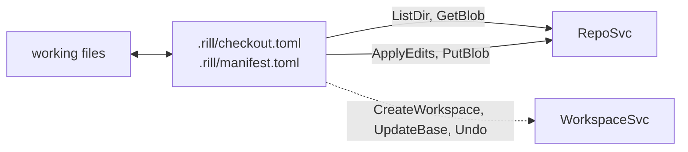

# Checkouts

A checkout is a client directory created from a root (trunk, `trunk@N`, a
version hash, a ref or a tree) and tracked in `.rill/`. The SDK's
`Checkout` writes the files to disk, reports local status, sends the local
edits to the server as a change version, and moves to a new root without
losing local work. A checkout works without a server workspace. When one
is attached, the CLI treats it as advisory.



## Metadata

Both files are TOML written atomically by rename
([meta.rs](../../crates/clients/sdk/src/local/meta.rs)).

| File | Contents |
| --- | --- |
| `checkout.toml` | `endpoint`, `repo`, `workspace` (optional id), `base` (a `Root` string), `base_version` (the hash `base` resolved to, if any), `working_change` (optional `ChangeId`), `sparse.include` / `sparse.exclude`. |
| `manifest.toml` | Per path: `content_hash` (server `ContentRef::content_hash`), `local_hash` (BLAKE3 of the bytes written), `size`, `mtime_ms`, `kind`, `conflict`. |

`base_version` pins the base. When `base` is a ref that later moves,
updates still read the old base content from the pinned version.

## Create

`Checkout::create` refuses a directory that already has
`.rill/checkout.toml`, and `Checkout::find` walks up to the nearest such
directory, so a repository's own `.rill/` (policy files) is not mistaken
for a checkout.
`remote::list_tree` lists the root one `ListDir` RPC per directory. It does
not enter a directory that is excluded, or that is neither under an
include nor an ancestor of one (`dir_may_contain`). Each file is fetched
with `GetBlob`; inline content needs no round-trip. The file is written and
gets a manifest entry.

`rill checkout` calls `CreateWorkspace` first, unless `--no-workspace` is
given. An empty repository has no trunk to check out, so the checkout is
based on the empty tree. That case requires a workspace, because
`CreateWorkspace` is what stores the empty tree. `--sparse` sets include
prefixes only.

## Status

`compute_status` ([status.rs](../../crates/clients/sdk/src/local/status.rs))
runs under `spawn_blocking`. For each manifest entry:

1. `conflict` flag set: `Conflict`.
2. Missing on disk: `Deleted`.
3. Same symlink-ness, `size` and `mtime_ms`: unchanged, without reading the file.
4. Otherwise read the file. It is `Modified` only if the kind or BLAKE3 hash differs from `local_hash`.

Every file on disk that is not in the manifest is `Added`. The walk skips
the checkout's own files (the reserved `.rill/checkout.toml` and
`.rill/manifest.toml`, and `.rill/.rill-tmp-*` while they are written) and
paths matched by `.rillignore` (gitignore syntax, any level,
[walk.rs](../../crates/clients/sdk/src/local/walk.rs)). The repository's
own files in `.rill/` (`verify.toml`, `owners.toml`, `secrets.toml`) are
tracked like any other. Ignore rules hide
untracked files only. A tracked file that matches an ignore rule is still
reported.

## Snapshot (`rill new`, `amend`, `describe`)

`Checkout::snapshot` turns status into edits: `Set` with bytes and kind for
added or modified files, and `Delete` for deleted ones. Any `Conflict` is
an error. It then calls `RepoSvc.ApplyEdits` with
`EditBase::Root(Version(base_version))` (the symbolic `base` only when
nothing is pinned, on an empty repository) and `change_id =
working_change`. Pinning matters: a symbolic `trunk` would be re-resolved by
the server and silently overwrite anything landed since the files were
materialized. Bytes at or under
`INLINE_THRESHOLD` (256) travel inline. Larger files are first uploaded
with the streamed `PutBlob` RPC in `PUT_BLOB_CHUNK_SIZE` (256 KiB)
messages ([blobs.rs](../../crates/clients/sdk/src/repo/blobs.rs)). The
returned change id is saved as `working_change`.

A snapshot changes neither `base` nor the manifest. Each snapshot
therefore sends the full difference from the base, and the server builds a
new version of the same change with parent = base. The CLI flows built on
this are in [changes and stacks](changes-and-stacks.md).

## Update (`rill sync`, `rill undo`)

`Checkout::update(new_root)` ([update.rs](../../crates/clients/sdk/src/local/update.rs))
lists the new root under the checkout's sparse profile. It compares each
path's old manifest `content_hash` and kind against the new listing
(upstream) and against status (local):

| Local \ upstream | unchanged | changed | deleted |
| --- | --- | --- | --- |
| unchanged | keep | fetch | remove file |
| modified / added | keep | `merge_file(base, local, upstream)` | conflict |
| deleted | keep deleted | conflict | drop |
| `Conflict` | keep | keep | keep |

The merge base is read with `ReadFile` from the pinned `base_version`. A
path added on both sides with identical bytes is adopted as-is. Otherwise
it is merged against an empty base. A clean merge is written as a local
modification. A conflict is rendered from `Merge::three_way` with markers
and flagged `conflict = true`. Merged and conflicted entries record the
upstream bytes as their comparison base with `mtime_ms = -1`, so status
always re-hashes them. Afterwards `base`, `base_version` and the manifest
are replaced.

```mermaid
sequenceDiagram
    participant CLI as rill sync
    participant W as WorkspaceSvc
    participant SDK as Checkout
    participant R as RepoSvc
    CLI->>W: UpdateBase(ws, onto) (error only logged)
    CLI->>SDK: update(onto)
    SDK->>R: ListDir per directory of new root
    SDK->>R: ReadFile(base_version, path), GetBlob(upstream)
    SDK->>SDK: merge_file, write markers on conflict
    SDK-->>CLI: UpdateReport { updated, removed, merged, conflicts }
    CLI-->>CLI: clear working_change if it landed; exit 3 on conflicts
```

`rill resolve <paths>` (or `--all`) clears the manifest `conflict` flag
after the user edits the file. `Checkout::mark_resolved` first parses each
file with `parse_materialized` and refuses one that still has conflicts or
malformed markers; `--force` skips the check for files whose real content
looks like markers. After `rill land --wait` lands the checkout's working
change, the CLI runs the same update as `rill sync` onto trunk. `rill undo` calls the workspace `Undo`,
then `update(Root::Version(workspace.base))`.

## Relation to the server workspace

A checkout never calls the workspace `Snapshot` or `NewChange` RPCs. Its
`working_change` comes from `ApplyEdits` and differs from the workspace's
`working_change`. As a result, the `UpdateBase` sent by `rill sync` only
moves the workspace `base`; it never rebases the checkout's change. The
checkout's change follows the new base the next time it is snapshotted.
`rill new`, when it stacks, moves the checkout with `update` and does not
call `UpdateBase`.

## Limitations

* The checkout keeps no local history. `rill undo` needs an attached
  workspace and undoes only the workspace's last operation.
* The workspace record drifts from the checkout. `rill sync` ignores a
  failed `UpdateBase`, and stacking via `rill new` never updates it.
* The sparse profile is fixed when the checkout is created. No command
  changes it, and `SetSparseProfile` does not touch a checkout.
* A partially resolved file cannot be uploaded: resolution is all or
  nothing per file.
* Every snapshot re-uploads every changed file larger than the inline
  threshold. The SDK does not check whether the server already has it.
* Status walks the whole checkout directory on every call.
* `rill stack sync` rebases on the server only. The checkout's base does
  not move.

## Code

* [rill-sdk/src/local/checkout.rs](../../crates/clients/sdk/src/local/checkout.rs), [meta.rs](../../crates/clients/sdk/src/local/meta.rs)
* [rill-sdk/src/local/status.rs](../../crates/clients/sdk/src/local/status.rs), [walk.rs](../../crates/clients/sdk/src/local/walk.rs), [fs.rs](../../crates/clients/sdk/src/local/fs.rs)
* [rill-sdk/src/local/update.rs](../../crates/clients/sdk/src/local/update.rs), [remote.rs](../../crates/clients/sdk/src/local/remote.rs)
* [rill-sdk/src/repo/blobs.rs](../../crates/clients/sdk/src/repo/blobs.rs), [write.rs](../../crates/clients/sdk/src/repo/write.rs)
* [rill-cli/src/commands/checkout.rs](../../crates/clients/cli/src/commands/checkout.rs), [change.rs](../../crates/clients/cli/src/commands/change/mod.rs), [status.rs](../../crates/clients/cli/src/commands/status.rs), [checkout_meta.rs](../../crates/clients/cli/src/checkout_meta.rs)

---
← Previous: [Workspaces](workspaces.md) · [Index](../index.md) · Next: [Changes and stacks](changes-and-stacks.md) →
