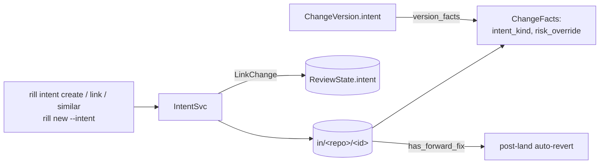

# Intents

An intent is the "why" behind changes: a task, bug, spec or plan. It is
stored as a mutable record (`Intent`, id `in_<hex>`). Change versions point
at it, and review reads it for policy facts. Three carriers record the
link between a change and an intent, and they are written independently:

* `ChangeVersion.intent`: immutable per version, set by whoever creates
  the version.
* `ReviewState.intent`: mutable.
* `Intent.changes`: mutable; only `LinkChange` writes it.

## Record

`Intent` ([intent.rs](../../crates/rill-types/src/objects/intent.rs)):

| Field | Notes |
| --- | --- |
| `id` | `IntentId::new()` at creation. |
| `title`, `body` | Free text. `title` must be non-blank on create. |
| `kind` | `Feature` (default), `Bug`, `Refactor`, `Chore`, `Experiment`, `System`. |
| `status` | `Open`, `InProgress`, `Done`, `Abandoned`. |
| `owner` | The creating principal. |
| `parent` | Optional `IntentId`. |
| `risk_override` | Optional `RiskClass` that replaces the computed risk class. |
| `changes` | `ChangeId`s linked through `LinkChange`, in link order, without duplicates. |
| `created_at`, `updated_at` | Timestamps. |

The only automatic status move is `Open` to `InProgress` on the first
`LinkChange` that adds a change. Every other move is an explicit
`UpdateIntent`.

## RPCs

`IntentSvc` ([intent.rs](../../crates/rill-api/src/services/intent.rs)):

| RPC | Permit | Effect | Errors |
| --- | --- | --- | --- |
| `CreateIntent` | `write(root)` | New record from `title`, `body`, `kind`, `parent`, `risk_override`. | blank title: `InvalidArgument`; missing parent: `NotFound` |
| `GetIntent` | `read(root)` | The record. | `NotFound` |
| `UpdateIntent` | `write(root)` + owner or admin | Updates any of `title`, `body`, `status`, `parent` / `clear_parent`, `risk_override` / `clear_risk_override`. Bumps `updated_at`. | self-parent: `InvalidArgument` |
| `ListIntents` | `read(root)` | Filters by `status[]`, `kind[]`, `owner`, `parent`. Sorted newest `updated_at` first. `limit` default 100, max 10 000. | |
| `LinkChange` | `write(root)` | Appends the change to `changes` if absent and moves `Open` to `InProgress`. If the change has a review, sets the review's `intent` with `write_review`, checked against the change record it read. | change with no versions: `NotFound`; review CAS conflict: `Aborted` |
| `FindSimilarIntents` | `read(root)` | Scores every intent against the query's `title` and `body`. | |

Intent records are written with an unconditional `put_intent`. Two
concurrent `UpdateIntent` or `LinkChange` calls can lose one side's
fields.

### Similarity

`FindSimilarIntents` tokenizes `"<title> <body>"` for the query and for
every intent. Text is split on non-alphanumeric characters, words shorter
than three bytes are dropped, and the rest are lower-cased into a set. The
score is the Jaccard index `|A ∩ B| / |A ∪ B|`. Zero scores are dropped.
The rest are sorted descending and cut to `limit` (default 10, max 100). An
empty query returns nothing. The RPC scans every intent: there is no
index, stemming or embedding.

## Relation to changes

| Carrier | Written by | Read by |
| --- | --- | --- |
| `ChangeVersion.intent` | the `intent` field of `ApplyEdits`, `NewChange` and `Merge`. `rebase` and `build_revert` copy it. | `version_facts`, review agent context, `has_forward_fix`, and review `submit` / `add_version` (copied into `ReviewState.intent`) |
| `ReviewState.intent` | `submit`, `add_version`, `LinkChange` | the `intent` filter of `ListReviews` |
| `Intent.changes` | `LinkChange` only | `GetIntent`, CLI display |

`rill new --intent <id>` sets the version field and then calls
`LinkChange`, because the version field does not update the intent's change
list. A version created any other way leaves `Intent.changes` stale until
someone links it. `add_version` overwrites `ReviewState.intent` with the
new version's field. A `LinkChange` on a review is therefore undone by the
next version that does not carry the intent; `rill amend` sends none.

## Policy and post-land

`ReviewService::version_facts`
([facts.rs](../../crates/rill-review/src/facts.rs)) loads the version's
intent if the record still exists, and calls
`ChangeFacts::with_intent(kind, risk_override)`. In
`rill_policy::classify`, `risk_override` replaces the computed class as the
last step. `intent_kind` is passed to the submit policy as the Cedar
attribute `resource.intent_kind`, with `"none"` when no intent is set. See
[submit policy](../05-policy/submit-policy.md). An intent's `status`
has no effect on review or landing.

`has_forward_fix` ([revert.rs](../../crates/rill-lander/src/revert.rs))
counts a later trunk version as a fix for `trunk@N` when its message
contains `trunk@N`, or when its intent's title or body does. See
[post-land verification](post-land-verification.md).

## Limitations

* No optimistic concurrency on intent records.
* Intent RPCs accept an `operation_id` but ignore it; retries are not
  idempotent.
* `UpdateIntent` does not check that a new `parent` exists or that it
  forms no cycle.
* `ListIntents` and `FindSimilarIntents` scan every intent in the
  repository. `ListIntents` has no continuation token.
* The three link carriers are not reconciled with each other.
* An amend through `ApplyEdits` does not inherit the previous version's
  `intent`; `rill amend` and `rill describe` produce versions without one.
* The CLI cannot set `risk_override`.
* `IntentKind::System` has no producer in the codebase.

## Code

* [rill-types/src/objects/intent.rs](../../crates/rill-types/src/objects/intent.rs)
* [rill-api/src/services/intent.rs](../../crates/rill-api/src/services/intent.rs)
* [rill-review/src/facts.rs](../../crates/rill-review/src/facts.rs) (`version_facts`)
* [rill-policy/src/submit/entities.rs](../../crates/rill-policy/src/submit/entities.rs) (`intent_kind` attribute)
* [rill-lander/src/revert.rs](../../crates/rill-lander/src/revert.rs) (`has_forward_fix`)
* [rill-sdk/src/intent.rs](../../crates/rill-sdk/src/intent.rs)
* [rill-cli/src/commands/intent.rs](../../crates/rill-cli/src/commands/intent.rs)

---
← Previous: [Post-land verification](post-land-verification.md) · [Index](../index.md) · Next: [Identity and authentication](../05-policy/identity-and-auth.md) →
