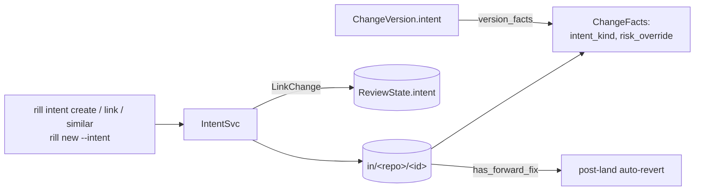

# Intents

An intent is the "why" behind changes: a task, bug, spec or plan. It is
stored as a mutable record (`Intent`, id `in_<hex>`). Change versions point
at it, and review reads it for policy facts. An intent may carry a
**scope**: once the owners of the directories it covers approve it,
changes linked to it and inside the scope inherit that approval (the
`intent_in_scope` policy fact), which is how a few humans govern many
agents' work. Three carriers record the link between a change and an
intent:

* `ChangeVersion.intent`: immutable per version, set by whoever creates
  the version.
* `ReviewState.intent`: mutable.
* `Intent.changes`: mutable; `LinkChange` writes it, and the
  `intent-budgets` consumer adds every change whose first version names
  the intent.

## Record

`Intent` ([intent.rs](../../crates/foundation/types/src/objects/intent.rs)):

| Field | Notes |
| --- | --- |
| `id` | `IntentId::new()` at creation. |
| `title`, `body` | Free text. `title` must be non-blank on create. |
| `kind` | `Feature` (default), `Bug`, `Refactor`, `Chore`, `Experiment`, `System`. |
| `status` | `Open`, `InProgress`, `Done`, `Abandoned`. |
| `owner` | The creating principal. |
| `parent` | Optional `IntentId`. |
| `risk_override` | Optional `RiskClass` that replaces the computed risk class. |
| `changes` | `ChangeId`s linked through `LinkChange`, in link order, without duplicates. |
| `created_at`, `updated_at` | Timestamps. |
| `scope` | Optional `IntentScope`: `paths` and `forbid_paths` globs, `max_files_per_change`, `max_changes`, `expires`, `agent_quorum`, `human_sample_permille`, `changes_per_day`, `lands_per_day`. |
| `revision` | Bumped on every scope change (1 for a scope given at creation). |
| `approvals` | `IntentApproval { by, at, revision, owns }`: who approved which revision, and the scope directories they owned then. |

The only automatic status move is `Open` to `InProgress` on the first
`LinkChange` that adds a change. Every other move is an explicit
`UpdateIntent`.

## RPCs

`IntentSvc` ([intent.rs](../../crates/server/api/src/services/intent/records.rs)):

| RPC | Permit | Effect | Errors |
| --- | --- | --- | --- |
| `CreateIntent` | `write(root)` | New record from `title`, `body`, `kind`, `parent`, `risk_override` and an optional `scope` (revision 1). | blank title or bad glob: `InvalidArgument`; missing parent: `NotFound` |
| `GetIntent` | `read(root)` | The record. | `NotFound` |
| `UpdateIntent` | `write(root)` + owner or admin | Updates the masked fields of `title`, `body`, `status`, `parent`, `risk_override`, `scope`. A new scope bumps `revision`. Written only if the record is still what the etag check read. | parent missing or forming a cycle, bad glob: `InvalidArgument`; a concurrent write: `Aborted` |
| `ListIntents` | `read(root)` | Filters by `status[]`, `kind[]`, `owner`, `parent`. Sorted newest `updated_at` first. `limit` default 100, max 10 000. | |
| `LinkChange` | `write(root)` | Appends the change to `changes` if absent and moves `Open` to `InProgress`. If the change has a review, sets the review's `intent` with `write_review`, checked against the change record it read. | change with no versions: `NotFound`; review CAS conflict: `Aborted` |
| `FindSimilarIntents` | `read(root)` | Scores every intent against the query's `title` and `body`. | |
| `ApproveIntent` | `read(root)` + owning a scope directory | Records the caller's approval of `revision` for the scope directories they own, replacing an earlier one. | no scope or a stale `revision`: `FailedPrecondition`; owns none: `PermissionDenied` |
| `RevokeIntentApproval` | `read(root)` | Removes the caller's approvals. | |
| `ExplainIntentScope` | `read(root)` | For a change in review: its intent, `approved`, `in_scope`, the reasons it is not, and the scope directories still short of approvals. | |

Intent writes from these RPCs and the budget consumer compare and swap the
stored record, retrying a few times on a conflict.

### Similarity

`FindSimilarIntents` tokenizes `"<title> <body>"` for the query and for
every intent. Text is split on non-alphanumeric characters, words shorter
than three bytes are dropped, and the rest are lower-cased into a set. The
score is the Jaccard index `|A ∩ B| / |A ∪ B|`. Zero scores are dropped.
The rest are sorted descending and cut to `limit` (default 10, max 100). An
empty query returns nothing. The RPC scans every intent: there is no
index, stemming or embedding.

## Scope and approval

[`rill_policy::intents`](../../crates/domain/policy/src/intents.rs) is
pure. The scope's directories are each glob's literal prefix (`svc/**`
covers `svc`, `Cargo.toml` covers the root). An intent is **approved** when
every scope directory has, at the current revision, as many distinct
approvals listing it in `owns` as the most demanding owner set covering the
directory requires (one when no `OWNERS.toml` does). An agent's approval of
its own intent never counts; a human owner may approve their own.

`ApproveIntent` decides what the caller owns: for each scope directory,
whether they count for an owner set covering it
([code owners](ownership.md)), or, where no file covers it, whether they
hold the `owner` relation on it. Dev mode owns every directory.

A change is **in scope** when its intent is approved and every one of these
holds:
- every touched path matches `paths` and none matches `forbid_paths`;
- it touches at most `max_files_per_change` files;
- the intent has at most `max_changes` changes;
- the intent is not closed and has not expired;
- today's linked changes are within `changes_per_day`, and today's
  landings below `lands_per_day`.

Out of scope is not a refusal: the change gets normal review. The review
service computes this per evaluation
([`rill-review` intents.rs](../../crates/domain/review/src/intents.rs)) for
the version's intent, or the review's when the version names none. Cedar
sees `intent_approved`, `intent_in_scope` and `intent_agent_quorum`
([submit policy](../05-policy/submit-policy.md)).

Day counts live in the record `intent-day:<intent>:<YYYY-MM-DD>` (UTC).
The `intent-budgets` event consumer
([workers/intents.rs](../../crates/server/runtime/src/workers/intents.rs))
keeps them. It counts a change's first version naming an intent against
`changes_per_day` (and links the change), and a landing under an intent
against `lands_per_day`.

## Relation to changes

| Carrier | Written by | Read by |
| --- | --- | --- |
| `ChangeVersion.intent` | the `intent` field of `ApplyEdits`, `StartChange` and `MergeVersions`. `rebase` and `build_revert` copy it. | `version_facts`, review agent context, `has_forward_fix`, and review `submit` / `add_version` (copied into `ReviewState.intent`) |
| `ReviewState.intent` | `submit`, `add_version`, `LinkChange` | the `intent` filter of `ListReviews` |
| `Intent.changes` | `LinkChange`; the `intent-budgets` consumer for a change's first version that names the intent | `GetIntent`, `max_changes`, CLI display |

`ApplyEdits` amending a change keeps the previous version's intent when the
request names none, so `rill amend`, `rill describe` and `rill commit` keep
it.

## Policy and post-land

`ReviewService::version_facts`
([facts.rs](../../crates/domain/review/src/facts.rs)) loads the version's
intent if the record still exists, and calls
`ChangeFacts::with_intent(kind, risk_override)`. In
`rill_policy::classify`, `risk_override` replaces the computed class as the
last step. `intent_kind` is passed to the submit policy as the Cedar
attribute `resource.intent_kind`, with `"none"` when no intent is set. See
[submit policy](../05-policy/submit-policy.md). An intent's `status`
has no effect on review or landing.

`has_forward_fix` ([revert.rs](../../crates/domain/lander/src/revert.rs))
counts a later trunk version as a fix for `trunk@N` when its message
contains `trunk@N`, or when its intent's title or body does. See
[post-land verification](post-land-verification.md).

## Limitations

* `ListIntents` and `FindSimilarIntents` scan every intent in the
  repository; `ListIntents` pages that scan.
* The budget consumer counts after the fact: changes made in the same
  moment can all pass a `changes_per_day` limit before any is counted.
* `human_sample_permille` is recorded; sampled audits use it once audits sample landings.
* The CLI cannot set `risk_override`.
* `IntentKind::System` has no producer in the codebase.

## Code

* [rill-types/src/objects/intent.rs](../../crates/foundation/types/src/objects/intent.rs)
* [rill-api/src/services/intent/records.rs](../../crates/server/api/src/services/intent/records.rs)
* [rill-review/src/facts.rs](../../crates/domain/review/src/facts.rs) (`version_facts`)
* [rill-policy/src/submit/entities.rs](../../crates/domain/policy/src/submit/entities.rs) (`intent_kind` attribute)
* [rill-lander/src/revert.rs](../../crates/domain/lander/src/revert.rs) (`has_forward_fix`)
* [rill-sdk/src/intent.rs](../../crates/clients/sdk/src/intent.rs)
* [rill-cli/src/commands/intent.rs](../../crates/clients/cli/src/commands/intent.rs), [intent_scope.rs](../../crates/clients/cli/src/commands/intent_scope.rs)
* [rill-policy/src/intents.rs](../../crates/domain/policy/src/intents.rs), [rill-api/src/services/intent/approvals.rs](../../crates/server/api/src/services/intent/approvals.rs), [rill-runtime/src/workers/intents.rs](../../crates/server/runtime/src/workers/intents.rs)

---
← Previous: [Post-land verification](post-land-verification.md) · [Index](../index.md) · Next: [Identity and authentication](../05-policy/identity-and-auth.md) →
