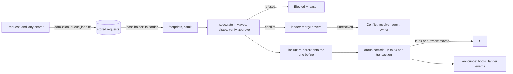

# Landing

The lander, while it holds the repository's lease, serves stored land
requests in fair order (lanes, then weighted shares per sponsor). Requests
that touch nothing in common are rebased onto the trunk head and verified
in parallel; a request that overlaps earlier ones is rebased on top of
them. Each is approved against the review as stored, and the batch is
lined up at commit, each version re-parented onto the one before it. Up
to 64 approved requests then land in one transaction that checks the trunk
head, the lease and every review it was approved on, assigns gap-free
sequence numbers, and writes landing records, reviews, request statuses,
events and follow-up jobs. A request whose approval no longer holds is
ejected with the reason. A stack lands as an ordered group, whole or as a
prefix, and what stays stacked above a landing is rebased onto it.



## Queue and tickets

Land requests live in the store (`repo/land_queue.rs`), so any server can
accept one, any server can report its status, and they survive restarts:

* `queue_land(request)` writes, in one transaction, the record
  `(lrt, ..., ticket)` (`LandRequestRecord`: ticket, request, status,
  updated_at), a row in the pending index `(lrq, ..., lane, requested_at,
  ticket)`, the index `(lrc, ..., change) → ticket`, a `LandRequested`
  event and a bump of the wake counter. A change with an unfinished
  request gets that request's ticket back instead, so asking twice is
  harmless. Tickets are random 64-bit numbers, shown as `land#n`.
* Requests are served by lane (`emergency`, `human`, `agent`, `bulk`; the
  requester's kind picks `human` or `agent`, reverts use `emergency`), then
  oldest first.
* Every status change is a transaction that writes the record and a
  `LandStatusChanged` event, conditioned on the record as read and fenced
  by the lander's lease. A terminal status (`Landed`, `Failed`,
  `Conflict`, `Returned`, `Ejected`) drops the pending and change rows,
  and never changes again. `Landed` is written by the land transaction
  itself.
* Finished requests stay queryable for `TERMINAL_RETENTION` (7 days) and
  are then swept.

`Lander::run_forever` serves the queue while it holds the lease: it reads
up to 256 pending requests, partitions and processes them, then waits for
the wake counter to move or `batch_window`, whichever is first.
`land_now` (reverts, CLI) queues a request and serves until it finishes,
or until `max_wait` while another process holds the lease.
`GetLandStatus`, `GetTrunkStatus` and `WatchReview` read the stored
records.

| Lander `LandStatus` | Wire `LandStatus` |
| --- | --- |
| `Queued` | `Queued` |
| `Verifying`, `Landing` | `Rebasing` |
| `Landed { seq }` | `Landed` |
| `Failed { reason }`, `Conflict { paths }` | `Failed` |
| `Returned { reason }`, `Ejected { reason }` | `Cancelled` |

## Admission

`Lander::enqueue` returns the ticket of the change's unfinished request if
it has one. Otherwise, outside the `emergency` lane, it refuses with
`RESOURCE_EXHAUSTED`:

* `QueueFull` when `max_queued` (10,000) requests are unfinished, with a
  `retry-after` header (seconds, from the recent landing rate);
* `TooManyRequests` when the requester has `max_in_flight` (50), or its
  sponsor (`sponsor` from the token, so all of one person's or team's
  agents) has `max_sponsor_in_flight` (2,000) unfinished.

The server evaluates the submit policy for the requester before queueing
(`RequestLand`), and records the token's sponsor on the request.

## Sequencing

The pure decisions live in `rill-lander/src/schedule/`; the sequencer
(`land/sequence.rs`, `land/prepare.rs`, `land/speculate.rs`, `land/commit.rs`) does the I/O.

**Order.** `run_once` reads up to 256 pending requests and `serve_order`
puts them in lane order (`emergency`, `human`, `agent`, `bulk`), and
within a lane by weighted fair queuing over share keys (the sponsor, or
the requester): the n-th request of a key with weight w gets virtual time
n/w (`sponsor_weights`, default 1), ties in queue order. One swarm cannot
starve another sponsor or a human.

**Footprints.** A request's conflict domains are the paths its version
changed (the `changed-paths` derivation), the groups `.rill/landing.toml`
declares for them, whether it changes `.rill/` (configuration), and, when
its verify plan declares a [build graph](../06-services/exec.md#build-graphs),
the build targets it touches against its first parent (changed, added or
removed; asked once per version through the `TargetGraph`, which the
server answers with the plan's `[graph]` query, cached like any action).
Two requests interact when one is configuration, they share a group or a
target, or a path of one is or is under a path of the other; a shared
parent directory does not count. So two changes to different files of one
target are verified together, the second on top of the first. A graph
that cannot be queried leaves path domains for that request.

```toml
# .rill/landing.toml, on trunk (owner-only, like all of .rill/)
[[serialize]]            # these always land one after another
name = "db"
paths = ["schema/**", "migrations/**"]

[throttle]               # swarm thrash (defaults shown)
conflict_rate = 0.5
min_attempts = 10
window_secs = 300
```

Each window of up to `MAX_BATCH` (64):

1. **Accept.** Requests are taken up and their footprints read
   concurrently. The first time a request is taken up, `hooks.mark_landing`
   moves its review to `Landing` (or accepts it already `Landing`, when a
   lander that took over resumes it). A refusal fails the request.
2. **Admit.** A configuration change ends the batch before it or is all of
   it, and requests after it wait, so the rules in force never change
   within a batch. In a throttled domain only the first request is taken;
   the rest wait for the next batch, and `LandEvent::Throttled` says why.
3. **Speculate** in waves (`Plan`): a request goes in the wave after every
   earlier request it overlaps. Each is placed (`Slot`) on the trunk head
   when no surviving earlier request overlaps it, after the latest one when
   that one's chain holds all it overlaps, or else on the lined-up batch.
   A wave's requests are prepared concurrently: a version already on trunk
   or an ancestor of it fails; one not based on its slot is rebased, with
   [structural merge](../03-core-algorithms/merge.md#structural-merge-mergecontentrs-rill-merge-syntax)
   resolving what the line merge cannot and the
   [conflict ladder](#conflict-ladder) what neither can; it is verified unless its
   mode is `None`; its land-critical values are stored; and it is approved.
   A failure removes only what was speculated on top of it: later requests
   are placed against the survivors.
4. **Approve.** `hooks.approve(change, requested version, requester)`
   reads the review and judges it: it must still be `Landing` or
   `Landable`, its current version must still be the requested one, the
   submit policy must still allow the requester, the version's author and
   the requester must still be allowed to act (`AuthorStanding`), the
   author must still hold write on every path it writes (`WriteRights`,
   outside dev mode), and neither it nor an ancestor off trunk may be
   quarantined by secret scanning. A refusal sets `Ejected { reason }`.
   An approval carries the review snapshot, the policy digest and the
   votes it saw.
5. **Line up.** In commit order each candidate is re-parented onto the one
   before it. Everything it overlaps is already in its base, so everything
   between its base and the tip is disjoint from it: the new version is
   the same edits on a new parent, keeping what its rebase recorded
   (`merge_drivers`, `structural_merge`). It cannot conflict and is not
   verified again. The re-parented versions are stored together
   (`store_chain`): their values computed in order in memory, their
   objects and tree nodes written at once, and one transaction for all of
   them; a storage failure fails the first and returns what was lined up
   after it to the queue. Requests placed on
   the lined-up batch are prepared on the stored tip.
6. **Commit** the chain in one `RepoStore::land` batch on the head read at
   the start. A conflict (trunk moved, or a review changed after it was
   approved) rebuilds the window, up to `max_retries` times; a conflict
   because the lease moved on stops the sweep (`Fenced`).

Every window lands or finishes at least its first request, so held-back
requests are served by the next window. Trunk is one line: each landed
version's first parent is the position before it. Every `Failed` and
`Ejected` returns the change to its owner and publishes
`LandEvent::Failed`. The rebase itself is described in
[rebase](../03-core-algorithms/rebase.md).

**Thrash.** Every rebase is recorded against its domains (top-level
directories and declared groups). A domain whose conflict rate over
`window_secs` reaches `conflict_rate` after `min_attempts` attempts is
throttled to one request per batch until the rate falls.

**Positions and ETAs.** `GetLandStatus` returns, while queued, the
request's place in the serve order and an ETA from the mean time between
recent landings. `rill land` prints both. The lease holder exports
`land_wait_p50_ms`, `land_wait_p99_ms` (queue to trunk), `land_interval_ms`,
`land_conflict_permille{key=domain}` and `land_queued_by_share{key}` (the
busiest 20 of each).

## Stacks as ordered groups

A stack asked to land with `RequestLandStack` is queued as one ordered
group: each member's request carries `LandGroup { mode, tickets, index }`,
and `queue_land_group` writes them all in one transaction (refused if any
member already has a request). The sequencer:

* serves a group where its first member falls in the serve order, members
  bottom first (`keep_groups_together`), and never ends a window inside a
  group (`window_len`; a group is at most `MAX_BATCH`);
* holds the group when a lower member is still queued outside the window,
  and fails members above a lower one that finished without landing
  (`gate_groups`);
* gives members the domain `stack:<id>`, so each is speculated, verified
  and approved on top of the one below;
* holds the whole group when admission holds back any member;
* lands an `All` group only if every member is ready: one that fails
  (conflict, red, ejected, refused) fails the rest with "another change in
  its stack did not land", including members already lined up, which are
  taken off the chain with everything after them (those wait for the next
  batch). A `Prefix` group lands the members below the first failure and
  fails the ones above it.

After the batch lands, changes still stacked above a landed one are
restacked onto it ([stacks](changes-and-stacks.md#stacks)).

## Conflict ladder

A rebase that still conflicts climbs a ladder before anyone sees it
(`rill-lander/src/ladder/`):

1. **Merge algebra**: trivial resolution inside `rebase`.
2. **Structural merge**: weave, inside `rebase`.
3. **Merge drivers** declared at the head the batch lands on, in
   `.rill/merge.toml`, falling back to `merge=union` in the root
   `.gitattributes` (gitoxide's attribute matcher):

   ```toml
   [[driver]]
   paths = ["CHANGELOG.md", "registry/*.toml"]
   merge = "union"        # both sides' added lines, the head's first (gix-merge)

   [[driver]]
   paths = ["snapshots/**"]
   merge = "generated"    # the head's version; a later change regenerates it

   [[driver]]
   name = "cargo"
   paths = ["Cargo.lock"]
   merge = "regenerate"   # the head's version, then this command
   command = ["cargo", "update", "--workspace", "--offline"]
   inputs = ["Cargo.lock", "**/Cargo.toml"]   # whole tree when omitted
   timeout_secs = 300
   risk = ["trivial", "low", "normal"]        # every class when omitted

   [ladder]
   manual = ["auth/**"]   # conflicts here go to the owner, never an agent
   ```

   The first driver whose paths match applies, for the risk classes it
   lists. It is all or nothing: if any conflicted path has no driver, or a
   driver fails, every conflict stays. `regenerate` stores the version with
   the head's side in place, and the `Regenerator` runs the command at the
   root of that tree. In the server that is `ExecRegenerator`: a
   `merge:<name>` step on the repository's plan runner (same workers,
   platform defaults and cache as verification; sandboxed, no network,
   cached by its inputs). The outputs it wrote become the files. Without
   verification enabled, regeneration fails. `-merge` and
   `merge=binary` in `.gitattributes` count as manual. A resolved version
   records `merge_drivers` in its extras (`cargo: Cargo.lock; union:
   registry.toml`).
4. **Resolver agent**: a `ConflictResolver`, when the lander has one and
   no path is manual, is offered the change and the paths. Its resolution
   is a new version that comes back through the queue. Dispatch to real
   agents is phase 23; the server has none yet.
5. **Owner**: the request ends `Conflict { paths }` and the change goes
   back to its owner, with the driver's error and who is resolving it, if
   anyone.

A driver's resolution keeps the request's approvals and risk class: the
approval is for the requested version, as for any rebase, and the drivers
are on trunk, where `.rill/` is owner-only. Only a rebase that climbs past
the drivers counts as a conflict for thrash throttling.

## The land transaction

`RepoStore::land(LandBatch { expected, entries, fence, actor, also })` reads the
trunk-head row (`(thd, ns, repo)`: be64 seq ++ hash) and returns
`Conflict` if its hash is not `expected`. Otherwise one transaction, for
entries at `seq = head_seq + 1, + 2, ...`:

* checks: the head row equals what was read, the trunk ref equals
  `expected`, each position is absent, the lease epoch row equals the
  lander's, and each review's change record (and vote epoch) equals its
  snapshot;
* writes: each position and its reverse index, a `Landing` record at
  `(land, ns, repo, seq)`, each review set to `Landed` with its
  `landed_seq`, `Landed` and `StatusChanged` events, a landings charge per
  requester, the new head row and trunk ref, and `also`: the lander passes
  one derive job per landed version and an index job for the new head
  (`land::followups::landing_jobs`), so follow-up work exists exactly when
  the landing does.

A review that is no longer `Landing` or `Landable` (abandoned meanwhile)
stops the batch. Two landers racing for a slot get exactly one winner; the
sequence is gap-free because it comes from the head inside the
transaction that writes it. A batch lands several versions at once, which
the sequencer's group commit (phase 9) uses. `land_on_trunk(expected,
hash)` is a one-entry batch without review or lease, for imports and
tools.

**Leases and fencing.** A lander lands only while it holds the `lander`
lease (`LeaseHolder`, 10 s, renewed once half has passed); `run_once`
leaves requests queued while another process holds it, and
`run_forever` releases it at shutdown so a standby takes over at once.
Taking the lease bumps its epoch, and the land transaction checks the
epoch row, so a lander that was replaced (paused, partitioned) fails every
land with `Fenced` even while it still believes it holds the lease. See
[events and workers](../07-runtime/events-and-workers.md#leases).

## Announcing and land records

After the transaction (which also set the request `Landed`), `announce` calls
`hooks.mark_landed` (a notification: the review service publishes its
events, the record is already written), publishes `LandEvent::Landed`. Then, for every landed change whose
change above it (`hooks.dependents_of`) did not land in the same batch,
`hooks.restack` moves the rest of its stack onto it and
`LandEvent::DependentsRestacked` lists what moved. Hook errors are logged,
never fatal.

Every trunk position has a `Landing { seq, change_id, version,
requested_version, requester, risk, landed_at, policy, approvals }`
record, written by the land transaction, imports included. `policy` is the
digest of the submit policy that approved the landing and `approvals` the
votes it saw (both empty for changes without review). `landing_of(version)` goes through the
reverse index; `list_landings(limit)` scans the newest records.

## Release lines

A release is a second line of landings beside trunk. `CutRelease(name,
at)` (repository owners; audited as `ref.move` with no old target) writes,
in one transaction, the ref `release/<name>` and the release's head row at
position 0, the trunk version it was cut at (`RepoStore::cut_release`;
refused if the release exists). After that the release moves only through
its lander: `MoveRef` refuses `release/*` like `trunk`.

Everything a line needs is keyed by `Line` (`Trunk` or `Release(name)`):
`RepoKeys::line(&line)` gives trunk's own keys, or the release's rows in
the release tables (`rhd`, `rel`, `relh`, `rland`, `rlq`, `rln`;
[keyspace](../02-data/storage-and-keyspace.md)). `RepoStore::land` lands a
`LandBatch` on `batch.line`: the same checks and writes, against that
line's head row and ref. A release landing writes a `RefMoved` event, not
`Landed`, and does not set the review's `landed_seq` (a trunk position);
it enqueues derive jobs but no search index job, so search stays on
trunk.

A land request carries its line (`LandRequest::onto`): `RequestLand` and
`RequestLandStack` take `onto = "release/<name>"`, refused with
`NOT_FOUND` for a release never cut. Each release has its own lander
(`Lander::on_line`): its own queue (`rlq`), its own lease
(`lander:release/<name>`, so it never contends with trunk's), and the same
review hooks, verifier, merge drivers and build graph as trunk. A lander
refuses a request for another line. Its rules are the release's own:
`.rill/landing.toml`, `.rill/merge.toml` and `.rill/verify.toml` are read
at the release head (or in the tree verified), so a release keeps the
rules it was cut with. Submit policy and write grants are repository-wide
records, so they are the same on every line.

A cherry-pick is a change whose base is the release, or any change landed
onto it: the rebase replays the change's own edit (its diff from its
first parent) onto the release head. `ReleaseLanders` (in the runtime)
builds release landers on demand; one task per repository serves every
release's queue concurrently after each new release request (one shared
`rln` counter) or `batch_window`. Post-land verification, reverts and
bisection follow trunk only.

## Formal model

[`spec/sequencer/Sequencer.tla`](../../spec/sequencer/Sequencer.tla) is a
TLA+ model of the sequencer, its lease and group commit: landers racing
for a lease that can lapse mid-batch, speculation as a snapshot of the
head, the epoch and the approvals of a batch, reviews withdrawing approval
at any moment, conflicts, ejection, and a commit that checks the head,
the epoch and every approval. TLC checks that no request lands twice, a
request is `Landed` exactly when it is on trunk, every landing was
approved in its own transaction, ejected and conflicted requests never
land, trunk is append-only, and a lander whose lease was taken over never
changes trunk. `spec/sequencer/check.sh` runs it (two landers, three
requests, three epochs: 164,820 states, about a second). Rebases and
re-parenting are abstracted: a batch is any queue-ordered subsequence of
the queued requests.

## Configuration

`LandPolicy`, the `[lander]` section of the server config:

| Field | Default |
| --- | --- |
| `modes` | trivial `none`; low, normal `affected`; sensitive, critical `full` |
| `max_wait` | 30 min |
| `batch_window` | 2 s (longest pause; a new request starts a sweep at once) |
| `max_retries` | 8 |
| `max_in_flight` | 50 unfinished requests per requester |
| `max_sponsor_in_flight` | 2,000 per sponsor |
| `max_queued` | 10,000 in all |
| `sponsor_weights` | empty (every sponsor 1) |
| `auto_revert`, `revert_grace` | `false`, 15 min (see [post-land verification](post-land-verification.md)) |

The verifier is `ExecVerifier` (runs `.rill/verify.toml` through the
execution scheduler, see [exec](../06-services/exec.md)) when
`[verify].enabled`, else `AlwaysGreen`. It gets a `VerifyRequest`: the
candidate's root, its version, its risk class, the stage (`PreLand`) and,
in `Affected` mode, the trunk tip's root as the base, so steps whose inputs
the change did not touch are skipped. `Full` passes no base and runs every
step.

## Limitations

* A request keeps the risk class it was enqueued with.
* A slow verification holds its wave, and so its window: the batch commits
  together.
* A re-parented request is not verified again. With build-target
  domains that is sound for what the graph sees; with paths only, two
  changes to different files that break each other land together (declare
  a `[graph]` or a `[[serialize]]` group).
* Requests queued in the same millisecond are served in ticket order,
  which is random.
* ETAs and wait percentiles live in the lease holder's memory and start
  empty after a takeover.
* A store failure inside `mark_landing` also refuses the request; the
  client has to request again.
* After a failed landing the rebased version stays stored but is not the
  review's current version.
* Only the root `.gitattributes` is read, and only its `merge` attribute.
* Releases: all of a repository's releases are served by one task, so a
  slow verification on one release delays the others' next sweep. A
  release cannot be deleted, and nothing helps make a cherry-pick (create
  the change on the release, or land a trunk change's copy onto it).
* `regenerate` runs without network, so lockfile commands must work
  offline (vendored or cached dependencies in the image). A conflicted
  chain of lockfile changes regenerates once per request, in order.

## Code

* [rill-lander/src/land/lander.rs](../../crates/domain/lander/src/land/lander.rs), [sequence.rs](../../crates/domain/lander/src/land/sequence.rs), [prepare.rs](../../crates/domain/lander/src/land/prepare.rs), [commit.rs](../../crates/domain/lander/src/land/commit.rs), [speculate.rs](../../crates/domain/lander/src/land/speculate.rs), [domains.rs](../../crates/domain/lander/src/land/domains.rs), [record.rs](../../crates/domain/lander/src/land/record.rs)
* [rill-lander/src/schedule/](../../crates/domain/lander/src/schedule/) (footprints, landing rules, fair order, ordered groups, plan, thrash, ETAs), [land/groups.rs](../../crates/domain/lander/src/land/groups.rs)
* [rill-store/src/keys/line_keys.rs](../../crates/foundation/store/src/keys/line_keys.rs), [rill-runtime/src/state/releases.rs](../../crates/server/runtime/src/state/releases.rs), [rill-api/src/services/repo/refs.rs](../../crates/server/api/src/services/repo/refs.rs) (`CutRelease`)
* [rill-lander/src/ladder/](../../crates/domain/lander/src/ladder/) (merge rules, `.gitattributes`, union, the ladder), [land/head_config.rs](../../crates/domain/lander/src/land/head_config.rs) (rules read once per head)
* [rill-exec/src/verify/regenerate.rs](../../crates/domain/exec/src/verify/regenerate.rs), [rill-runtime/src/workers/regenerator.rs](../../crates/server/runtime/src/workers/regenerator.rs)
* [rill-lander/src/queue.rs](../../crates/domain/lander/src/queue.rs), [config.rs](../../crates/domain/lander/src/config.rs), [events.rs](../../crates/domain/lander/src/events.rs), [traits.rs](../../crates/domain/lander/src/traits.rs)
* [rill-lander/src/land/followups.rs](../../crates/domain/lander/src/land/followups.rs) (jobs a landing enqueues)
* [rill-store/src/repo/landing.rs](../../crates/foundation/store/src/repo/landing.rs) (`land`, `land_on_trunk`, landing records), [repo/leases.rs](../../crates/foundation/store/src/repo/leases.rs), [repo/trunk.rs](../../crates/foundation/store/src/repo/trunk.rs) (`trunk_head`, `trunk_seq_of`)
* [rill-api/src/services/review/mod.rs](../../crates/server/api/src/services/review/mod.rs) (`request_land`, `get_land_status`), [common.rs](../../crates/server/api/src/services/common.rs) (`ticket_status`), [repo/land_queue.rs](../../crates/foundation/store/src/repo/land_queue.rs), [state/repo_build.rs](../../crates/server/runtime/src/state/repo_build.rs), [workers/repo_tasks.rs](../../crates/server/runtime/src/workers/repo_tasks.rs)

---
← Previous: [Review agents](review-agents.md) · [Index](../index.md) · Next: [Post-land verification](post-land-verification.md) →
