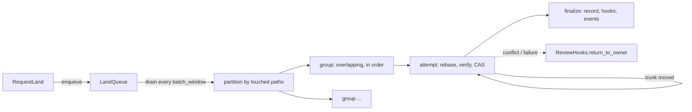

# Landing

The lander takes a requested change version, rebases it onto the current
trunk head if needed, optionally verifies it, and advances trunk with a
compare-and-swap that assigns the next sequence number. Nothing is locked
while a request is rebased or verified; the CAS on the trunk ref decides,
and the loser rebases again. Trunk is one ref plus a gap-free sequence of
positions `trunk/<seq>`, each written by exactly one successful
`land_on_trunk` transaction.

## Queue and tickets

`LandQueue` is process memory: a `VecDeque<QueuedRequest>` of pending
requests and a `DashMap<LandTicket, watch::Sender<LandStatus>>`. `enqueue`
assigns `LandTicket(n)` (shown as `land#n`) from a counter starting at 1
and publishes `LandEvent::Queued`. `Lander::run_forever` sleeps
`batch_window`, calls `run_once` (drain all pending, partition, process),
then `forget_terminal` drops tickets that finished more than
`TERMINAL_RETENTION` (10 minutes) ago, so a client polling after the
request completed still sees its outcome. `land_now`, used by reverts,
enqueues, runs one sweep inline and waits on the ticket's watch channel.

The server also remembers each ticket in `RepoContext.tickets` so
`GetLandStatus` can answer after the queue forgot it (after the retention
window or a restart): it falls back to the review state (`landed_seq` set
means `Landed`, otherwise `Returned { "ticket expired ..." }`). The lander
itself never sets `Returned`.

| Lander `LandStatus` | Wire `LandStatus` |
| --- | --- |
| `Queued` | `Queued` |
| `Verifying`, `Landing` | `Rebasing` |
| `Landed { seq }` | `Landed` |
| `Failed { reason }`, `Conflict { paths }` | `Failed` |
| `Returned { reason }` | `Cancelled` |

## Conflict graph

`touched_paths(version)` is the tree diff of the version against its first
parent, plus its conflicted paths and its `subtree_changes` keys.
`partition` is a union-find over the drained requests in arrival order:
two requests join one group when they share a path or one path is a
directory prefix of the other. Each group runs as its own task and
processes its requests in arrival order, so a later request is rebased
onto the earlier one's result. Groups run concurrently and race only on
the CAS. A request whose touched paths cannot be computed fails at once.

## Attempt loop

`process` never returns an error; every outcome becomes a ticket status.
It calls `hooks.mark_landing` once (an error is logged and ignored), picks
the verify mode (`verify_override`, else `LandPolicy.modes` for the
request's risk), and runs up to `max_retries + 1` attempts with `tip`
starting at the requested version:

1. Read `trunk_head`. If `tip` already has a trunk position:
   `Failed("already landed at ...")`.
2. If trunk is non-empty and `tip`'s first parent is not the head: fail
   when `tip` is already an ancestor of the head; otherwise
   `rill_core::rebase(tip, head)`. A conflicted rebase sets `Conflict
   { paths }`, calls `return_to_owner`, publishes `LandEvent::Conflict` and
   stops. A clean rebase is stored with `put_change_version` (a new version
   of the same change) and becomes the candidate.
3. Unless the mode is `VerifyMode::None`: status `Verifying`, run the
   `Verifier` on the candidate's root under `max_wait`. Timeout, verifier
   error or red outcome fails the request.
4. Status `Landing`, then `land_on_trunk(expected = head, candidate)`.
   Success goes to finalize. A store `Conflict` ("trunk moved") retries
   with `tip = candidate`. Any other error fails the request.

After the last attempt: `Failed("trunk moved N times while landing; giving
up")`. Every `Failed` calls `return_to_owner` and publishes
`LandEvent::Failed`. The rebase itself is described in
[rebase](../03-core-algorithms/rebase.md).

## CAS and sequence numbers

`RepoStore::land_on_trunk(expected, hash)` reads the head and returns
`Conflict` if its hash is not `expected`. Otherwise it submits one
transaction with `seq = head_seq + 1`:

* `expect(ref/trunk == expected)` and `expect_absent(trunk/<seq>)`;
* `set(ref/trunk = hash)`, `set(trunk/<seq> = hash)`,
  `set(trunkh/<hash> = seq)`.

Two landers racing for the same slot get exactly one winner. The sequence
is gap-free because the next number is derived from the head inside the
same transaction that writes it. Key layout is in
[storage and keyspace](../02-data/storage-and-keyspace.md).

## Finalize and land records

`finalize` writes a `Landing { seq, change_id, version, requested_version,
requester, risk, landed_at }` record, then sets the ticket to `Landed`,
calls `hooks.mark_landed`, publishes `LandEvent::Landed`, and publishes
`DependentsReady` when `hooks.dependents_of` returns stack members above
the change. Hook errors are logged, never fatal: trunk has already moved.

The record is stored twice: as derived data `land@1` keyed by the landed
version (`landing_of`), and appended to the `landings` misc row, a ring of
the last `LANDINGS_RING` (1000) entries (`list_landings`). The ring update
is a read-modify-write of one row, so it runs under `record_lock`, a
process-local `tokio::sync::Mutex`, to keep concurrent groups from dropping
entries. A version put on trunk without the lander (the git importer calls
`land_on_trunk` directly) has no record.

## Configuration

`LandPolicy`, the `[lander]` section of the server config:

| Field | Default |
| --- | --- |
| `modes` | trivial `none`; low, normal `affected`; sensitive, critical `full` |
| `max_wait` | 30 min |
| `batch_window` | 2 s |
| `max_retries` | 8 |
| `auto_revert`, `revert_grace` | `false`, 15 min (see [post-land verification](post-land-verification.md)) |

The verifier is `ExecVerifier` (runs `.rill/verify.toml` through
`rill-exec`) when `[verify].enabled`, else `AlwaysGreen`.

## Limitations

* Queue, tickets and `record_lock` are process-local. The deployment
  assumes one lander per repository; a restart loses queued requests and
  ticket status.
* `RepoContext.tickets` is never pruned.
* `VerifyMode::Affected` and `Full` call the same verifier; the mode is not
  passed through.
* A request keeps the risk class it was enqueued with.
* A failed `mark_landing` (for example, approvals withdrawn or the change
  abandoned after `RequestLand`) does not stop the landing.
* After a failed landing the rebased version stays stored but is not the
  review's current version.

## Code

* [rill-lander/src/land/lander.rs](../../crates/rill-lander/src/land/lander.rs), [pipeline.rs](../../crates/rill-lander/src/land/pipeline.rs), [record.rs](../../crates/rill-lander/src/land/record.rs)
* [rill-lander/src/queue.rs](../../crates/rill-lander/src/queue.rs), [conflict_graph.rs](../../crates/rill-lander/src/conflict_graph.rs), [config.rs](../../crates/rill-lander/src/config.rs), [events.rs](../../crates/rill-lander/src/events.rs), [traits.rs](../../crates/rill-lander/src/traits.rs)
* [rill-store/src/repo.rs](../../crates/rill-store/src/repo.rs) (`land_on_trunk`, `trunk_head`, `trunk_seq_of`)
* [rill-server/src/services/review.rs](../../crates/rill-server/src/services/review.rs) (`request_land`, `get_land_status`), [common.rs](../../crates/rill-server/src/services/common.rs) (`ticket_status`), [state/registry.rs](../../crates/rill-server/src/state/registry.rs), [workers/mod.rs](../../crates/rill-server/src/workers/mod.rs)

---
← Previous: [Review agents](review-agents.md) · [Index](../index.md) · Next: [Post-land verification](post-land-verification.md) →
