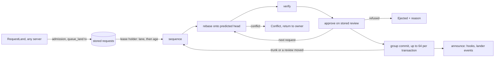

# Landing

The lander, while it holds the repository's lease, serves stored land
requests as one ordered sequence. Each request is rebased onto the head it
will land on (the request before it in the sequence, or trunk), verified
if its risk asks for it, and approved against the review as stored. Up to
64 approved requests then land in one transaction that checks the trunk
head, the lease and every review it was approved on, assigns gap-free
sequence numbers, and writes landing records, reviews, request statuses,
events and follow-up jobs. A request whose approval no longer holds is
ejected with the reason.

## Queue and tickets

Land requests live in the store (`repo/land_queue.rs`), so any server can
accept one, any server can report its status, and they survive restarts:

* `queue_land(request)` writes, in one transaction, the record
  `(lrt, ..., ticket)` (`LandRequestRecord`: ticket, request, status,
  updated_at), a row in the pending index `(lrq, ..., lane, requested_at,
  ticket)`, the index `(lrc, ..., change) → ticket`, a `LandRequested`
  event and a bump of the wake counter. A change with an unfinished
  request gets that request's ticket back instead, so asking twice is
  harmless. Tickets are random 64-bit numbers, shown as `land#n`.
* Requests are served by lane (`emergency`, `human`, `agent`, `bulk`; the
  requester's kind picks `human` or `agent`, reverts use `emergency`), then
  oldest first.
* Every status change is a transaction that writes the record and a
  `LandStatusChanged` event, conditioned on the record as read and fenced
  by the lander's lease. A terminal status (`Landed`, `Failed`,
  `Conflict`, `Returned`, `Ejected`) drops the pending and change rows,
  and never changes again. `Landed` is written by the land transaction
  itself.
* Finished requests stay queryable for `TERMINAL_RETENTION` (7 days) and
  are then swept.

`Lander::run_forever` serves the queue while it holds the lease: it reads
up to 256 pending requests, partitions and processes them, then waits for
the wake counter to move or `batch_window`, whichever is first.
`land_now` (reverts, CLI) queues a request and serves until it finishes,
or until `max_wait` while another process holds the lease.
`GetLandStatus`, `GetTrunkStatus` and `WatchReview` read the stored
records.

| Lander `LandStatus` | Wire `LandStatus` |
| --- | --- |
| `Queued` | `Queued` |
| `Verifying`, `Landing` | `Rebasing` |
| `Landed { seq }` | `Landed` |
| `Failed { reason }`, `Conflict { paths }` | `Failed` |
| `Returned { reason }`, `Ejected { reason }` | `Cancelled` |

## Admission

`Lander::enqueue` returns the ticket of the change's unfinished request if
it has one. Otherwise a requester may have at most `max_in_flight` (50)
unfinished requests; more are refused with `TooManyRequests`
(`RESOURCE_EXHAUSTED`) until some finish. The `emergency` lane is exempt.
The server evaluates the submit policy for the requester before queueing
(`RequestLand`).

## Sequencing

`run_once` reads up to 256 pending requests in lane-then-age order and
`sequence` serves them in windows of `MAX_BATCH` (64). For each window:

1. **Accept.** The first time a request is taken up, `hooks.mark_landing`
   moves its review to `Landing` (or accepts it already `Landing`, when a
   lander that took over resumes it). A refusal fails the request.
2. **Prepare** each request in order with `tip` = the previous request's
   candidate, or the trunk head: a version already on trunk or already an
   ancestor of it fails; a version not based on `tip` is rebased onto it
   (`rill_core::rebase`), and a conflicted rebase sets `Conflict { paths }`
   and returns the change to its owner; the candidate is verified unless
   its mode is `None` (status `Verifying`; red, timeout or error fails it);
   its land-critical values are stored.
3. **Approve.** `hooks.approve(change, requested version, requester)`
   reads the review and judges it: it must still be `Landing` or
   `Landable`, its current version must still be the requested one, the
   submit policy must still allow the requester, and the version's author
   and the requester must still be allowed to act (`AuthorStanding`: a
   suspended user, a killed or lapsed agent, a blocked model or a revoked
   session that wrote it refuses). Outside dev mode the author must also
   still hold write on every path the version writes (`WriteRights`, in
   `workers/rights.rs`), so a revoke between commit and land keeps the
   change off trunk. A refusal sets `Ejected
   { reason }` and returns the change to its owner. An approval carries the
   review snapshot, the policy's digest (BLAKE3 of its text) and the votes
   it saw. Status `Landing`.
4. **Commit** the chain in one `RepoStore::land` batch on the head read at
   the start. A conflict (trunk moved, or a review changed after it was
   approved) rebuilds the chain from step 2, up to `max_retries` times; a
   conflict because the lease moved on stops the sweep (`Fenced`).

Requests later in a window are rebased onto earlier ones, so a window
lands in queue order and each version's first parent is the one before it.
After the last attempt the rest fail with `trunk moved N times while
landing; giving up`. Every `Failed` and `Ejected` returns the change to its
owner and publishes `LandEvent::Failed`. The rebase itself is described in
[rebase](../03-core-algorithms/rebase.md).

## The land transaction

`RepoStore::land(LandBatch { expected, entries, fence, actor, also })` reads the
trunk-head row (`(thd, ns, repo)`: be64 seq ++ hash) and returns
`Conflict` if its hash is not `expected`. Otherwise one transaction, for
entries at `seq = head_seq + 1, + 2, ...`:

* checks: the head row equals what was read, the trunk ref equals
  `expected`, each position is absent, the lease epoch row equals the
  lander's, and each review's change record (and vote epoch) equals its
  snapshot;
* writes: each position and its reverse index, a `Landing` record at
  `(land, ns, repo, seq)`, each review set to `Landed` with its
  `landed_seq`, `Landed` and `StatusChanged` events, a landings charge per
  requester, the new head row and trunk ref, and `also`: the lander passes
  one derive job per landed version and an index job for the new head
  (`land::followups::landing_jobs`), so follow-up work exists exactly when
  the landing does.

A review that is no longer `Landing` or `Landable` (abandoned meanwhile)
stops the batch. Two landers racing for a slot get exactly one winner; the
sequence is gap-free because it comes from the head inside the
transaction that writes it. A batch lands several versions at once, which
the sequencer's group commit (phase 9) uses. `land_on_trunk(expected,
hash)` is a one-entry batch without review or lease, for imports and
tools.

**Leases and fencing.** A lander lands only while it holds the `lander`
lease (`LeaseHolder`, 10 s, renewed once half has passed); `run_once`
leaves requests queued while another process holds it, and
`run_forever` releases it at shutdown so a standby takes over at once.
Taking the lease bumps its epoch, and the land transaction checks the
epoch row, so a lander that was replaced (paused, partitioned) fails every
land with `Fenced` even while it still believes it holds the lease. See
[events and workers](../07-runtime/events-and-workers.md#leases).

## Announcing and land records

After the transaction (which also set the request `Landed`), `announce` calls
`hooks.mark_landed` (a notification: the review service publishes its
events, the record is already written), publishes `LandEvent::Landed`, and
publishes `DependentsReady` when `hooks.dependents_of` returns stack
members above the change. Hook errors are logged, never fatal.

Every trunk position has a `Landing { seq, change_id, version,
requested_version, requester, risk, landed_at, policy, approvals }`
record, written by the land transaction, imports included. `policy` is the
digest of the submit policy that approved the landing and `approvals` the
votes it saw (both empty for changes without review). `landing_of(version)` goes through the
reverse index; `list_landings(limit)` scans the newest records.

## Configuration

`LandPolicy`, the `[lander]` section of the server config:

| Field | Default |
| --- | --- |
| `modes` | trivial `none`; low, normal `affected`; sensitive, critical `full` |
| `max_wait` | 30 min |
| `batch_window` | 2 s (longest pause; a new request starts a sweep at once) |
| `max_retries` | 8 |
| `max_in_flight` | 50 unfinished requests per requester |
| `auto_revert`, `revert_grace` | `false`, 15 min (see [post-land verification](post-land-verification.md)) |

The verifier is `ExecVerifier` (runs `.rill/verify.toml` through
`rill-exec`) when `[verify].enabled`, else `AlwaysGreen`.

## Limitations

* `VerifyMode::Affected` and `Full` call the same verifier; the mode is not
  passed through.
* A request keeps the risk class it was enqueued with.
* A window is one chain: a request that fails verification or approval
  is dropped and the rest are rebased again, but one slow verification
  holds the whole window.
* A store failure inside `mark_landing` also refuses the request; the
  client has to request again.
* After a failed landing the rebased version stays stored but is not the
  review's current version.

## Code

* [rill-lander/src/land/lander.rs](../../crates/rill-lander/src/land/lander.rs), [sequence.rs](../../crates/rill-lander/src/land/sequence.rs), [record.rs](../../crates/rill-lander/src/land/record.rs)
* [rill-lander/src/queue.rs](../../crates/rill-lander/src/queue.rs), [config.rs](../../crates/rill-lander/src/config.rs), [events.rs](../../crates/rill-lander/src/events.rs), [traits.rs](../../crates/rill-lander/src/traits.rs)
* [rill-lander/src/land/followups.rs](../../crates/rill-lander/src/land/followups.rs) (jobs a landing enqueues)
* [rill-store/src/repo/landing.rs](../../crates/rill-store/src/repo/landing.rs) (`land`, `land_on_trunk`, landing records), [repo/leases.rs](../../crates/rill-store/src/repo/leases.rs), [repo/trunk.rs](../../crates/rill-store/src/repo/trunk.rs) (`trunk_head`, `trunk_seq_of`)
* [rill-api/src/services/review/mod.rs](../../crates/rill-api/src/services/review/mod.rs) (`request_land`, `get_land_status`), [common.rs](../../crates/rill-api/src/services/common.rs) (`ticket_status`), [repo/land_queue.rs](../../crates/rill-store/src/repo/land_queue.rs), [state/registry.rs](../../crates/rill-api/src/state/registry.rs), [workers/mod.rs](../../crates/rill-api/src/workers/mod.rs)

---
← Previous: [Review agents](review-agents.md) · [Index](../index.md) · Next: [Post-land verification](post-land-verification.md) →
