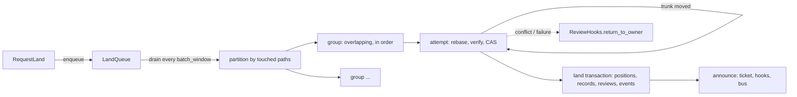

# Landing

The lander takes a requested change version, rebases it onto the current
trunk head if needed, optionally verifies it, and advances trunk in one
transaction that assigns the next sequence number, writes the landing
record, marks the review `Landed` and records events. Nothing is locked
while a request is rebased or verified; the compare-and-swap on the trunk
head decides, and the loser rebases again. Trunk is a head row plus a
gap-free sequence of positions, each written by exactly one successful
land transaction.

## Queue and tickets

`LandQueue` is process memory: a `VecDeque<QueuedRequest>` of pending
requests and a `DashMap<LandTicket, watch::Sender<LandStatus>>`. `enqueue`
assigns `LandTicket(n)` (shown as `land#n`) from a counter starting at 1
and publishes `LandEvent::Queued`. `Lander::run_forever` sleeps
`batch_window`, calls `run_once` (drain all pending, partition, process),
then `forget_terminal` drops tickets that finished more than
`TERMINAL_RETENTION` (10 minutes) ago, so a client polling after the
request completed still sees its outcome. `land_now`, used by reverts,
enqueues, runs one sweep inline and waits on the ticket's watch channel.

The server also remembers each ticket in `RepoContext.tickets` so
`GetLandStatus` can answer after the queue forgot it (after the retention
window or a restart): it falls back to the review state (`landed_seq` set
means `Landed`, otherwise `Returned { "ticket expired ..." }`). The lander
itself never sets `Returned`.

| Lander `LandStatus` | Wire `LandStatus` |
| --- | --- |
| `Queued` | `Queued` |
| `Verifying`, `Landing` | `Rebasing` |
| `Landed { seq }` | `Landed` |
| `Failed { reason }`, `Conflict { paths }` | `Failed` |
| `Returned { reason }` | `Cancelled` |

## Conflict graph

`touched_paths(version)` reads the version's stored `changed@1` set (its
file change and subtree change paths, conflicted paths included); no tree
is diffed. Before moving trunk the lander calls `ensure_land_critical`, so
every trunk version has its root tree, changed paths and ancestry stored.
`partition` is a union-find over the drained requests in arrival order:
two requests join one group when they share a path or one path is a
directory prefix of the other. Each group runs as its own task and
processes its requests in arrival order, so a later request is rebased
onto the earlier one's result. Groups run concurrently and race only on
the CAS. A request whose touched paths cannot be computed fails at once.

## Attempt loop

`process` never returns an error; every outcome becomes a ticket status.
It first calls `hooks.mark_landing`. If review refuses (the change was
abandoned or returned after `RequestLand`, or another request for it is
already landing), the ticket fails with `change is no longer landable`
and nothing lands; this is what stops a change requested twice from landing
twice. Otherwise it picks
the verify mode (`verify_override`, else `LandPolicy.modes` for the
request's risk), and runs up to `max_retries + 1` attempts with `tip`
starting at the requested version:

1. Read `trunk_head`. If `tip` already has a trunk position:
   `Failed("already landed at ...")`.
2. If trunk is non-empty and `tip`'s first parent is not the head: fail
   when `tip` is already an ancestor of the head; otherwise
   `rill_core::rebase(tip, head)`. A conflicted rebase sets `Conflict
   { paths }`, calls `return_to_owner`, publishes `LandEvent::Conflict` and
   stops. A clean rebase is stored with `put_change_version` (a new version
   of the same change) and becomes the candidate.
3. Unless the mode is `VerifyMode::None`: status `Verifying`, run the
   `Verifier` on the candidate's root under `max_wait`. Timeout, verifier
   error or red outcome fails the request.
4. Status `Landing`, `ensure_land_critical`, then `RepoStore::land` with
   one entry: the candidate, the change's review as read, the lander's
   lease, and the landing's jobs. Success is announced. A `Conflict` retries with
   `tip = candidate`, unless the lease moved on, which fails with
   `Fenced`. Any other error first checks trunk: when the candidate has a
   landing record for this change the land committed and only its reply
   was lost, so it is announced as landed; otherwise the request fails.

After the last attempt: `Failed("trunk moved N times while landing; giving
up")`. Every `Failed` calls `return_to_owner` and publishes
`LandEvent::Failed`. The rebase itself is described in
[rebase](../03-core-algorithms/rebase.md).

## The land transaction

`RepoStore::land(LandBatch { expected, entries, fence, actor, also })` reads the
trunk-head row (`(thd, ns, repo)`: be64 seq ++ hash) and returns
`Conflict` if its hash is not `expected`. Otherwise one transaction, for
entries at `seq = head_seq + 1, + 2, ...`:

* checks: the head row equals what was read, the trunk ref equals
  `expected`, each position is absent, the lease epoch row equals the
  lander's, and each review's change record (and vote epoch) equals its
  snapshot;
* writes: each position and its reverse index, a `Landing` record at
  `(land, ns, repo, seq)`, each review set to `Landed` with its
  `landed_seq`, `Landed` and `StatusChanged` events, a landings charge per
  requester, the new head row and trunk ref, and `also`: the lander passes
  one derive job per landed version and an index job for the new head
  (`land::followups::landing_jobs`), so follow-up work exists exactly when
  the landing does.

A review that is no longer `Landing` or `Landable` (abandoned meanwhile)
stops the batch. Two landers racing for a slot get exactly one winner; the
sequence is gap-free because it comes from the head inside the
transaction that writes it. A batch lands several versions at once, which
the sequencer's group commit (phase 9) uses. `land_on_trunk(expected,
hash)` is a one-entry batch without review or lease, for imports and
tools.

**Leases and fencing.** A lander lands only while it holds the `lander`
lease (`LeaseHolder`, 10 s, renewed once half has passed); `run_once`
leaves requests queued while another process holds it, and
`run_forever` releases it at shutdown so a standby takes over at once.
Taking the lease bumps its epoch, and the land transaction checks the
epoch row, so a lander that was replaced (paused, partitioned) fails every
land with `Fenced` even while it still believes it holds the lease. See
[events and workers](../07-runtime/events-and-workers.md#leases).

## Announcing and land records

After the transaction, `announce` sets the ticket to `Landed`, calls
`hooks.mark_landed` (a notification: the review service publishes its
events, the record is already written), publishes `LandEvent::Landed`, and
publishes `DependentsReady` when `hooks.dependents_of` returns stack
members above the change. Hook errors are logged, never fatal.

Every trunk position has a `Landing { seq, change_id, version,
requested_version, requester, risk, landed_at }` record, written by the
land transaction, imports included. `landing_of(version)` goes through the
reverse index; `list_landings(limit)` scans the newest records.

## Configuration

`LandPolicy`, the `[lander]` section of the server config:

| Field | Default |
| --- | --- |
| `modes` | trivial `none`; low, normal `affected`; sensitive, critical `full` |
| `max_wait` | 30 min |
| `batch_window` | 2 s |
| `max_retries` | 8 |
| `auto_revert`, `revert_grace` | `false`, 15 min (see [post-land verification](post-land-verification.md)) |

The verifier is `ExecVerifier` (runs `.rill/verify.toml` through
`rill-exec`) when `[verify].enabled`, else `AlwaysGreen`.

## Limitations

* Queue and tickets are process-local; a restart loses queued requests
  and ticket status (phase 9). A standby lander does not see the active
  one's queue.
* `RepoContext.tickets` is never pruned.
* `VerifyMode::Affected` and `Full` call the same verifier; the mode is not
  passed through.
* A request keeps the risk class it was enqueued with.
* `mark_landing` checks status only. Votes withdrawn after the request
  while the change stays `Landable` are not re-evaluated against policy.
* A store failure inside `mark_landing` also refuses the request; the
  client has to request again.
* After a failed landing the rebased version stays stored but is not the
  review's current version.

## Code

* [rill-lander/src/land/lander.rs](../../crates/rill-lander/src/land/lander.rs), [pipeline.rs](../../crates/rill-lander/src/land/pipeline.rs), [record.rs](../../crates/rill-lander/src/land/record.rs)
* [rill-lander/src/queue.rs](../../crates/rill-lander/src/queue.rs), [conflict_graph.rs](../../crates/rill-lander/src/conflict_graph.rs), [config.rs](../../crates/rill-lander/src/config.rs), [events.rs](../../crates/rill-lander/src/events.rs), [traits.rs](../../crates/rill-lander/src/traits.rs)
* [rill-lander/src/land/followups.rs](../../crates/rill-lander/src/land/followups.rs) (jobs a landing enqueues)
* [rill-store/src/repo/landing.rs](../../crates/rill-store/src/repo/landing.rs) (`land`, `land_on_trunk`, landing records), [repo/leases.rs](../../crates/rill-store/src/repo/leases.rs), [repo/trunk.rs](../../crates/rill-store/src/repo/trunk.rs) (`trunk_head`, `trunk_seq_of`)
* [rill-server/src/services/review/mod.rs](../../crates/rill-server/src/services/review/mod.rs) (`request_land`, `get_land_status`), [common.rs](../../crates/rill-server/src/services/common.rs) (`ticket_status`), [state/registry.rs](../../crates/rill-server/src/state/registry.rs), [workers/mod.rs](../../crates/rill-server/src/workers/mod.rs)

---
← Previous: [Review agents](review-agents.md) · [Index](../index.md) · Next: [Post-land verification](post-land-verification.md) →
