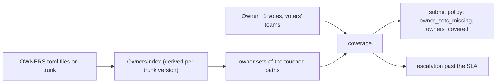

# Code owners

Ownership says who must approve a change to which paths. It is declared
in `OWNERS.toml` files, one per directory, reviewed and landed like code.
Review sees trunk's files, so ownership changes take effect exactly when
the change that makes them lands.



## The file

```toml
owners = ["team:gateway"]          # this directory and below
inherit = true                     # also require the parent's sets
sla = "1d"                         # default set's SLA
escalate_to = "team:gateway-oncall"
[[rule]]
paths = ["auth/**", "*.proto"]     # globs relative to this directory
owners = ["team:security", "user:alice"]
required = 2
sensitive = true
sla = "8h"
escalate_to = "team:security-oncall"
[[delegate]]
from = "user:alice"
to = "user:bob"
until = "2026-11-01"               # a date (end of day, UTC) or RFC 3339
```

Owners are `user:<name>`, `agent:<name>` or `team:<name>`. Globs use
`literal_separator`, so `*` stops at `/` and `**` spans directories. SLAs
are `<n>s`, `<n>m`, `<n>h` or `<n>d`.

## Owner sets

[`OwnersIndex::sets_for`](../../crates/domain/policy/src/owners/index.rs)
finds the nearest directory above a path that has a file:

- each `[[rule]]` whose globs match the path (relative to that directory)
  is a set `<dir>#rule<n>` with its `required` count;
- when none matches, the directory's `owners` are the set `<dir>#default`,
  needing one approval;
- when the file says `inherit = true`, the next file up adds its sets too.

A change's sets are the distinct sets of every path it touches.

## Coverage

[`coverage`](../../crates/domain/policy/src/owners/coverage.rs) counts,
per set, the distinct principals with a positive `Owner` vote on the
current version who count for it. A principal counts for a set when it
is one of the set's entries (a team by membership), or is the `to` of a
running delegation from one. The author never counts, even as an owner.
A set is covered when its count reaches `required`.

The review service builds the facts:

- [`trunk_owners`](../../crates/domain/review/src/owners.rs) compiles the
  index at trunk's head;
- the voters' teams and agents' sponsors come from the org's identity
  records through the `Directory` trait (`OrgDirectory`);
- the facts include the person casting a vote, so their approval counts in
  that same write.

The submit policy sees `owner_sets`, `owner_sets_missing` and
`owners_covered` ([submit policy](../05-policy/submit-policy.md)). The
default policy's `block_uncovered_owners` forbids landing a change of
normal risk or above while any set is missing approvals.

## The index

A version's index is kept as derived data (`owners@1`):

- **No `OWNERS.toml` changed:** it is its first parent's.
- **Some changed:** it is the parent's, patched with the files the version
  set or deleted. A conflicted file keeps the parent's text.
- **No cached ancestor within 256 versions, or the version copied or
  deleted a directory:** the tree is walked.

A file that does not parse is skipped with a warning when compiled, so a
bad file on trunk never stops review.

## Writing owners files

- An `OWNERS.toml` takes `owner` on its directory to change, like `.rill/`
  ([permissions](../05-policy/permissions.md)).
- Every stored version's `OWNERS.toml` must parse, or the commit is refused
  with `INVALID_ARGUMENT`. The lint refuses:
  - malformed owners;
  - empty `owners` without `inherit`;
  - a rule with no paths or owners, or `required = 0`;
  - bad globs, SLAs or dates;
  - self-delegation.
- Changing an `OWNERS.toml`, or touching a `sensitive` rule's paths, makes
  a change at least `sensitive` ([risk
  classification](../05-policy/risk-classification.md)).

## Who may vote `Owner +1`

[`check_approval`](../../crates/server/api/src/services/review/owners.rs)
allows a positive `Owner` vote from someone who counts for at least one set
the change touches. For touched paths no file covers, it falls back to
someone holding the `owner` relation on all of them. Anyone may vote `-1`.
Dev mode skips the check.

## Escalation

A durable event consumer (`escalation-scheduler`) reacts to
`review_submitted`, and to `version_stored` for changes in review. For
every uncovered set with an SLA, it queues a delayed `escalate` job.

When the job runs, if the change is still open, on that version, with the
set uncovered, the review escalates one level. The levels are:

1. the owners' running delegates;
2. the set's `escalate_to`;
3. the owners of the parent directory.

Each escalation posts a thread on the change, addressed to the target when
it is a single principal, and records the note
`escalation:<set> = <level>|<target>|<ms>`. The next level is scheduled one
SLA later. Nothing is ever approved automatically.

Event consumers ([`workers/consumer.rs`](../../crates/server/runtime/src/workers/consumer.rs))
run in one server, the holder of the consumer's lease. They save their
event-log cursor under the lease after each event, so a restart or a
failover resumes where they stopped.

## API and CLI

- `ReviewService.GetOwners(repo, path)` returns the sets covering a path
  (needs read on the path).
- `ReviewService.ExplainOwnership(change)` returns each set with its
  approvals, coverage and escalations.
- `rill owners show <path>` and `rill owners explain [change]` show the
  same.

## Limitations

- Team membership comes from the org's user records; nested teams are not
  expanded.
- Escalation reacts to new versions, not to a later `OWNERS.toml` change
  that adds an SLA to an open review.
- A set's SLA is counted from when the change entered review or got its
  version, not from when the set became required.

## Code

- [owners/file.rs](../../crates/domain/policy/src/owners/file.rs), [owners/index.rs](../../crates/domain/policy/src/owners/index.rs), [owners/coverage.rs](../../crates/domain/policy/src/owners/coverage.rs), [directory.rs](../../crates/domain/policy/src/directory.rs)
- [rill-review/src/owners.rs](../../crates/domain/review/src/owners.rs), [rill-runtime workers/escalation.rs](../../crates/server/runtime/src/workers/escalation.rs), [identity/directory.rs](../../crates/server/runtime/src/identity/directory.rs)
- [api services/review/owners.rs](../../crates/server/api/src/services/review/owners.rs), [ownership.rs](../../crates/server/api/src/services/review/ownership.rs)

---
← Previous: [Review](review.md) · [Index](../index.md) · Next: [Review agents](review-agents.md) →
