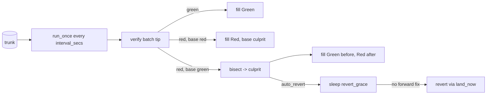

# Post-land verification

Trunk advances optimistically, so verification also runs after landing.
`PostLandVerifier` follows trunk in batches, verifies each batch tip,
bisects a red batch to the first red position, and, when policy allows,
lands a revert of it. Every trunk position at or below the worker's cursor
has a `VerificationRecord`, verified directly or inferred from its batch.

## Sweep

The worker is built by `RepoRegistry` when `[postland].enabled` and run by
`spawn_repo_workers` with `run_forever(interval, shutdown)`. `run_once`
holds `sweep_lock` (a process-local `tokio::sync::Mutex`) and:

1. Loads the cursor (`TrunkSeq::ZERO` if never stored). Stops if trunk is
   empty or the head is at or below the cursor.
2. Sets `to = min(head, cursor + batch_size)`.
3. Finds the base culprit: if the record at `cursor` is `Red`, its
   `culprit` (or `cursor` itself).
4. Verifies `to` directly with `verify_seq`.
5. Tip green: fill `(cursor, to)` as `Green`. Tip not green with a red
   base: fill as `Red` with the base culprit ("still red"). Tip not green
   on a green base: `bisect(cursor, to)`, fill before the culprit `Green`
   and after it `Red` with `culprit = found`.
6. Stores the cursor at `to`.

`verify_seq(seq)` runs the lander's `Verifier` on the root of
`trunk_at(seq)`, writes a direct record and publishes
`LandEvent::Verification { seq, green }`. If an earlier direct record for
that position disagrees, the new record is `Flaky`. `fill` writes an
`inferred: true` record for each position strictly between the bounds
that has no record yet. A verifier error aborts the sweep without moving
the cursor; the next sweep retries.

`batch_size` (default `DEFAULT_BATCH_SIZE` = 8) bounds one sweep. When the
worker keeps up it verifies every position directly; when behind, it
verifies only batch tips and pays for bisection only on a red tip over a
green base.

## Bisect

`bisect(green, red)` is a binary search that calls `verify_seq` on
midpoints (each a direct record; `rill-exec`'s action cache makes repeats
cheap). `Flaky` counts as not green. The culprit's own record gets
`culprit = itself`, `LandEvent::Culprit` is published, and if
`LandPolicy.auto_revert` is set, `schedule_auto_revert` is called.

## Revert

`build_revert(seq, reason, actor, tool)` creates a new change (fresh
`ChangeId`) whose file changes invert the landed version's diff against
its first parent: each path gets the parent's content back, or `Delete` if
it did not exist. The revert is parented on the landed version, so landing
it rebases it onto the current head with a three-way merge; later edits to
the same files surface as a rebase conflict instead of being overwritten.
Provenance carries `tool` (`lander:revert` or `lander:auto-revert`) and
`extra["reverts"] = seq`, `extra["reverted_version"]`. The message is
`Revert trunk@N: 
`.

`revert` lands it with `land_now`, `risk = Normal` and
`verify_override = Some(VerifyMode::None)`. Any result other than `Landed`
is `RevertFailed` (gRPC `Aborted`). On success it publishes
`LandEvent::Reverted { culprit, revert }`.

`schedule_auto_revert` spawns a task that sleeps `revert_grace` and calls
`auto_revert`. That skips the revert if `has_forward_fix(seq)` finds a
later trunk position whose provenance has `reverts == seq`, or whose
message or linked intent title or body contains `trunk@<seq>`. Otherwise it
reverts as the service principal `svc:lander`.

## `ReviewHooks`

`rill-lander` does not depend on `rill-review`. It calls back through the
`ReviewHooks` trait, which the server implements as `ReviewHooksAdapter`
over the `ArcSwap<ReviewService>` handle, so in-flight landings see a
policy reload. A missing review (reverts, direct lands) is never an error.

| Hook | Review call |
| --- | --- |
| `mark_landing` | `mark_landing` (`Landable` to `Landing`) |
| `mark_landed` | `mark_landed` (to `Landed`, sets `landed_seq`) |
| `return_to_owner` | `landing_failed` (on `InvalidStatus`, `refresh`), then a change-level thread from `svc:lander` addressed `to` the owner |
| `dependents_of` | `stack_of`, the members after the change |

The lander logs hook errors and carries on. Status transitions are in
[review](review.md).

## Records and RPCs

* derived `postland@1` keyed by version: the record (`record_of`;
  `record_at(seq)` resolves through `trunk_at`).
* misc `postland_index`: ring of the last `POSTLAND_RING` (1000) records,
  one per `seq`.
* misc `postland_cursor`: big-endian `u64`.
* misc `verify_reports:<seq>`: external reports from `ReportVerification`,
  one per `(target, reporter)`.

`GetVerification`, `ListLandings` and `GetTrunkStatus` merge the post-land
record (target `postland`) with external reports, worst wins: `Failed` or
`Inherited`, then `Running`, `Pending`, `Skipped`, `Passed`; no reports is
`Pending`. An inferred red record blaming another position is `Inherited`.
`RevertSeq` and `Bisect` need the `land()` permit; `Bisect` fails with
`FailedPrecondition` when the worker is disabled.

## Limitations

* The cursor only moves forward; positions below it are re-verified only
  by an explicit `Bisect`.
* A new failure inside a batch that is already red is attributed to the
  earlier culprit; it is not bisected separately.
* Pending auto-reverts live in a spawned task and are lost on restart.
* `has_forward_fix` is a substring match on `trunk@N`.
* The `Bisect` RPC does not take `sweep_lock` and does not check that
  `from` is green or `to` red.
* A revert that conflicts fails with `RevertFailed` and is not retried.
* External reports have no size limit or retention.

## Code

* [rill-lander/src/postland/worker.rs](../../crates/rill-lander/src/postland/worker.rs), [record.rs](../../crates/rill-lander/src/postland/record.rs)
* [rill-lander/src/revert.rs](../../crates/rill-lander/src/revert.rs), [traits.rs](../../crates/rill-lander/src/traits.rs)
* [rill-server/src/workers/hooks.rs](../../crates/rill-server/src/workers/hooks.rs), [verifier.rs](../../crates/rill-server/src/workers/verifier.rs), [mod.rs](../../crates/rill-server/src/workers/mod.rs)
* [rill-server/src/services/lander.rs](../../crates/rill-server/src/services/lander.rs)
* [rill-server/src/config/server.rs](../../crates/rill-server/src/config/server.rs) (`PostLandConfig`)

---
← Previous: [Landing](landing.md) · [Index](../index.md) · Next: [Intents](intents.md) →
