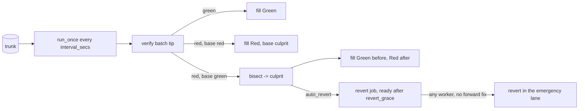

# Post-land verification

Trunk advances optimistically, so verification also runs after landing.
`PostLandVerifier` follows trunk in batches, verifies each batch tip,
bisects a red batch to the first red position, and, when policy allows,
lands a revert of it. Every trunk position at or below the worker's cursor
has a `VerificationRecord`, verified directly or inferred from its batch.

## Sweep

The worker is built by `RepoRegistry` when `[postland].enabled` and run by
`spawn_repo_workers` with `run_forever(interval, shutdown)`. `run_once`
holds `sweep_lock` (a process-local `tokio::sync::Mutex`) and:

1. Loads the cursor (`TrunkSeq::ZERO` if never stored) and the marks
   (`Marks { green, full_green }`: the last positions that passed, and
   passed the whole plan). Stops if trunk is empty or the head is at or
   below the cursor.
2. Sets `to = min(head, cursor + batch)`. The batch size adapts
   (`BatchSize`): it starts at 4, doubles after a passing tip up to
   `[postland].batch_size` (32) and halves after a red one, so verification
   keeps pace with landing and a red batch is small.
3. Finds the base culprit: if the record at `cursor` is `Red`, its
   `culprit` (or `cursor` itself).
4. Verifies `to` directly. Normally only what changed since `marks.green`
   runs: the verifier gets that position's root as the base, so steps
   whose inputs nothing since touched are skipped (they passed then and
   cannot have changed). Every `full_every_secs` (15 minutes), and on the
   first sweep after a start, the whole plan runs instead.
5. Tip passed (`Green`, or `Flaky`: it failed only in targets that passed
   when run again): fill `(cursor, to)` as `Green` and move
   `marks.green` (and `full_green` after a full run) to `to`. Tip red with
   a red base: fill as `Red` with the base culprit ("still red"). Tip red
   on a passing base: bisect, from the cursor, or from `full_green` after
   a full run (a full run can find what selection missed before the
   cursor); fill before the culprit `Green` and after it `Red` with
   `culprit = found`, and set `marks.green` just before the culprit.
6. Moves the cursor from `cursor` to `to` and the marks with
   compare-and-swaps fenced on the `postland` lease, so neither a replaced
   verifier nor a second sweep can move them twice.

A sweep that leaves trunk's head past `to` is followed at once by
another, so after a red batch shrinks the size, verification catches up
within one interval instead of falling further behind with every one.

Inferred records are replaced when a position is verified directly or a
later bisection decides it.

## Bisect

`bisect(green, red)` is a k-ary search (`BISECT_WAYS` = 8): each round
verifies the 7 evenly spaced positions inside the range at once (each a
direct record, verified against the range's passing end; `rill-exec`'s
action cache makes repeats cheap) and keeps the range between the last
passing and the first red of them, so 64 positions take two rounds
instead of six. `Flaky` counts as passing.

The search is narrowed first. Only a landing that touched the failing
steps' inputs can have turned them red, so it searches only the positions
for which `Verifier::could_affect(root, parent root, failing steps)` holds
(the server answers from the plan: the change touched the plan or one of
the steps' input globs), plus the known-red end. Usually that is one
position, verified once. When the steps are unknown it searches the whole
range.

A sweep on a trunk that is already red still looks for new breaks: steps
failing at the tip that trunk's open incidents do not explain are searched
for alone (`Search.focus`): a probe is red only if one of those steps
fails. That finds a second, overlapping culprit instead of blaming the
first. The same search follows every culprit a sweep finds, over the rest
of its batch, until the open incidents explain every step failing at the
tip: two breaks landing in one batch each get their own incident, rather
than the second being searched for later, outside the batch, where it
would blame whatever landed last.

The culprit's own record gets `culprit = itself`, red records after it get
`culprit = it`, `LandEvent::Culprit` is published, an incident is opened
(below) and, if `LandPolicy.auto_revert` is set (the default),
`schedule_auto_revert` queues the revert.

## Incidents and trunk health

Every culprit opens an `Incident` (`inc/(culprit seq)`, named `trunk@N`):
the culprit's version, change, failing targets and steps (only the new ones
for a focused search), its verification details, and where it came from
(author, session, model, sponsor). The lander tells the culprit's owner
(`ReviewHooks::notify_incident`: a comment addressed to the owner on the
culprit's review, naming the sponsor, the failing steps, the grace period
and how to fix it) and offers it to a `FixDispatcher` when the server has
one (fix agents come with the reviewer fleet; the server has none yet).

An incident is `Open` until a landing reverts its culprit or names it in a
`Fixes: trunk@N` trailer or its provenance (`fixes`); the land
transaction's caller then moves it to `Fixing` with the resolution
(`Reverted` or `Fixed` at that position). When a sweep's tip passes, every
open incident closes (`Recovered` if nothing fixed it explicitly).

Trunk's health (`TrunkHealth`, a misc row) is judged from the open
incidents after every change and every sweep (`healing::judge`): `Green`
with none, `Fixing` when all have a fix landed, else `Red`, and `Guarded`
once red for `guard_after` (30 minutes) or with `guard_incidents` (3)
incidents open. Each change writes `TrunkHealthChanged` and each incident
change `IncidentChanged`, both audited (`trunk.health`, `trunk.incident`).

A guarded trunk holds back, until a later sweep, landings that could
affect a failing step (asked of the verifier as above), except emergency
landings and those naming an open incident as fixed. An owner can freeze
trunk (`FreezeTrunk`): then only the emergency lane lands, whatever the
health. `rill trunk health`, `rill incidents`, `rill trunk
freeze [--reason]` and `rill trunk thaw` show and change it.

## Revert

`build_revert(seq, reason, actor, tool)` creates a new change (fresh
`ChangeId`) whose file changes invert the landed version's diff against
its first parent: each path gets the parent's content back, or `Delete` if
it did not exist. The revert is parented on the landed version, so landing
it rebases it onto the current head with a three-way merge; later edits to
the same files surface as a rebase conflict instead of being overwritten.
Provenance carries `tool` (`lander:revert` or `lander:auto-revert`) and
`extra["reverts"] = seq`, `extra["reverted_version"]`. The message is
`Revert trunk@N: 
`.

`revert` lands it with `land_now` in the `emergency` lane, `risk =
Normal` and `verify_override = Some(VerifyMode::None)`. Any result other than `Landed`
is `RevertFailed` (gRPC `Aborted`). On success it publishes
`LandEvent::Reverted { culprit, revert }`.

`schedule_auto_revert` stores the pending revert as a high-priority job on
the repository's `revert` queue, ready `revert_grace` after the culprit was
found, so a restart does not forget it. Each server with the workers role
runs a revert worker (`workers/reverter.rs`, `RevertHandler`); the job
calls `auto_revert`, retrying with backoff if landing fails; the first
failure (a conflict the [conflict ladder](landing.md#conflict-ladder) could
not resolve, say) is recorded on the incident as `revert_blocked` and the
culprit's owner is told. It skips the revert if `has_forward_fix(seq)`
finds a later trunk position that reverts it or names it in a `Fixes:
trunk@N` trailer or its provenance's `fixes`; a message merely mentioning
`trunk@N` does not count. Otherwise it reverts as the service
principal `svc:lander`, as a change whose id is derived from the culprit's
position: a job rerun after a crash finds the request or the landed revert
the first run made instead of reverting twice.

## Blast-radius reverts

`BulkRevert` (repository owners; `rill revert --session S --model M
--sponsor P --author A --intent I [--since N] [--until M] -m why`) undoes
every landing one origin made: those whose vouched provenance matches every
field given (session and model come from the token that wrote a version,
so a client cannot claim them), in `(since, until]`, not reverts
themselves and not already reverted, newest first, at most 500. A range
alone is refused: it is not a blast radius.

Without `apply` (`--apply`) it is a preview: each revert is built and
rebased onto the result of the newer ones, and the paths it would
conflict at are listed; nothing lands (the versions it built stay for the
collector). With `apply`, each revert is queued on its own in the
emergency lane without pre-land verification, a millisecond apart so they
are served newest first, and the reverts that do not conflict land even
when one does (that one goes through the conflict ladder and back to the
requester). One `RevertsRequested` event records the selector and count
(audited as `trunk.mass_revert`).

## `ReviewHooks`

`rill-lander` does not depend on `rill-review`. It calls back through the
`ReviewHooks` trait, which the server implements as `ReviewHooksAdapter`
over the `ArcSwap<ReviewService>` handle, so in-flight landings see a
policy reload. A missing review (reverts, direct lands) is never an error.

| Hook | Review call |
| --- | --- |
| `mark_landing` | `mark_landing` (`Landable` to `Landing`) |
| `mark_landed` | `mark_landed` (to `Landed`, sets `landed_seq`) |
| `return_to_owner` | `landing_failed` (on `InvalidStatus`, `refresh`), then a change-level thread from `svc:lander` addressed `to` the owner |
| `dependents_of` | `stack_of`, the members after the change |
| `notify_incident` | a change-level thread from `svc:lander` addressed to the owner: the break, or that its revert is blocked |

The lander logs hook errors and carries on. Status transitions are in
[review](review.md).

## Records and RPCs

* derived `postland@1` keyed by version: the record (`record_of`;
  `record_at(seq)` resolves through `trunk_at`).
* misc `postland_index`: ring of the last `POSTLAND_RING` (1000) records,
  one per `seq`.
* misc `postland_cursor`: big-endian `u64`.
* misc `verify_reports:<seq>`: external reports from `ReportVerification`,
  one per `(target, reporter)`.

`GetVerification`, `ListLandings` and `GetTrunkStatus` merge the post-land
record (target `postland`) with external reports, worst wins: `Failed` or
`Inherited`, then `Running`, `Pending`, `Skipped`, `Passed`; no reports is
`Pending`. An inferred red record blaming another position is `Inherited`.
`RevertLanding` and `Bisect` need the `land()` permit; `Bisect` fails with
`FailedPrecondition` when the worker is disabled. `GetTrunkHealth` (health
and open incidents) and `ListIncidents` need read access; `FreezeTrunk`
and `BulkRevert` need repository ownership.

## Limitations

* The cursor only moves forward; positions below it are re-verified only
  by an explicit `Bisect`.
* A new break in a step that is already failing is attributed to the
  earlier culprit; only newly failing steps are searched separately.
* Held landings of a guarded trunk show as `Queued`, without a reason.
* The `Bisect` RPC does not take `sweep_lock` and does not check that
  `from` is green or `to` red.
* A blocked revert is retried by its job until the job runs out of
  attempts.
* External reports have no size limit or retention.

## Code

* [rill-lander/src/postland/](../../crates/domain/lander/src/postland/mod.rs): [worker.rs](../../crates/domain/lander/src/postland/worker.rs), [bisect.rs](../../crates/domain/lander/src/postland/bisect.rs), [positions.rs](../../crates/domain/lander/src/postland/positions.rs), [batch.rs](../../crates/domain/lander/src/postland/batch.rs), [record.rs](../../crates/domain/lander/src/postland/record.rs)
* [rill-lander/src/healing/](../../crates/domain/lander/src/healing/mod.rs) (incidents, health, fixes, mass reverts), [land/guard.rs](../../crates/domain/lander/src/land/guard.rs); store [repo/health.rs](../../crates/foundation/store/src/repo/health.rs)
* [rill-exec/src/verify/affects.rs](../../crates/domain/exec/src/verify/affects.rs), [rill-api/src/services/trunk/health.rs](../../crates/server/api/src/services/trunk/health.rs)
* [rill-lander/src/revert.rs](../../crates/domain/lander/src/revert.rs), [traits.rs](../../crates/domain/lander/src/traits.rs)
* [rill-runtime/src/workers/hooks.rs](../../crates/server/runtime/src/workers/hooks.rs), [verifier.rs](../../crates/server/runtime/src/workers/verifier.rs), [repo_tasks.rs](../../crates/server/runtime/src/workers/repo_tasks.rs)
* [rill-api/src/services/trunk/verification.rs](../../crates/server/api/src/services/trunk/verification.rs)
* The gate that breaks trunk on purpose and times the healing: `trunk_red`, see [performance](../09-engineering/performance.md#trunk-healing)
* [rill-runtime/src/config/server.rs](../../crates/server/runtime/src/config/server.rs) (`PostLandConfig`)

---
← Previous: [Landing](landing.md) · [Index](../index.md) · Next: [Intents](intents.md) →
