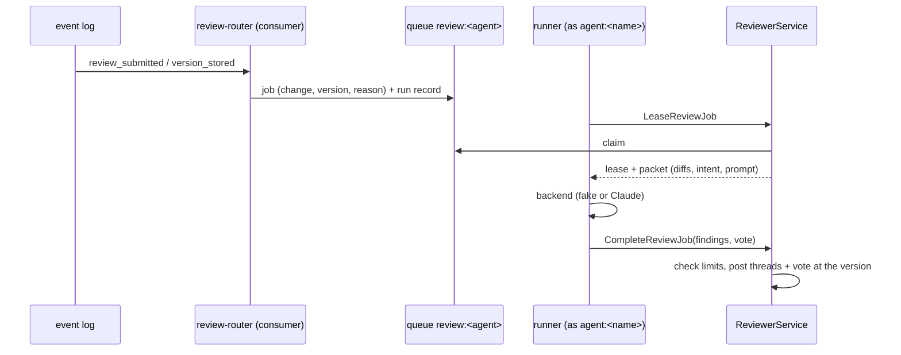

# Review agents

Agent reviewers and conflict resolvers run outside the server, as a
fleet. A reviewer is a registered agent with a reviewer profile. The
repository's `.rill/review.toml` routes changes to reviewers, and each
reviewer has its own job queue. A runner signs in as the agent, leases
jobs, runs a model and reports structured results. The server checks every
result before posting it as that agent.



## Reviewers

An agent becomes a reviewer when its record carries a `ReviewerProfile`
(`rill agent register --reviewer-family … --reviewer-model …`):

| Field | Meaning |
| --- | --- |
| `model_family` | `claude`, `gpt`, …; independence compares it |
| `model` | the model the runner should run |
| `prompt` | repository path of its prompt (default `.rill/reviewers/<name>/prompt.md`) |
| `max_vote` | the largest `Review` vote it may cast, either way (1 or 2) |
| `runs_per_day` | reviews it may run per day in a repository |

Model API keys never reach the server. They live with the runner.

## Routing

```toml
# .rill/review.toml, landed like code (it is under .rill/, so it takes owner)
[[reviewer]]
agent = "reviewer-security"
paths = ["services/**", "*.proto"]   # default: every path
exclude = ["**/testdata/**"]
min_risk = "normal"                  # default: trivial

[resolver]
agent = "resolver"
paths = ["**"]
```

The `review-router` durable consumer
([workers/reviewers.rs](../../crates/server/runtime/src/workers/reviewers.rs))
reacts to two events:

- **`review_submitted`:** queues a review for every reviewer whose globs
  match a touched path at or above its `min_risk`.
- **`version_stored`:** does the same for a later version of a change in
  review. A message edit or trivial rebase (`VersionRelation` other than
  `Changed`) is skipped, because its votes are copied.

A version with conflicts on paths the `[resolver]` covers gets a resolve
job instead of reviews. The file is linted at commit
([`ReviewConfig::parse`](../../crates/domain/policy/src/reviewers/config.rs)).

Queueing ([fleet/jobs.rs](../../crates/server/runtime/src/fleet/jobs.rs))
records a run for each (kind, agent, version), so the same version is
never queued twice unless the earlier run failed. A run is `skipped` when
the agent has no reviewer profile, or when its daily budget is spent
(counted in `reviewer-day:<agent>:<day>`). `ReviewerService.RequestReview`
queues reviews on demand (`rill review request [--reviewer …]`).

## Leases

Each agent has a queue per repository, `review:<agent>` or
`resolve:<agent>` (rill-jobs, 2-minute lease).

- **`LeaseReviewJob`:** waits up to 30 s. It reaps expired claims, claims
  a job and hands back an opaque lease (the serialized claim). It ends
  jobs that need no work instead of returning them:
  - a duplicate whose run already finished;
  - a change that moved on (the run becomes `stale`);
  - a path the agent may not read (the run becomes `failed`).
- **Using a lease:** `Queue::verify` checks every lease that comes back.
  Its keys must be the caller's own queue's, and its recorded claim must
  name the same job and holder. A lease for another agent or a forged
  payload is refused.
- **Renewing:** runners renew while a model runs (`RenewReviewLease`).

The job carries a packet built by `review_context` within the server's
token budget:
- the description, author and risk;
- the linked intent;
- per-file unified diffs (whole text for added and deleted files);
- the prompt file's text on trunk.

## Results

`CompleteReviewJob` sends findings (path, lines, category, confidence,
body), a vote and a summary.
[`check_result`](../../crates/domain/review/src/agents/results.rs) refuses
a result, ending the job and failing the run, when:

- the vote is above the reviewer's `max_vote`;
- there are more than 50 findings, or a body is empty or over 8 KiB;
- a finding names a path the version does not touch;
- a line range is backwards.

`post_review_result` then:
- posts findings at confidence 30 or more as threads anchored at the
  reviewed version;
- casts the vote with `vote_at(expected version)`.

If the change has a newer version, nothing is posted and the run is
`stale`. Votes otherwise follow [review](review.md). `Review +2` stays
human-only, and `Bug`/`Security` threads block landing.

Runs are kept per change (`review-runs:<change>`, newest 200) and listed
by `ListReviewRuns` (`rill review runs`). A run records:
- its status: `queued`, `done`, `failed`, `stale` or `skipped`;
- the vote, the number of findings and the model;
- the summary or error.

## Independence

[`independent_approvals`](../../crates/domain/policy/src/reviewers/independence.rs)
counts the positive agent `Review` votes on the current version that are
independent of the author. A vote does not count when:

- the voter is the author;
- the voter's sponsor is the author (a human) or the author's sponsor;
- an already-counted voter runs the same model family and prompt.

The submit policy sees the result as `independent_agent_approvals`. The
default policy's normal-risk agent path needs two of them plus a human
owner's `+1`.

## Calibration

The `reviewer-calibration` consumer
([workers/calibration.rs](../../crates/server/runtime/src/workers/calibration.rs))
keeps a record per reviewer per repository (`reviewer-stats`). It
follows what happens after review:

| Event | Effect on the record |
| --- | --- |
| a landing, for each agent whose `Review +` vote the policy saw | `approvals += 1` |
| that landing reverted (a landing whose provenance names it in `reverts`), or blamed by a newly opened incident | `escapes += 1` for those agents, once per landing (`escaped:<seq>`) |
| a reviewer's blocking finding (Bug/Security, confidence 70 or more) resolved after a newer version | `blocks += 1` |
| the same, resolved on the version it was raised on | `dismissed += 1` |

[`ReviewerStats`](../../crates/domain/policy/src/reviewers/trust.rs)
turns the record into trust:

- **Good calls:** approvals that did not escape, plus blocks.
- **Bad calls:** escapes, plus dismissals.
- **Trust:** the mean of Beta(good + 1, bad + 1), in permille. A new
  reviewer has 500.

After 20 outcomes, a reviewer below 700 is demoted. The router then
skips it (the run becomes `skipped`), and its approvals stop counting as
independent. An owner clears the record with `ReinstateReviewer`
(`rill reviewer reinstate`). `ListReviewerStats` (`rill reviewer stats`)
shows every record.

The facts give each reviewer its trust. The policy sees
`min_agent_trust`, the lowest trust among the independent approvers (0
when there are none). A rule can then require, for example,
`independent_agent_approvals >= 2 && min_agent_trust >= 800`.

## Resolvers

A resolver leases its next conflicted version with `LeaseResolveJob`,
which returns the change, version, conflicted paths and prompt. It reads
the terms through the normal diff and blob APIs. It stores its resolution
with `ChangeService.ResolveConflicts` as itself, so its write rights apply
and the version records `resolved_by = "agent"`. `CompleteResolveJob`
records the outcome: either the resolved version, which must be the same
change and conflict-free, or that it declined.

## The reference runner

`rill-review-runner` ([crates/clients/review-runner](../../crates/clients/review-runner))
uses only the SDK. It signs in with the usual credentials: `RILL_TOKEN`,
or a workload identity exchanged for an agent token. It runs
`--mode review|resolve` with one of two backends:

- **`fake`:** deterministic and offline.
  - It flags added lines carrying `RILL-DEFECT`, catching each with
    probability `--detect-permille` drawn from the version and line.
  - It wrongly blocks `--false-positive-permille` of clean changes.
  - It resolves conflicts by keeping every side.
  Simulations and the phase gate use it.
- **`claude`:** one Messages API request per job, with a forced tool call
  (`report_review` or `report_resolution`).
  - The system prompt frames the diff as untrusted data.
  - Unknown categories are dropped and bad ranges fixed.
  - A blocking finding always votes against, whatever the model voted.
  - It reads `ANTHROPIC_API_KEY` and optionally `ANTHROPIC_BASE_URL`.

  Its tests run against a local stand-in serving recorded answers.

## Limitations

- Sampled human audits feed escapes once they exist ([attention](review.md)); until then only reverts and incidents do.
- Independence does not compare sessions, and does not expand a team
  sponsor to its members.
- A reviewer's daily budget is per repository, not across the org.
- Changing `.rill/review.toml` does not re-route open reviews; use
  `RequestReview`.

## Code

- [rill-policy reviewers/](../../crates/domain/policy/src/reviewers/mod.rs): routing, independence, trust
- [rill-review agents/](../../crates/domain/review/src/agents/mod.rs): context, result checks, runs, trunk routing
- [rill-runtime fleet/](../../crates/server/runtime/src/fleet/mod.rs), [workers/reviewers.rs](../../crates/server/runtime/src/workers/reviewers.rs), [workers/calibration.rs](../../crates/server/runtime/src/workers/calibration.rs)
- [rill-api services/reviewers/](../../crates/server/api/src/services/reviewers/mod.rs), [reviewers.proto](../../crates/foundation/proto/proto/rill/v1/reviewers.proto)
- [rill-sdk reviewers.rs](../../crates/clients/sdk/src/reviewers.rs), [rill-review-runner](../../crates/clients/review-runner/src/lib.rs)
- Tests: [api access/reviewers.rs](../../crates/server/api/tests/grpc/access/reviewers.rs), [runner tests](../../crates/clients/review-runner/tests/runner/main.rs)

---
← Previous: [Code owners](ownership.md) · [Index](../index.md) · Next: [Landing](landing.md) →
