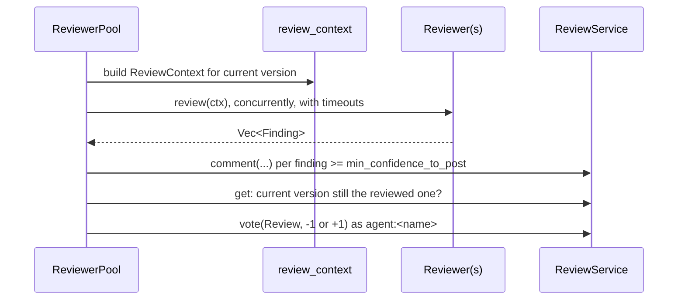

# Review agents

`rill-review::agents` defines how automated reviewers take part in
[review](review.md): they read a bounded context for a change, return
findings, and the pool posts those findings as threads and casts a
`Review` vote. It is library code; the server never constructs a
`ReviewerPool`, and only `crates/domain/review/tests/review_flow.rs`
exercises it.

## Context

`review_context` builds a `ReviewContext` for the change's current version:

* per-file diffs with hunks, for text files under 1 MiB;
* blame of the parent-side lines the change removes (best effort);
* the linked intent and the stack;
* a `truncated` flag, set after dropping the content of the largest diffs
  until the size estimate (bytes / 4) fits `Budget.max_input_tokens`.

`Budget` defaults: `max_input_tokens = 100_000`, `timeout = 120 s` per
reviewer.

## Reviewer and findings

`Reviewer` is an `async_trait` with `name()` and
`review(Arc<ReviewContext>) -> Result<Vec<Finding>>`. A `Finding` has a
`CommentCategory`, a confidence 0-100, a body, and an optional path and
line range. It becomes a `Change`, `File` or `Lines` thread anchor at the
reviewed version.

`HeuristicReviewer` is the built-in implementation. It runs regex checks
on added lines and reports:

| Check | Category |
| --- | --- |
| `TODO` / `FIXME` / `XXX` | `Suggestion` |
| debug prints (`println!`, `dbg!`, `console.log(`, ...) in source files | `Style` |
| credential-shaped strings and private-key headers | `Security` |
| new files over `max_new_file_lines` (500) | `Suggestion` |
| source files changed with no test path touched (change-level) | `TestGap` |

Each check can be switched off in `HeuristicConfig`.

## Pool

`ReviewerPool::run(service, change_id)` runs every registered reviewer
concurrently. Each runs under its `Budget.timeout`, and all of them under
`PoolConfig.total_timeout` (300 s). For each reviewer:

1. Post findings with confidence at or above `min_confidence_to_post` (30)
   as threads authored by `Principal::agent(name)`.
2. Re-read the review. If the current version moved during the run, cast
   no vote and record "version changed during review".
3. Vote `Review -1` if any finding is in `block_categories` (`Bug`,
   `Security`) with confidence at or above `block_confidence` (70), else
   `Review +1`.

A reviewer error, a timeout or a rejected vote becomes
`ReviewerOutcome.error`; the pool run still succeeds and returns a
`PoolReport` with one outcome per reviewer.

Because agent `Review` votes and `Bug`/`Security` threads feed the submit
facts, a pool run can change the change's status like any human vote.

## Resolver

`Resolver` fixes the shape of a conflict-resolving agent:
`resolve(&ConflictTerms) -> Result<Option<Resolution>>`, where
`ConflictTerms` carries a conflicted path's terms and their text, and
`Resolution` carries the content (or deletion), a rationale and a
confidence. There is no implementation and no caller; the lander returns
conflicts to the owner instead of invoking resolvers.

## Limitations

* No server entry point, RPC or worker runs the pool or any reviewer.
* `HeuristicReviewer` is the only `Reviewer`; there is no model-backed one.
* `Resolver` has no implementation and is not wired into landing.
* Findings are posted before the version check, so a run against a moved
  version still leaves threads anchored at the old version.

## Code

* [rill-review/src/agents/mod.rs](../../crates/domain/review/src/agents/mod.rs)
* [rill-review/src/agents/reviewer.rs](../../crates/domain/review/src/agents/reviewer.rs), [context.rs](../../crates/domain/review/src/agents/context.rs)
* [rill-review/src/agents/heuristic.rs](../../crates/domain/review/src/agents/heuristic.rs)
* [rill-review/src/agents/pool.rs](../../crates/domain/review/src/agents/pool.rs)
* [rill-review/src/agents/resolver.rs](../../crates/domain/review/src/agents/resolver.rs)
* [rill-review/tests/review_flow.rs](../../crates/domain/review/tests/review_flow.rs)

---
← Previous: [Review](review.md) · [Index](../index.md) · Next: [Landing](landing.md) →
