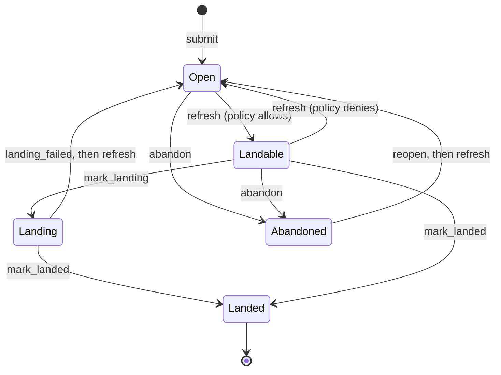

# Review

Review is a state machine over each change's review: a change record,
its votes and its threads. It
collects votes and threads and decides when the change may land: a change
is `Landable` exactly when the Cedar submit policy lets its owner land the
current version, given the votes on it, unresolved threads and risk class.
Automated reviewers are covered in [review agents](review-agents.md).

## Record and writes

`ReviewState` is the assembled view: `versions` (last is current),
`status`, `owner` (who called `submit`), `intent`, `votes`, `threads`,
`risk`, `risk_reasons`, `stack` and `landed_seq`. It is stored as parts, so
reviewers acting at once do not rewrite each other's data:

| Part | Key | Written by |
| --- | --- | --- |
| `ChangeRecord` (everything but votes and threads) | `(ch, ns, repo, change)` | status, version, risk, stack and intent changes |
| `LabelVote` | `(vote, ns, repo, change, label, voter, version)` | its voter, blind |
| vote epoch | `(vep, ns, repo, change)` | every vote write, blind |
| `ThreadHeader` | `(thr, ns, repo, change, thread)` | thread creation, resolve, re-anchor |
| `Comment` | `(cmt, ns, repo, change, thread, stamp)` | each comment, appended with a versionstamp |

`ReviewService` holds no state. Every mutation (`update`) reads a
`ReviewSnapshot`, mutates a copy of the assembled state, and
`RepoStore::review_writes` turns the difference into the rows that
changed. Every write checks the change record it read, so a decision made
on stale status or versions retries. A write that changes the record also
checks the vote epoch, so a status computed from fewer votes cannot
overwrite one computed from more; votes and comments themselves never
conflict. `updated_at` moves only with the record. On conflict `update`
retries up to `MAX_WRITE_ATTEMPTS` (8), then fails with `Contended` (gRPC
`Aborted`). Votes are listed in the order they were cast.

A vote that does not change the status re-checks it after writing: votes
cast together each see only some of the others, and whoever writes last
re-evaluates with every vote in view, so the change reaches the status the
votes add up to (`tests/review/concurrency.rs`).

## Labels and votes

`LabelSet` is the label configuration, taken from `ServerConfig.labels` and
shared by every repository on the server. The default:

| Label | Range | `copy_on_trivial_rebase` | `max_requires_human` |
| --- | --- | --- | --- |
| `Review` | -2..=2 | yes | no |
| `Verified` | -1..=1 | no | no |
| `Owner` | -1..=1 | yes | yes |

`validate_vote` rejects an unknown label (`UnknownLabel`), a value outside
the range (`VoteOutOfRange`), and the maximum value from a non-human on a
`max_requires_human` label (`MaxRequiresHuman`). An agent may vote
`Owner -1` but not `Owner +1`.

A positive `Owner` vote must come from someone who counts for an owner set
the change touches. Owner sets come from the `OWNERS.toml` files on trunk;
paths no file covers fall back to the `owner` relation. The submit policy
requires every touched set to have its approvals
([code owners](ownership.md)).

`vote` needs status `Open` or `Landable`. It replaces any earlier vote by
the same principal on the same label and version, appends a `LabelVote`
bound to the current version, and refreshes the status in the same write.
The gRPC `Vote` accepts an optional `version` and fails with
`FailedPrecondition` if it is not current, so a client cannot approve a
version it has not seen. Votes on older versions stay in the record but do
not count: `SubmitFacts::from_review` summarizes `current_votes()` only.

## Threads

A `Thread { id, anchor, comments, resolved, to }` is anchored at `Change`,
`File { version, path }` or `Lines { version, path, start, end,
context_hash }`. When `comment` receives a `Lines` anchor with an empty
`context_hash`, it computes one: BLAKE3 with the `rill:anchor:` prefix over
the anchored lines plus `CONTEXT_LINES` (1) on each side, clipped to the
file.

On each new version, `reanchor` moves `Lines` anchors to the nearest
same-length window whose context hash matches (`find_context`), and `File`
anchors when the path still exists. Otherwise the anchor keeps its version.

An unresolved thread containing any comment with category `Bug` or
`Security` counts as `unresolved_blocking_threads`. `resolve` and
`unresolve` therefore refresh the status. Resolving an already resolved
thread fails with `ThreadAlreadyResolved`.

## New versions and vote carry-over

`commit_version` in the server calls `add_version` for every stored version
of a change under review. `add_version` is a no-op when the version is
already recorded and fails with `InvalidStatus` unless the status is
`Open` or `Landable`. The server ignores that error, so a version of a
`Landing`, `Landed` or `Abandoned` change is stored but not recorded.
Otherwise, in one write, it appends the version, takes `intent` from it,
copies votes, re-anchors threads, recomputes risk and refreshes status.

`relate_versions` classifies the new version against the previous current
one:

* `SameContent`: same root tree (only message, metadata or parents changed).
* `TrivialRebase`: different roots, neither version records a conflict, and
  the per-path `(before, after)` content identities (with `FileKind`) of
  each version's diff against its own first parent are equal.
* `Changed`: anything else, including any version with conflicts.

For the first two, votes on the old version whose label has
`copy_on_trivial_rebase` are copied to the new one (`Verified` never is).
For `Changed`, nothing is copied and the change needs fresh approval.

## Status machine

`refresh_status` evaluates the policy as the owner and only moves between
`Open` and `Landable`; other statuses are left alone. It runs inside
`submit`, `vote`, `resolve`, `unresolve`, `add_version` and `set_stack`.
`mark_landing` accepts only `Landable`; `mark_landed` accepts `Landing` or
`Landable` and sets `landed_seq`. The lander drives these through
`ReviewHooks` (see [post-land verification](post-land-verification.md)).
Invalid transitions fail with `InvalidStatus` (`FailedPrecondition`).

## Submit, evaluate, request land

`submit` loads all stored versions (`NoVersions` if none), rejects a second
submit (`AlreadySubmitted`), sets `owner = caller`, classifies risk,
refreshes status and writes with no expected value. `evaluate_for(state,
principal)` builds `ChangeFacts` and `SubmitFacts` and returns the
policy's `SubmitDecision { allowed, reasons, matched_policies }`. How the
facts and default Cedar rules work is in
[submit policy](../05-policy/submit-policy.md).

`RequestLand` needs the `land()` permit, refuses `Landed`, `Landing` and
`Abandoned`, evaluates the policy for the caller (not the owner), and on
allow enqueues `LandRequest { change_id, version: current, requester, risk }`
with the lander. It does not change the review status; the lander does
when it picks the request up ([landing](landing.md)).

`UpdatePolicy` makes `RepoContext::reload_policy` rebuild the `ReviewService`
and swap it behind an `ArcSwap`.

**Events.** Every review write records its events in the same
transaction: `create_review` writes `ReviewSubmitted`, and
`review_writes(snapshot, next, actor)` derives the rest from what changed:
`Voted` per changed vote (by the voter), `Commented` per new comment
(`new_thread` on a thread's first), `ThreadResolved` when a thread flips,
and `StackSet` and `StatusChanged` when the record changes. Writes the
service makes on its own (re-evaluation, stacks, new versions) are by
`Principal::service("review")`. `WatchReview` reads these from the event
log ([events and workers](../07-runtime/events-and-workers.md)). The
service also still broadcasts a `ReviewEvent` per mutation in process.

## Limitations

* Labels are server-wide; there is no per-repository label configuration.
* `vote`, `resolve` and `unresolve` compute `ChangeFacts` once before the
  retry loop, so a concurrently added version is evaluated with stale facts
  for that write.
* Assembling a review reads the record, the votes and each thread's
  comments; listing many reviews costs a scan per review.
* Re-anchoring is line-exact and path-bound; a renamed file loses anchors.
* `reopen` exists in `ReviewService` but has no RPC.
* The version the lander lands (often a rebased one) is not appended to
  `versions`.

## Code

* [rill-review/src/service.rs](../../crates/domain/review/src/service.rs), [evaluate.rs](../../crates/domain/review/src/evaluate.rs), [facts.rs](../../crates/domain/review/src/facts.rs), [stacks.rs](../../crates/domain/review/src/stacks.rs)
* [rill-review/src/lifecycle/](../../crates/domain/review/src/lifecycle/mod.rs): [submit.rs](../../crates/domain/review/src/lifecycle/submit.rs), [versions.rs](../../crates/domain/review/src/lifecycle/versions.rs), [interdiff.rs](../../crates/domain/review/src/lifecycle/interdiff.rs), [status.rs](../../crates/domain/review/src/lifecycle/status.rs), [retry.rs](../../crates/domain/review/src/lifecycle/retry.rs)
* [rill-review/src/votes/labels.rs](../../crates/domain/review/src/votes/labels.rs), [cast.rs](../../crates/domain/review/src/votes/cast.rs), [threads/comment.rs](../../crates/domain/review/src/threads/comment.rs), [threads/anchor.rs](../../crates/domain/review/src/threads/anchor.rs)
* [rill-types/src/objects/review.rs](../../crates/foundation/types/src/objects/review.rs), [rill-api/src/services/review/](../../crates/server/api/src/services/review/mod.rs)

---
← Previous: [Changes and stacks](changes-and-stacks.md) · [Index](../index.md) · Next: [Code owners](ownership.md) →
