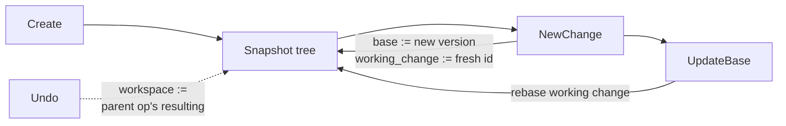

# Workspaces

A workspace is a server-side record of one principal's in-progress state on
a repository: a base version, a working change id, an optional snapshot
tree and a sparse profile. Every mutation is an `Operation` appended to the
workspace's log. Each operation records the whole resulting workspace, so
undo restores every field and never computes an inverse.

Client checkouts in `.rill/` are a separate mechanism that may be attached
to a workspace; see [checkouts](checkouts.md).

## Record

`Workspace` ([workspace.rs](../../crates/rill-types/src/objects/workspace.rs)):

| Field | Meaning |
| --- | --- |
| `id`, `repo`, `name` | Identity. `WorkspaceId` prints as `ws_<hex>`. |
| `owner` | The creator, until `Handoff` changes it. |
| `base` | `ChangeVersionHash` the work sits on. `ObjectHash::ZERO` while the repository has no history. |
| `working_change` | `ChangeId` that the next `NewChange` produces a version of. |
| `snapshot` | Latest `TreeHash` set by `Snapshot` or `UpdateBase`; `None` until then. |
| `sparse` | `SparseProfile { include, exclude }` of directory prefixes. Empty `include` means the whole repo; `exclude` wins over `include`. |
| `head_op` | Id of the latest `Operation`. |

## Operation log and idempotency

Every mutating RPC builds `Operation { id, workspace, parent, actor,
kind, resulting, at }`, where `resulting` is the workspace after the
operation (with `head_op` pointing at it), and writes it with
`RepoStore::operation_tx`: one transaction with `Absent(opi op_id)`,
`Equals(ws record as the request read it)`, a stamped append to the
workspace's `op` log, the new `ws` record and the `opi` marker. A
workspace changed by someone else since the request read it fails the
operation rather than being overwritten. `NewChange` and `UpdateBase`
merge the operation into the commit transaction of the version they
create, so the version never exists without the workspace pointing at it
(see [changes and stacks](changes-and-stacks.md)).

The `operation_id` in the request is the idempotency key. A retry with the
same id gets the first response back from the server's idempotency layer
(see [API surface](../07-runtime/api-surface.md#retries)); the `opi` marker
is a second guard inside the operation's own transaction. An empty id
means the server generates one. The SDK exposes this
through the `*_with_op` methods on `WorkspaceClient`.

## RPCs

All RPCs live on `WorkspaceSvc`. Reads need `read(root)`. `CreateWorkspace`
needs `write(root)`. Every other mutating RPC loads the record through
`load_mut`, which needs `write(root)` and owner-or-admin.

| RPC | `OperationKind` | Effect |
| --- | --- | --- |
| `CreateWorkspace` | `Create` | `base` resolved from the optional `RootSpec` (trunk head when absent, `ZERO` when the repo is empty; a tree hash is `InvalidArgument`). Fresh `working_change`. |
| `Snapshot` | `Snapshot { tree }` | Sets `snapshot`. The tree must already be stored, else `FailedPrecondition`. |
| `NewChange` | `NewChange { change, base }` | See below. |
| `UpdateBase` | `Rebase { from, to }` | See below. |
| `SetSparseProfile` | `SetSparse { profile }` | Replaces `sparse`. |
| `Handoff` | `Handoff { to }` | `owner := to`. `to` is required. |
| `Undo` | `Undo { undone }` | See below. |
| `ListOperations` | none | Latest `limit` operations (default 50, max 1000), optionally only those before an id. |
| `GetWorkspace`, `ListWorkspaces` | none | `ListWorkspaces` filters by owner; `limit` default 100, max 10 000. |
| `WorkspaceDiff` | none | File diffs from the base root to `snapshot`, through the caller's read filter. |
| `DeleteWorkspace` | none | Deletes the record. Not logged. |

### NewChange

1. `snapshot` must be set, else `FailedPrecondition`.
2. `diff_trees(base root, snapshot)`; an empty diff is `FailedPrecondition`.
3. `write(path)` is checked for every touched path.
4. `version_from_diff` builds a `ChangeVersion` of `working_change` with
   `parents = [base]` (none when `base` is `ZERO`) and `predecessor` = the
   last entry of `change_versions(working_change)`.
5. `commit_version` stores it (see
   [changes and stacks](changes-and-stacks.md)).
6. `base := new hash`, `working_change := ChangeId::new()`.

The next `NewChange` is therefore parented on the previous one, which is
how a workspace builds a stack.

### UpdateBase

The new base must resolve to a version. An empty repository gives
`FailedPrecondition`. If `working_change` already has a version and the
base actually moves, that version is rebased with `rill_core::rebase`. The
rebased version is committed, and `snapshot` becomes its root tree.
Conflicts are recorded in the version and never cause an error (see
[rebase](../03-core-algorithms/rebase.md)). Then `base := new`.

After a `NewChange`, `working_change` is a fresh id with no versions, so
`UpdateBase` only moves `base`.

### Undo

`Undo` reads the latest 1000 operations. It finds `target` (default
`head_op`) and then the target's parent, and makes the workspace equal to
the parent's `resulting` state (base, snapshot, working change, sparse
profile, owner, name), keeping only its identity, then records a new
`Undo` operation. Undoing the first operation is `FailedPrecondition`. A
target or parent outside the 1000-operation window is `NotFound`. Undo is
itself an operation, so undoing an `Undo` redoes. Undoing a `NewChange`
restores the old base and working change; the committed version stays in
history.

## Persistence

| Key | Value |
| --- | --- |
| `(ws, ns, repo, ws)` (`RepoKeys::workspace`) | `Workspace` record |
| `(op, ns, repo, ws, stamp)` (`RepoKeys::operations`) | `Operation`, append-only, versionstamped |
| `(opi, ns, repo, op_id)` (`RepoKeys::operation_index`) | empty marker, for idempotency |

## Limitations

* `Undo` sees only the latest 1000 operations. Undoing a `Handoff`
  returns the workspace to its previous owner.
* `Snapshot` checks that the root tree exists. It does not check that the
  tree's blobs exist or that the tree respects the sparse profile. The
  server never filters a snapshot or a `NewChange` diff by profile.
* `DeleteWorkspace` removes only the record. The operation log and index
  rows stay.
* `ListWorkspaces` scans every workspace in the repository and has no
  continuation token.
* The `Describe`, `Resolve` and `Other` operation kinds exist in the type
  but no RPC records them.

## Code

* [rill-types/src/objects/workspace.rs](../../crates/rill-types/src/objects/workspace.rs)
* [rill-server/src/services/workspace.rs](../../crates/rill-server/src/services/workspace.rs)
* [rill-server/src/services/repo/write.rs](../../crates/rill-server/src/services/repo/write.rs) (`commit_version`, `version_from_diff`)
* [rill-store/src/repo/records.rs](../../crates/rill-store/src/repo/records.rs) (`append_operation`, `list_operations`)
* [rill-store/src/keys.rs](../../crates/rill-store/src/keys.rs)
* [rill-sdk/src/workspace.rs](../../crates/rill-sdk/src/workspace.rs)
* [rill-cli/src/commands/ws.rs](../../crates/rill-cli/src/commands/ws.rs)

---
← Previous: [Change builder](../03-core-algorithms/change-builder.md) · [Index](../index.md) · Next: [Checkouts](checkouts.md) →
