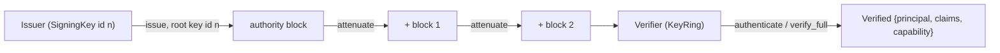

# Capability tokens

Every token Rill issues is a [Biscuit](https://www.biscuitsec.org) signed by
one of the instance's P-256 keys, named by the token's root key id; every
block's ephemeral key is P-256 too (`ephemeral_key`, since Biscuit defaults
those to Ed25519). The authority block names the principal, carries signed
`TokenClaims` and, when the token is narrowed, Datalog checks for one
`Capability`. A holder can append blocks offline to narrow it further. The
invariants: checks accumulate across blocks, so no block can grant more than
the one before it, and the principal and token id are read only from the
authority block.

## Claims

[`TokenClaims`](../../crates/domain/policy/src/tokens/claims.rs) are what the
server trusts about a token and stamps on the writes it makes:

| Claim | Meaning |
| --- | --- |
| `token_id` | `tk_…`; revokes this token and everything attenuated from it. |
| `org` | The principal's organization. |
| `session` | `ss_…`; the sign-in session or agent run. |
| `sponsor` | The human or team an agent acts for. |
| `model` | The model an agent declared at exchange. |
| `issued_at`, `expires_at` | The lifetime. |

`TokenLifetimes` caps the lifetime per principal kind: 1 h for humans,
15 min for agents and 12 h for services. `Issuer::issue` refuses longer
claims, and a lifetime that is not positive.

A token without a capability (a human's session token) passes any
repository, path and verb; the stored relations decide. A capability, in
the authority block or an attenuation, narrows it.

## Capability

[`Capability`](../../crates/domain/policy/src/tokens/capability.rs) is the scope
of one token:

| Field | Semantics |
| --- | --- |
| `repo: RepoId` | The single repository the token applies to. |
| `workspace: Option<WorkspaceId>` | When set, the Datalog check requires a matching `request_workspace`. |
| `paths: Vec<RepoPathBuf>` | Prefixes covered. The root covers everything. Empty fails `validate`. |
| `verbs: Vec<Verb>` | `Read`, `Write`, `Land`, `Review`, `Admin`, `Execute` (wire names lowercase). `Execute` gates the remote execution service for the token's org. |
| `expires_at: Timestamp` | The token is refused once `now >= expires_at`. |

`check_narrower_than(parent)` returns `Error::Widening` unless all of these
hold:

* same `repo`;
* same workspace, or newly pinned when the parent has none (a pinned parent
  cannot be unpinned);
* verbs a subset of the parent's;
* every path under one of the parent's prefixes (`starts_with` by component, so
  `srcx` is not under `src`);
* `expires_at` no later than the parent's.

## Datalog

[`datalog.rs`](../../crates/domain/policy/src/tokens/datalog.rs) turns a
capability into one block. Every attenuation block carries its checks plus
the capability's JSON as the block context, so a token's grant can be read
back without re-deriving it. The authority block holds the identity and
token facts and the expiry check, and its context is an `AuthorityContext`
(the claims plus the capability, if any):

```datalog
principal("pr_…", "agent", "reviewer-7");
token("tk_…");
check if time($t), $t < 2026-10-21T00:15:00Z;
// when narrowed:
check if request_repo("rp_…");
check if request_workspace("ws_…");          // only when pinned
check if request_verb($v), {"read", "write"}.contains($v);
check if request_path($p), $p == "src" || $p.starts_with("src/");
check if time($t), $t < 2026-10-21T00:00:00Z;
```

A root prefix omits the `request_path` check. Expiry is rounded down to whole
seconds so a token never outlives its capability. All terms are bound with
`code_with_params`, never string formatting, so a path or name cannot inject
Datalog.

## Keys, issue, attenuate, verify



* [`KeyRing`](../../crates/domain/policy/src/tokens/keyring.rs) holds P-256
  public keys by id, each with an optional `not_after`. A token naming no
  key, an unknown key or a retired one is `Error::Token`; so is a key that
  reuses a trusted id with different material (the signature fails).
* [`Issuer`](../../crates/domain/policy/src/tokens/issuer.rs) holds one
  `SigningKey` and `TokenLifetimes`. `issue(principal, claims, capability)`
  returns a base64 token with the key's id.
* `attenuate(token, keys, narrower)` parses the parent, enforces
  `check_narrower_than` against its effective capability (or, for an
  unnarrowed parent, that the capability ends by the token's expiry), and
  appends a block. A client that skips this check still cannot escape the
  parent, because Biscuit evaluates every block's checks.
* `inspect(token, keys)` returns the claims and effective capability without
  authorizing anything.
* `effective_scope` reads the authority context, then walks the attenuation
  contexts in order, checking each narrows the previous one. A block without
  context is `Error::Token`; a widening block is `Error::Widening`.

[`Verifier`](../../crates/domain/policy/src/tokens/verifier.rs):

1. Parse with the key the token names; a bad signature chain is
   `Error::Token`.
2. Compute `effective_scope`.
3. Expired (claims or capability) at `now`: `Error::TokenExpired`.
4. Add `time` and, for `verify_full(token, request)`, `request_repo`,
   `request_path`, `request_verb` and optionally `request_workspace` facts,
   then `allow if true`. A failed check is `Error::TokenRejected`.
   `authenticate(token, now)` probes a narrowed token with something its
   capability allows; per-request checks run later against the capability.
5. Read `principal` and `token` with `authorizer.query`, which sees only the
   authority block, so facts in an attenuation block are ignored; the token
   fact must match the claims. The rebuilt `Principal` has `identity: None`.

`TokenRequest.now` is supplied by the caller, so verification is deterministic.

## Server use

[`BiscuitAuthenticator`](identity-and-auth.md) turns a valid token into an
`AuthContext` with `capability: Some(cap)`. Per-request enforcement is
`AuthContext::capability_allows` inside `Permit::check`. It is evaluated in
Rust rather than through Datalog, and before the relation check, even in dev
mode. The effective right is the capability AND the stored relations.

`AdminService.IssueToken`
([admin/tokens.rs](../../crates/server/api/src/services/admin/tokens.rs)) mints tokens:

* Each `pb::Capability.scope` is `repo:<name>[/<dir>][/*]`. All scopes must
  name one repository.
* Actions accept `read`/`repo.read`, `write`/`repo.write`,
  `land`/`repo.land`/`lander.land`, `review`/`repo.review`/`review.vote`,
  `admin`/`repo.admin`, `execute`/`exec.execute`.
* Expiry defaults to the longest lifetime the subject's kind allows. A past
  value is `INVALID_ARGUMENT`, a longer one is refused by the issuer.
* A caller holding a capability must pass `check_narrower_than`, which is the
  only check for that caller; widening is `INVALID_ARGUMENT`. A caller without
  a capability must pass `permit().admin()`.
* The subject is `for_principal`, or the caller. Another principal is
  allowed only for a registered agent the caller sponsors (by name, or
  through one of its teams), or for an instance administrator.

`WhoAmI` reports the caller's capability as one `pb::Capability` per
verb and path, with action `repo.<verb>` and scope `repo:<name>/<path>/*`.

## Limitations

* The server never enforces `Capability::workspace` per request.
* There is no revocation yet. A token is valid until `expires_at`.
* Tokens carry no `identity` or teams.
* Clients do not call `attenuate`; delegation goes through `IssueToken`.

## Code

* [`tokens/capability.rs`](../../crates/domain/policy/src/tokens/capability.rs): `Capability`, `Verb`, `check_narrower_than`.
* [`tokens/claims.rs`](../../crates/domain/policy/src/tokens/claims.rs): `TokenClaims`, `TokenLifetimes`.
* [`tokens/keyring.rs`](../../crates/domain/policy/src/tokens/keyring.rs): `SigningKey`, `KeyRing`.
* [`tokens/datalog.rs`](../../crates/domain/policy/src/tokens/datalog.rs): `capability_block`, `authority_block`, `effective_scope`.
* [`tokens/issuer.rs`](../../crates/domain/policy/src/tokens/issuer.rs): `Issuer`, `attenuate`, `inspect`.
* [`tokens/verifier.rs`](../../crates/domain/policy/src/tokens/verifier.rs): `TokenRequest`, `Verified`, `Verifier`.
* [`tokens/tests/`](../../crates/domain/policy/src/tokens/tests/mod.rs): issue, attenuate and reject cases.
* [`services/admin/mod.rs`](../../crates/server/api/src/services/admin/mod.rs): `IssueToken`, `WhoAmI`, `parse_scope`, `parse_action`.

---
← Previous: [Identity and authentication](identity-and-auth.md) · [Index](../index.md) · Next: [Token keys](token-keys.md) →
