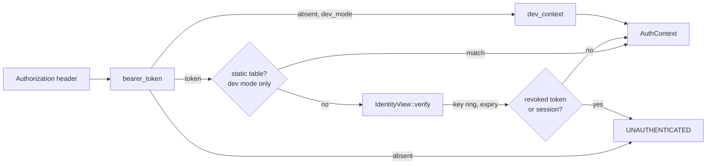
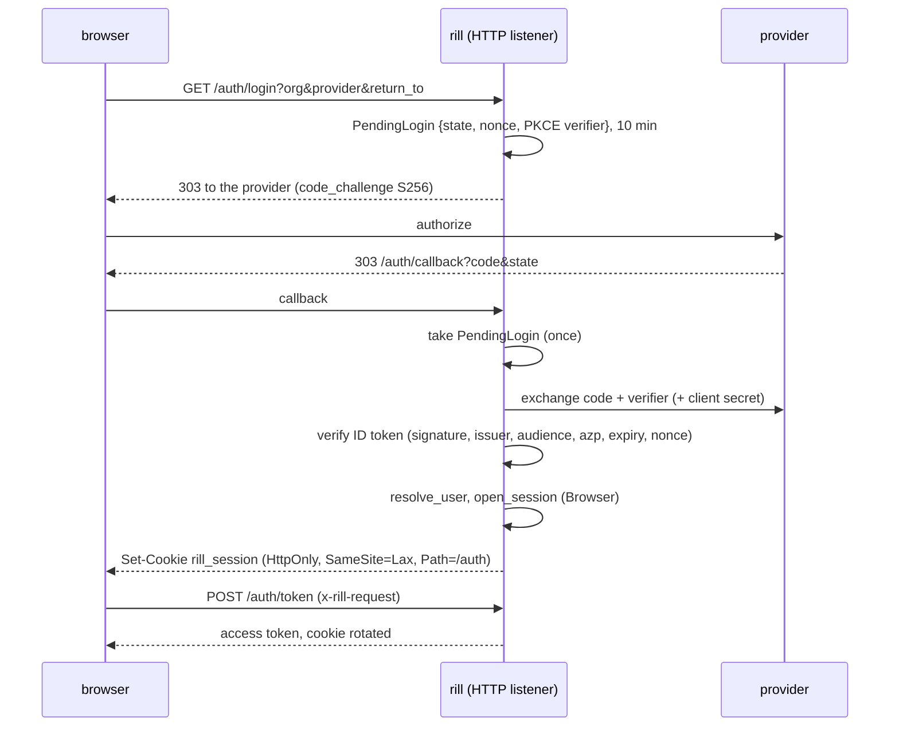

# Identity and authentication

Every request runs as a `Principal`, resolved from its `Authorization` header
before any handler executes. The header carries a token the instance signed
([capability tokens](capability-tokens.md), with keys from
[token keys](token-keys.md)); each server checks it against its identity
view, which also knows what has been revoked. `rill-api/src/auth/` adapts
both transports onto that and wraps the result in `Permit`, the check every
handler runs before touching a repository.

## Principals

[`Principal`](../../crates/foundation/types/src/principal.rs) is the actor recorded
on every change, vote and landing.

| Field | Notes |
| --- | --- |
| `id: PrincipalId` | 16 bytes. `Principal::human/agent/service(name)` derive it with `PrincipalId::derived(kind, name)` (BLAKE3 over `rill:id:pr:<kind>:<name>`), so a name always maps to the same id. Displays as `pr_<hex>`. |
| `kind: PrincipalKind` | `Human`, `Agent`, `Service`; `as_str` gives `human`, `agent`, `service`. |
| `name: String` | Handle. `Display` renders `alice`, `agent:reviewer-7`, `svc:lander`. |
| `identity: Option<String>` | Email or SPIFFE id. Informational; no policy reads it. |

The human who delegated an agent's work is `Provenance::sponsor` on the change
version, not a field of `Principal`. Nothing in `rill-policy` reads it.

## From header to AuthContext

[`AuthContext`](../../crates/domain/policy/src/identity.rs) is what a request
runs as: `principal`, `teams` (names for `team:` relation subjects),
`capability` (`Some` only for a narrowed token) and `claims` (the token's
`TokenClaims`; `None` for static tokens and dev mode).
`capability_allows(repo, path, verb)` is `true` when there is no
capability, otherwise `cap.repo == repo && cap.allows(verb) &&
cap.covers_path(path)`.

`authenticate(state, header)` is the single entry point:

* no header and `dev_mode`: `dev_context()`, the human `dev` with no teams,
  capability or claims;
* no header otherwise: `UNAUTHENTICATED`;
* a header present: it must authenticate, even in dev mode, so tests and
  tools can act as specific principals. A dev-mode server first tries its
  static table; every other token goes to `IdentityView::verify`.

`bearer_token` accepts the `Bearer` scheme case-insensitively and rejects an
empty token. Static tokens outside dev mode stop the server at startup
(`auth::static_tokens`).

## The identity view

Each server holds an [`IdentityView`](../../crates/server/runtime/src/identity/view.rs):
the `KeySet` (every trusted public key and the issuer it signs with) and the
revoked token ids and session ids still in force. `verify(token)` checks the
signature against the key the token names, the expiry, then the revocation
sets. A token naming a key the view does not know forces one reload of the
keys (at most once a second) before it is refused, so a key another server
just added is never a reason to fail.

[`follow`](../../crates/server/runtime/src/identity/follower.rs) keeps the view
current. It waits on the identity log counter (an FDB watch), applies new
entries (`TokenRevoked`, `SessionRevoked`, `KeysChanged`), reloads
everything every 60 s, and reloads when a pending key activates. A server
that revokes something applies it to its own view at once. Every process
runs a follower; processes with the workers role also run
[`maintain_forever`](../../crates/server/runtime/src/identity/maintenance.rs)
every 10 minutes: key rotation and pruning, and sweeping expired
revocations and sessions (after a day) and log entries (after 7 days).

The `IdentityService` RPCs:

| RPC | Who |
| --- | --- |
| `RevokeToken { token }` | anyone holding the token (logout) |
| `RevokeToken { token_id }` | instance administrators |
| `RevokeSession` | the session's principal, or administrators |
| `RotateTokenKeys`, `ListTokenKeys` | administrators |
| identity providers, users, workload issuers | org administrators |
| `RegisterAgent`, `UpdateAgent`, `ListAgents` | org administrators, or the sponsoring user |
| `KillSwitch` | org administrators |
| `Create`/`List`/`RevokeScimCredential` | org administrators |

`require_instance_admin` passes in dev mode, or for a principal named in
`identity.admins` presenting an unnarrowed token.

`WhoAmI` reports the caller's token id, session, org, sponsor and model with
its principal and capability.

## Sign-in

Each organization registers OpenID Connect providers (or
[SAML](#saml-20) ones)
(`PutIdentityProvider`: issuer, a confidential client for browsers whose
secret the key service wraps, an optional public client for the CLI, the
username and groups claims, and whether a first sign-in provisions the
user). An issuer belongs to one provider in the instance. Issuers must use
https, except on loopback addresses.

The browser flow is [`openidconnect`](https://crates.io/crates/openidconnect)
([`oidc/browser.rs`](../../crates/domain/identity/src/oidc/browser.rs)):
discovery, the authorization URL with PKCE (S256) and a nonce, the code
exchange (client secret by HTTP Basic) and ID-token validation. It calls
providers through the workspace's `reqwest` and never follows redirects.
Workload and device-flow ID tokens are verified by Rill's JWT verifier over
discovered JWKS (`oidc/jwt.rs`, `jsonwebtoken`, asymmetric algorithms only).

[`resolve_user`](../../crates/domain/identity/src/signin/users.rs) finds the
user an `(issuer, subject)` is linked to, or creates one named by the
provider's username claim (`preferred_username`, falling back to `email`)
when the provider provisions. Principal names are unique across the
instance, so a second identity claiming a taken name is refused; groups
become teams on every sign-in when the provider names a groups claim.
Suspended users and identities of another organization are refused.

[`open_session`](../../crates/domain/identity/src/signin/sessions.rs) stores a
`SessionRecord` (`identity.session_hours`, 12 by default) with a hash of a
random refresh secret; the refresh token is `ss_<id>.<secret>`. Each refresh
replaces the secret with a compare-and-set, so a refresh token works once
and a stolen one dies the first time either party uses it. Access tokens
carry the session and live as long as the principal's kind allows, never
past the session.

The HTTP routes ([signin/](../../crates/server/api/src/signin/mod.rs)), on the
object-protocol listener and open:

| Route | Does |
| --- | --- |
| `GET /auth/login?org&provider&return_to` | starts the browser flow; `return_to` must be a path on this server |
| `GET /auth/callback` | finishes it; sets the session cookie and redirects or shows a page |
| `POST /auth/token` | cookie to access token, rotating the cookie; needs the `x-rill-request` header |
| `POST /auth/logout` | ends the cookie's session; needs `x-rill-request` |
| `GET /auth/providers?org` | the org's providers, CLI clients and device endpoints |
| `POST /oauth/token` | `refresh_token` grants, and RFC 8693 exchange of a provider ID token (`subject_token_type` `…:id_token`, any of the provider's clients) for a device session |

The same exchange and refresh are served over gRPC by `SessionService`
(`ListSignInProviders`, `ExchangeToken`, `RefreshSession`), registered
without the auth layer so clients need only the gRPC endpoint; the CLI and
SDK use it ([CLI](../08-clients/cli.md), [SDK](../08-clients/sdk.md)).

Refreshing refuses and ends the session of a user suspended since signing
in; every request by a suspended user is refused through the identity view
(`UserChanged` in the log drops the cached user).

### SAML 2.0

A server built with the `saml` feature also signs browsers in through SAML
2.0 providers ([`rill-identity/src/saml/`](../../crates/domain/identity/src/saml/mod.rs),
on samael with xmlsec). `PutIdentityProvider` with `saml_metadata` (the
IdP's metadata XML) stores the provider with the IdP's entity id as its
issuer and Rill's entity id (`saml_sp_entity_id`, default
`<public_url>/auth/saml/<org>/<name>`) as its client. Metadata without a
signing certificate or an HTTP-Redirect SSO endpoint is refused when it is
saved, since samael would accept unsigned responses for it.

`/auth/login` for a SAML provider records a `PendingLogin` keyed by a
random RelayState, with the AuthnRequest's id (`rill-<40 hex>`) as its
nonce, and redirects to the IdP. The IdP posts the response to
`POST /auth/saml/acs`. That route takes the pending login once and then
checks the response:

* its signature, against the metadata's certificates, with RSA or ECDSA
  over SHA-256/384/512 only;
* the issuer;
* `InResponseTo`, which must equal the request id (IdP-initiated sign-in is
  refused);
* the destination and recipient, which must equal
  `<public_url>/auth/saml/acs`;
* the validity window;
* an audience restriction to Rill's entity id.

The assertion then reads as claims: `iss` is the entity id, `sub` is the
NameID, and each attribute appears under its name and its friendly name.
Users, groups and sessions are then the same as for OIDC. The username is
the NameID unless `username_claim` names an attribute. Responses are
verified on a blocking thread. `GET /auth/saml/metadata?org&provider`
serves Rill's SP metadata. A SAML provider issues no ID tokens, so the CLI
signs in through OIDC providers only.

Building needs libxml2 and xmlsec1 (with OpenSSL). On macOS the Homebrew
`libxml2`, `libxslt` and `libxmlsec1` must all be on `PKG_CONFIG_PATH`.
Otherwise the binary links the system libxml2 next to Homebrew's, xmlsec
cannot resolve signature references, and every response is refused.

Org administration (`require_org_admin`): instance administrators, or an
active member of the org with the `admin` role presenting an unnarrowed
token for that org. `ListIdentityProviders`, `DeleteIdentityProvider`,
`ListUsers` and `UpdateUser` (suspend, reactivate, set roles) need it.

## Provisioning (SCIM 2.0)

Each organization's provisioning system (Okta, Entra ID) calls
`/scim/v2/<org>` ([scim/](../../crates/server/api/src/scim/mod.rs)) with a
credential an org administrator creates (`CreateScimCredential`: a bearer
`scim_<id>.<secret>` shown once, its secret stored as a keyed BLAKE3 hash,
revocable, never expiring because provisioning systems cannot refresh). A
credential works only for its org.

| Resource | Maps to | Notes |
| --- | --- | --- |
| `/Users` | `UserRecord` | `userName` is the principal name and cannot change; `externalId`, `displayName`/`name`, the primary email and `active` are kept; a user who signed in before provisioning started is adopted, not duplicated |
| `/Groups` | `TeamRecord` | `displayName` is the team name; members' `teams` follow membership, renames and deletion, so `team:` relations apply at once |
| `ServiceProviderConfig`, `ResourceTypes`, `Schemas` | — | patch and `eq` filters (joined by `and`) supported; no bulk, sort or etags |

[`rill_identity::scim`](../../crates/domain/identity/src/scim/mod.rs) holds the
mapping, filters and PatchOp handling (both Okta's path form and Entra ID's
whole-object form, `active` as a string or boolean). `DELETE /Users` and
`active: false` deprovision: the user is suspended (kept for attribution),
their live sessions are revoked and the agents they sponsor are suspended
until an administrator reassigns them; reactivating the user does not
resume the agents.

## Agents and workload identity

An org registers agents ([`AgentRecord`](../../crates/foundation/types/src/identity/agent.rs),
`RegisterAgent`): a name unique across the instance, a sponsor (`user:<name>`
or `team:<name>`, the team active while an active member has it), a
purpose, the repositories (`*` for all) and path prefixes it may use, a
model allow-list, budgets, workload bindings and an optional expiry. Org
administrators manage every agent; a user may register and manage agents
they sponsor themselves.

Agents hold no secrets. A workload (a Kubernetes pod, a CI job, a SPIFFE
workload, a cloud function) presents a JWT from an issuer its org trusts
(`PutWorkloadIssuer`: issuer, keys by discovery, URL or an inline JWKS, and
accepted audiences) to `ExchangeToken` or `/oauth/token` with
`subject_token_type` `urn:ietf:params:oauth:token-type:jwt`, the `org`, and
optionally the `agent` and `model`.
[`exchange_workload`](../../crates/domain/identity/src/agents/exchange.rs)
verifies the JWT against that issuer, finds the agent whose binding
matches (issuer, `sub` with a trailing `*` wildcard, and exact claims;
several matches need the `agent` named), and refuses unless
[`agent_may_act`](../../crates/domain/identity/src/agents/standing.rs): the
registration is active and unexpired, the model is allowed and not blocked
by the org, and the sponsor is active. The grant is a `Workload` session of
the agent's maximum lifetime (15 min) with no refresh token: the workload
exchanges again. Its token carries the session, the sponsor label and the
model.

Every request by a registered agent re-checks its standing through the
identity view (`IdentityView::context`, cached per agent and model and
dropped by `AgentChanged`, `UserChanged` and `OrgSettingsChanged`), so
suspending the agent or its sponsor, or blocking its model, refuses its
tokens within the log's propagation time. Its `AuthContext.scope` holds the
registered repositories and paths; `Permit` refuses anything outside them
before the relation check, and read filters are narrowed to them. An agent
principal with no registration (named by an administrator through
`IssueToken` or `mint-token`) has no scope beyond its token.

## Budgets and the kill switch

A registered agent's budgets travel in its `AgentScope`:

| Budget | Enforced |
| --- | --- |
| `versions_per_day` | in the commit transaction: a counter per agent and UTC day (`idb` table) is read and set with compare-and-set alongside the version, so concurrent writes never exceed it and failed commits never spend it |
| `lands_per_day` | at `RequestLand`, before the request is queued |
| `requests_per_minute` | per server, in the identity view: a `governor` token bucket of the budget refilled over a minute; a cluster of n servers admits up to n times the budget |
| `executions_per_day` | at `Execute`, for actions not served from the action cache, before queueing ([remote execution](../06-services/remote-execution.md)) |

Exhausted budgets are `RESOURCE_EXHAUSTED`.

`KillSwitch` (org administrators) stops an agent (suspended, its live
sessions revoked), a session, every agent of a sponsor, or a model (added
to the org's `blocked_models`, live sessions running as it revoked). Tokens
are refused at once on the server that ran it and through the log on the
others. Work already queued is caught at landing: the lander's approval
hook asks `AuthorStanding` whether the version's author and the requester
may still act, so a killed agent's queued requests are ejected and its open
changes cannot land ([landing](../04-workflow/landing.md#sequencing)).

## Bootstrap

A server outside dev mode accepts only tokens the instance signed. The first
comes from `rill api mint-token <kind:name>`
([mint.rs](../../crates/server/runtime/src/identity/mint.rs)): it opens the store
and key service from the server configuration, makes sure a key exists, and
signs an unnarrowed token for the principal (by default as long as its kind
allows). Whoever can reach the store and the key service can sign as the
instance; that is the trust boundary.

## Transport layers

[`AuthInterceptor`](../../crates/server/api/src/auth/interceptor.rs) is a
`connectrpc` interceptor around every Rill service: authentication may await
the store (team lookups), and a refusal is encoded in the protocol the client
spoke (Connect, gRPC or gRPC-web). `SessionService`, reflection and health
pass without a token. REAPI's tonic services use the tower
[`AuthLayer`](../../crates/server/api/src/auth/layer.rs) with the same logic.
Both store the `AuthContext` in the request's extensions or fail the call. Handlers read it with `caller(&request)`. A missing
extension is a wiring bug and is still reported as `UNAUTHENTICATED`, so
nothing proceeds without a caller.

[`require_auth`](../../crates/server/api/src/auth/http.rs) is the axum
equivalent for the object protocol. It guards `/o/{repo}/{kind}/{hash}` and
`/o/{repo}/batch` and replies `401` with the error text. `/livez`,
`/readyz` and `/metrics` are open.

## Permit

Handlers never check relations directly. `Opened::permit()` builds a
[`Permit`](../../crates/server/api/src/auth/permit.rs) for the caller, the
repository and `dev_mode`. `Permit::check(verb, relation, path)` runs two
layers:

1. `capability_allows` must hold. This is enforced even in dev mode, because a
   token only narrows what its principal could otherwise do.
2. Under `dev_mode`, or when the repository has no relation tuples at all (the
   bootstrap rule), the check passes. Otherwise `Authorizer::check_path` must
   grant the relation. See [permissions](permissions.md).

Denial is `PERMISSION_DENIED`, with a message naming the principal, relation,
path and repository. `resolved_by()` maps the caller's kind to the
`Provenance::resolved_by` string that `ApplyEdits` records.

## Configuration

| Setting | Meaning |
| --- | --- |
| `[[auth.tokens]]` | Static tokens: `token`, `principal_name`, `kind` (`Human`, `Agent`, `Service`), `teams`. Dev mode only. |
| `[identity.keys]` | The key service (`backend` = `local`, `vault`, `aws-kms`, `gcp-kms`); see [token keys](token-keys.md). |
| `[identity.lifetimes]` | `human_secs` (3600), `agent_secs` (900), `service_secs` (43200). |
| `[identity.rotation]` | `rotate_after_days` (30), `activation_delay_secs` (60), `grace_secs` (300). |
| `identity.admins` | Principal names that administer the instance. |
| `dev_mode` | Anonymous requests act as `dev`; the relation layer is skipped. |
| `RILL_STATIC_TOKENS` | `token=name[:kind[:team,team]];...`; replaces the static list. |
| `RILL_MASTER_KEY`, `RILL_MASTER_KEY_FILE`, `RILL_VAULT_ADDR` + `RILL_VAULT_KEY`, `RILL_AWS_KMS_KEY`, `RILL_GCP_KMS_KEY` | Choose the key service. |
| `RILL_ADMINS` | Comma-separated administrators. |

## Limitations

* `capability_allows` ignores `Capability::workspace`. A workspace-pinned token
  is accepted for any workspace.
* No `TeamResolver` is wired in the server. Token-authenticated principals
  always have empty teams; only static tokens carry teams.
* SAML sign-in is browser-only, does no single logout, and does not
  accept encrypted assertions.
* `PrincipalKind` has no serde rename, so a TOML `auth.tokens[].kind` must be
  written `Human`, `Agent` or `Service`. The env var form uses lowercase.
* `CreateChangeVersion` stores the client-supplied `author` and `provenance`
  without comparing them to the caller. Only `ApplyEdits` uses the caller.
* `Provenance::sponsor` is informational. No check ties an agent's token or
  votes to its sponsor.
* `AuthHeaders::principal_hint` exists, but no built-in authenticator honours it.

## Code

* [`rill-policy/src/identity.rs`](../../crates/domain/policy/src/identity.rs): `AuthHeaders`, `AuthContext`, `Authenticator`, `StaticTokenAuthenticator`, `TeamResolver`.
* [`signin/`](../../crates/server/api/src/signin/mod.rs): the sign-in HTTP routes; [`rill-identity/src/signin/`](../../crates/domain/identity/src/signin/mod.rs), [`rill-identity/src/oidc/`](../../crates/domain/identity/src/oidc/mod.rs).
* [`identity/callers.rs`](../../crates/server/runtime/src/identity/callers.rs): teams, agent standing and scope; [`rill-identity/src/agents/`](../../crates/domain/identity/src/agents/mod.rs): the workload exchange.
* Tests: `rill-api/tests/grpc/scim.rs` (credentials, groups as teams, deactivation), `rill-identity/tests/scim.rs`, `rill-api/tests/grpc/killswitch.rs` (exact budgets, rate, kill switch ejection), `rill-api/tests/grpc/agents.rs` (exchange, scope, sponsor and model suspension), `rill-identity/tests/workload.rs`, `rill-api/tests/grpc/identity.rs` (revocation and rotation across servers), `rill-api/tests/grpc/signin.rs` (browser flow, exchange, refresh, suspension, org admins, against `rill_identity::testing::MockIdp`), `rill-identity/tests/{oidc,signin}.rs`, `rill-api/tests/grpc/keycloak_saml.rs` (SAML through Keycloak: a forged response, a replay), `rill-cli/tests/bootstrap.rs`.
* [`rill-types/src/principal.rs`](../../crates/foundation/types/src/principal.rs): `Principal`, `PrincipalKind`.
* [`auth/authenticator.rs`](../../crates/server/api/src/auth/authenticator.rs): `static_tokens`, `authenticate`.
* [`auth/instance.rs`](../../crates/server/api/src/auth/instance.rs): `require_instance_admin`.
* [`identity/`](../../crates/server/runtime/src/identity/mod.rs): `IdentityView`, `follow`, `maintain_forever`, `mint_token`.
* [`services/identity/`](../../crates/server/api/src/services/identity/mod.rs): the `IdentityService` RPCs.
* [`auth/context.rs`](../../crates/server/api/src/auth/context.rs): `caller`, `bearer_token`, `dev_context`.
* [`auth/layer.rs`](../../crates/server/api/src/auth/layer.rs), [`auth/http.rs`](../../crates/server/api/src/auth/http.rs): gRPC and HTTP middleware.
* [`auth/permit.rs`](../../crates/server/api/src/auth/permit.rs): `Permit`.
* [`services/common.rs`](../../crates/server/api/src/services/common.rs): `Opened`, `open`.
* [`config/auth.rs`](../../crates/server/runtime/src/config/auth.rs), [`config/identity.rs`](../../crates/server/runtime/src/config/identity.rs), [`config/env.rs`](../../crates/server/runtime/src/config/env.rs): `AuthConfig`, `StaticToken`, `IdentityConfig`, env overrides.

---
← Previous: [Intents](../04-workflow/intents.md) · [Index](../index.md) · Next: [Capability tokens](capability-tokens.md) →
