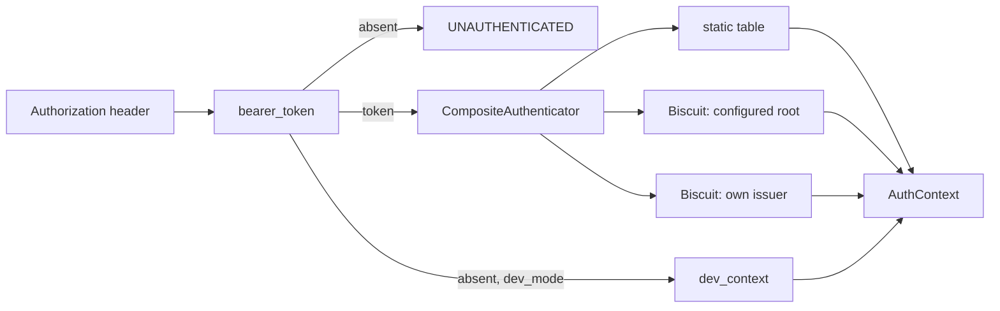

# Identity and authentication

Every request runs as a `Principal`, resolved from its `Authorization` header
before any handler executes. `rill-policy` defines the credential model
(`AuthHeaders` to `Authenticator` to `AuthContext`) without seeing tonic or
axum. `rill-server/src/auth/` adapts both transports onto it and wraps the
result in `Permit`, the check every handler runs before touching a repository.

## Principals

[`Principal`](../../crates/rill-types/src/principal.rs) is the actor recorded
on every change, vote and landing.

| Field | Notes |
| --- | --- |
| `id: PrincipalId` | 16 bytes. `Principal::human/agent/service(name)` derive it with `PrincipalId::derived(kind, name)` (BLAKE3 over `rill:id:pr:<kind>:<name>`), so a name always maps to the same id. Displays as `pr_<hex>`. |
| `kind: PrincipalKind` | `Human`, `Agent`, `Service`; `as_str` gives `human`, `agent`, `service`. |
| `name: String` | Handle. `Display` renders `alice`, `agent:reviewer-7`, `svc:lander`. |
| `identity: Option<String>` | Email or SPIFFE id. Informational; no policy reads it. |

The human who delegated an agent's work is `Provenance::sponsor` on the change
version, not a field of `Principal`. Nothing in `rill-policy` reads it.

## From header to AuthContext

[`AuthContext`](../../crates/rill-policy/src/identity.rs) is what a request
runs as: `principal`, `teams` (names for `team:` relation subjects) and
`capability` (`Some` only for a Biscuit token). `capability_allows(repo, path,
verb)` is `true` when there is no capability, otherwise `cap.repo == repo &&
cap.allows(verb) && cap.covers_path(path)`.

Authenticators implement the `async_trait` `Authenticator`:

* `StaticTokenAuthenticator`: exact match in a token table, yielding the
  configured principal and teams with `capability: None`.
* `BiscuitAuthenticator`: calls `tokens::inspect`, then `Verifier::verify_full`
  with a probe request built from the capability's own first path and verb.
  Only the signature chain, block consistency and expiry are tested here. Teams
  come from a `TeamResolver`; `new` uses `NoTeams`. `TokenExpired` passes
  through; every other failure becomes `Unauthenticated`.
* `CompositeAuthenticator` (server): tries the static table, then each Biscuit
  verifier in order. A `TokenExpired` returns at once. Otherwise the last
  error wins, or "unknown or invalid bearer token" when a static table exists.

`build_authenticator` always appends a verifier for the server's own `Issuer`,
so tokens from `IssueToken` work under every `AuthConfig`. It skips the
configured Biscuit root when it equals the issuer key. `build_issuer` uses
`root_private_key_hex` when set and otherwise `Issuer::generate()`, so issued
tokens die with the process.

`authenticate(state, header)` is the single entry point:

* no header and `dev_mode`: `dev_context()`, the human `dev` with no teams and
  no capability;
* no header otherwise: `UNAUTHENTICATED`;
* a header present: it must authenticate, even in dev mode, so tests and
  tools can act as specific principals.

`bearer_token` accepts the `Bearer` scheme case-insensitively and rejects an
empty token.

## Transport layers

[`AuthLayer`](../../crates/rill-server/src/auth/layer.rs) is a tower layer,
not a tonic `Interceptor`, because interceptors are synchronous and team lookup
may need the store. `serve_grpc` wraps the Repo, Workspace, Review, Intent,
Lander and Admin services. Reflection and gRPC health are not wrapped. The
layer stores the `AuthContext` in request extensions or short-circuits with
the error status. Handlers read it with `caller(&request)`. A missing
extension is a wiring bug and is still reported as `UNAUTHENTICATED`, so
nothing proceeds without a caller.

[`require_auth`](../../crates/rill-server/src/auth/http.rs) is the axum
equivalent for the object protocol. It guards `/o/{repo}/{kind}/{hash}` and
`/o/{repo}/batch` and replies `401` with the error text. `/healthz` and
`/readyz` are open.

## Permit

Handlers never check relations directly. `Opened::permit()` builds a
[`Permit`](../../crates/rill-server/src/auth/permit.rs) for the caller, the
repository and `dev_mode`. `Permit::check(verb, relation, path)` runs two
layers:

1. `capability_allows` must hold. This is enforced even in dev mode, because a
   token only narrows what its principal could otherwise do.
2. Under `dev_mode`, or when the repository has no relation tuples at all (the
   bootstrap rule), the check passes. Otherwise `Authorizer::check_path` must
   grant the relation. See [permissions](permissions.md).

Denial is `PERMISSION_DENIED`, with a message naming the principal, relation,
path and repository. `resolved_by()` maps the caller's kind to the
`Provenance::resolved_by` string that `ApplyEdits` records.

## Configuration

`AuthConfig` is tagged by `kind`. The default is `static` with no tokens, which
rejects every bearer token.

| Setting | Meaning |
| --- | --- |
| `auth.kind = "static"`, `auth.tokens[]` | `token`, `principal_name`, `kind` (default human), `teams`. |
| `auth.kind = "biscuit"` | `root_public_key_hex`; optional `root_private_key_hex` used to sign `IssueToken` output. |
| `dev_mode` | Anonymous requests act as `dev`; the relation layer is skipped. |
| `RILL_STATIC_TOKENS` | `token=name[:kind[:team,team]];...`; replaces the static list. |
| `RILL_ROOT_PUBLIC_KEY`, `RILL_ROOT_PRIVATE_KEY` | Switch `auth` to Biscuit. |
| `RILL_DEV_MODE` | Boolean. |

## Limitations

* `capability_allows` ignores `Capability::workspace`. A workspace-pinned token
  is accepted for any workspace.
* No `TeamResolver` is wired in the server. Biscuit-authenticated principals
  always have empty teams; only static tokens carry teams.
* `PrincipalKind` has no serde rename, so a TOML `auth.tokens[].kind` must be
  written `Human`, `Agent` or `Service`. The env var form uses lowercase.
* `CreateChangeVersion` stores the client-supplied `author` and `provenance`
  without comparing them to the caller. Only `ApplyEdits` uses the caller.
* `Provenance::sponsor` is informational. No check ties an agent's token or
  votes to its sponsor.
* `AuthHeaders::principal_hint` exists, but no built-in authenticator honours it.

## Code

* [`rill-policy/src/identity.rs`](../../crates/rill-policy/src/identity.rs): `AuthHeaders`, `AuthContext`, `Authenticator`, `StaticTokenAuthenticator`, `BiscuitAuthenticator`, `TeamResolver`.
* [`rill-types/src/principal.rs`](../../crates/rill-types/src/principal.rs): `Principal`, `PrincipalKind`.
* [`auth/authenticator.rs`](../../crates/rill-server/src/auth/authenticator.rs): `build_issuer`, `build_authenticator`, `CompositeAuthenticator`, `authenticate`.
* [`auth/context.rs`](../../crates/rill-server/src/auth/context.rs): `caller`, `bearer_token`, `dev_context`.
* [`auth/layer.rs`](../../crates/rill-server/src/auth/layer.rs), [`auth/http.rs`](../../crates/rill-server/src/auth/http.rs): gRPC and HTTP middleware.
* [`auth/permit.rs`](../../crates/rill-server/src/auth/permit.rs): `Permit`.
* [`services/common.rs`](../../crates/rill-server/src/services/common.rs): `Opened`, `open`.
* [`config/auth.rs`](../../crates/rill-server/src/config/auth.rs), [`config/env.rs`](../../crates/rill-server/src/config/env.rs): `AuthConfig`, `StaticToken`, env overrides.

---
← Previous: [Intents](../04-workflow/intents.md) · [Index](../index.md) · Next: [Capability tokens](capability-tokens.md) →
