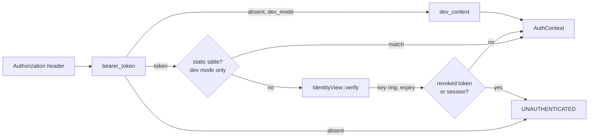

# Identity and authentication

Every request runs as a `Principal`, resolved from its `Authorization` header
before any handler executes. The header carries a token the instance signed
([capability tokens](capability-tokens.md), with keys from
[token keys](token-keys.md)); each server checks it against its identity
view, which also knows what has been revoked. `rill-api/src/auth/` adapts
both transports onto that and wraps the result in `Permit`, the check every
handler runs before touching a repository.

## Principals

[`Principal`](../../crates/rill-types/src/principal.rs) is the actor recorded
on every change, vote and landing.

| Field | Notes |
| --- | --- |
| `id: PrincipalId` | 16 bytes. `Principal::human/agent/service(name)` derive it with `PrincipalId::derived(kind, name)` (BLAKE3 over `rill:id:pr:<kind>:<name>`), so a name always maps to the same id. Displays as `pr_<hex>`. |
| `kind: PrincipalKind` | `Human`, `Agent`, `Service`; `as_str` gives `human`, `agent`, `service`. |
| `name: String` | Handle. `Display` renders `alice`, `agent:reviewer-7`, `svc:lander`. |
| `identity: Option<String>` | Email or SPIFFE id. Informational; no policy reads it. |

The human who delegated an agent's work is `Provenance::sponsor` on the change
version, not a field of `Principal`. Nothing in `rill-policy` reads it.

## From header to AuthContext

[`AuthContext`](../../crates/rill-policy/src/identity.rs) is what a request
runs as: `principal`, `teams` (names for `team:` relation subjects),
`capability` (`Some` only for a narrowed token) and `claims` (the token's
`TokenClaims`; `None` for static tokens and dev mode).
`capability_allows(repo, path, verb)` is `true` when there is no
capability, otherwise `cap.repo == repo && cap.allows(verb) &&
cap.covers_path(path)`.

`authenticate(state, header)` is the single entry point:

* no header and `dev_mode`: `dev_context()`, the human `dev` with no teams,
  capability or claims;
* no header otherwise: `UNAUTHENTICATED`;
* a header present: it must authenticate, even in dev mode, so tests and
  tools can act as specific principals. A dev-mode server first tries its
  static table; every other token goes to `IdentityView::verify`.

`bearer_token` accepts the `Bearer` scheme case-insensitively and rejects an
empty token. Static tokens outside dev mode stop the server at startup
(`auth::static_tokens`).

## The identity view

Each server holds an [`IdentityView`](../../crates/rill-api/src/identity/view.rs):
the `KeySet` (every trusted public key and the issuer it signs with) and the
revoked token ids and session ids still in force. `verify(token)` checks the
signature against the key the token names, the expiry, then the revocation
sets. A token naming a key the view does not know forces one reload of the
keys (at most once a second) before it is refused, so a key another server
just added is never a reason to fail.

[`follow`](../../crates/rill-api/src/identity/follower.rs) keeps the view
current. It waits on the identity log counter (an FDB watch), applies new
entries (`TokenRevoked`, `SessionRevoked`, `KeysChanged`), reloads
everything every 60 s, and reloads when a pending key activates. A server
that revokes something applies it to its own view at once. Every process
runs a follower; processes with the workers role also run
[`maintain_forever`](../../crates/rill-api/src/identity/maintenance.rs)
every 10 minutes: key rotation and pruning, and sweeping expired
revocations and sessions (after a day) and log entries (after 7 days).

The `IdentityService` RPCs:

| RPC | Who |
| --- | --- |
| `RevokeToken { token }` | anyone holding the token (logout) |
| `RevokeToken { token_id }` | instance administrators |
| `RevokeSession` | the session's principal, or administrators |
| `RotateTokenKeys`, `ListTokenKeys` | administrators |

`require_instance_admin` passes in dev mode, or for a principal named in
`identity.admins` presenting an unnarrowed token.

`WhoAmI` reports the caller's token id, session, org, sponsor and model with
its principal and capability.

## Bootstrap

A server outside dev mode accepts only tokens the instance signed. The first
comes from `rill api mint-token <kind:name>`
([mint.rs](../../crates/rill-api/src/identity/mint.rs)): it opens the store
and key service from the server configuration, makes sure a key exists, and
signs an unnarrowed token for the principal (by default as long as its kind
allows). Whoever can reach the store and the key service can sign as the
instance; that is the trust boundary.

## Transport layers

[`AuthLayer`](../../crates/rill-api/src/auth/layer.rs) is a tower layer,
not a tonic `Interceptor`, because interceptors are synchronous and team lookup
may need the store. `serve_grpc` wraps the Repo, Workspace, Review, Intent,
Lander and Admin services. Reflection and gRPC health are not wrapped. The
layer stores the `AuthContext` in request extensions or short-circuits with
the error status. Handlers read it with `caller(&request)`. A missing
extension is a wiring bug and is still reported as `UNAUTHENTICATED`, so
nothing proceeds without a caller.

[`require_auth`](../../crates/rill-api/src/auth/http.rs) is the axum
equivalent for the object protocol. It guards `/o/{repo}/{kind}/{hash}` and
`/o/{repo}/batch` and replies `401` with the error text. `/livez`,
`/readyz` and `/metrics` are open.

## Permit

Handlers never check relations directly. `Opened::permit()` builds a
[`Permit`](../../crates/rill-api/src/auth/permit.rs) for the caller, the
repository and `dev_mode`. `Permit::check(verb, relation, path)` runs two
layers:

1. `capability_allows` must hold. This is enforced even in dev mode, because a
   token only narrows what its principal could otherwise do.
2. Under `dev_mode`, or when the repository has no relation tuples at all (the
   bootstrap rule), the check passes. Otherwise `Authorizer::check_path` must
   grant the relation. See [permissions](permissions.md).

Denial is `PERMISSION_DENIED`, with a message naming the principal, relation,
path and repository. `resolved_by()` maps the caller's kind to the
`Provenance::resolved_by` string that `ApplyEdits` records.

## Configuration

| Setting | Meaning |
| --- | --- |
| `[[auth.tokens]]` | Static tokens: `token`, `principal_name`, `kind` (`Human`, `Agent`, `Service`), `teams`. Dev mode only. |
| `[identity.keys]` | The key service (`backend` = `local`, `vault`, `aws-kms`, `gcp-kms`); see [token keys](token-keys.md). |
| `[identity.lifetimes]` | `human_secs` (3600), `agent_secs` (900), `service_secs` (43200). |
| `[identity.rotation]` | `rotate_after_days` (30), `activation_delay_secs` (60), `grace_secs` (300). |
| `identity.admins` | Principal names that administer the instance. |
| `dev_mode` | Anonymous requests act as `dev`; the relation layer is skipped. |
| `RILL_STATIC_TOKENS` | `token=name[:kind[:team,team]];...`; replaces the static list. |
| `RILL_MASTER_KEY`, `RILL_MASTER_KEY_FILE`, `RILL_VAULT_ADDR` + `RILL_VAULT_KEY`, `RILL_AWS_KMS_KEY`, `RILL_GCP_KMS_KEY` | Choose the key service. |
| `RILL_ADMINS` | Comma-separated administrators. |

## Limitations

* `capability_allows` ignores `Capability::workspace`. A workspace-pinned token
  is accepted for any workspace.
* No `TeamResolver` is wired in the server. Token-authenticated principals
  always have empty teams; only static tokens carry teams.
* There is no sign-in yet: tokens come from `mint-token` and `IssueToken`.
* `PrincipalKind` has no serde rename, so a TOML `auth.tokens[].kind` must be
  written `Human`, `Agent` or `Service`. The env var form uses lowercase.
* `CreateChangeVersion` stores the client-supplied `author` and `provenance`
  without comparing them to the caller. Only `ApplyEdits` uses the caller.
* `Provenance::sponsor` is informational. No check ties an agent's token or
  votes to its sponsor.
* `AuthHeaders::principal_hint` exists, but no built-in authenticator honours it.

## Code

* [`rill-policy/src/identity.rs`](../../crates/rill-policy/src/identity.rs): `AuthHeaders`, `AuthContext`, `Authenticator`, `StaticTokenAuthenticator`, `TeamResolver`.
* Tests: `rill-api/tests/grpc/identity.rs` (revocation and rotation across servers), `rill-cli/tests/bootstrap.rs`.
* [`rill-types/src/principal.rs`](../../crates/rill-types/src/principal.rs): `Principal`, `PrincipalKind`.
* [`auth/authenticator.rs`](../../crates/rill-api/src/auth/authenticator.rs): `static_tokens`, `authenticate`.
* [`auth/instance.rs`](../../crates/rill-api/src/auth/instance.rs): `require_instance_admin`.
* [`identity/`](../../crates/rill-api/src/identity/mod.rs): `IdentityView`, `follow`, `maintain_forever`, `mint_token`.
* [`services/identity/`](../../crates/rill-api/src/services/identity/mod.rs): the `IdentityService` RPCs.
* [`auth/context.rs`](../../crates/rill-api/src/auth/context.rs): `caller`, `bearer_token`, `dev_context`.
* [`auth/layer.rs`](../../crates/rill-api/src/auth/layer.rs), [`auth/http.rs`](../../crates/rill-api/src/auth/http.rs): gRPC and HTTP middleware.
* [`auth/permit.rs`](../../crates/rill-api/src/auth/permit.rs): `Permit`.
* [`services/common.rs`](../../crates/rill-api/src/services/common.rs): `Opened`, `open`.
* [`config/auth.rs`](../../crates/rill-api/src/config/auth.rs), [`config/identity.rs`](../../crates/rill-api/src/config/identity.rs), [`config/env.rs`](../../crates/rill-api/src/config/env.rs): `AuthConfig`, `StaticToken`, `IdentityConfig`, env overrides.

---
← Previous: [Intents](../04-workflow/intents.md) · [Index](../index.md) · Next: [Capability tokens](capability-tokens.md) →
