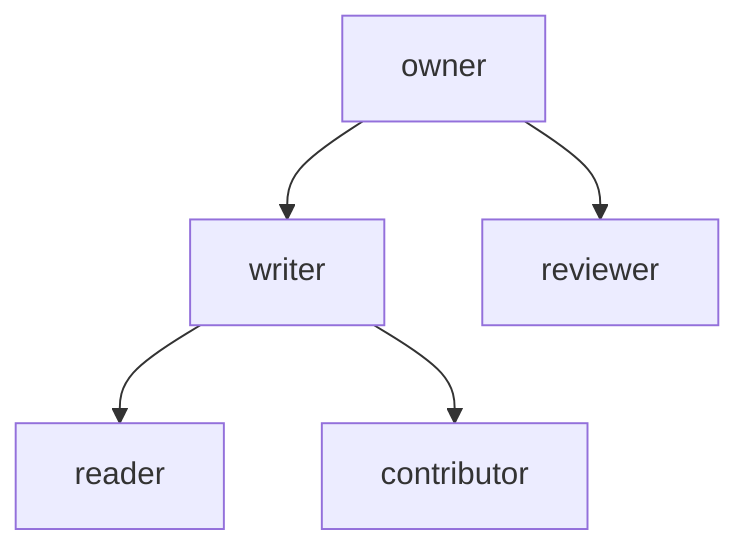

# Permissions

Access to a repository is a set of `(object, relation, subject)` tuples stored
in the repository's metadata. Objects are the repository (`repo`) or
directories (`dir:/src/billing`). Subjects are a principal, a team, a
principal kind or everyone. `Authorizer` applies the relation rewrites and
directory inheritance over a short-lived snapshot. The invariants: a relation
granted on a directory applies to its whole subtree, and a store error denies
rather than allowing.

## Model

An arrow means "satisfies": a check for the lower relation accepts a tuple
that holds the upper one.
[`Relation::satisfied_by`](../../crates/rill-policy/src/rebac/model.rs)
encodes this. `writer` does not imply `reviewer`, so a writer cannot vote
unless also granted `reviewer`. `contributor` is defined, but no handler
checks it.

Subjects, parsed by `Subject::from_str`:

| Form | Matches |
| --- | --- |
| `principal:<PrincipalId>` | `id == principal.id` |
| `team:<name>` | `name` in `AuthContext::teams`; the name must be non-empty with no `/` |
| `kind:human`, `kind:agent`, `kind:service` | `principal.kind` |
| `*` | everyone |

`dir_object(path)` is `repo` for the root and `dir:/<path>` otherwise.
`inheritance_chain(object)` lists the object, each ancestor directory, then
`repo`. An object that is not a directory has no ancestors.

## Storage

Tuples are keys with empty values in the repository's metadata store
([`keys.rs`](../../crates/rill-store/src/keys.rs)):
`(rebac, ns, repo, object, relation, subject)`, each a tuple element, so an
object id containing `/` is stored and read back exactly.
`RepoStore::add_relation` sets the key, `remove_relation` deletes it,
`relations_of(object)` scans one object's rows and `list_relations` all of
them.

`Snapshot::load` reads `list_relations`. A tuple whose relation or subject
does not parse is logged with `warn` and skipped, so one bad row does not
fail every check in the repository.

## Snapshot and authorizer

[`Snapshot::check(principal, teams, relation, object)`](../../crates/rill-policy/src/rebac/snapshot.rs)
is true when any tuple has an accepted relation, an object in the inheritance
chain, and a matching subject. `granted_dirs` returns the directories on which
the principal directly holds an accepted tuple.

[`Authorizer`](../../crates/rill-policy/src/rebac/authorizer.rs) is one per
`RepoContext`. It caches one `Arc<Snapshot>` for `DEFAULT_SNAPSHOT_TTL`
(500 ms), so a request that runs many checks scans the store once.

* `grant` and `revoke` write the tuple and then `invalidate` the cache.
* `check` treats a store error as `false` and logs it at `error`.
* `check_path(path)` is `check` on `dir_object(path)`. The path itself and
  every ancestor directory are consulted.
* `allowed_paths_for(relation)` returns `PathFilter::under(granted_dirs)`,
  or `deny_all` on a store error.

A write that bypasses the authorizer is invisible until the TTL elapses.
There are no multi-tuple transactions.

## Read filtering

[`PathFilter`](../../crates/rill-policy/src/rebac/authorizer.rs) is a cheap
predicate built once per request. `under(roots)` allows paths at or below any
root. A root entry means allow all; an empty list means deny all.
`Permit::read_filter()` returns `allow_all` under dev mode or bootstrap, and
otherwise the caller's `Reader` directories, narrowed by the token's paths
(a token for another repository, or without `read`, denies all) and the
agent's registered scope. Listings and searches use it so
that names of unreadable directories do not leak: `ListDir` and `Diff`
(`services/repo/trees.rs`), `WorkspaceDiff`, and `Grep`. Point reads such as
file content, history and blame call `permit().read(path)` instead.

## Enforcement

[`Permit`](../../crates/rill-api/src/auth/permit.rs) maps each operation to
a verb, a relation and a path:

| Method | Verb | Relation | Typical callers |
| --- | --- | --- | --- |
| `read(path)` | `Read` | `Reader` | every read RPC, `ListRelations`, `GetPolicy`, `EvaluateSubmit`, object `GET`/`HEAD` |
| `write(path)` | `Write` | `Writer` | `CreateChangeVersion` per file and subtree path (copy sources need `read`), `ApplyEdits`, workspace snapshot per entry |
| `write(root)` | `Write` | `Writer` | `Rebase`, `Merge`, workspace and intent changes, `SubmitForReview`, `SetStack`, `Abandon`, object `PUT` |
| `review()` | `Review` | `Reviewer` | `Vote`, `Comment`, thread reply and resolve |
| `land()` | `Land` | `Writer` | `RequestLand`, `ReportVerification`, `RevertSeq`, `Bisect` |
| `admin()` | `Admin` | `Owner` | `AddRelation`, `RemoveRelation`, `SetPolicy`, `IssueToken` without a token |

`owns_or_admin(owner)` passes when the caller is the record's owner, and
otherwise requires `admin()`.

Bootstrap rule: a repository with zero tuples is open to any authenticated
principal. `CreateRepo` grants `owner` on `repo` to its creator right away, so
repositories created through the API leave that state immediately.

## Admin RPCs

[`AdminService`](../../crates/rill-api/src/services/admin.rs) names the
repository inside the object string. The object is `repo:<name>` or
`path:<name>/<dir>`. `AddRelation` and `RemoveRelation` require `admin()`;
`ListRelations` requires `read(root)` and takes an optional relation filter.
`parse_subject` strips a trailing `#member`, so `team:infra#member` is read as
`team:infra`.

## Limitations

* Subjects are not validated against known principals. Any 16-byte id is
  accepted.
* An unknown relation or malformed subject returns `INTERNAL`, not
  `INVALID_ARGUMENT`, because the parse error is `Error::PolicyEvaluation`.
* `team:` tuples never match Biscuit-authenticated principals, because no
  team resolver is wired.
* Removing a repository's last tuple returns it to the open bootstrap state.
* There are no cross-repository roles and no negative (deny) tuples.
* Every snapshot reload scans all of the repository's tuples. There is no
  index by subject.
* `ListRelations` on `path:<repo>/<dir>` scans the `dir:/<dir>/` prefix, so it
  also returns mis-split rows for nested directories.

## Code

* [`rebac/model.rs`](../../crates/rill-policy/src/rebac/model.rs): `Relation`, `Subject`, `dir_object`, `inheritance_chain`.
* [`rebac/snapshot.rs`](../../crates/rill-policy/src/rebac/snapshot.rs): `Tuple`, `Snapshot`, `SnapshotCache`.
* [`rebac/authorizer.rs`](../../crates/rill-policy/src/rebac/authorizer.rs): `Authorizer`, `PathFilter`, `DEFAULT_SNAPSHOT_TTL`.
* [`rebac/tests.rs`](../../crates/rill-policy/src/rebac/tests.rs): rewrite, inheritance and filter cases.
* [`rill-store/src/repo/relations.rs`](../../crates/rill-store/src/repo/relations.rs): `add_relation`, `remove_relation`, `relations_of`, `list_relations`.
* [`auth/permit.rs`](../../crates/rill-api/src/auth/permit.rs): `Permit`.
* [`services/admin.rs`](../../crates/rill-api/src/services/admin.rs): relation RPCs.

---
← Previous: [Token keys](token-keys.md) · [Index](../index.md) · Next: [Risk classification](risk-classification.md) →
