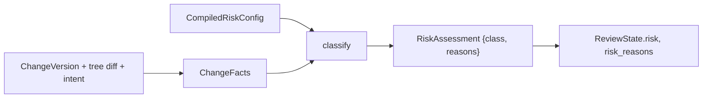

# Risk classification

The risk classifier maps facts about a change version to a `RiskClass` and the
list of features that fired. It is a pure, deterministic function: the review
service assembles the facts, and the classifier never reads the object store.
The resulting class is stored on the review and drives the
[submit policy](submit-policy.md).

## Facts

[`ChangeFacts`](../../crates/domain/policy/src/risk/facts.rs) is built by
[`ReviewService::version_facts`](../../crates/domain/review/src/facts.rs) from
the version, its tree diff against the first parent, and its linked intent.

| Field | Source |
| --- | --- |
| `author`, `provenance` | The `ChangeVersion`. |
| `paths: Vec<PathFacts>` | One per `diff_trees` entry, plus conflicted paths with no tree difference. Cached as derived data under `review-paths@1`. |
| `total_files`, `total_lines` | Derived from `paths` by `ChangeFacts::new`. A caller that truncates `paths` keeps the true counts. |
| `intent_kind`, `risk_override` | The linked `Intent`, when `cv.intent` resolves. |
| `owner_sets`, `people` | The owner sets of the touched paths at trunk's head, and the teams and sponsors of the people involved ([code owners](../04-workflow/ownership.md)). |
| `stack_depth` | Index of the change in `ReviewState::stack`, set by `change_facts`. |

`PathFacts` records `added`, `modified`, `deleted`, `conflict`,
`lines_added`, `lines_removed` and `cosmetic_only: Option<bool>`. Line counts
and `cosmetic_only` are filled only when both sides are text no larger than
`MAX_DIFF_BYTES` (1 MiB). `cosmetic_only` is true when the two texts are equal
after removing whitespace, empty lines, and lines starting with `//` or `#`.

## Configuration

[`RiskConfig`](../../crates/domain/policy/src/risk/config.rs) is declarative.
`compile()` turns it into `CompiledRiskConfig` once. Globs use
`literal_separator`, so `*` stops at `/` and `**` spans directories. An invalid
pattern is `Error::InvalidGlob`.

| Field | Default | Role |
| --- | --- | --- |
| `sensitive: Vec<SensitiveGlob { glob, class }>` | empty | A matching path raises the class to at least `class`. |
| `trivial_extensions` | `md`, `txt`, `rst`, `adoc` | Documentation files (case-insensitive). |
| `test_globs` | `**/tests/**`, `**/test/**`, `**/*_test.*`, `**/*.test.*`, `**/*_spec.*` | Test files. |
| `max_files` | 50 | More files bumps one step. |
| `max_lines` | 1000 | More lines bumps one step. |

The server's fallback is `ServerConfig.risk`. A per-repository override is
stored with `UpdatePolicy` as described in [submit policy](submit-policy.md).

## Algorithm

[`classify(facts, config)`](../../crates/domain/policy/src/risk/classify.rs)
runs a fixed, ordered list of features. Later steps see the result of earlier
ones. Every feature that fires appends a reason, and the review stores the
list as `risk_reasons`.

| Step | Feature | Effect | Reason |
| --- | --- | --- | --- |
| 1 | no paths | `Trivial` | `no paths touched` |
| 1 | list complete and every path docs or `cosmetic_only == Some(true)` | `Trivial` | `docs or comments only` |
| 1 | list complete and every path a test | `Low` | `tests only` |
| 1 | otherwise | `Normal` | none |
| 2 | sensitive glob match | `max(class, floor)` | `sensitive path 
 matches "<glob>" (at least <class>)` |
| 2 | first component is `.rill` | `Critical` | `policy file 
 under .rill/` |
| 2 | file name is `OWNERS.toml` | at least `Sensitive` | `sensitive path 
 changes ownership` |
| 2 | a touched owner set is `sensitive` | at least `Sensitive` | `sensitive path owners rule <set> is sensitive` |
| 3 | `provenance.resolved_by == "agent"` | `bump()` | `conflict resolved by agent` |
| 3 | any path in conflict | `bump()` | `unresolved conflicts` |
| 3 | `total_files > max_files` | `bump()` | `<n> files exceeds <max>` |
| 3 | `total_lines > max_lines` | `bump()` | `<n> lines exceeds <max>` |
| 4 | intent `risk_override` | replaces the class | `intent risk override <class>` |

"List complete" means `total_files <= paths.len()`. A truncated list cannot
prove anything about the omitted files, so it never lowers the baseline.
`RiskClass::bump` goes `Trivial`, `Low`, `Normal`, `Sensitive`, `Critical`,
and `Critical` saturates. The `.rill/` rule is unconditional because files
there, such as `.rill/verify.toml`, control how the repository is verified.

`SENSITIVE_REASON_PREFIX` (`"sensitive path "`) is stable.
`touches_sensitive(reasons)` recovers the sensitive-path fact from stored
`risk_reasons` alone, and the submit facts use it.

## When risk is computed

The review applies `classify` when a change is submitted, when a new version is
added, and when a stack is set (`apply_risk`). Votes and comments re-evaluate
the submit policy against the stored class without reclassifying.

## Limitations

* `.rill/risk.toml` in the tree is not read. The only sources are the stored
  `risk` policy and `ServerConfig.risk`.
* `RiskConfig` has no `#[serde(default)]`, so a stored JSON config must list
  every field.
* `stack_depth` is computed but neither the classifier nor the Cedar schema
  uses it.
* The cosmetic check is textual. A `#` or `//` line inside a string literal
  counts as a comment.
* Changing the risk config does not reclassify existing reviews until their
  next version or stack change.

## Code

* [`risk/facts.rs`](../../crates/domain/policy/src/risk/facts.rs): `ChangeFacts`, `PathFacts`.
* [`risk/config.rs`](../../crates/domain/policy/src/risk/config.rs): `RiskConfig`, `SensitiveGlob`, `CompiledRiskConfig`.
* [`risk/classify.rs`](../../crates/domain/policy/src/risk/classify.rs): `classify`, `RiskAssessment`, `SENSITIVE_REASON_PREFIX`, `touches_sensitive`.
* [`rill-review/src/facts.rs`](../../crates/domain/review/src/facts.rs): fact assembly, `MAX_DIFF_BYTES`, `cosmetic_only`.
* [`rill-types/src/objects/intent.rs`](../../crates/foundation/types/src/objects/intent.rs): `RiskClass`, `bump`.

---
← Previous: [Permissions](permissions.md) · [Index](../index.md) · Next: [Submit policy](submit-policy.md) →
