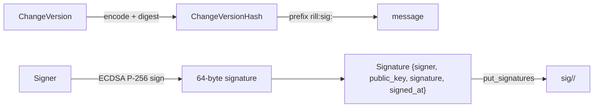

# Signing

`signing.rs` produces and checks ECDSA P-256 signatures over object hashes.
Every key Rill uses is P-256, so one key service can hold them all. A
`Signer` holds a keypair. `sign` returns a detached `Signature` that names the
signing principal, and `verify` checks it against the public key the signature
carries. The invariant: the signed message is `"rill:sig:" || hash`, so a
signature over a Rill object hash cannot be replayed as a signature over other
data signed with the same key.

## What is signed

A signature covers an `ObjectHash`, the BLAKE3 digest of a kind-prefixed
encoding. In practice the signed object is a change version. The version hash
covers its author, provenance, parents and file changes, so a signature over
it attests to the whole version, including
[`Provenance`](../../crates/rill-types/src/objects/change.rs).

| `Signature` field | Content |
| --- | --- |
| `signer` | The `Principal` the key signed for. |
| `public_key` | 33-byte compressed SEC1 P-256 point. |
| `signature` | 64-byte `r || s` over `rill:sig:` + hash bytes, always low-S. |
| `signed_at` | Informational. Not covered by the signature. |

## Keys and API

[`Signer`](../../crates/rill-policy/src/signing.rs):

* `generate()` draws a random 32-byte scalar. `from_bytes` rejects anything
  that is not a valid P-256 secret scalar with `Error::InvalidKey`.
* `secret_bytes()` returns the secret, and `public_key()` the 33-byte
  compressed point. `Debug` prints only the public key.
* Signing is deterministic (RFC 6979) and normalized to low-S.
* `sign(hash, principal)` is `sign_at(hash, principal, Timestamp::now())`.

`verify(sig, hash)` rebuilds the message and checks the ECDSA signature. A
malformed key or signature, or a high-S signature (so each signature has one
encoding), returns `false` and never panics. A `true` result proves only that the embedded key
signed this hash. It does not prove that the key belongs to `sig.signer`; that
binding is the caller's job.

`KeyFile::encode` writes the secret as 64 hex characters plus a newline.
`decode` trims whitespace and hex-decodes. `encode_public` and `decode_public`
do the same for verifying keys. The crate defines this format but performs no
file I/O.

## Provenance

`Provenance` is part of the hashed version, so a version signature also fixes
`tool`, `model`, `session`, `prompt_ref`, `sponsor` (the human who delegated an
agent's work), `resolved_by` and the free-form `extra` map. The server sets
`resolved_by` from `Permit::resolved_by()` in `ApplyEdits`. Every commit
path stamps the rest from the caller's signed token before hashing
([stamp.rs](../../crates/rill-api/src/services/repo/stamp.rs)): `session`
and `model` are the token's claims, `sponsor` is the token's user sponsor
(a team sponsor goes to `extra["sponsor_team"]`), and a client value that
differs is kept as `extra["claimed_session"]` / `extra["claimed_model"]`.
Without a token claim the field is empty and the client value is only a
claim. The risk classifier
bumps a change whose `resolved_by` is `agent`; see
[risk classification](risk-classification.md).

## Server path

`CreateChangeVersion` accepts `signatures` with the version. It converts each
one with `Signature::try_from`, commits the version, and then calls
`RepoStore::put_signatures(&hash, &signatures)` when the list is non-empty.
`GetChangeVersion` returns `get_signatures(&hash)` with the version. The SDK
exposes both. Signatures are stored as one record-encoded `Vec<Signature>`
under `sig/<repo>/<hash>`.

The server never calls `verify`, never checks `sig.signer` against the caller,
and never signs anything itself. `ApplyEdits` and the lander produce unsigned
versions.

## Limitations

* `Signer` and `verify` have no callers outside `rill-policy`. The CLI, SDK
  and server do not sign or verify.
* Signatures are written after the version commit. A failure between the two
  leaves an unsigned version.
* `put_signatures` replaces the whole list. A second `CreateChangeVersion` for
  the same hash with different signatures overwrites the first list.
* No key directory binds public keys to principals, so a stored signature
  proves possession of some key, not the identity in `signer`.
* `signed_at` is unsigned metadata.
* Signing keys are unrelated to the Biscuit root key used for
  [capability tokens](capability-tokens.md).

## Code

* [`signing.rs`](../../crates/rill-policy/src/signing.rs): `Signer`, `verify`, `KeyFile`.
* [`objects/change.rs`](../../crates/rill-types/src/objects/change.rs): `Signature`, `Provenance`.
* [`rill-store/src/repo/versions.rs`](../../crates/rill-store/src/repo/versions.rs): `put_signatures`, `add_signatures`, `get_signatures`.
* [`services/repo/write.rs`](../../crates/rill-api/src/services/repo/write.rs): `create_change_version_impl`, provenance handling.
* [`services/repo/history.rs`](../../crates/rill-api/src/services/repo/history.rs): signatures on read.
* [`rill-sdk/src/repo/write.rs`](../../crates/rill-sdk/src/repo/write.rs), [`rill-sdk/src/repo/history.rs`](../../crates/rill-sdk/src/repo/history.rs): client surface.

---
← Previous: [Submit policy](submit-policy.md) · [Index](../index.md) · Next: [Threat model](threat-model.md) →
