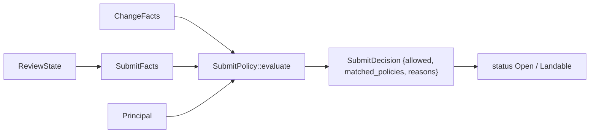
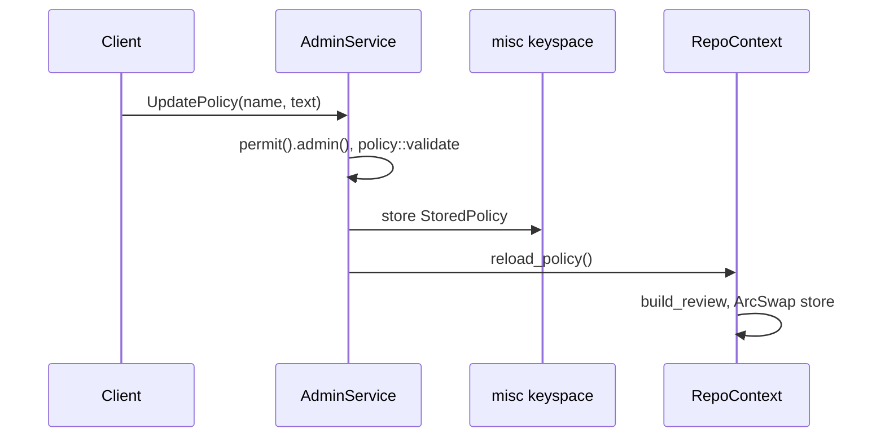

# Submit policy

The submit policy decides whether a change may land. It is a Cedar policy set
evaluated against a `Rill::Principal`, a `Rill::Change` built from the
review's risk class, votes and threads, and the `Rill::Action::"land"`
action. Evaluation is pure and cheap, so the review service runs it on every
vote. The invariant: a Cedar `forbid` always wins over any `permit`, and an
empty policy set denies everything.

## Review facts

[`SubmitFacts::from_review`](../../crates/domain/policy/src/submit/facts.rs)
reads the `ReviewState`:

* `risk`: the stored class (see [risk classification](risk-classification.md)).
* `labels`: one `VoteSummary` per label, over `current_votes()` (votes on
  the current version only).
* `unresolved_threads`, and `unresolved_blocking_threads`: unresolved threads
  with a `Bug` or `Security` comment.
* `touches_sensitive`: a `sensitive path ` entry exists in `risk_reasons`.

`VoteSummary::from_votes` keeps each voter's latest vote and reports `max`,
`min`, `human_max`, `agent_max`, `human_votes`, `agent_votes`,
`human_approvals` and `agent_approvals` (approval means value > 0). Service
votes count toward `max` and `min` only.

## Cedar schema

[`SCHEMA_SRC`](../../crates/domain/policy/src/submit/schema.rs) is parsed once
per process. Labels are entity tags on `Rill::Change`, so a policy can address
any label by name without the schema listing them.

| Entity | Attributes |
| --- | --- |
| `Rill::Principal` | `kind`, `name` |
| `Rill::Change` | `risk`, `author_kind`, `intent_kind` (or `none`), `unresolved_threads`, `unresolved_blocking_threads`, `touches_sensitive`, `has_agent_resolution`, `label_names: Set<String>`, `owner_sets`, `owner_sets_missing`, `owners_covered` ([code owners](../04-workflow/ownership.md)), `intent_approved`, `intent_in_scope`, `intent_agent_quorum` ([intents](../04-workflow/intents.md)), `independent_agent_approvals`, `min_agent_trust` ([review agents](../04-workflow/review-agents.md#independence)); tags of type `VoteSummary` |
| `Rill::VoteSummary` | the eight `VoteSummary` counters, as `Long` |

[`entities.rs`](../../crates/domain/policy/src/submit/entities.rs) builds
`Rill::Principal::"<id>"` and `Rill::Change::"current"`, validates both
against the schema, and uses an empty context.

## Default policy

[`DEFAULT_POLICY`](../../crates/domain/policy/src/submit/default_policy.rs)
applies when a repository has no stored submit policy. Each rule has an
`@id`:

| Rule | Effect | Condition |
| --- | --- | --- |
| `block_review_veto` | forbid | `Review.min <= -2` |
| `block_unresolved_bug_or_security` | forbid | `unresolved_blocking_threads > 0` |
| `block_uncovered_owners` | forbid | `owner_sets_missing > 0` and risk not `trivial`/`low` |
| `land_trivial_or_low` | permit | risk `trivial`/`low` and `Verified.max >= 1` |
| `land_normal_human_review` | permit | risk `normal` and `Review.human_max >= 2` |
| `land_normal_agent_review_with_owner` | permit | risk `normal`, `independent_agent_approvals >= 2` and `Owner.human_max >= 1` |
| `land_sensitive_or_critical` | permit | risk `sensitive`/`critical`, `Owner.human_max >= 1` and `Review.human_max >= 2` |

## Loading and evaluation

[`SubmitPolicy::from_source`](../../crates/domain/policy/src/submit/policy.rs)
parses the text (`Error::PolicyParse`) and renames each policy to its
`@id("...")` annotation; duplicate ids are `PolicyParse`. It then validates in
`ValidationMode::Strict` against the schema (`Error::PolicyValidation`), so a
reference to an unknown attribute fails at load, not at land time.

`evaluate(principal, change, review)` returns `SubmitDecision`:

* `allowed`: Cedar returned `Allow`;
* `matched_policies`: sorted ids from the diagnostics, which are the forbids
  that fired when denied and the permits otherwise;
* `reasons`: `<id>: <effect>` per match (plus `(<description>)` when the
  policy has a `@description`), `no permit rule matched` when none matched,
  and `evaluation error: ...` for each Cedar error (also logged at `warn`).

Callers in [`rill-review`](../../crates/domain/review/src/evaluate.rs) and the
server:

* `refresh_status` evaluates as the review's owner and flips `Open` to
  `Landable` or back. It leaves other statuses alone.
* `EvaluateLanding` (requires `read`) and `RequestLand` (requires `land`)
  evaluate as the caller via `evaluate_for`. `RequestLand` fails with
  `FAILED_PRECONDITION` and the joined reasons when the policy denies.

## Storage and hot swap

[`state/policy.rs`](../../crates/server/runtime/src/state/policy.rs) stores two
documents per repository as JSON `StoredPolicy { text, updated_at,
updated_by }` under `misc/<repo>/policy:<name>`:

| Policy name | Text |
| --- | --- |
| `<repo>/submit` | Cedar |
| `<repo>/risk` | JSON `RiskConfig` |

* `UpdatePolicy` requires `admin()`. `policy::validate` fully parses the text
  (Cedar validation, or JSON parse plus glob compilation). Failure is
  `INVALID_ARGUMENT`, and nothing is stored.
* `reload_policy` rebuilds the `ReviewService` from `effective_submit` (stored
  or `default_rules()`) and `effective_risk` (stored or `ServerConfig.risk`),
  then swaps it into the `ArcSwap`. In-flight requests finish on the old
  `Arc`. Review event subscribers are unaffected because the broadcast sender
  is shared.
* `GetPolicy` requires `read`. With nothing stored, it returns the default
  text, attributed to the lander service principal at the repository's
  `created_at`.

## Limitations

* `.rill/submit.cedar` in the tree is not read. Policies come only from
  `UpdatePolicy`.
* `Provenance::sponsor` and `stack_depth` are not entity attributes, and no
  default rule uses `author_kind`.
* Changing the policy does not re-evaluate existing reviews until their next
  vote, comment, version or refresh.
* Vote values are not range-checked here against the label definitions.

## Code

* [`submit/schema.rs`](../../crates/domain/policy/src/submit/schema.rs): `SCHEMA_SRC`, `schema`.
* [`submit/facts.rs`](../../crates/domain/policy/src/submit/facts.rs): `SubmitFacts`, `VoteSummary`.
* [`submit/entities.rs`](../../crates/domain/policy/src/submit/entities.rs): `build_request`.
* [`submit/default_policy.rs`](../../crates/domain/policy/src/submit/default_policy.rs): `DEFAULT_POLICY`.
* [`submit/policy.rs`](../../crates/domain/policy/src/submit/policy.rs): `SubmitPolicy`, `SubmitDecision`.
* [`submit/tests.rs`](../../crates/domain/policy/src/submit/tests.rs): default-policy cases.
* [`rill-review/src/evaluate.rs`](../../crates/domain/review/src/evaluate.rs): `evaluate_for`, `refresh_status`.
* [`state/policy.rs`](../../crates/server/runtime/src/state/policy.rs), [`state/repo_context.rs`](../../crates/server/runtime/src/state/repo_context.rs): storage and `reload_policy`.
* [`services/admin/mod.rs`](../../crates/server/api/src/services/admin/mod.rs): `GetPolicy`, `UpdatePolicy`.

---
← Previous: [Risk classification](risk-classification.md) · [Index](../index.md) · Next: [Signing](signing.md) →
