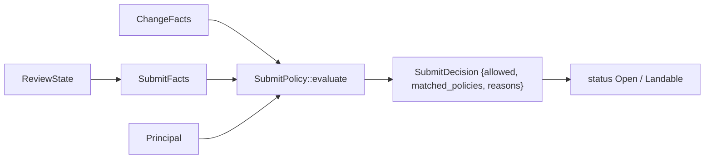

# Submit policy

The submit policy decides whether a change may land. It is a Cedar policy set
evaluated against a `Rill::Principal`, a `Rill::Change` built from the
review's risk class, votes and threads, and the `Rill::Action::"land"`
action. Evaluation is pure and cheap, so the review service runs it on every
vote. The invariant: a Cedar `forbid` always wins over any `permit`, and an
empty policy set denies everything.

## Review facts

[`SubmitFacts::from_review`](../../crates/domain/policy/src/submit/facts.rs)
reads the `ReviewState`:

* `risk`: the stored class (see [risk classification](risk-classification.md)).
* `labels`: one `VoteSummary` per label, over `current_votes()` (votes on
  the current version only).
* `unresolved_threads`, and `unresolved_blocking_threads`: unresolved threads
  with a `Bug` or `Security` comment.
* `touches_sensitive`: a `sensitive path ` entry exists in `risk_reasons`.

`VoteSummary::from_votes` keeps each voter's latest vote and reports `max`,
`min`, `human_max`, `agent_max`, `human_votes`, `agent_votes`,
`human_approvals` and `agent_approvals` (approval means value > 0). Service
votes count toward `max` and `min` only.

## Cedar schema

[`SCHEMA_SRC`](../../crates/domain/policy/src/submit/schema.rs) is parsed once
per process. Labels are entity tags on `Rill::Change`, so a policy can address
any label by name without the schema listing them.

| Entity | Attributes |
| --- | --- |
| `Rill::Principal` | `kind`, `name` |
| `Rill::Change` | `risk`, `author_kind`, `intent_kind` (or `none`), `unresolved_threads`, `unresolved_blocking_threads`, `touches_sensitive`, `has_agent_resolution`, `label_names: Set<String>`, `owner_sets`, `owner_sets_missing`, `owners_covered` ([code owners](../04-workflow/ownership.md)), `intent_approved`, `intent_in_scope`, `intent_agent_quorum` ([intents](../04-workflow/intents.md)), `independent_agent_approvals`, `min_agent_trust` ([review agents](../04-workflow/review-agents.md#independence)), `files`, `lines`, `stack_depth`, `author_model`, `author_sponsor` (provenance, `""` when none), `weekend`, `hour` (UTC, when the facts were taken), `trunk_state` (`green`, `red`, `fixing`, `guarded`), `frozen`; tags of type `VoteSummary` |
| `Rill::VoteSummary` | the eight `VoteSummary` counters, as `Long` |

[`entities.rs`](../../crates/domain/policy/src/submit/entities.rs) builds
`Rill::Principal::"<id>"` and `Rill::Change::"current"`, validates both
against the schema, and uses an empty context.

## Default policy

[`DEFAULT_POLICY`](../../crates/domain/policy/src/submit/default_policy.rs)
applies when a repository has neither policy files nor a stored policy. It
is shaped for agents to review most changes. "Independent" means
`independent_agent_approvals`, and a human's `Review` vote can stand in at
every class:

| Rule | Effect | Condition |
| --- | --- | --- |
| `block_review_veto` | forbid | `Review.min <= -2` |
| `block_unresolved_bug_or_security` | forbid | `unresolved_blocking_threads > 0` |
| `block_uncovered_owners` | forbid | `owner_sets_missing > 0` and risk not `trivial`/`low` |
| `land_trivial` | permit | `trivial`, `Verified`, and 1 independent or `Review.human_max >= 1` |
| `land_low` | permit | `low`, `Verified`, and 2 independent or `Review.human_max >= 1` |
| `land_normal_human_review` | permit | `normal` and `Review.human_max >= 2` |
| `land_normal_agent_review` | permit | `normal`, `Verified`, independent ≥ max(2, `intent_agent_quorum`), and `intent_in_scope` or `Owner.human_max >= 1` |
| `land_sensitive_agent_review` | permit | `sensitive`, `Verified`, 1 independent, `Owner.human_max >= 1` |
| `land_sensitive_or_critical` | permit | `sensitive`/`critical`, `Owner.human_max >= 1` and `Review.human_max >= 2` |

## Loading and evaluation

[`SubmitPolicy::from_source`](../../crates/domain/policy/src/submit/policy.rs)
parses the text (`Error::PolicyParse`) and renames each policy to its
`@id("...")` annotation; duplicate ids are `PolicyParse`. It then validates in
`ValidationMode::Strict` against the schema (`Error::PolicyValidation`), so a
reference to an unknown attribute fails at load, not at land time.

`evaluate(principal, change, review)` returns `SubmitDecision`:

* `allowed`: Cedar returned `Allow`;
* `matched_policies`: sorted ids from the diagnostics, which are the forbids
  that fired when denied and the permits otherwise;
* `reasons`: `<id>: <effect>` per match (plus `(<description>)` when the
  policy has a `@description`), `no permit rule matched` when none matched,
  and `evaluation error: ...` for each Cedar error (also logged at `warn`).

Callers in [`rill-review`](../../crates/domain/review/src/evaluate.rs) and the
server:

* `refresh_status` evaluates as the review's owner and flips `Open` to
  `Landable` or back. It leaves other statuses alone.
* `EvaluateLanding` (requires `read`) and `RequestLand` (requires `land`)
  evaluate as the caller via `evaluate_for`. `RequestLand` fails with
  `FAILED_PRECONDITION` and the joined reasons when the policy denies.

## Where the rules come from

[`effective_submit`](../../crates/server/runtime/src/state/policy.rs) builds
the policy a repository uses from the first of these that exists:

1. **Trunk's `.rill/policy/*.cedar` files**, in name order. They are under
   `.rill/`, so changing them takes `owner` and is critical risk. Each
   file is linted at commit: it must compile, and it may not use an id
   starting `org_`. A change to them is evaluated under the rules already
   on trunk, because review reads trunk. If the files do not compile
   together, they are ignored with an error logged.
2. **The stored `submit` policy** (`UpdatePolicy`, repository owners).
3. **The default.**

The org's **guardrails** are appended to whichever source applies. They
are Cedar `forbid` rules, each `@id("org_…")`, kept in the org's identity
settings and set by org administrators
([`UpdateGuardrails`](../../crates/server/api/src/services/policy/guardrails.rs)).
Because a `forbid` always wins, no repository rule can override a
guardrail.

The review service is rebuilt and hot-swapped (`ArcSwap`; in-flight
requests finish on the old one) whenever:

- a `PolicyChanged` event arrives: a stored policy changed, or the org's
  guardrails did (announced to every repository of the org);
- a landing touches `.rill/policy/`.

`GetEffectivePolicy` returns the text in force, its source (`default`,
`stored` or the file list, with `+ org guardrails`) and its BLAKE3
digest. The text is kept under its digest (`policy-text:<hex>`).

## Recorded decisions, `rill why` and simulation

Every landing carries the digest of the policy that allowed it. The
`landing-decisions` consumer
([workers/decisions.rs](../../crates/server/runtime/src/workers/decisions.rs))
re-evaluates that policy on the change's facts and stores the result
(`landing-decision:<seq>`):

- the principal;
- `ChangeFacts` and `SubmitFacts`, with `at` set to the landing time;
- the decision and the source.

Two RPCs read these records:

- **`ExplainLanding`** (`rill why trunk@N [--facts]`) returns them with the
  policy text.
- **`SimulatePolicy`** (`rill policy simulate --policy new.cedar [--since]
  [--until]`) replays up to 10,000 recorded landings under a candidate
  ([`simulate.rs`](../../crates/domain/policy/src/submit/simulate.rs)). It
  reports:
  - how many it replayed, and how many in range had no record;
  - how many are still allowed;
  - each one now blocked, with reasons;
  - how many could have landed with no human vote, under the recorded
    policy and under the candidate. Human votes are stripped, while
    approved intents still count. This is the human-load measure.

## Storage

Stored policies are JSON `StoredPolicy { text, updated_at, updated_by }`
under `misc/<repo>/policy:<name>` (`submit`: Cedar; `risk`: JSON
`RiskConfig`).
- `UpdatePolicy` requires `admin()` and validates fully before storing.
- `GetPolicy` returns the default text when nothing is stored.

## Limitations

* A recorded decision re-evaluates the landing's policy on facts taken
  just after landing, not inside the landing transaction.
* Policy files changed in the same batch as code are not landed alone.
* Changing the policy does not re-evaluate existing reviews until their next
  vote, comment, version or refresh.
* Vote values are not range-checked here against the label definitions.

## Code

* [`submit/schema.rs`](../../crates/domain/policy/src/submit/schema.rs): `SCHEMA_SRC`, `schema`.
* [`submit/facts.rs`](../../crates/domain/policy/src/submit/facts.rs): `SubmitFacts`, `VoteSummary`.
* [`submit/entities.rs`](../../crates/domain/policy/src/submit/entities.rs): `build_request`.
* [`submit/default_policy.rs`](../../crates/domain/policy/src/submit/default_policy.rs): `DEFAULT_POLICY`.
* [`submit/policy.rs`](../../crates/domain/policy/src/submit/policy.rs): `SubmitPolicy`, `SubmitDecision`.
* [`submit/tests.rs`](../../crates/domain/policy/src/submit/tests.rs): default-policy cases.
* [`rill-review/src/evaluate.rs`](../../crates/domain/review/src/evaluate.rs): `evaluate_for`, `refresh_status`.
* [`submit/guardrails.rs`](../../crates/domain/policy/src/submit/guardrails.rs), [`submit/simulate.rs`](../../crates/domain/policy/src/submit/simulate.rs): guardrails, replay.
* [`state/policy.rs`](../../crates/server/runtime/src/state/policy.rs), [`state/decisions.rs`](../../crates/server/runtime/src/state/decisions.rs), [`state/repo_context.rs`](../../crates/server/runtime/src/state/repo_context.rs): sources, records and `reload_policy`.
* [`services/policy/`](../../crates/server/api/src/services/policy/mod.rs): the RPCs.
* [`services/admin/mod.rs`](../../crates/server/api/src/services/admin/mod.rs): `GetPolicy`, `UpdatePolicy`.

---
← Previous: [Risk classification](risk-classification.md) · [Index](../index.md) · Next: [Signing](signing.md) →
