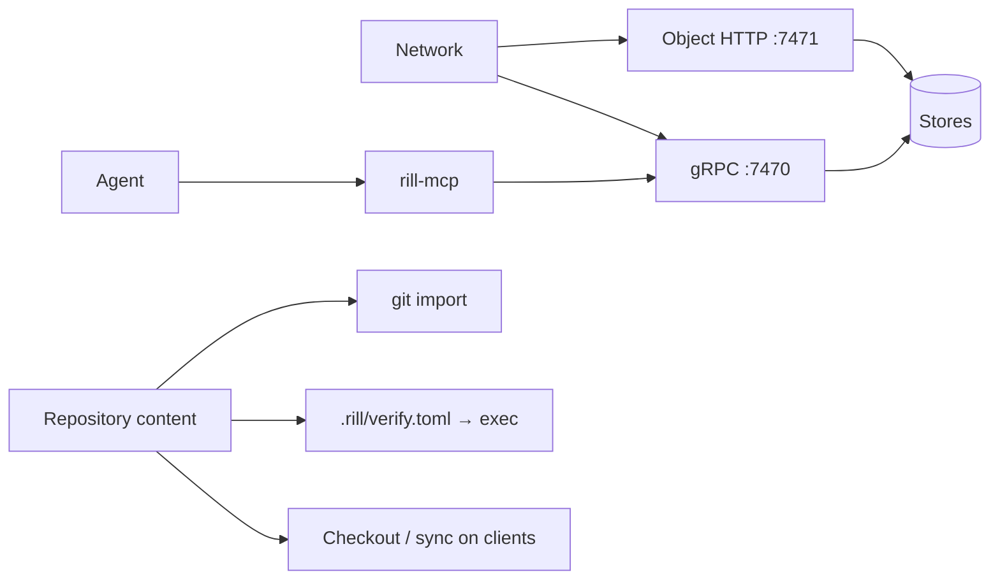

# Threat model

Who might attack a Rill deployment, through which entry points, and which
controls exist today versus which are planned. Each threat lists its current
(v1) state as a fact and the roadmap phase that closes it, so security work
can be prioritised and reviewed. A threat with no planned control is a bug
in this page.

## Assets

| Asset | Why it matters |
| --- | --- |
| Repository content and history | Source code is the product; leaks and silent edits are both critical |
| Trunk order and landing records | `trunk@N` must mean the same thing forever |
| Review state and provenance | The evidence that a change was reviewed and by whom |
| Tokens and the issuing key | Anyone holding them acts as a principal |
| Server host and its credentials | Storage keys, the metadata database, every repository |
| Client machines | Checkouts run on developer laptops, agent hosts and CI |

## Actors

| Actor | Capability | Goal |
| --- | --- | --- |
| External attacker | Network access, no credentials | Steal code or tokens; plant code |
| Compromised human account | A valid token | Land malicious code; exfiltrate |
| Prompt-injected or misaligned agent | A scoped token, runs at machine speed, many at once | Exfiltrate, approve its own work, escape its scope, burn resources |
| Malicious repository content | Anything a writer can commit | Escape the checkout, run code on CI or the server, overwrite client state |
| Insider admin | Admin relations, server access | Tamper silently |
| Supply chain | A dependency or build-pipeline compromise | Ship a backdoored binary |

## Entry points

## Threats

| # | Threat | v1 state | Control (planned) | Phase |
| --- | --- | --- | --- | --- |
| T1 | Tokens sniffed on the wire | TLS on both listeners when `[tls]` is set, optionally mutual (`client_ca`); the SDK checks the server for `https` endpoints and can present a client certificate. Plain text when unset (`rill dev`) | Certificates from an issuer (SPIFFE) and rotation | 8 (done), 10 |
| T2 | Repository writer runs code on the server | `.rill/verify.toml` steps run as host processes with the server's user and network when verification is enabled | Sandboxed remote execution; refuse unsandboxed outside dev | 15 |
| T3 | Checkout writes outside its directory | Server side fixed: every commit rejects symlink targets that are absolute or climb above the root, inline or blob-stored. Clients still follow symlinks when writing | `O_NOFOLLOW` writes on clients | 20 |
| T4 | Repository content rewrites client state | Server side fixed: `.rill/checkout.toml` and `.rill/manifest.toml` cannot be committed, copied into or targeted by a symlink. Client state still lives in the working tree | Client state outside the working tree | 20 |
| T5 | Reader of one directory reads another | `GetTree`, `GetBlob` and the object routes check only repository-level read; any object is fetchable by hash | Signed read grants checked at every tier | 11 |
| T6 | Path-scoped token searches everything | `Grep` performs no path permit | Permit on every read RPC, generated permission matrix | 11 |
| T7 | Writer edits paths they cannot write | `CreateChangeVersion` checks `file_changes` only; a version made only of `subtree_changes` gets no path check | All write checks inside the commit transaction | 11 |
| T8 | Spoofed authorship | Fixed: the server stamps `author` and `created_at`, drops client `sponsor` and `resolved_by`, and signs an attestation for every version it stores | — | — |
| T9 | Impersonation through token issuance | A repository owner can issue a token for any principal name | Issuance bound to the caller; agent registry with sponsors | 10 |
| T10 | Leaked token stays valid | No revocation; no maximum TTL; ephemeral issuer key by default | Revocation list, max TTLs, KMS-backed keys | 10 |
| T11 | Agent approves its own swarm's work | Votes from any agent count toward agent quorums | Independence rules (session, sponsor, model) in policy facts | 23 |
| T12 | Compromised model or session lands bad code at scale | No way to find or revert by provenance | Kill switch and blast-radius revert by provenance | 10, 18 |
| T13 | Memory exhaustion by one request | Partly fixed: `PutBlob` streams in bounded memory with a 5 GiB cap, chunked reads check manifest sizes, change versions are capped at 8 MiB and 100k paths. Other RPCs have no message-size limits | Input limits on every RPC | 12 |
| T14 | Repository open to everyone | A repository with no relation tuples is readable and writable by every authenticated principal | Explicit open flag; refuse removing the last owner | 11 |
| T15 | Secret committed to history | Nothing detects it; nothing can remove it | Secret scanning on ingest; audited redaction | 12 |
| T16 | Silent tampering by an admin | No audit log | Hash-chained audit log exported off-system | 12 |
| T17 | Backdoored release | No release pipeline | Reproducible builds, SBOM, signed releases | 30 |
| T18 | Stale snapshot overwrites concurrent landings | Fixed: checkouts snapshot against the pinned `base_version` | Workspace-authoritative clients | — |

## Assumptions

* The server host, its operating system and the storage services are
  trusted. Rill does not defend against a root user on the server.
* Clients are trusted to protect their own tokens; the server limits what a
  stolen token can do (scope, expiry, revocation).
* Cryptographic primitives (BLAKE3, Ed25519, the Biscuit format) are sound.

## Limitations

- This page reflects v1 code; rows move to "fixed" as their phase lands and
  the owning page changes in the same commit.
- Denial-of-service beyond single-request limits (rate limiting, admission
  control) is tracked under operations, not here.

## Code

- [rill-api/src/auth/](../../crates/rill-api/src/auth/mod.rs), [rill-api/src/services/repo/write.rs](../../crates/rill-api/src/services/repo/write.rs)
- [rill-api/src/objects/](../../crates/rill-api/src/objects/mod.rs), [rill-exec/src/sandbox/](../../crates/rill-exec/src/sandbox/mod.rs)
- [rill-sdk/src/local/](../../crates/rill-sdk/src/local/mod.rs), [rill-policy/src/tokens/](../../crates/rill-policy/src/tokens/mod.rs)

---
← Previous: [Signing](signing.md) · [Index](../index.md) · Next: [Search](../06-services/search.md) →
