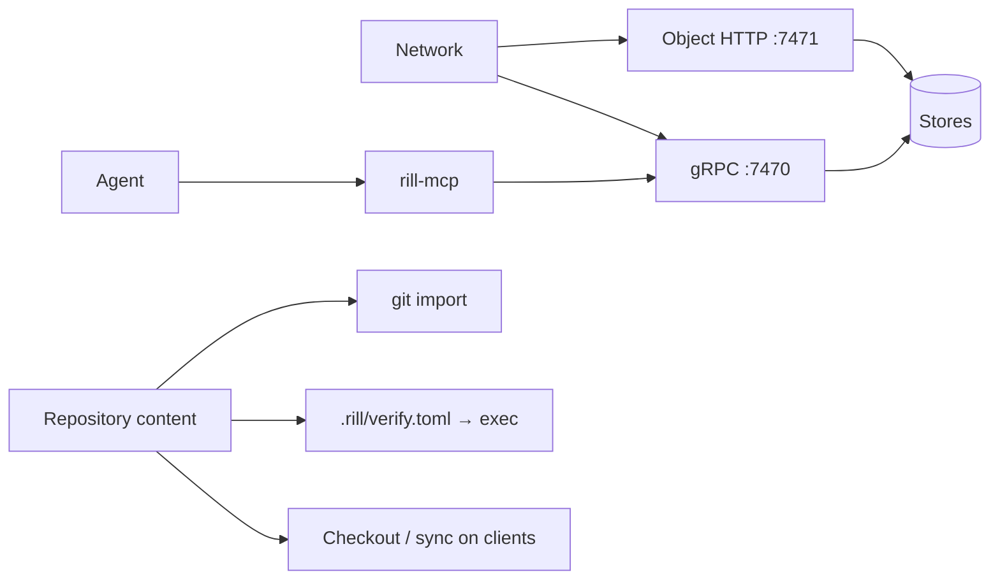

# Threat model

Who might attack a Rill deployment, through which entry points, and which
controls exist today versus which are planned. Each threat lists its current
(v1) state as a fact and the roadmap phase that closes it, so security work
can be prioritised and reviewed. A threat with no planned control is a bug
in this page.

## Assets

| Asset | Why it matters |
| --- | --- |
| Repository content and history | Source code is the product; leaks and silent edits are both critical |
| Trunk order and landing records | `trunk@N` must mean the same thing forever |
| Review state and provenance | The evidence that a change was reviewed and by whom |
| Tokens and the issuing key | Anyone holding them acts as a principal |
| Server host and its credentials | Storage keys, the metadata database, every repository |
| Client machines | Checkouts run on developer laptops, agent hosts and CI |

## Actors

| Actor | Capability | Goal |
| --- | --- | --- |
| External attacker | Network access, no credentials | Steal code or tokens; plant code |
| Compromised human account | A valid token | Land malicious code; exfiltrate |
| Prompt-injected or misaligned agent | A scoped token, runs at machine speed, many at once | Exfiltrate, approve its own work, escape its scope, burn resources |
| Malicious repository content | Anything a writer can commit | Escape the checkout, run code on CI or the server, overwrite client state |
| Insider admin | Admin relations, server access | Tamper silently |
| Supply chain | A dependency or build-pipeline compromise | Ship a backdoored binary |

## Entry points

## Threats

| # | Threat | v1 state | Control (planned) | Phase |
| --- | --- | --- | --- | --- |
| T1 | Tokens sniffed on the wire | TLS on both listeners when `[tls]` is set, optionally mutual (`client_ca`); the SDK checks the server for `https` endpoints and can present a client certificate. Plain text when unset (`rill dev`) | Certificates from an issuer (SPIFFE) and rotation | 8 (done), 10 |
| T2 | Repository writer runs code on the server | Fixed: REAPI actions and `.rill/verify.toml` steps run only on workers. Buildbarn workers run them under gVisor with no network, a read-only root and cleaned state between actions, and the sandbox escape suite passes ([remote execution](../06-services/remote-execution.md)). In-process local workers must be `confined` or `gvisor` outside dev mode ([exec](../06-services/exec.md)) | — | 15, 16 (done) |
| T3 | Checkout writes outside its directory | Server side fixed: every commit rejects symlink targets that are absolute or climb above the root, inline or blob-stored. Clients still follow symlinks when writing | `O_NOFOLLOW` writes on clients | 20 |
| T4 | Repository content rewrites client state | Fixed: client state lives in the daemon's directory, outside the working tree; the only file in the tree, the `.rill/mount.json` marker, cannot be committed, copied into or targeted by a symlink | — | 20 (done) |
| T5 | Reader of one directory reads another | Fixed: objects are fetched by hash only with a signed read grant naming them, checked by the server and the cache tier; listings, diffs, versions and logs show only readable paths; each org's objects are stored apart, so a hash from another org fetches nothing | — | 11 (done) |
| T6 | Path-scoped token searches everything | Fixed: read filters intersect relations, token paths and agent scope; the generated permission matrix covers every RPC | — | 11 (done) |
| T7 | Writer edits paths they cannot write | Fixed: every version's write set (files, subtrees, copy sources, owner-only `.rill/`) is checked inside its commit, which asserts the relation version, and again at landing | — | 11 (done) |
| T8 | Spoofed authorship | Fixed: the server stamps `author` and `created_at`, drops client `sponsor` and `resolved_by`, and signs an attestation for every version it stores | — | — |
| T9 | Impersonation through token issuance | Fixed: `IssueToken` issues for the caller, for a registered agent the caller sponsors (directly or through a team), or by an instance administrator; agents otherwise get tokens only through the workload exchange | — | 10 (done) |
| T10 | Leaked token stays valid | Fixed: tokens and sessions are revoked through the identity log and refused by every server within seconds; lifetimes are capped per principal kind (1 h human, 15 min agent, 12 h service); signing keys are wrapped by a key service and rotate | — | 10 (done) |
| T11 | Agent approves its own swarm's work | Votes from any agent count toward agent quorums | Independence rules (session, sponsor, model) in policy facts | 23 |
| T12 | Compromised model or session lands bad code at scale | Partly fixed: the kill switch stops an agent, session, sponsor or model at once and the lander ejects its queued work; provenance (session, sponsor, model) is stamped from the token. No blast-radius revert yet | Blast-radius revert by provenance | 10 (done), 18 |
| T13 | Memory exhaustion by one request | Fixed: every gRPC message is capped (16 MiB in, 64 MiB out, 1024 streams per connection), inline content, messages and edit counts are bounded, `WriteBlob` streams in bounded memory with a 5 GiB cap, change versions are capped at 8 MiB and 100k paths ([input limits](../07-runtime/api-surface.md#input-limits)) | — | 12 (done) |
| T14 | Repository open to everyone | Fixed: a repository with no relation tuples is closed to all but org administrators, who can recover one whose last owner left | — | 11 (done) |
| T15 | Secret committed to history | Fixed: every stored version is scanned (block by default, warn or quarantine per repository), and redaction approved by two administrators stops every tier serving an object ([data protection](data-protection.md)) | — | 12 (done) |
| T16 | Silent tampering by an admin | Fixed: a hash-chained audit log per org built from the logs every change writes, sealed with signed roots and verifiable offline (`rill admin audit verify`); anchoring outside Rill is the operator's (S3 object lock) | — | 12 (done) |
| T17 | Backdoored release | No release pipeline | Reproducible builds, SBOM, signed releases | 30 |
| T18 | Stale snapshot overwrites concurrent landings | Fixed: checkouts snapshot against the pinned `base_version` | Workspace-authoritative clients | — |
| T19 | Stolen disk, bucket or backup | Fixed for objects: sealed with AES-256-GCM under per-org data keys wrapped by the key service, bound to their org and hash ([data protection](data-protection.md#encryption-at-rest)). Metadata other than secrets relies on disk encryption | Re-encryption under rotated keys | 12 (done), 28 |
| T20 | CI secret leaks | Partly fixed: org secrets are sealed under org data keys, write-only through the API, scoped to repositories and to post-land verification, never in an action, its cache key or the cache, given only to the worker running the action, and masked in its logs ([exec](../06-services/exec.md#secrets)). A command given a secret can still leak it on purpose | Output-file masking; per-step network policy | 16 |
| T21 | Poisoned or non-reproducible build cache | Fixed: only workers write the action cache; entries are sealed under org data keys and bound to their action; a result naming content that is not stored is neither cached nor served; a sample of cached results is re-run and a mismatch evicts the entry and stops caching that step or target ([remote execution](../06-services/remote-execution.md#action-cache)) | A worker itself compromised can still report a false result; reproducibility across machines | 16 |

## Assumptions

* The server host, its operating system and the storage services are
  trusted. Rill does not defend against a root user on the server.
* Clients are trusted to protect their own tokens; the server limits what a
  stolen token can do (scope, expiry, revocation).
* Cryptographic primitives (BLAKE3, ECDSA P-256, the Biscuit format) are sound.

## Limitations

- This page reflects v1 code; rows move to "fixed" as their phase lands and
  the owning page changes in the same commit.
- Denial-of-service beyond single-request limits and per-principal rate
  limits ([rate limits](../07-runtime/api-surface.md#rate-limits)) is
  tracked under operations, not here.

## Code

- [rill-api/src/auth/](../../crates/server/api/src/auth/mod.rs), [rill-api/src/services/changes/write.rs](../../crates/server/api/src/services/changes/write.rs)
- [rill-api/src/objects/](../../crates/server/api/src/objects/mod.rs), [rill-exec/src/sandbox/](../../crates/domain/exec/src/sandbox/mod.rs)
- [rill-daemon/src/eager/](../../crates/clients/daemon/src/eager/mod.rs), [rill-policy/src/tokens/](../../crates/domain/policy/src/tokens/mod.rs)

---
← Previous: [Data protection](data-protection.md) · [Index](../index.md) · Next: [Security review packet](security-review.md) →
