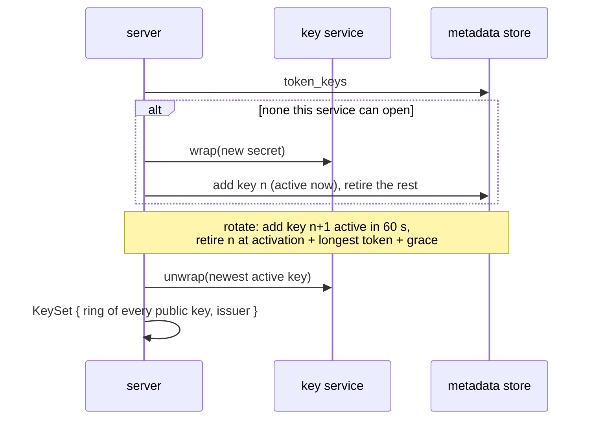

# Token keys

Tokens are signed with P-256 keys the instance generates itself, wraps with
a key service and keeps in the metadata store
([ADR 013](../10-decisions/013-p256-envelope-token-keys.md)). The
invariant: a token is accepted only if the key it names is trusted at the
moment of verification, and a key is trusted by every server before it
signs anything.

## Records

[`TokenKeyRecord`](../../crates/rill-types/src/identity/keys.rs), one per
key, in the instance-wide `idk` table:

| Field | Meaning |
| --- | --- |
| `id` | The root key id tokens carry. Ids only grow. |
| `public_key` | Compressed P-256 point, in clear. |
| `secret` | `WrappedSecret { backend, key_ref, ciphertext }`. |
| `created_at` | When it was stored. |
| `active_from` | Servers sign with the newest active key. |
| `not_after` | Set when a newer key takes over; tokens it signed are refused from then on. |

Every change to the table appends `IdentityChange::KeysChanged` to the
identity log in the same transaction
([identity store](../../crates/rill-store/src/identity/)), so other
servers learn of it from the log.

## Key services

[`KeyWrapper`](../../crates/rill-identity/src/keys/wrapper.rs) wraps and
unwraps a secret; `can_unwrap` matches the stored backend and `key_ref`.

| Backend | `key_ref` | Notes |
| --- | --- | --- |
| `local` | fingerprint of the master key | AES-256-GCM, random nonce, AAD binds backend and fingerprint. Master key from hex, a file, or random per process. |
| `vault` | `<mount>/<key>` | Transit `encrypt`/`decrypt`; token from config, a file or `VAULT_TOKEN`. |
| `aws-kms` | key id or ARN | `Encrypt`/`Decrypt` with encryption context `purpose=rill-token-key`; default AWS credentials; `aws` feature. |
| `gcp-kms` | `projects/…/cryptoKeys/…` | REST `:encrypt`/`:decrypt` with AAD `rill-token-key`; application default credentials; `gcp` feature. |

`KeyServiceConfig` (tagged by `backend`) selects one; `key_service` builds
it.

## Lifecycle

[`KeyManager`](../../crates/rill-identity/src/keys/manager.rs), with
`RotationPolicy` defaults: rotate after 30 days, activate 60 s after
storing, verify 5 min past the last token, delete retired keys after a day.

* `ensure_key` creates key 1 on a fresh instance, or a new key when the
  configured service cannot open any stored one. Two servers racing both
  try key id n; the store's absent-check lets one win and the other
  returns.
* `rotate` stores key n+1 with `active_from = now + activation delay` and
  retires every older key at `active_from + longest token lifetime + grace`,
  so tokens signed just before the switch still verify until they expire.
* `maintain` deletes keys retired more than a day ago and rotates when the
  newest key is older than the rotation period.
* `load(now)` builds the `KeyRing` from every stored public key (with its
  `not_after`) and an `Issuer` from the newest key active at `now` that this
  server can unwrap, plus `next_activation` so a server reloads when a
  pending key activates. Unwrapped secrets are cached per process.

## Code

* [`rill-identity/src/keys/`](../../crates/rill-identity/src/keys/mod.rs): services, `KeyManager`.
* [`rill-store/src/identity/`](../../crates/rill-store/src/identity/mod.rs): key, session and revocation tables, identity log.
* [`rill-types/src/identity/`](../../crates/rill-types/src/identity/mod.rs): records.
* Tests: `rill-identity/tests/keys.rs` (lifecycle), `tests/key_services.rs` (Vault, AWS KMS on LocalStack; run when configured), `tests/gcp_kms.rs` (REST contract); `rill-store/tests/conformance/identity.rs`.

---
← Previous: [Capability tokens](capability-tokens.md) · [Index](../index.md) · Next: [Permissions](permissions.md) →
