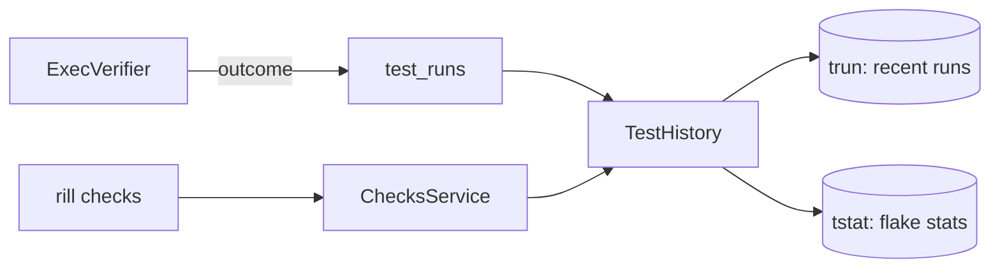

# Checks

What verification ran, kept so people and agents can see it after the
fact: every step and test case's outcome, and how flaky each is. The
checks themselves are compiled and run by [exec](exec.md);
`ChecksService` reads what they left behind.

## Test history

After every verification, `ExecVerifier` records a `TestRun` per step (or
shard) that ran, `step:<name>` or `step:<name>#<i>/<n>`, and per test case
in the step's JUnit report, `test:<class>::<name>`
(`VerificationOutcome::test_runs`). A step declares its report with
`junit = "<path>"` (relative to its working directory, added to its
outputs); `parse_junit` reads it with `quick-junit`, and a report that does
not parse is ignored with a warning. Results served from the action cache
are not recorded again; they were recorded when they ran.

A run holds its outcome (`passed`, `failed` for a non-zero exit or a
timeout, `skipped`, `error` when it could not run), whether the test
runner retried it before it passed (`flakyFailure` / `flakyError` in the
report), its duration, the action it ran in, the worker, the version, and
whether it was trunk (post-land) or a change (pre-land).

`TestHistory` (`rill-exec/history/`) keeps, in the repository's records:

* `trun/(target, newest first, id)`: the last 100 runs per target
  (`RUNS_KEPT`); older ones are deleted as new ones arrive;
* `tstat/(target)`: decayed counts for the flake score.

## Flake scores

A test is flaky when its verdict changes while its inputs do not. The
action a run happened in is exactly its inputs (a step's action digest
covers its command, environment, platform and input files), so each new
run is compared with the latest run of the same target in the same
action:

* same action, different verdict: a **flip**;
* same action, same verdict: a **repeat** without a flip;
* new action: neither (a test failing on new code is broken, not flaky);
* passed after the runner's own retries: a flip.

Steps flip naturally: a passing result is cached, so a step reruns on the
same inputs only after it failed, and a pass then is a flip.

`FlakeStats` keeps runs, failures, repeats and flips, each halved every
week (`HALF_LIFE_MS`). The score is the posterior mean of a Beta(0.1, 5)
prior on the flip rate, `(flips + 0.1) / (repeats + 5.1)`: a new test
scores 0.02, one flip in one repeat 0.18, and a test that stops flipping
drifts back down.

## API and CLI

`ChecksService` (repository read access):

* `GetTestHistory(repo, target, limit)`: recent runs, newest first, and
  the target's score;
* `ListFlakyTests(repo, min_score = 0.1, limit = 50)`: targets at or above
  the score, flakiest first.

`rill checks flaky [--min-score] [--limit]` and `rill checks history
<target> [--limit]` print them.

## Limitations

* Flake scores are reported, not acted on: retries of flaky targets and
  quarantine come with post-land v1.
* `ListFlakyTests` reads every target's statistics; fine for thousands of
  targets per repository, not millions.
* Test cases in a cached step are not recorded again, so a test only
  accumulates evidence when its step runs.
* JUnit is the only report format; Bazel's build event protocol is not
  read.

## Code

* [history/](../../crates/domain/exec/src/history/mod.rs): [outcome.rs](../../crates/domain/exec/src/history/outcome.rs), [junit.rs](../../crates/domain/exec/src/history/junit.rs), [score.rs](../../crates/domain/exec/src/history/score.rs), [store.rs](../../crates/domain/exec/src/history/store.rs)
* Recording: [workers/verifier.rs](../../crates/server/runtime/src/workers/verifier.rs), [verify/outcome.rs](../../crates/domain/exec/src/verify/outcome.rs)
* Service: [services/checks.rs](../../crates/server/api/src/services/checks.rs), [checks.proto](../../crates/foundation/proto/proto/rill/v1/checks.proto); CLI [commands/checks.rs](../../crates/clients/cli/src/commands/checks.rs)
* Tests: [tests/verification/history.rs](../../crates/domain/exec/tests/verification/history.rs), [grpc verification](../../crates/server/api/tests/grpc/verification.rs)

---
← Previous: [Remote execution](remote-execution.md) · [Index](../index.md) · Next: [Git import and export](git-import.md) →
