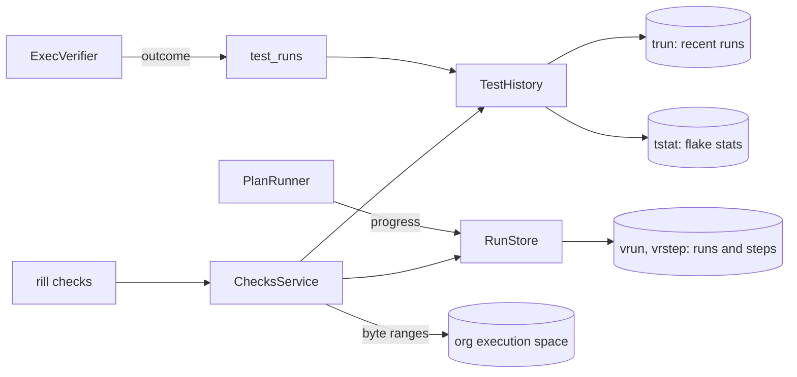

# Checks

What verification ran, kept so people and agents can follow it while it
runs and read it after: each run's steps with their logs and artifacts,
every step and test case's outcome over time, and how flaky each is. The
checks themselves are compiled and run by [exec](exec.md);
`ChecksService` reads what they left behind.

## Runs

Every verification is a run (`rill-exec/runs/`), recorded by
`PlanRunner` as it goes, so a run can be watched while it runs:

* `vrun/(id)`: the header: version, whether it is trunk (post-land),
  start, and once it ends whether it was green and its one-line summary.
  Ids are the inverted start time and four random bytes, so runs list
  newest first. `vrunv/(version, id)` finds a version's runs.
* `vrstep/(id, index)`: one record per step or shard, indexed in the
  order steps were selected: `Queued` when submitted, `Running` when a
  worker takes the action (the operation's stage), then `Done` with how it
  ended (`Passed`, `Failed`, `TimedOut`, `Error`, `Unaffected`,
  `NotGating`), its action, the digests of standard output and error, its
  output files (artifacts), worker and duration. Steps skipped by
  selection are recorded at once.
* `vrunc/(id)`: a counter every write moves, which watchers wait on.

A failure to write progress is logged and never fails verification. The
lander's details end with `(run <id>)`, so a refused landing names the
run to read.

**Retention.** `[verify] retention_days` (30) bounds how long runs stay:
each new run first deletes up to 32 of the oldest runs started before
it. The logs and artifacts themselves are content in the org's execution
space; once no run refers to them they are garbage for the store's
collector (data lifecycle phase), which does not exist yet.

**Logs and artifacts** are read by byte range from the execution space
(1 MiB per call; a negative offset counts from the end, so `-4096` is the
last 4 KiB). Output is complete when a step ends: workers upload it then,
so a running step has no log yet.

## Test history

After every verification, `ExecVerifier` records a `TestRun` per step (or
shard) that ran, `step:<name>` or `step:<name>#<i>/<n>`, and per test case
in the step's JUnit report, `test:<class>::<name>`
(`VerificationOutcome::test_runs`). A step declares its report with
`junit = "<path>"` (relative to its working directory, added to its
outputs); `parse_junit` reads it with `quick-junit`, and a report that does
not parse is ignored with a warning. Results served from the action cache
are not recorded again; they were recorded when they ran.

A run holds its outcome (`passed`, `failed` for a non-zero exit or a
timeout, `skipped`, `error` when it could not run), whether the test
runner retried it before it passed (`flakyFailure` / `flakyError` in the
report), its duration, the action it ran in, the worker, the version, and
whether it was trunk (post-land) or a change (pre-land).

`TestHistory` (`rill-exec/history/`) keeps, in the repository's records:

* `trun/(target, newest first, id)`: the last 100 runs per target
  (`RUNS_KEPT`); older ones are deleted as new ones arrive;
* `tstat/(target)`: decayed counts for the flake score.

## Flake scores

A test is flaky when its verdict changes while its inputs do not. The
action a run happened in is exactly its inputs (a step's action digest
covers its command, environment, platform and input files), so each new
run is compared with the latest run of the same target in the same
action:

* same action, different verdict: a **flip**;
* same action, same verdict: a **repeat** without a flip;
* new action: neither (a test failing on new code is broken, not flaky);
* passed after the runner's own retries: a flip.

Steps flip naturally: a passing result is cached, so a step reruns on the
same inputs only after it failed, and a pass then is a flip.

`FlakeStats` keeps runs, failures, repeats and flips, each halved every
week (`HALF_LIFE_MS`). The score is the posterior mean of a Beta(0.1, 5)
prior on the flip rate, `(flips + 0.1) / (repeats + 5.1)`: a new test
scores 0.02, one flip in one repeat 0.18, and a test that stops flipping
drifts back down.

## Non-hermetic steps

A step whose re-run gives other outputs reads something besides its
inputs. The scheduler's hermeticity probes ([remote
execution](remote-execution.md#action-cache)) catch it and flag the
step's label, `verify:<repo>/<step>`, for a week. A flagged step runs
uncached: `PlanRunner` skips the cache lookup, the step's result is not
stored, and its run record and result say `nonhermetic`.
`ListNonhermetic` lists a repository's flagged steps with what differed.

## API and CLI

`ChecksService` (repository read access):

* `ListRuns(repo, version?, limit = 20)`, `GetRun(repo, run)`, and
  `WatchRun`, which sends the run now and after every change until it
  ends (a stopping server ends the stream);
* `ReadLog(repo, run, step, stdout|stderr, offset, limit)` and
  `ReadArtifact(repo, run, step, path, offset, limit)`;
* `ListNonhermetic(repo)`: steps flagged non-hermetic, with what
  differed and until when;
* `GetTestHistory(repo, target, limit)`: recent runs, newest first, and
  the target's score;
* `ListFlakyTests(repo, min_score = 0.1, limit = 50)`: targets at or above
  the score, flakiest first.

`rill checks runs [--of-version]`, `rill checks run <id> [--watch]`, `rill
checks log <run> <step> [--stderr] [--tail BYTES]`, `rill checks artifact
<run> <step> <path> [-o FILE]`, `rill checks nonhermetic`, `rill checks
flaky [--min-score] [--limit]` and `rill checks history <target>
[--limit]` use them.

## Limitations

* Logs are readable when a step ends, not line by line while it runs:
  Buildbarn's worker uploads output on completion.
* Retention removes run records, not bytes; reclaiming unreferenced logs
  and artifacts waits for the store's garbage collector.
* A repository that stops verifying keeps its last runs until it runs
  again, since expiry happens as runs start.
* Flake scores are reported, not acted on: retries of flaky targets and
  quarantine come with post-land v1.
* `ListFlakyTests` reads every target's statistics; fine for thousands of
  targets per repository, not millions.
* Test cases in a cached step are not recorded again, so a test only
  accumulates evidence when its step runs.
* JUnit is the only report format; Bazel's build event protocol is not
  read.

## Code

* [runs/](../../crates/domain/exec/src/runs/mod.rs): [record.rs](../../crates/domain/exec/src/runs/record.rs), [store.rs](../../crates/domain/exec/src/runs/store.rs); progress [verify/progress.rs](../../crates/domain/exec/src/verify/progress.rs)
* [history/](../../crates/domain/exec/src/history/mod.rs): [outcome.rs](../../crates/domain/exec/src/history/outcome.rs), [junit.rs](../../crates/domain/exec/src/history/junit.rs), [score.rs](../../crates/domain/exec/src/history/score.rs), [store.rs](../../crates/domain/exec/src/history/store.rs)
* Recording: [workers/verifier.rs](../../crates/server/runtime/src/workers/verifier.rs), [verify/outcome.rs](../../crates/domain/exec/src/verify/outcome.rs)
* Service: [services/checks/](../../crates/server/api/src/services/checks/mod.rs), [checks.proto](../../crates/foundation/proto/proto/rill/v1/checks.proto); CLI [commands/checks/](../../crates/clients/cli/src/commands/checks/mod.rs)
* Tests: [tests/verification/runs.rs](../../crates/domain/exec/tests/verification/runs.rs), [tests/verification/history.rs](../../crates/domain/exec/tests/verification/history.rs), [grpc verification](../../crates/server/api/tests/grpc/verification.rs)

---
← Previous: [Remote execution](remote-execution.md) · [Index](../index.md) · Next: [Git import and export](git-import.md) →
