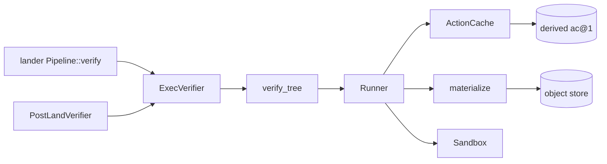
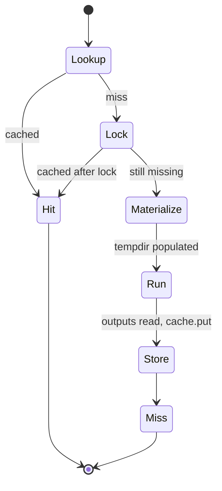

# Exec

`rill-exec` runs verification commands against materialized trees and
caches each result by the digest of its `Action`. The digest covers every
input, so an action with a known digest is never run twice by anything
sharing the repository's metadata store. The server wraps it as the
lander's `Verifier` for pre-land and post-land verification.



`rill-exec` decides how to run a step. When verification runs, and what a
red result means for landing, belongs to `rill-lander` (see
[landing](../04-workflow/landing.md)).

## Actions and results

An `Action` has `command` (`command[0]` is the executable), `env`,
`input_root: TreeHash`, `working_dir`, `timeout` (600 s from
`Action::new`), `platform` (`host_platform()`: `os` and `arch`) and
`output_paths`. It is `Encodable` as a derived object; `digest()` is the
hash of its canonical encoding. All fields are in the digest, so changing
the timeout or one env var changes the key. Maps are `BTreeMap`, so
insertion order does not matter.

An `ActionResult` holds `exit_code` (`TIMEOUT_EXIT_CODE` = 124 on timeout,
-1 when killed by a signal), `stdout` and `stderr` as `ContentRef`s,
`duration_ms`, `output_files`, `worker`, `started_at` and `timed_out`.
`succeeded()` is `exit_code == 0 && !timed_out`. A failing command is a
result, not an error, and is cached like a passing one.

`ActionCache` stores results under derived kind `ac@1` keyed by digest.
Captured bytes go through `rill_core::store_content`, so logs and outputs
are ordinary blobs in the object store.

## Runner



`Runner::execute` returns `(ActionResult, CacheStatus)`. Concurrent misses
for one digest serialize on a per-digest mutex in `in_flight`, and the
second caller re-checks the cache under the lock. On a miss the runner
creates a temp directory, materializes the full `input_root` into it, calls
`Sandbox::run`, reads the declared outputs (a missing output is not an
error), stores everything, writes the cache record, and removes the
directory on a blocking thread.

`materialize` reads blobs on the async side and writes batches of 256 files
on `spawn_blocking`. Anything already at a target path is removed first so
a stale symlink is never followed. Unix modes are 0644 or 0755; symlink
content is the link target. `local_path` rejects any non-normal path
component with `Error::PathEscape`.

## Sandboxes

`Sandbox::run(dir, action) -> RawOutcome` is the whole contract. The runner
owns materialization, caching and output capture.

* `LocalSandbox` runs a `tokio::process::Command` in the materialized
  directory with `env_clear()`, the action's `env`, and `PATH` and `HOME`
  passed through from the host unless the action sets them. stdin is null
  and the child gets its own process group on Unix. stdout and stderr are
  drained while waiting, so a chatty process cannot deadlock. On timeout it
  `killpg`s the group with `SIGKILL` and waits at most `DRAIN_GRACE` (2 s)
  for the pipes.
* Its `Isolation` picks how far the process is fenced in:
  * `None`: the above and nothing more. `network` is advisory. This is the
    only choice on macOS and is for trusted single-tenant servers, tests
    and development.
  * `Confined` (Linux only; refused elsewhere with `NotSupported`):
    `sandbox/confine.rs` prepares, before `fork`, a Landlock ruleset
    (`landlock` crate) that allows read and execute on system directories
    and the host `PATH`, read and write on `/dev`, and everything inside
    the step's directory; when `network` is false it also handles TCP bind
    and connect, which refuses them. A seccomp filter (`seccompiler`)
    returns `EPERM` for `ptrace`, `mount`, `unshare`, `setns`, `bpf`,
    `kexec_load`, module loading, key management and clock changes. The
    child applies `RLIMIT_FSIZE` (4 GiB), `RLIMIT_CORE` (0), the ruleset
    and the filter in `pre_exec`; a kernel that does not enforce Landlock
    fails the step rather than running it unconfined. `TMPDIR` points at
    `.rill-tmp` inside the step directory.
  * `Gvisor { runsc }`: the command runs as
    `runsc --network=none|host --overlay2=none do --cwd=<dir> -- <cmd>`, a
    user-space kernel for untrusted multi-tenant work. `runsc` must be
    installed and allowed to create sandboxes (root or `--rootless`
    setups).

## Verify plans

A tree declares its own checks in `.rill/verify.toml` (`PLAN_PATH`), so the
plan is versioned with the code. A tree without the file verifies green
with zero steps.

```toml
[[step]]
name = "unit"                    # optional; default "step-<index>"
command = ["cargo", "test"]      # required, non-empty
timeout_secs = 900               # optional; default 600
working_dir = "crates/core"      # optional; default root
env = { RUST_BACKTRACE = "1" }   # optional
outputs = ["target/report.xml"]  # optional
```

`VerificationPlan::parse` binds each step to the root and host platform.
Bad TOML, an empty command or non-UTF-8 content is `Error::Config`.
`verify_plan` runs steps in order and stops at the first step that did not
succeed. `VerificationOutcome { green, steps }` records each step's result
and whether it was cached.

## Server wiring

`RepoContext` builds a `Runner` with `LocalSandbox::new(verify.network)`
and the `Isolation` for `[verify] sandbox` (`local`, `confined`, `gvisor`
with `runsc`) only when `[verify] enabled` (or `RILL_VERIFY_ENABLED`) is true; otherwise
the lander gets `AlwaysGreen`. `ExecVerifier` calls `verify_tree`, maps any
`rill_exec::Error` to `rill_lander::Error::Verifier`, and returns green or
red with a one-line detail such as `step "unit" failed with exit code 1`.
`PostLandVerifier` uses the same verifier through `lander.verifier()`, so
re-verifying a tree already verified pre-land is a cache hit per step.

The lander picks a `VerifyMode` per risk class: `None` skips verification;
`Affected` and `Full` call the verifier the same way. `LandPolicy::max_wait`
(30 min) bounds the whole plan. See
[configuration](../07-runtime/configuration.md) for the keys.

## Limitations

* `Isolation::None` commands run as the server's user with its network
  and filesystem; only safe for trusted, single-tenant use.
* `Confined` does not limit reads of system directories, UDP, memory or
  process count, and runs as the server's user. Use `gvisor` for
  untrusted code.
* The confinement test runs only on Linux (in CI, or locally in a Linux
  container); the gVisor wiring has no automated test.
* The cache key's platform is `os` and `arch` only. A toolchain upgrade
  does not invalidate cached results.
* Failed results stay cached until the digest changes; there is no
  eviction or retry of a flaky failure.
* Every step re-materializes the full tree; sparse profiles are not used.
* `VerifyMode::Affected` behaves exactly like `Full`.
* A `max_wait` expiry drops the verifier future; the process is then
  stopped only by `kill_on_drop`, not by a process-group kill.
* Output paths and materialized symlinks are not confined: an output that
  is a symlink is read through, and a directory output is `Error::Io`.

## Code

* [lib.rs](../../crates/rill-exec/src/lib.rs), [error.rs](../../crates/rill-exec/src/error.rs)
* [action.rs](../../crates/rill-exec/src/action.rs), [cache.rs](../../crates/rill-exec/src/cache.rs), [runner.rs](../../crates/rill-exec/src/runner.rs), [materialize.rs](../../crates/rill-exec/src/materialize.rs)
* [sandbox/mod.rs](../../crates/rill-exec/src/sandbox/mod.rs), [sandbox/local.rs](../../crates/rill-exec/src/sandbox/local.rs), [sandbox/confine.rs](../../crates/rill-exec/src/sandbox/confine.rs)
* [verify.rs](../../crates/rill-exec/src/verify.rs)
* Server: [workers/verifier.rs](../../crates/rill-api/src/workers/verifier.rs), [state/registry.rs](../../crates/rill-api/src/state/registry.rs), [config/server.rs](../../crates/rill-api/src/config/server.rs)
* Lander: [config.rs](../../crates/rill-lander/src/config.rs), [land/sequence.rs](../../crates/rill-lander/src/land/sequence.rs)

---
← Previous: [Search](search.md) · [Index](../index.md) · Next: [Git import](git-import.md) →
